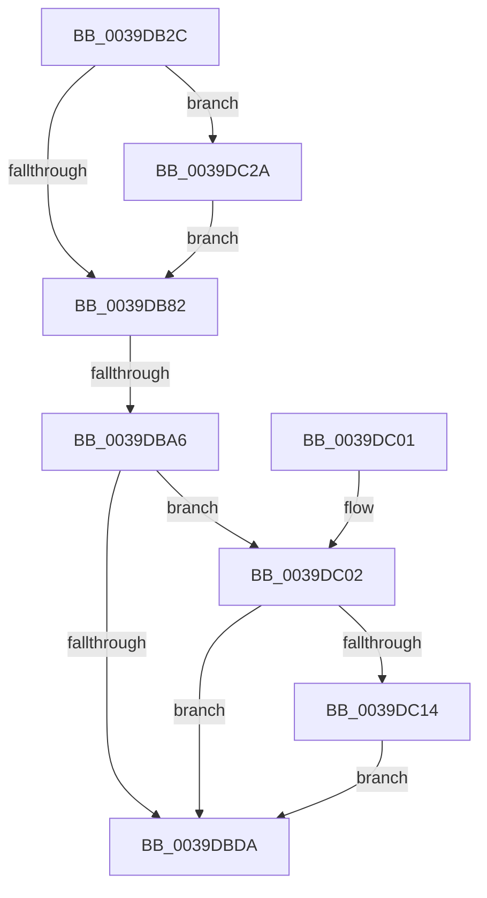

# KiSetClockTimer

- RVA: `0x0039DB2C`–`0x0039DC45` (길이 `281` bytes)
- VA: `0x000000014039DB2C`
- 실행 섹션: `.text`
- PDB 이름 있음: `예`; PDB Function 태그: `예`
- unwind 정보 RVA: `0x00081ADC`
- 디코드: `75`개 명령, `281/281` bytes 표시
- 미해석 바이트: `0` (있으면 어셈블리에 `.byte`로 보존)

> 이 문서는 커널 이미지의 기계어와 PDB 기호를 분석해 생성했습니다. 4번과 5번은 함수 원형과 자료형을 바이너리 사용 방식에서 추정한 C 해석이며 원본 소스 복구 결과는 아닙니다.

## 1. Dependencies

- 직접 호출 지점: **4**; 고유 호출 대상: **4**
- 직접 호출자로 확인된 함수: **9**
- RIP 상대 이미지 참조: **3**

### Outgoing calls
- `0x0039DBE1` → [_security_check_cookie](../6A/_security_check_cookie_function_006AC640.md) (function, `0x006AC640`)
- `0x0039DC0B` → [KiShouldRearmClockTimer](KiShouldRearmClockTimer_function_0039E134.md) (function, `0x0039E134`)
- `0x0039DC23` → [KiSetNextClockTickDueTime](../23/KiSetNextClockTickDueTime_function_002363F0.md) (function, `0x002363F0`)
- `0x0039DC2F` → [RtlGetInterruptTimePrecise](../20/RtlGetInterruptTimePrecise_function_0020A4C0.md) (function, `0x0020A4C0`)

### Direct callers
- [KiSetClockTimerKTimerDeadlines](../23/KiSetClockTimerKTimerDeadlines_function_0023671C.md) at `0x0023682E`
- [KiTransitionSchedulingGroupGeneration](../30/KiTransitionSchedulingGroupGeneration_function_003094C8.md) at `0x0030980A`
- [KiUpdateRunTime](KiUpdateRunTime_function_0039BB70.md) at `0x0039BD6E`
- [KiUpdateRunTime](KiUpdateRunTime_function_0039BB70.md) at `0x0039C05A`
- [sub_0039CA0B](Unknown_function_0039CA0B.md) at `0x0039CAB9`
- [KiResumeClockTimer](../4F/KiResumeClockTimer_function_004F6420.md) at `0x004F650A`
- [KePrepareClockTimerForIdle](../5B/KePrepareClockTimerForIdle_function_005BA49C.md) at `0x005BA63C`
- [KeResumeClockTimerFromIdle](../5B/KeResumeClockTimerFromIdle_function_005BACC4.md) at `0x005BB0A8`
- [KeResumeClockTimerFromIdle](../5B/KeResumeClockTimerFromIdle_function_005BACC4.md) at `0x005BB243`
- [sub_006DCEEE](../6D/Unknown_function_006DCEEE.md) at `0x006DCF30`
- [KeInitializeClock](../../init/C7/KeInitializeClock_function_00C70C30.md) at `0x00C70FCD`

### Static image references
- `0x0039DB48` → RVA `0x00E0A740` (`.data`; read)
- `0x0039DB72` → RVA `0x00FC6AA5` (`ALMOSTRO`; read)
- `0x0039DB99` → RVA `0x00E070D8` (`.data`; read)

## 2. Other-region calls and transfers

- 다른 실행 섹션으로 향하는 call: **0**
- call이 아닌 외부 분기/꼬리 이동: **1**
  - `0x0039DBA0` → [sub_006E5F9E](../6E/Unknown_function_006E5F9E.md) (`tail-transfer`)

## 3. Assembly (complete function range)

```asm
0039DB2C  48 89 5C 24 18                  mov qword ptr [rsp + 0x18], rbx
0039DB31  55                              push rbp
0039DB32  56                              push rsi
0039DB33  57                              push rdi
0039DB34  41 54                           push r12
0039DB36  41 55                           push r13
0039DB38  41 56                           push r14
0039DB3A  41 57                           push r15
0039DB3C  48 8D 6C 24 F0                  lea rbp, [rsp - 0x10]
0039DB41  48 81 EC 10 01 00 00            sub rsp, 0x110
0039DB48  48 8B 05 F1 CB A6 00            mov rax, qword ptr [rip + 0xa6cbf1]
0039DB4F  48 33 C4                        xor rax, rsp
0039DB52  48 89 45 00                     mov qword ptr [rbp], rax
0039DB56  48 63 45 70                     movsxd rax, dword ptr [rbp + 0x70]
0039DB5A  4D 8B E0                        mov r12, r8
0039DB5D  4C 8B F0                        mov r14, rax
0039DB60  44 89 4C 24 38                  mov dword ptr [rsp + 0x38], r9d
0039DB65  4D 03 F6                        add r14, r14
0039DB68  89 44 24 34                     mov dword ptr [rsp + 0x34], eax
0039DB6C  45 33 C0                        xor r8d, r8d
0039DB6F  48 8B F2                        mov rsi, rdx
0039DB72  44 38 05 2C 8F C2 00            cmp byte ptr [rip + 0xc28f2c], r8b
0039DB79  48 8B F9                        mov rdi, rcx
0039DB7C  0F 84 A8 00 00 00               je 0x14039dc2a
0039DB82  44 8A AD 80 00 00 00            mov r13b, byte ptr [rbp + 0x80]
0039DB89  4C 8B FE                        mov r15, rsi
0039DB8C  8A 5D 78                        mov bl, byte ptr [rbp + 0x78]
0039DB8F  4D 2B FC                        sub r15, r12
0039DB92  4D 85 E4                        test r12, r12
0039DB95  4D 0F 4F FC                     cmovg r15, r12
0039DB99  83 3D 38 95 A6 00 05            cmp dword ptr [rip + 0xa69538], 5
0039DBA0  0F 87 F8 83 34 00               ja 0x1406e5f9e
0039DBA6  8B 44 24 38                     mov eax, dword ptr [rsp + 0x38]
0039DBAA  02 DB                           add bl, bl
0039DBAC  42 89 84 F7 A0 95 00 00         mov dword ptr [rdi + r14*8 + 0x95a0], eax
0039DBB4  42 8A 84 F7 A4 95 00 00         mov al, byte ptr [rdi + r14*8 + 0x95a4]
0039DBBC  0C 01                           or al, 1
0039DBBE  4E 89 BC F7 98 95 00 00         mov qword ptr [rdi + r14*8 + 0x9598], r15
0039DBC6  32 D8                           xor bl, al
0039DBC8  80 E3 02                        and bl, 2
0039DBCB  32 D8                           xor bl, al
0039DBCD  42 88 9C F7 A4 95 00 00         mov byte ptr [rdi + r14*8 + 0x95a4], bl
0039DBD5  45 84 ED                        test r13b, r13b
0039DBD8  75 28                           jne 0x14039dc02
0039DBDA  48 8B 4D 00                     mov rcx, qword ptr [rbp]
0039DBDE  48 33 CC                        xor rcx, rsp
0039DBE1  E8 5A EA 30 00                  call 0x1406ac640
0039DBE6  48 8B 9C 24 60 01 00 00         mov rbx, qword ptr [rsp + 0x160]
0039DBEE  48 81 C4 10 01 00 00            add rsp, 0x110
0039DBF5  41 5F                           pop r15
0039DBF7  41 5E                           pop r14
0039DBF9  41 5D                           pop r13
0039DBFB  41 5C                           pop r12
0039DBFD  5F                              pop rdi
0039DBFE  5E                              pop rsi
0039DBFF  5D                              pop rbp
0039DC00  C3                              ret
0039DC01  CC                              int3
0039DC02  41 B0 01                        mov r8b, 1
0039DC05  48 8B D6                        mov rdx, rsi
0039DC08  48 8B CF                        mov rcx, rdi
0039DC0B  E8 24 05 00 00                  call 0x14039e134
0039DC10  84 C0                           test al, al
0039DC12  74 C6                           je 0x14039dbda
0039DC14  B2 01                           mov dl, 1
0039DC16  C7 87 90 95 00 00 02 00 00 00   mov dword ptr [rdi + 0x9590], 2
0039DC20  48 8B CE                        mov rcx, rsi
0039DC23  E8 C8 87 E9 FF                  call 0x1402363f0
0039DC28  EB B0                           jmp 0x14039dbda
0039DC2A  48 8D 4C 24 40                  lea rcx, [rsp + 0x40]
0039DC2F  E8 8C C8 E6 FF                  call 0x14020a4c0
0039DC34  44 8B 4C 24 38                  mov r9d, dword ptr [rsp + 0x38]
0039DC39  48 8B F0                        mov rsi, rax
0039DC3C  8B 44 24 34                     mov eax, dword ptr [rsp + 0x34]
0039DC40  E9 3D FF FF FF                  jmp 0x14039db82
```

## 4. C-style interpretation (structured pseudocode)

```c
__int64 __fastcall KiSetClockTimer(__int64 a1, __int64 a2, __int64 a3, int a4, unsigned int a5, unsigned __int8 a6, unsigned __int8 a7)
{
    __int64 result;
    __int64 v_r14;
    __int64 v_r15;
    __int64 v_rbx;
    __int64 v_rsp;
    unsigned int v_stack_m110;
    unsigned int v_stack_m114;
    unsigned __int64 v_stack_m48;
    unsigned __int64 v_stack_p18;
    unsigned int v_stack_p34;
    unsigned int v_stack_p38;
    unsigned __int64 v_stack_p40;

    v_stack_p18 = v_rbx;
    v_rsp = (v_rsp) - (272);
    result = (*(unsigned __int64 *)(v_rip + 10931185)) ^ (v_rsp);
    v_stack_m48 = result;
    v_stack_m110 = a4;
    v_r14 = ((int)(a5)) + ((int)(a5));
    v_stack_m114 = (unsigned int)((int)(a5));
    a3 = 0;
    if ((*(unsigned __int8 *)(v_rip + 12750636)) == 0) goto loc_0039DC2A;
loc_0039DB82:
    v_r15 = (a2) - (0);
    if (condition_is_greater) { v_r15 = 0; }
    v_rbx = (unsigned __int8)((a6) + (a6));
    *(unsigned int *)(a1 + v_r14 * 8 + 38304) = (unsigned int)((unsigned int)(v_stack_m110));
    result = (unsigned __int8)((*(unsigned __int8 *)(a1 + v_r14 * 8 + 38308)) | (1));
    *(unsigned __int64 *)(a1 + v_r14 * 8 + 38296) = v_r15;
    v_rbx = (unsigned __int8)((v_rbx) ^ ((unsigned __int8)(result)));
    v_rbx = (unsigned __int8)((v_rbx) & (2));
    v_rbx = (unsigned __int8)((v_rbx) ^ ((unsigned __int8)(result)));
    *(unsigned __int8 *)(a1 + v_r14 * 8 + 38308) = (unsigned __int8)(v_rbx);
    if (a7 != 0) goto loc_0039DC02;
loc_0039DBDA:
    a1 = (v_stack_m48) ^ (v_rsp);
    result = _security_check_cookie(a1, a2, a3, a4);
    v_rsp = (v_rsp) + (272);
    return result;
loc_0039DC02:
    result = KiShouldRearmClockTimer(a1, a2, 1, a4);
    if ((unsigned __int8)(result) == 0) goto loc_0039DBDA;
    *(unsigned int *)(a1 + 38288) = 2;
    result = KiSetNextClockTickDueTime(a2, 1, 1, a4);
    goto loc_0039DBDA;
loc_0039DC2A:
    result = RtlGetInterruptTimePrecise(v_stack_p40, 1, 1, a4);
    goto loc_0039DB82;
}
```

## 5. (Beta) C Style

```c
int64_t KiSetClockTimer(void *Arg1, int64_t Arg2, int64_t Arg3, int32_t Arg4, uint32_t Arg5, uint8_t Arg6, uint8_t Arg7)
{
    uint8_t *arg1 = (uint8_t *)Arg1;

    int64_t result;
    int64_t local_r14;
    int64_t local_r15;
    int64_t local_rbx;
    int64_t local_rsp;
    uint32_t v_stack_m110;
    uint32_t v_stack_m114;
    uint64_t v_stack_m48;
    uint64_t v_stack_p18;
    uint32_t v_stack_p34;
    uint32_t v_stack_p38;
    uint64_t v_stack_p40;

    v_stack_p18 = local_rbx;
    local_rsp = (local_rsp) - (272);
    result = (*(uint64_t *)(v_rip + 0xA6CBF1)) ^ (local_rsp);
    v_stack_m48 = result;
    v_stack_m110 = Arg4;
    local_r14 = ((int32_t)(Arg5)) + ((int32_t)(Arg5));
    v_stack_m114 = (uint32_t)((int32_t)(Arg5));
    Arg3 = 0;
    if ((*(uint8_t *)(v_rip + 0xC28F2C)) == 0) goto loc_0039DC2A;
loc_0039DB82:
    local_r15 = (Arg2) - (0);
    if (condition_is_greater) { local_r15 = 0; }
    local_rbx = (uint8_t)((Arg6) + (Arg6));
    *(uint32_t *)(arg1 + local_r14 * 8 + 0x95A0) = (uint32_t)((uint32_t)(v_stack_m110));
    result = (uint8_t)((*(uint8_t *)(arg1 + local_r14 * 8 + 0x95A4)) | (1));
    *(uint64_t *)(arg1 + local_r14 * 8 + 0x9598) = local_r15;
    local_rbx = (uint8_t)((local_rbx) ^ ((uint8_t)(result)));
    local_rbx = (uint8_t)((local_rbx) & (2));
    local_rbx = (uint8_t)((local_rbx) ^ ((uint8_t)(result)));
    *(uint8_t *)(arg1 + local_r14 * 8 + 0x95A4) = (uint8_t)(local_rbx);
    if (Arg7 != 0) goto loc_0039DC02;
loc_0039DBDA:
    Arg1 = (v_stack_m48) ^ (local_rsp);
    result = _security_check_cookie(Arg1, Arg2, Arg3, Arg4);
    local_rsp = (local_rsp) + (272);
    return result;
loc_0039DC02:
    result = KiShouldRearmClockTimer(Arg1, Arg2, 1, Arg4);
    if ((uint8_t)(result) == 0) goto loc_0039DBDA;
    *(uint32_t *)(arg1 + 0x9590) = 2;
    result = KiSetNextClockTickDueTime(Arg2, 1, 1, Arg4);
    goto loc_0039DBDA;
loc_0039DC2A:
    result = RtlGetInterruptTimePrecise(v_stack_p40, 1, 1, Arg4);
    goto loc_0039DB82;
}
```

### 관측된 메모리 오프셋

구조체 형식이 확인되지 않은 접근은 인자 기준의 오프셋으로만 기록했습니다.

| 기준 인자 | 오프셋 표현 | 폭 (bit) | 접근 |
|---|---:|---:|---|
| `Arg1` | `+ 0x9590` | `32` | `W` |
| `Arg1` | `+ 0x9598 + r14*8` | `64` | `W` |
| `Arg1` | `+ 0x95A0 + r14*8` | `32` | `W` |
| `Arg1` | `+ 0x95A4 + r14*8` | `8` | `R` |
| `Arg1` | `+ 0x95A4 + r14*8` | `8` | `W` |

## 6. Execution-region graph

[열기: 2D/3D 그래프와 함수 탐색 컨트롤 패널](../../../control-panel.html?section=text&rva=0x0039DB2C&view=graph)

- 2D 그래프는 위에서 아래로 흐르고, 3D 그래프는 빈 공간을 드래그해 회전합니다. Shift+드래그는 이동, 휠은 확대·축소, 함수 노드 선택은 대상 보고서 이동입니다.

### Static fallback


