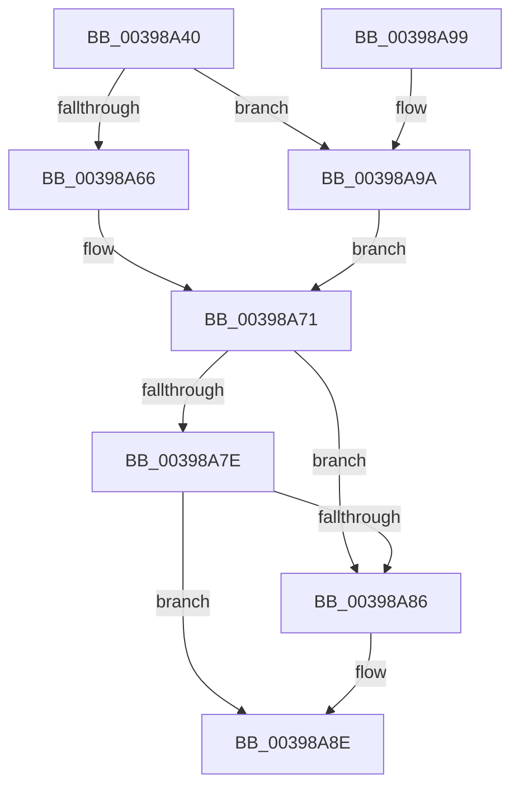

# KiSetPriorityBoost

- RVA: `0x00398A40`–`0x00398AAB` (길이 `107` bytes)
- VA: `0x0000000140398A40`
- 실행 섹션: `.text`
- PDB 이름 있음: `예`; PDB Function 태그: `아니요`
- unwind 정보 RVA: `0x00081618`
- 디코드: `34`개 명령, `107/107` bytes 표시
- 미해석 바이트: `0` (있으면 어셈블리에 `.byte`로 보존)

> 이 문서는 커널 이미지의 기계어와 PDB 기호를 분석해 생성했습니다. 4번과 5번은 함수 원형과 자료형을 바이너리 사용 방식에서 추정한 C 해석이며 원본 소스 복구 결과는 아닙니다.

## 1. Dependencies

- 직접 호출 지점: **3**; 고유 호출 대상: **3**
- 직접 호출자로 확인된 함수: **8**
- RIP 상대 이미지 참조: **0**

### Outgoing calls
- `0x00398A5C` → [KiThreadSetUnusualBoost](../4A/KiThreadSetUnusualBoost_function_004AAC8C.md) (function, `0x004AAC8C`)
- `0x00398A6C` → [KiSetPriorityThread](../22/KiSetPriorityThread_function_00220E78.md) (function, `0x00220E78`)
- `0x00398AA4` → [KiUpdateThreadPriority](../25/KiUpdateThreadPriority_function_00257810.md) (function, `0x00257810`)

### Direct callers
- [sub_002142F9](../21/Unknown_function_002142F9.md) at `0x00214480`
- [sub_002142F9](../21/Unknown_function_002142F9.md) at `0x0021474B`
- [KiNormalPriorityReadyScan](../21/KiNormalPriorityReadyScan_function_0021B400.md) at `0x0021B73B`
- [sub_0021C69D](../21/Unknown_function_0021C69D.md) at `0x0021C762`
- [sub_002546EC](../25/Unknown_function_002546EC.md) at `0x00254A1B`
- [KiPrepareReadyThreadForRescheduling](KiPrepareReadyThreadForRescheduling_function_00397F2C.md) at `0x00397F82`
- [sub_0039890D](Unknown_function_0039890D.md) at `0x0039892E`
- [KiScanSharedReadyThreads](../46/KiScanSharedReadyThreads_function_0046F120.md) at `0x0046F628`
- [KiVpBackingThreadYieldExecution](../4D/KiVpBackingThreadYieldExecution_function_004DF1A4.md) at `0x004DF2DE`

### Static image references
- 디코드된 RIP-relative 메모리 참조가 없습니다.

## 2. Other-region calls and transfers

- 다른 실행 섹션으로 향하는 call: **0**
- 별도 외부 분기/꼬리 이동을 확인하지 못했습니다.

## 3. Assembly (complete function range)

```asm
00398A40  48 89 5C 24 08                  mov qword ptr [rsp + 8], rbx
00398A45  57                              push rdi
00398A46  48 83 EC 30                     sub rsp, 0x30
00398A4A  48 8B DA                        mov rbx, rdx
00398A4D  4C 8B D1                        mov r10, rcx
00398A50  48 8B CB                        mov rcx, rbx
00398A53  49 8B F9                        mov rdi, r9
00398A56  41 8B D0                        mov edx, r8d
00398A59  45 8B C8                        mov r9d, r8d
00398A5C  E8 2B 22 11 00                  call 0x1404aac8c
00398A61  4D 85 D2                        test r10, r10
00398A64  74 34                           je 0x140398a9a
00398A66  45 8B C1                        mov r8d, r9d
00398A69  49 8B D2                        mov rdx, r10
00398A6C  E8 07 84 E8 FF                  call 0x140220e78
00398A71  48 8B 43 20                     mov rax, qword ptr [rbx + 0x20]
00398A75  8B 4C 24 60                     mov ecx, dword ptr [rsp + 0x60]
00398A79  48 3B F8                        cmp rdi, rax
00398A7C  77 08                           ja 0x140398a86
00398A7E  48 2B C7                        sub rax, rdi
00398A81  48 3B C1                        cmp rax, rcx
00398A84  73 08                           jae 0x140398a8e
00398A86  48 8D 04 39                     lea rax, [rcx + rdi]
00398A8A  48 89 43 20                     mov qword ptr [rbx + 0x20], rax
00398A8E  48 8B 5C 24 40                  mov rbx, qword ptr [rsp + 0x40]
00398A93  48 83 C4 30                     add rsp, 0x30
00398A97  5F                              pop rdi
00398A98  C3                              ret
00398A99  CC                              int3
00398A9A  4C 8B C3                        mov r8, rbx
00398A9D  C6 44 24 20 00                  mov byte ptr [rsp + 0x20], 0
00398AA2  33 C9                           xor ecx, ecx
00398AA4  E8 67 ED EB FF                  call 0x140257810
00398AA9  EB C6                           jmp 0x140398a71
```

## 4. C-style interpretation (structured pseudocode)

```c
__int64 __fastcall KiSetPriorityBoost(__int64 a1, __int64 a2, int a3, __int64 a4, unsigned int a5)
{
    __int64 result;
    __int64 v_rsp;
    unsigned __int8 v_stack_p20;
    unsigned __int64 v_stack_p8;

    v_stack_p8 = v_rbx;
    v_rsp = (v_rsp) - (48);
    result = KiThreadSetUnusualBoost(a2, (unsigned int)(a3), a3, (unsigned int)(a3));
    if (a1 == 0) goto loc_00398A9A;
    result = KiSetPriorityThread(a2, a1, (unsigned int)((unsigned int)((unsigned int)(a3))), (unsigned int)(a3));
loc_00398A71:
    if (a4 > (*(unsigned __int64 *)(a2 + 32))) goto loc_00398A86;
    result = (*(unsigned __int64 *)(a2 + 32)) - (a4);
    if (result < ((unsigned int)(a5))) {
        result = (unsigned int)(a5) + a4 * 1;
        *(unsigned __int64 *)(a2 + 32) = result;
    }
    v_rsp = (v_rsp) + (48);
    return result;
loc_00398A9A:
    v_stack_p20 = 0;
    a1 = 0;
    result = KiUpdateThreadPriority(a1, a1, v_stack_p8, (unsigned int)(a3));
    goto loc_00398A71;
}
```

## 5. (Beta) C Style

```c
int64_t KiSetPriorityBoost(int64_t Arg1, void *Arg2, int32_t Arg3, int64_t Arg4, void *Arg5)
{
    uint8_t *arg2 = (uint8_t *)Arg2;
    uint8_t *arg5 = (uint8_t *)Arg5;

    int64_t result;
    int64_t local_rsp;
    uint8_t v_stack_p20;
    uint64_t v_stack_p8;

    v_stack_p8 = local_rbx;
    local_rsp = (local_rsp) - (48);
    result = KiThreadSetUnusualBoost(Arg2, (uint32_t)(Arg3), Arg3, (uint32_t)(Arg3));
    if (Arg1 == 0) goto loc_00398A9A;
    result = KiSetPriorityThread(Arg2, Arg1, (uint32_t)((uint32_t)((uint32_t)(Arg3))), (uint32_t)(Arg3));
loc_00398A71:
    if (Arg4 > (*(uint64_t *)(arg2 + 0x20))) goto loc_00398A86;
    result = (*(uint64_t *)(arg2 + 0x20)) - (Arg4);
    if (result < ((uint32_t)(Arg5))) {
        result = (uint32_t)(Arg5) + Arg4 * 1;
        *(uint64_t *)(arg2 + 0x20) = result;
    }
    local_rsp = (local_rsp) + (48);
    return result;
loc_00398A9A:
    v_stack_p20 = 0;
    Arg1 = 0;
    result = KiUpdateThreadPriority(Arg1, Arg1, v_stack_p8, (uint32_t)(Arg3));
    goto loc_00398A71;
}
```

### 관측된 메모리 오프셋

구조체 형식이 확인되지 않은 접근은 인자 기준의 오프셋으로만 기록했습니다.

| 기준 인자 | 오프셋 표현 | 폭 (bit) | 접근 |
|---|---:|---:|---|
| `Arg2` | `+ 0x20` | `64` | `R` |
| `Arg2` | `+ 0x20` | `64` | `W` |
| `Arg5` | `+ 0x0 + rdi*1` | `64` | `R` |

## 6. Execution-region graph

[열기: 2D/3D 그래프와 함수 탐색 컨트롤 패널](../../../control-panel.html?section=text&rva=0x00398A40&view=graph)

- 2D 그래프는 위에서 아래로 흐르고, 3D 그래프는 빈 공간을 드래그해 회전합니다. Shift+드래그는 이동, 휠은 확대·축소, 함수 노드 선택은 대상 보고서 이동입니다.

### Static fallback


