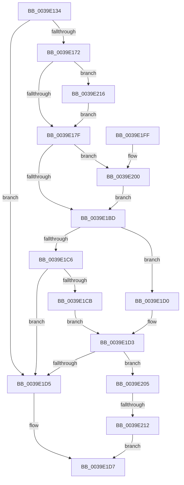

# KiShouldRearmClockTimer

- RVA: `0x0039E134`–`0x0039E228` (길이 `244` bytes)
- VA: `0x000000014039E134`
- 실행 섹션: `.text`
- PDB 이름 있음: `예`; PDB Function 태그: `예`
- unwind 정보 RVA: `0x00081B70`
- 디코드: `67`개 명령, `244/244` bytes 표시
- 미해석 바이트: `0` (있으면 어셈블리에 `.byte`로 보존)

> 이 문서는 커널 이미지의 기계어와 PDB 기호를 분석해 생성했습니다. 4번과 5번은 함수 원형과 자료형을 바이너리 사용 방식에서 추정한 C 해석이며 원본 소스 복구 결과는 아닙니다.

## 1. Dependencies

- 직접 호출 지점: **3**; 고유 호출 대상: **3**
- 직접 호출자로 확인된 함수: **5**
- RIP 상대 이미지 참조: **4**

### Outgoing calls
- `0x0039E19A` → [KiGetClockTimerEarliestDeadline](../23/KiGetClockTimerEarliestDeadline_function_00237AB0.md) (function, `0x00237AB0`)
- `0x0039E1DE` → [_security_check_cookie](../6A/_security_check_cookie_function_006AC640.md) (function, `0x006AC640`)
- `0x0039E21B` → [RtlGetInterruptTimePrecise](../20/RtlGetInterruptTimePrecise_function_0020A4C0.md) (function, `0x0020A4C0`)

### Direct callers
- [KeUpdatePendingQosRequest](KeUpdatePendingQosRequest_function_003924F4.md) at `0x003925CC`
- [KiSetClockTimer](KiSetClockTimer_function_0039DB2C.md) at `0x0039DC0B`
- [KiRestoreClockTickRate](../4D/KiRestoreClockTickRate_function_004D2780.md) at `0x004D27E6`
- [KePrepareClockTimerForIdle](../5B/KePrepareClockTimerForIdle_function_005BA49C.md) at `0x005BA68A`
- [sub_006F418E](../6F/Unknown_function_006F418E.md) at `0x006F41F2`

### Static image references
- `0x0039E152` → RVA `0x00E0A740` (`.data`; read)
- `0x0039E172` → RVA `0x00FC6AA5` (`ALMOSTRO`; read)
- `0x0039E17F` → RVA `0x00FC6B3C` (`ALMOSTRO`; read)
- `0x0039E205` → RVA `0x00E070D8` (`.data`; read)

## 2. Other-region calls and transfers

- 다른 실행 섹션으로 향하는 call: **0**
- call이 아닌 외부 분기/꼬리 이동: **1**
  - `0x0039E20C` → [sub_006E6084](../6E/Unknown_function_006E6084.md) (`tail-transfer`)

## 3. Assembly (complete function range)

```asm
0039E134  48 89 5C 24 10                  mov qword ptr [rsp + 0x10], rbx
0039E139  48 89 74 24 18                  mov qword ptr [rsp + 0x18], rsi
0039E13E  55                              push rbp
0039E13F  57                              push rdi
0039E140  41 54                           push r12
0039E142  41 56                           push r14
0039E144  41 57                           push r15
0039E146  48 8D 6C 24 F0                  lea rbp, [rsp - 0x10]
0039E14B  48 81 EC 10 01 00 00            sub rsp, 0x110
0039E152  48 8B 05 E7 C5 A6 00            mov rax, qword ptr [rip + 0xa6c5e7]
0039E159  48 33 C4                        xor rax, rsp
0039E15C  48 89 45 00                     mov qword ptr [rbp], rax
0039E160  80 B9 08 96 00 00 00            cmp byte ptr [rcx + 0x9608], 0
0039E167  45 8A E0                        mov r12b, r8b
0039E16A  4C 8B F2                        mov r14, rdx
0039E16D  48 8B D9                        mov rbx, rcx
0039E170  74 63                           je 0x14039e1d5
0039E172  80 3D 2C 89 C2 00 00            cmp byte ptr [rip + 0xc2892c], 0
0039E179  0F 84 97 00 00 00               je 0x14039e216
0039E17F  44 8B 1D B6 89 C2 00            mov r11d, dword ptr [rip + 0xc289b6]
0039E186  41 8A D4                        mov dl, r12b
0039E189  48 8B BB 80 95 00 00            mov rdi, qword ptr [rbx + 0x9580]
0039E190  48 8B CB                        mov rcx, rbx
0039E193  41 8B F3                        mov esi, r11d
0039E196  4F 8D 3C 33                     lea r15, [r11 + r14]
0039E19A  E8 11 99 E9 FF                  call 0x140237ab0
0039E19F  4C 63 C8                        movsxd r9, eax
0039E1A2  49 8B C9                        mov rcx, r9
0039E1A5  48 03 C9                        add rcx, rcx
0039E1A8  44 8B 84 CB A0 95 00 00         mov r8d, dword ptr [rbx + rcx*8 + 0x95a0]
0039E1B0  48 8B 94 CB 98 95 00 00         mov rdx, qword ptr [rbx + rcx*8 + 0x9598]
0039E1B8  45 3B C3                        cmp r8d, r11d
0039E1BB  73 43                           jae 0x14039e200
0039E1BD  48 8D 0C 32                     lea rcx, [rdx + rsi]
0039E1C1  4C 3B F9                        cmp r15, rcx
0039E1C4  77 0A                           ja 0x14039e1d0
0039E1C6  48 3B FA                        cmp rdi, rdx
0039E1C9  72 0A                           jb 0x14039e1d5
0039E1CB  48 3B F9                        cmp rdi, rcx
0039E1CE  EB 03                           jmp 0x14039e1d3
0039E1D0  49 3B FF                        cmp rdi, r15
0039E1D3  76 30                           jbe 0x14039e205
0039E1D5  B0 01                           mov al, 1
0039E1D7  48 8B 4D 00                     mov rcx, qword ptr [rbp]
0039E1DB  48 33 CC                        xor rcx, rsp
0039E1DE  E8 5D E4 30 00                  call 0x1406ac640
0039E1E3  4C 8D 9C 24 10 01 00 00         lea r11, [rsp + 0x110]
0039E1EB  49 8B 5B 38                     mov rbx, qword ptr [r11 + 0x38]
0039E1EF  49 8B 73 40                     mov rsi, qword ptr [r11 + 0x40]
0039E1F3  49 8B E3                        mov rsp, r11
0039E1F6  41 5F                           pop r15
0039E1F8  41 5E                           pop r14
0039E1FA  41 5C                           pop r12
0039E1FC  5F                              pop rdi
0039E1FD  5D                              pop rbp
0039E1FE  C3                              ret
0039E1FF  CC                              int3
0039E200  49 8B F0                        mov rsi, r8
0039E203  EB B8                           jmp 0x14039e1bd
0039E205  83 3D CC 8E A6 00 05            cmp dword ptr [rip + 0xa68ecc], 5
0039E20C  0F 87 72 7E 34 00               ja 0x1406e6084
0039E212  32 C0                           xor al, al
0039E214  EB C1                           jmp 0x14039e1d7
0039E216  48 8D 4C 24 38                  lea rcx, [rsp + 0x38]
0039E21B  E8 A0 C2 E6 FF                  call 0x14020a4c0
0039E220  4C 8B F0                        mov r14, rax
0039E223  E9 57 FF FF FF                  jmp 0x14039e17f
```

## 4. C-style interpretation (structured pseudocode)

```c
__int64 __fastcall KiShouldRearmClockTimer(__int64 a1, __int64 a2, unsigned __int8 a3)
{
    __int64 result;
    __int64 v_rsp;
    unsigned __int64 v_stack_m28;
    unsigned __int64 v_stack_m38;
    unsigned __int64 v_stack_mD8;
    unsigned __int64 v_stack_p10;
    unsigned __int64 v_stack_p18;

    v_stack_p10 = v_rbx;
    v_stack_p18 = v_rsi;
    v_rsp = (v_rsp) - (272);
    result = (*(unsigned __int64 *)(v_rip + 10929639)) ^ (v_rsp);
    v_stack_m38 = result;
    if ((*(unsigned __int8 *)(a1 + 38408)) == 0) goto loc_0039E1D5;
    if ((*(unsigned __int8 *)(v_rip + 12749100)) == 0) goto loc_0039E216;
loc_0039E17F:
    result = KiGetClockTimerEarliestDeadline(a1, a3, a3, a4);
    a1 = ((int)((unsigned int)(result))) + ((int)((unsigned int)(result)));
    if (((unsigned int)((unsigned int)(*(unsigned int *)(a1 + a1 * 8 + 38304)))) >= ((unsigned int)((unsigned int)(*(unsigned int *)(v_rip + 12749238))))) goto loc_0039E200;
loc_0039E1BD:
    if (((unsigned int)(*(unsigned int *)(v_rip + 12749238)) + a2 * 1) > (*(unsigned __int64 *)(a1 + a1 * 8 + 38296) + (unsigned int)((unsigned int)((unsigned int)(*(unsigned int *)(v_rip + 12749238)))) * 1)) goto loc_0039E1D0;
    if ((*(unsigned __int64 *)(a1 + 38272)) < (*(unsigned __int64 *)(a1 + a1 * 8 + 38296))) goto loc_0039E1D5;
    goto loc_0039E1D3;
loc_0039E1D0:
loc_0039E1D3:
    if ((*(unsigned __int64 *)(a1 + 38272)) <= ((unsigned int)(*(unsigned int *)(v_rip + 12749238)) + a2 * 1)) goto loc_0039E205;
loc_0039E1D5:
loc_0039E1D7:
    a1 = (v_stack_m38) ^ (v_rsp);
    result = _security_check_cookie(a1, *(unsigned __int64 *)(a1 + a1 * 8 + 38296), (unsigned int)(*(unsigned int *)(a1 + a1 * 8 + 38304)), (int)((unsigned int)(result)));
    return result;
loc_0039E200:
    goto loc_0039E1BD;
loc_0039E205:
    result = 0;
    goto loc_0039E1D7;
loc_0039E216:
    result = RtlGetInterruptTimePrecise(v_stack_mD8, *(unsigned __int64 *)(a1 + a1 * 8 + 38296), (unsigned int)(*(unsigned int *)(a1 + a1 * 8 + 38304)), (int)((unsigned int)(result)));
    goto loc_0039E17F;
}
```

## 5. (Beta) C Style

```c
int64_t KiShouldRearmClockTimer(void *Arg1, int64_t Arg2, uint8_t Arg3)
{
    uint8_t *arg1 = (uint8_t *)Arg1;

    int64_t result;
    int64_t local_rsp;
    uint64_t v_stack_m28;
    uint64_t v_stack_m38;
    uint64_t v_stack_mD8;
    uint64_t v_stack_p10;
    uint64_t v_stack_p18;

    v_stack_p10 = local_rbx;
    v_stack_p18 = local_rsi;
    local_rsp = (local_rsp) - (272);
    result = (*(uint64_t *)(v_rip + 0xA6C5E7)) ^ (local_rsp);
    v_stack_m38 = result;
    if ((*(uint8_t *)(arg1 + 0x9608)) == 0) goto loc_0039E1D5;
    if ((*(uint8_t *)(v_rip + 0xC2892C)) == 0) goto loc_0039E216;
loc_0039E17F:
    result = KiGetClockTimerEarliestDeadline(Arg1, Arg3, Arg3, a4);
    Arg1 = ((int32_t)((uint32_t)(result))) + ((int32_t)((uint32_t)(result)));
    if (((uint32_t)((uint32_t)(*(uint32_t *)(arg1 + arg1 * 8 + 0x95A0)))) >= ((uint32_t)((uint32_t)(*(uint32_t *)(v_rip + 0xC289B6))))) goto loc_0039E200;
loc_0039E1BD:
    if (((uint32_t)(*(uint32_t *)(v_rip + 0xC289B6)) + Arg2 * 1) > (*(uint64_t *)(arg1 + arg1 * 8 + 0x9598) + (uint32_t)((uint32_t)((uint32_t)(*(uint32_t *)(v_rip + 0xC289B6)))) * 1)) goto loc_0039E1D0;
    if ((*(uint64_t *)(arg1 + 0x9580)) < (*(uint64_t *)(arg1 + arg1 * 8 + 0x9598))) goto loc_0039E1D5;
    goto loc_0039E1D3;
loc_0039E1D0:
loc_0039E1D3:
    if ((*(uint64_t *)(arg1 + 0x9580)) <= ((uint32_t)(*(uint32_t *)(v_rip + 0xC289B6)) + Arg2 * 1)) goto loc_0039E205;
loc_0039E1D5:
loc_0039E1D7:
    Arg1 = (v_stack_m38) ^ (local_rsp);
    result = _security_check_cookie(Arg1, *(uint64_t *)(arg1 + arg1 * 8 + 0x9598), (uint32_t)(*(uint32_t *)(arg1 + arg1 * 8 + 0x95A0)), (int32_t)((uint32_t)(result)));
    return result;
loc_0039E200:
    goto loc_0039E1BD;
loc_0039E205:
    result = 0;
    goto loc_0039E1D7;
loc_0039E216:
    result = RtlGetInterruptTimePrecise(v_stack_mD8, *(uint64_t *)(arg1 + arg1 * 8 + 0x9598), (uint32_t)(*(uint32_t *)(arg1 + arg1 * 8 + 0x95A0)), (int32_t)((uint32_t)(result)));
    goto loc_0039E17F;
}
```

### 관측된 메모리 오프셋

구조체 형식이 확인되지 않은 접근은 인자 기준의 오프셋으로만 기록했습니다.

| 기준 인자 | 오프셋 표현 | 폭 (bit) | 접근 |
|---|---:|---:|---|
| `Arg1` | `+ 0x9580` | `64` | `R` |
| `Arg1` | `+ 0x9598 + rcx*8` | `64` | `R` |
| `Arg1` | `+ 0x95A0 + rcx*8` | `32` | `R` |
| `Arg1` | `+ 0x9608` | `8` | `R` |

## 6. Execution-region graph

[열기: 2D/3D 그래프와 함수 탐색 컨트롤 패널](../../../control-panel.html?section=text&rva=0x0039E134&view=graph)

- 2D 그래프는 위에서 아래로 흐르고, 3D 그래프는 빈 공간을 드래그해 회전합니다. Shift+드래그는 이동, 휠은 확대·축소, 함수 노드 선택은 대상 보고서 이동입니다.

### Static fallback


