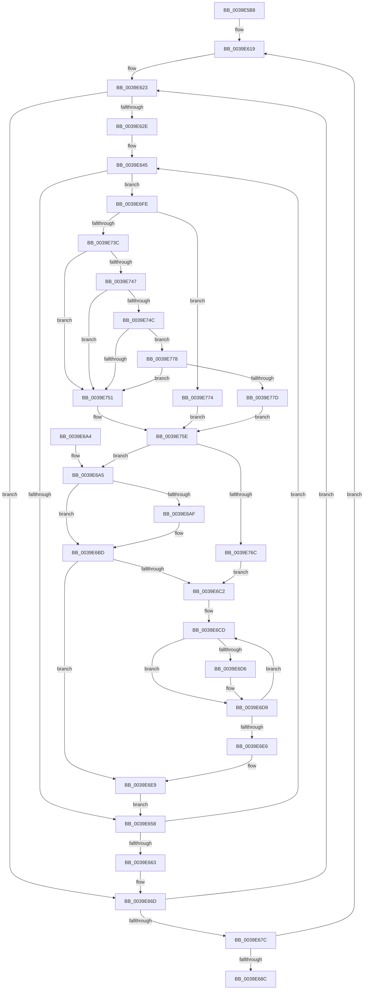

# KiTallyHeteroSoftParkElectionVotes

- RVA: `0x0039E5B8`–`0x0039E78C` (길이 `468` bytes)
- VA: `0x000000014039E5B8`
- 실행 섹션: `.text`
- PDB 이름 있음: `예`; PDB Function 태그: `아니요`
- unwind 정보 RVA: `0x00081BCC`
- 디코드: `126`개 명령, `468/468` bytes 표시
- 미해석 바이트: `0` (있으면 어셈블리에 `.byte`로 보존)

> 이 문서는 커널 이미지의 기계어와 PDB 기호를 분석해 생성했습니다. 4번과 5번은 함수 원형과 자료형을 바이너리 사용 방식에서 추정한 C 해석이며 원본 소스 복구 결과는 아닙니다.

## 1. Dependencies

- 직접 호출 지점: **5**; 고유 호출 대상: **5**
- 직접 호출자로 확인된 함수: **1**
- RIP 상대 이미지 참조: **2**

### Outgoing calls
- `0x0039E5FE` → [memset](../6C/memset_function_006C6C40.md) (function, `0x006C6C40`)
- `0x0039E6B8` → [KiHeteroReduceToMaximallyPreferredByClass](../41/KiHeteroReduceToMaximallyPreferredByClass_function_00414A48.md) (function, `0x00414A48`)
- `0x0039E728` → [KiGenerateHeteroSets](KiGenerateHeteroSets_function_0039ED50.md) (function, `0x0039ED50`)
- `0x0039E759` → [KiReduceAffinityToRankListMinimums](KiReduceAffinityToRankListMinimums_function_0039EFA0.md) (function, `0x0039EFA0`)
- `0x0039E785` → [KiReduceAffinityToRankListMaximums](../41/KiReduceAffinityToRankListMaximums_function_00414D70.md) (function, `0x00414D70`)

### Direct callers
- [KiPerformHeteroSoftParkElection](KiPerformHeteroSoftParkElection_function_0039E490.md) at `0x0039E539`

### Static image references
- `0x0039E710` → RVA `0x00FC5460` (`ALMOSTRO`; read)
- `0x0039E73C` → RVA `0x00F23450` (`.data`; read)

## 2. Other-region calls and transfers

- 다른 실행 섹션으로 향하는 call: **0**
- 별도 외부 분기/꼬리 이동을 확인하지 못했습니다.

## 3. Assembly (complete function range)

```asm
0039E5B8  4C 8B DC                        mov r11, rsp
0039E5BB  49 89 5B 08                     mov qword ptr [r11 + 8], rbx
0039E5BF  4D 89 4B 20                     mov qword ptr [r11 + 0x20], r9
0039E5C3  4D 89 43 18                     mov qword ptr [r11 + 0x18], r8
0039E5C7  49 89 53 10                     mov qword ptr [r11 + 0x10], rdx
0039E5CB  55                              push rbp
0039E5CC  56                              push rsi
0039E5CD  57                              push rdi
0039E5CE  41 54                           push r12
0039E5D0  41 55                           push r13
0039E5D2  41 56                           push r14
0039E5D4  41 57                           push r15
0039E5D6  48 83 EC 60                     sub rsp, 0x60
0039E5DA  0F 57 C0                        xorps xmm0, xmm0
0039E5DD  4C 8B E2                        mov r12, rdx
0039E5E0  4C 8B E9                        mov r13, rcx
0039E5E3  33 C0                           xor eax, eax
0039E5E5  48 8B 8C 24 C8 00 00 00         mov rcx, qword ptr [rsp + 0xc8]
0039E5ED  33 D2                           xor edx, edx
0039E5EF  0F 11 44 24 48                  movups xmmword ptr [rsp + 0x48], xmm0
0039E5F4  41 B8 00 02 00 00               mov r8d, 0x200
0039E5FA  49 89 43 C0                     mov qword ptr [r11 - 0x40], rax
0039E5FE  E8 3D 86 32 00                  call 0x1406c6c40
0039E603  48 8B 84 24 D0 00 00 00         mov rax, qword ptr [rsp + 0xd0]
0039E60B  33 F6                           xor esi, esi
0039E60D  48 83 20 00                     and qword ptr [rax], 0
0039E611  45 33 FF                        xor r15d, r15d
0039E614  4C 89 7C 24 38                  mov qword ptr [rsp + 0x38], r15
0039E619  33 FF                           xor edi, edi
0039E61B  45 33 F6                        xor r14d, r14d
0039E61E  4C 89 74 24 30                  mov qword ptr [rsp + 0x30], r14
0039E623  32 DB                           xor bl, bl
0039E625  41 38 9D B9 00 00 00            cmp byte ptr [r13 + 0xb9], bl
0039E62C  76 3F                           jbe 0x14039e66d
0039E62E  4B 8D 04 37                     lea rax, [r15 + r14]
0039E632  4C 8B B4 24 D0 00 00 00         mov r14, qword ptr [rsp + 0xd0]
0039E63A  4C 8D 38                        lea r15, [rax]
0039E63D  48 8D 0C C5 00 00 00 00         lea rcx, [rax*8]
0039E645  0F B6 C3                        movzx eax, bl
0039E648  48 03 C1                        add rax, rcx
0039E64B  49 8B 2C C4                     mov rbp, qword ptr [r12 + rax*8]
0039E64F  48 85 ED                        test rbp, rbp
0039E652  0F 85 A6 00 00 00               jne 0x14039e6fe
0039E658  FE C3                           inc bl
0039E65A  41 3A 9D B9 00 00 00            cmp bl, byte ptr [r13 + 0xb9]
0039E661  72 E2                           jb 0x14039e645
0039E663  4C 8B 74 24 30                  mov r14, qword ptr [rsp + 0x30]
0039E668  4C 8B 7C 24 38                  mov r15, qword ptr [rsp + 0x38]
0039E66D  49 FF C6                        inc r14
0039E670  FF C7                           inc edi
0039E672  4C 89 74 24 30                  mov qword ptr [rsp + 0x30], r14
0039E677  83 FF 02                        cmp edi, 2
0039E67A  7C A7                           jl 0x14039e623
0039E67C  49 83 C7 02                     add r15, 2
0039E680  FF C6                           inc esi
0039E682  4C 89 7C 24 38                  mov qword ptr [rsp + 0x38], r15
0039E687  83 FE 07                        cmp esi, 7
0039E68A  7C 8D                           jl 0x14039e619
0039E68C  48 8B 9C 24 A0 00 00 00         mov rbx, qword ptr [rsp + 0xa0]
0039E694  48 83 C4 60                     add rsp, 0x60
0039E698  41 5F                           pop r15
0039E69A  41 5E                           pop r14
0039E69C  41 5D                           pop r13
0039E69E  41 5C                           pop r12
0039E6A0  5F                              pop rdi
0039E6A1  5E                              pop rsi
0039E6A2  5D                              pop rbp
0039E6A3  C3                              ret
0039E6A4  CC                              int3
0039E6A5  48 8B 54 24 50                  mov rdx, qword ptr [rsp + 0x50]
0039E6AA  48 23 D0                        and rdx, rax
0039E6AD  74 0E                           je 0x14039e6bd
0039E6AF  44 8A CB                        mov r9b, bl
0039E6B2  45 8B C4                        mov r8d, r12d
0039E6B5  49 8B CD                        mov rcx, r13
0039E6B8  E8 8B 63 07 00                  call 0x140414a48
0039E6BD  48 85 C0                        test rax, rax
0039E6C0  74 27                           je 0x14039e6e9
0039E6C2  48 8B 94 24 C8 00 00 00         mov rdx, qword ptr [rsp + 0xc8]
0039E6CA  45 33 C0                        xor r8d, r8d
0039E6CD  41 8B C8                        mov ecx, r8d
0039E6D0  48 0F A3 C8                     bt rax, rcx
0039E6D4  73 03                           jae 0x14039e6d9
0039E6D6  48 01 2A                        add qword ptr [rdx], rbp
0039E6D9  41 FF C0                        inc r8d
0039E6DC  48 83 C2 08                     add rdx, 8
0039E6E0  41 83 F8 40                     cmp r8d, 0x40
0039E6E4  72 E7                           jb 0x14039e6cd
0039E6E6  49 01 2E                        add qword ptr [r14], rbp
0039E6E9  4C 8B A4 24 A8 00 00 00         mov r12, qword ptr [rsp + 0xa8]
0039E6F1  4A 8D 0C FD 00 00 00 00         lea rcx, [r15*8]
0039E6F9  E9 5A FF FF FF                  jmp 0x14039e658
0039E6FE  48 8B 94 24 B8 00 00 00         mov rdx, qword ptr [rsp + 0xb8]
0039E706  48 8D 44 24 48                  lea rax, [rsp + 0x48]
0039E70B  48 89 44 24 28                  mov qword ptr [rsp + 0x28], rax
0039E710  4C 8D 25 49 6D C2 00            lea r12, [rip + 0xc26d49]
0039E717  47 8B 24 BC                     mov r12d, dword ptr [r12 + r15*4]
0039E71B  44 8B CE                        mov r9d, esi
0039E71E  44 8A C3                        mov r8b, bl
0039E721  89 7C 24 20                     mov dword ptr [rsp + 0x20], edi
0039E725  49 8B CD                        mov rcx, r13
0039E728  E8 23 06 00 00                  call 0x14039ed50
0039E72D  48 8B 4C 24 58                  mov rcx, qword ptr [rsp + 0x58]
0039E732  48 23 8C 24 B0 00 00 00         and rcx, qword ptr [rsp + 0xb0]
0039E73A  74 38                           je 0x14039e774
0039E73C  0F B6 15 0D 4D B8 00            movzx edx, byte ptr [rip + 0xb84d0d]
0039E743  85 D2                           test edx, edx
0039E745  74 0A                           je 0x14039e751
0039E747  83 EA 01                        sub edx, 1
0039E74A  74 05                           je 0x14039e751
0039E74C  83 EA 01                        sub edx, 1
0039E74F  75 27                           jne 0x14039e778
0039E751  48 8B 94 24 C0 00 00 00         mov rdx, qword ptr [rsp + 0xc0]
0039E759  E8 42 08 00 00                  call 0x14039efa0
0039E75E  48 8B 4C 24 48                  mov rcx, qword ptr [rsp + 0x48]
0039E763  48 23 C8                        and rcx, rax
0039E766  0F 84 39 FF FF FF               je 0x14039e6a5
0039E76C  48 8B C1                        mov rax, rcx
0039E76F  E9 4E FF FF FF                  jmp 0x14039e6c2
0039E774  33 C0                           xor eax, eax
0039E776  EB E6                           jmp 0x14039e75e
0039E778  83 FA 01                        cmp edx, 1
0039E77B  75 D4                           jne 0x14039e751
0039E77D  48 8B 94 24 C0 00 00 00         mov rdx, qword ptr [rsp + 0xc0]
0039E785  E8 E6 65 07 00                  call 0x140414d70
0039E78A  EB D2                           jmp 0x14039e75e
```

## 4. C-style interpretation (structured pseudocode)

```c
__int64 __fastcall KiTallyHeteroSoftParkElectionVotes(__int64 a1, __int64 a2, __int64 a3, __int64 a4, __int64 a5, __int64 a6, __int64 a7)
{
    __int64 result;
    __int64 v_r14;
    __int64 v_r15;
    __int64 v_rbx;
    __int64 v_rdi;
    __int64 v_rsi;
    __int64 v_rsp;
    unsigned __int64 v_stack_m50;
    unsigned __int64 v_stack_m60;
    unsigned __int64 v_stack_m68;
    unsigned int v_stack_p20;
    unsigned __int64 v_stack_p28;
    unsigned __int64 v_stack_p48;
    unsigned __int64 v_stack_p50;
    unsigned __int64 v_stack_p58;
    unsigned __int64 v_stack_p8;
    unsigned __int64 v_stack_pA8;
    unsigned __int64 v_stack_pB0;
    unsigned __int64 v_stack_pB8;

    *(unsigned __int64 *)(v_rsp + 8) = v_rbx;
    *(unsigned __int64 *)(v_rsp + 32) = a4;
    *(unsigned __int64 *)(v_rsp + 24) = a3;
    *(unsigned __int64 *)(v_rsp + 16) = a2;
    v_rsp = (v_rsp) - (96);
    result = 0;
    a2 = 0;
    v_stack_m50 = v_xmm0;
    *(unsigned __int64 *)(v_rsp - 64) = 0;
    result = memset(a6, a2, 512, a4);
    v_rsi = 0;
    v_r15 = 0;
    v_stack_m60 = 0;
loc_0039E619:
    v_rdi = 0;
    v_r14 = 0;
    v_stack_m68 = 0;
loc_0039E623:
    v_rbx = 0;
    if ((*(unsigned __int8 *)(a1 + 185)) <= 0) goto loc_0039E66D;
loc_0039E645:
    result = (0) + (v_r15 + v_r14 * 1 * 8);
    if (*(unsigned __int64 *)(a2 + result * 8) != 0) goto loc_0039E6FE;
loc_0039E658:
    v_rbx = (unsigned __int8)((v_rbx) + 1);
    if (((unsigned __int8)(v_rbx)) < (*(unsigned __int8 *)(a1 + 185))) goto loc_0039E645;
loc_0039E66D:
    v_r14 = (v_stack_m68) + 1;
    v_rdi = (unsigned int)((v_rdi) + 1);
    v_stack_m68 = v_r14;
    if (((unsigned int)(v_rdi)) < 2) goto loc_0039E623;
    v_r15 = (v_stack_m60) + (2);
    v_rsi = (unsigned int)((v_rsi) + 1);
    v_stack_m60 = v_r15;
    if (((unsigned int)(v_rsi)) < 7) goto loc_0039E619;
    v_rsp = (v_rsp) + (96);
    return result;
loc_0039E6A5:
    a2 = (v_stack_p50) & (result);
    if (!(condition_is_equal)) {
        a4 = (unsigned __int8)(v_stack_p8);
        a3 = (unsigned int)(a2);
        a1 = a1;
        result = KiHeteroReduceToMaximallyPreferredByClass(a1, a2, a3, a4);
    }
    if (result == 0) goto loc_0039E6E9;
loc_0039E6C2:
    a3 = 0;
loc_0039E6CD:
    if (!(condition_is_above_or_equal)) {
    }
    a3 = (unsigned int)((a3) + 1);
    a2 = (a6) + (8);
    if (((unsigned int)(a3)) < 64) goto loc_0039E6CD;
loc_0039E6E9:
    goto loc_0039E658;
loc_0039E6FE:
    v_stack_p28 = v_stack_p48;
    v_stack_p20 = (unsigned int)(v_rdi);
    result = KiGenerateHeteroSets(a1, v_stack_pB8, (unsigned __int8)(v_stack_p8), (unsigned int)((unsigned int)(v_rsi)));
    a1 = (v_stack_p58) & (v_stack_pB0);
    if (condition_is_equal) goto loc_0039E774;
    if ((unsigned int)(*(unsigned __int8 *)(v_rip + 12078349)) == 0) goto loc_0039E751;
    a2 = (unsigned int)((*(unsigned __int8 *)(v_rip + 12078349)) - (1));
    if (condition_is_equal) goto loc_0039E751;
    a2 = (unsigned int)((a2) - (1));
    if (condition_is_not_equal) goto loc_0039E778;
loc_0039E751:
    result = KiReduceAffinityToRankListMinimums(a1, a5, (unsigned __int8)(v_stack_p8), (unsigned int)((unsigned int)(v_rsi)));
loc_0039E75E:
    a1 = (v_stack_p48) & (result);
    if (condition_is_equal) goto loc_0039E6A5;
    goto loc_0039E6C2;
loc_0039E774:
    result = 0;
    goto loc_0039E75E;
loc_0039E778:
    if (((unsigned int)(a5)) != 1) goto loc_0039E751;
    result = KiReduceAffinityToRankListMaximums(a1, a5, (unsigned __int8)(v_stack_p8), (unsigned int)((unsigned int)(v_rsi)));
    goto loc_0039E75E;
}
```

## 5. (Beta) C Style

```c
int64_t KiTallyHeteroSoftParkElectionVotes(void *Arg1, int64_t Arg2, int64_t Arg3, int64_t Arg4, int64_t Arg5, void *Arg6, void *Arg7)
{
    uint8_t *arg1 = (uint8_t *)Arg1;
    uint8_t *arg6 = (uint8_t *)Arg6;
    uint8_t *arg7 = (uint8_t *)Arg7;

    int64_t result;
    int64_t local_r14;
    int64_t local_r15;
    int64_t local_rbx;
    int64_t local_rdi;
    int64_t local_rsi;
    int64_t local_rsp;
    uint64_t v_stack_m50;
    uint64_t v_stack_m60;
    uint64_t v_stack_m68;
    uint32_t v_stack_p20;
    uint64_t v_stack_p28;
    uint64_t v_stack_p48;
    uint64_t v_stack_p50;
    uint64_t v_stack_p58;
    uint64_t v_stack_p8;
    uint64_t v_stack_pA8;
    uint64_t v_stack_pB0;
    uint64_t v_stack_pB8;

    *(uint64_t *)(local_rsp + 0x8) = local_rbx;
    *(uint64_t *)(local_rsp + 0x20) = Arg4;
    *(uint64_t *)(local_rsp + 0x18) = Arg3;
    *(uint64_t *)(local_rsp + 0x10) = Arg2;
    local_rsp = (local_rsp) - (96);
    result = 0;
    Arg2 = 0;
    v_stack_m50 = v_xmm0;
    *(uint64_t *)(local_rsp - 0x40) = 0;
    result = memset(Arg6, Arg2, 512, Arg4);
    local_rsi = 0;
    local_r15 = 0;
    v_stack_m60 = 0;
loc_0039E619:
    local_rdi = 0;
    local_r14 = 0;
    v_stack_m68 = 0;
loc_0039E623:
    local_rbx = 0;
    if ((*(uint8_t *)(arg1 + 0xB9)) <= 0) goto loc_0039E66D;
loc_0039E645:
    result = (0) + (local_r15 + local_r14 * 1 * 8);
    if (*(uint64_t *)(Arg2 + result * 8) != 0) goto loc_0039E6FE;
loc_0039E658:
    local_rbx = (uint8_t)((local_rbx) + 1);
    if (((uint8_t)(local_rbx)) < (*(uint8_t *)(arg1 + 0xB9))) goto loc_0039E645;
loc_0039E66D:
    local_r14 = (v_stack_m68) + 1;
    local_rdi = (uint32_t)((local_rdi) + 1);
    v_stack_m68 = local_r14;
    if (((uint32_t)(local_rdi)) < 2) goto loc_0039E623;
    local_r15 = (v_stack_m60) + (2);
    local_rsi = (uint32_t)((local_rsi) + 1);
    v_stack_m60 = local_r15;
    if (((uint32_t)(local_rsi)) < 7) goto loc_0039E619;
    local_rsp = (local_rsp) + (96);
    return result;
loc_0039E6A5:
    Arg2 = (v_stack_p50) & (result);
    if (!(condition_is_equal)) {
        Arg4 = (uint8_t)(v_stack_p8);
        Arg3 = (uint32_t)(Arg2);
        Arg1 = Arg1;
        result = KiHeteroReduceToMaximallyPreferredByClass(Arg1, Arg2, Arg3, Arg4);
    }
    if (result == 0) goto loc_0039E6E9;
loc_0039E6C2:
    Arg3 = 0;
loc_0039E6CD:
    if (!(condition_is_above_or_equal)) {
    }
    Arg3 = (uint32_t)((Arg3) + 1);
    Arg2 = (Arg6) + (8);
    if (((uint32_t)(Arg3)) < 64) goto loc_0039E6CD;
loc_0039E6E9:
    goto loc_0039E658;
loc_0039E6FE:
    v_stack_p28 = v_stack_p48;
    v_stack_p20 = (uint32_t)(local_rdi);
    result = KiGenerateHeteroSets(Arg1, v_stack_pB8, (uint8_t)(v_stack_p8), (uint32_t)((uint32_t)(local_rsi)));
    Arg1 = (v_stack_p58) & (v_stack_pB0);
    if (condition_is_equal) goto loc_0039E774;
    if ((uint32_t)(*(uint8_t *)(v_rip + 0xB84D0D)) == 0) goto loc_0039E751;
    Arg2 = (uint32_t)((*(uint8_t *)(v_rip + 0xB84D0D)) - (1));
    if (condition_is_equal) goto loc_0039E751;
    Arg2 = (uint32_t)((Arg2) - (1));
    if (condition_is_not_equal) goto loc_0039E778;
loc_0039E751:
    result = KiReduceAffinityToRankListMinimums(Arg1, Arg5, (uint8_t)(v_stack_p8), (uint32_t)((uint32_t)(local_rsi)));
loc_0039E75E:
    Arg1 = (v_stack_p48) & (result);
    if (condition_is_equal) goto loc_0039E6A5;
    goto loc_0039E6C2;
loc_0039E774:
    result = 0;
    goto loc_0039E75E;
loc_0039E778:
    if (((uint32_t)(Arg5)) != 1) goto loc_0039E751;
    result = KiReduceAffinityToRankListMaximums(Arg1, Arg5, (uint8_t)(v_stack_p8), (uint32_t)((uint32_t)(local_rsi)));
    goto loc_0039E75E;
}
```

### 관측된 메모리 오프셋

구조체 형식이 확인되지 않은 접근은 인자 기준의 오프셋으로만 기록했습니다.

| 기준 인자 | 오프셋 표현 | 폭 (bit) | 접근 |
|---|---:|---:|---|
| `Arg1` | `+ 0xB9` | `8` | `R` |
| `Arg6` | `+ 0x0` | `64` | `R/W` |
| `Arg7` | `+ 0x0` | `64` | `R/W` |

## 6. Execution-region graph

[열기: 2D/3D 그래프와 함수 탐색 컨트롤 패널](../../../control-panel.html?section=text&rva=0x0039E5B8&view=graph)

- 2D 그래프는 위에서 아래로 흐르고, 3D 그래프는 빈 공간을 드래그해 회전합니다. Shift+드래그는 이동, 휠은 확대·축소, 함수 노드 선택은 대상 보고서 이동입니다.

### Static fallback


