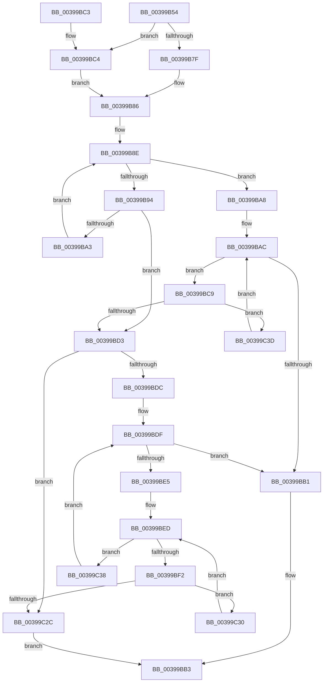

# KiTestNodeAffinity

- RVA: `0x00399B54`–`0x00399C45` (길이 `241` bytes)
- VA: `0x0000000140399B54`
- 실행 섹션: `.text`
- PDB 이름 있음: `예`; PDB Function 태그: `아니요`
- unwind 정보 RVA: `0x000817E4`
- 디코드: `68`개 명령, `241/241` bytes 표시
- 미해석 바이트: `0` (있으면 어셈블리에 `.byte`로 보존)

> 이 문서는 커널 이미지의 기계어와 PDB 기호를 분석해 생성했습니다. 4번과 5번은 함수 원형과 자료형을 바이너리 사용 방식에서 추정한 C 해석이며 원본 소스 복구 결과는 아닙니다.

## 1. Dependencies

- 직접 호출 지점: **0**; 고유 호출 대상: **0**
- 직접 호출자로 확인된 함수: **1**
- RIP 상대 이미지 참조: **4**

### Outgoing calls
- 직접 디코드된 call 명령이 없습니다.

### Direct callers
- [KiUpdateNodeAffinitizedFlag](KiUpdateNodeAffinitizedFlag_function_00399B1C.md) at `0x00399B2C`

### Static image references
- `0x00399B67` → RVA `0x00FC7120` (`ALMOSTRO`; read)
- `0x00399BD3` → RVA `0x00FC5000` (`ALMOSTRO`; read)
- `0x00399BFE` → RVA `0x00F231B8` (`.data`; read)
- `0x00399C08` → RVA `0x00FC8C40` (`ALMOSTRO`; read)

## 2. Other-region calls and transfers

- 다른 실행 섹션으로 향하는 call: **0**
- 별도 외부 분기/꼬리 이동을 확인하지 못했습니다.

## 3. Assembly (complete function range)

```asm
00399B54  48 89 5C 24 10                  mov qword ptr [rsp + 0x10], rbx
00399B59  48 89 74 24 18                  mov qword ptr [rsp + 0x18], rsi
00399B5E  48 89 7C 24 20                  mov qword ptr [rsp + 0x20], rdi
00399B63  44 0F B7 19                     movzx r11d, word ptr [rcx]
00399B67  48 8D 35 B2 D5 C2 00            lea rsi, [rip + 0xc2d5b2]
00399B6E  44 0F B7 05 AA D5 C2 00         movzx r8d, word ptr [rip + 0xc2d5aa]
00399B76  4C 8B C9                        mov r9, rcx
00399B79  66 45 3B D8                     cmp r11w, r8w
00399B7D  73 45                           jae 0x140399bc4
00399B7F  4C 8B D6                        mov r10, rsi
00399B82  45 0F B7 C3                     movzx r8d, r11w
00399B86  33 FF                           xor edi, edi
00399B88  0F B7 D7                        movzx edx, di
00399B8B  8D 5F 01                        lea ebx, [rdi + 1]
00399B8E  66 41 3B D0                     cmp dx, r8w
00399B92  73 14                           jae 0x140399ba8
00399B94  0F B7 CA                        movzx ecx, dx
00399B97  48 8B 44 CE 08                  mov rax, qword ptr [rsi + rcx*8 + 8]
00399B9C  49 39 44 C9 08                  cmp qword ptr [r9 + rcx*8 + 8], rax
00399BA1  75 30                           jne 0x140399bd3
00399BA3  66 03 D3                        add dx, bx
00399BA6  EB E6                           jmp 0x140399b8e
00399BA8  41 0F B7 0A                     movzx ecx, word ptr [r10]
00399BAC  66 3B D1                        cmp dx, cx
00399BAF  72 18                           jb 0x140399bc9
00399BB1  8B C3                           mov eax, ebx
00399BB3  48 8B 5C 24 10                  mov rbx, qword ptr [rsp + 0x10]
00399BB8  48 8B 74 24 18                  mov rsi, qword ptr [rsp + 0x18]
00399BBD  48 8B 7C 24 20                  mov rdi, qword ptr [rsp + 0x20]
00399BC2  C3                              ret
00399BC3  CC                              int3
00399BC4  4D 8B D1                        mov r10, r9
00399BC7  EB BD                           jmp 0x140399b86
00399BC9  0F B7 C2                        movzx eax, dx
00399BCC  49 39 7C C2 08                  cmp qword ptr [r10 + rax*8 + 8], rdi
00399BD1  74 6A                           je 0x140399c3d
00399BD3  66 39 1D 26 B4 C2 00            cmp word ptr [rip + 0xc2b426], bx
00399BDA  76 50                           jbe 0x140399c2c
00399BDC  0F B7 D7                        movzx edx, di
00399BDF  66 41 3B D3                     cmp dx, r11w
00399BE3  73 CC                           jae 0x140399bb1
00399BE5  0F B7 C2                        movzx eax, dx
00399BE8  4D 8B 44 C1 08                  mov r8, qword ptr [r9 + rax*8 + 8]
00399BED  4D 85 C0                        test r8, r8
00399BF0  74 46                           je 0x140399c38
00399BF2  49 0F BD C0                     bsr rax, r8
00399BF6  0F B7 CA                        movzx ecx, dx
00399BF9  C1 E1 06                        shl ecx, 6
00399BFC  03 C8                           add ecx, eax
00399BFE  48 8B 05 B3 95 B8 00            mov rax, qword ptr [rip + 0xb895b3]
00399C05  8B 04 88                        mov eax, dword ptr [rax + rcx*4]
00399C08  48 8D 0D 31 F0 C2 00            lea rcx, [rip + 0xc2f031]
00399C0F  48 8B 04 C1                     mov rax, qword ptr [rcx + rax*8]
00399C13  48 8B 88 C0 00 00 00            mov rcx, qword ptr [rax + 0xc0]
00399C1A  4C 8B 91 80 00 00 00            mov r10, qword ptr [rcx + 0x80]
00399C21  49 8B C2                        mov rax, r10
00399C24  49 23 C0                        and rax, r8
00399C27  49 3B C2                        cmp rax, r10
00399C2A  74 04                           je 0x140399c30
00399C2C  33 C0                           xor eax, eax
00399C2E  EB 83                           jmp 0x140399bb3
00399C30  49 F7 D2                        not r10
00399C33  4D 23 C2                        and r8, r10
00399C36  EB B5                           jmp 0x140399bed
00399C38  66 03 D3                        add dx, bx
00399C3B  EB A2                           jmp 0x140399bdf
00399C3D  66 03 D3                        add dx, bx
00399C40  E9 67 FF FF FF                  jmp 0x140399bac
```

## 4. C-style interpretation (structured pseudocode)

```c
__int64 __fastcall KiTestNodeAffinity(__int64 a1)
{
    __int64 result;
    __int64 v_r10;
    __int64 v_rdi;
    unsigned __int64 v_stack_p10;
    unsigned __int64 v_stack_p18;
    unsigned __int64 v_stack_p20;

    v_stack_p10 = v_rbx;
    v_stack_p18 = v_rsi;
    v_stack_p20 = v_rdi;
    if (((unsigned __int16)(*(unsigned __int16 *)(a1))) >= ((unsigned __int16)(*(unsigned __int16 *)(v_rip + 12768682)))) goto loc_00399BC4;
loc_00399B86:
    v_rdi = 0;
loc_00399B8E:
    if (0 >= ((unsigned __int16)((unsigned __int16)(*(unsigned __int16 *)(a1))))) goto loc_00399BA8;
    if ((*(unsigned __int64 *)(a1 + 0 * 8 + 8)) != (*(unsigned __int64 *)(v_rip + 12768690 + 0 * 8 + 8))) goto loc_00399BD3;
    a2 = (unsigned __int16)((0) + ((unsigned __int16)(v_rdi + 1)));
    goto loc_00399B8E;
loc_00399BA8:
loc_00399BAC:
    if (((unsigned __int16)(a2)) < ((unsigned __int16)(*(unsigned __int16 *)(v_rip + 12768690)))) goto loc_00399BC9;
loc_00399BB1:
loc_00399BB3:
    return (unsigned int)((unsigned int)(v_rdi + 1));
loc_00399BC4:
    goto loc_00399B86;
loc_00399BC9:
    if ((*(unsigned __int64 *)(a1 + (unsigned __int16)(a2) * 8 + 8)) == v_stack_p20) goto loc_00399C3D;
loc_00399BD3:
    if ((*(unsigned __int16 *)(v_rip + 12760102)) <= ((unsigned __int16)(v_stack_p10))) goto loc_00399C2C;
loc_00399BDF:
    if (((unsigned __int16)((unsigned __int16)(v_stack_p20))) >= ((unsigned __int16)(*(unsigned __int16 *)(a1)))) goto loc_00399BB1;
loc_00399BED:
    if (*(unsigned __int64 *)(a1 + (unsigned __int16)((unsigned __int16)(v_stack_p20)) * 8 + 8) == 0) goto loc_00399C38;
    a1 = (unsigned int)(((unsigned __int16)((unsigned __int16)(v_stack_p20))) << (6));
    a1 = (unsigned int)((a1) + ((unsigned int)((unsigned __int16)((unsigned __int16)(v_stack_p20)))));
    result = (*(unsigned __int64 *)(*(unsigned __int64 *)(*(unsigned __int64 *)(v_rip + 12775473 + (unsigned int)(*(unsigned int *)(*(unsigned __int64 *)(v_rip + 12096947) + a1 * 4)) * 8) + 192) + 128)) & (*(unsigned __int64 *)(a1 + (unsigned __int16)((unsigned __int16)(v_stack_p20)) * 8 + 8));
    if (result == (*(unsigned __int64 *)(*(unsigned __int64 *)(*(unsigned __int64 *)(v_rip + 12775473 + (unsigned int)(*(unsigned int *)(*(unsigned __int64 *)(v_rip + 12096947) + a1 * 4)) * 8) + 192) + 128))) goto loc_00399C30;
loc_00399C2C:
    result = 0;
    goto loc_00399BB3;
loc_00399C30:
    v_r10 = ~(*(unsigned __int64 *)(*(unsigned __int64 *)(*(unsigned __int64 *)(v_rip + 12775473 + (unsigned int)(*(unsigned int *)(*(unsigned __int64 *)(v_rip + 12096947) + a1 * 4)) * 8) + 192) + 128));
    a3 = (*(unsigned __int64 *)(a1 + (unsigned __int16)((unsigned __int16)(v_stack_p20)) * 8 + 8)) & (v_r10);
    goto loc_00399BED;
loc_00399C38:
    a2 = (unsigned __int16)(((unsigned __int16)(v_stack_p20)) + ((unsigned __int16)(v_stack_p10)));
    goto loc_00399BDF;
loc_00399C3D:
    a2 = (unsigned __int16)((a2) + ((unsigned __int16)(v_stack_p10)));
    goto loc_00399BAC;
}
```

## 5. (Beta) C Style

```c
int64_t KiTestNodeAffinity(void *Arg1)
{
    uint8_t *arg1 = (uint8_t *)Arg1;

    int64_t result;
    int64_t local_r10;
    int64_t local_rdi;
    uint64_t v_stack_p10;
    uint64_t v_stack_p18;
    uint64_t v_stack_p20;

    v_stack_p10 = local_rbx;
    v_stack_p18 = local_rsi;
    v_stack_p20 = local_rdi;
    if (((uint16_t)(*(uint16_t *)(arg1))) >= ((uint16_t)(*(uint16_t *)(v_rip + 0xC2D5AA)))) goto loc_00399BC4;
loc_00399B86:
    local_rdi = 0;
loc_00399B8E:
    if (0 >= ((uint16_t)((uint16_t)(*(uint16_t *)(arg1))))) goto loc_00399BA8;
    if ((*(uint64_t *)(arg1 + 0x0 * 8 + 0x8)) != (*(uint64_t *)(v_rip + 0xC2D5B2 + 0x0 * 8 + 0x8))) goto loc_00399BD3;
    a2 = (uint16_t)((0) + ((uint16_t)(local_rdi + 1)));
    goto loc_00399B8E;
loc_00399BA8:
loc_00399BAC:
    if (((uint16_t)(a2)) < ((uint16_t)(*(uint16_t *)(v_rip + 0xC2D5B2)))) goto loc_00399BC9;
loc_00399BB1:
loc_00399BB3:
    return (uint32_t)((uint32_t)(local_rdi + 1));
loc_00399BC4:
    goto loc_00399B86;
loc_00399BC9:
    if ((*(uint64_t *)(arg1 + (uint16_t)(a2) * 8 + 0x8)) == v_stack_p20) goto loc_00399C3D;
loc_00399BD3:
    if ((*(uint16_t *)(v_rip + 0xC2B426)) <= ((uint16_t)(v_stack_p10))) goto loc_00399C2C;
loc_00399BDF:
    if (((uint16_t)((uint16_t)(v_stack_p20))) >= ((uint16_t)(*(uint16_t *)(arg1)))) goto loc_00399BB1;
loc_00399BED:
    if (*(uint64_t *)(arg1 + (uint16_t)((uint16_t)(v_stack_p20)) * 8 + 0x8) == 0) goto loc_00399C38;
    Arg1 = (uint32_t)(((uint16_t)((uint16_t)(v_stack_p20))) << (6));
    Arg1 = (uint32_t)((Arg1) + ((uint32_t)((uint16_t)((uint16_t)(v_stack_p20)))));
    result = (*(uint64_t *)(*(uint64_t *)(*(uint64_t *)(v_rip + 0xC2F031 + (uint32_t)(*(uint32_t *)(*(uint64_t *)(v_rip + 0xB895B3) + arg1 * 4)) * 8) + 0xC0) + 0x80)) & (*(uint64_t *)(arg1 + (uint16_t)((uint16_t)(v_stack_p20)) * 8 + 0x8));
    if (result == (*(uint64_t *)(*(uint64_t *)(*(uint64_t *)(v_rip + 0xC2F031 + (uint32_t)(*(uint32_t *)(*(uint64_t *)(v_rip + 0xB895B3) + arg1 * 4)) * 8) + 0xC0) + 0x80))) goto loc_00399C30;
loc_00399C2C:
    result = 0;
    goto loc_00399BB3;
loc_00399C30:
    local_r10 = ~(*(uint64_t *)(*(uint64_t *)(*(uint64_t *)(v_rip + 0xC2F031 + (uint32_t)(*(uint32_t *)(*(uint64_t *)(v_rip + 0xB895B3) + arg1 * 4)) * 8) + 0xC0) + 0x80));
    a3 = (*(uint64_t *)(arg1 + (uint16_t)((uint16_t)(v_stack_p20)) * 8 + 0x8)) & (local_r10);
    goto loc_00399BED;
loc_00399C38:
    a2 = (uint16_t)(((uint16_t)(v_stack_p20)) + ((uint16_t)(v_stack_p10)));
    goto loc_00399BDF;
loc_00399C3D:
    a2 = (uint16_t)((a2) + ((uint16_t)(v_stack_p10)));
    goto loc_00399BAC;
}
```

### 관측된 메모리 오프셋

구조체 형식이 확인되지 않은 접근은 인자 기준의 오프셋으로만 기록했습니다.

| 기준 인자 | 오프셋 표현 | 폭 (bit) | 접근 |
|---|---:|---:|---|
| `Arg1` | `+ 0x0` | `16` | `R` |
| `Arg1` | `+ 0x8 + rax*8` | `64` | `R` |
| `Arg1` | `+ 0x8 + rcx*8` | `64` | `R` |

## 6. Execution-region graph

[열기: 2D/3D 그래프와 함수 탐색 컨트롤 패널](../../../control-panel.html?section=text&rva=0x00399B54&view=graph)

- 2D 그래프는 위에서 아래로 흐르고, 3D 그래프는 빈 공간을 드래그해 회전합니다. Shift+드래그는 이동, 휠은 확대·축소, 함수 노드 선택은 대상 보고서 이동입니다.

### Static fallback


