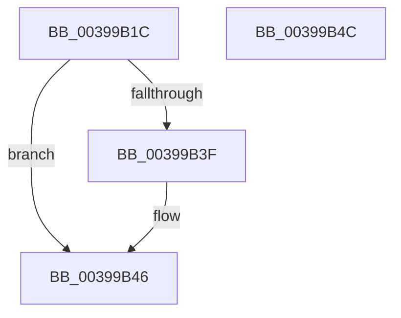

# KiUpdateNodeAffinitizedFlag

- RVA: `0x00399B1C`–`0x00399B4D` (길이 `49` bytes)
- VA: `0x0000000140399B1C`
- 실행 섹션: `.text`
- PDB 이름 있음: `예`; PDB Function 태그: `아니요`
- unwind 정보 RVA: `0x0005CF00`
- 디코드: `15`개 명령, `49/49` bytes 표시
- 미해석 바이트: `0` (있으면 어셈블리에 `.byte`로 보존)

> 이 문서는 커널 이미지의 기계어와 PDB 기호를 분석해 생성했습니다. 4번과 5번은 함수 원형과 자료형을 바이너리 사용 방식에서 추정한 C 해석이며 원본 소스 복구 결과는 아닙니다.

## 1. Dependencies

- 직접 호출 지점: **1**; 고유 호출 대상: **1**
- 직접 호출자로 확인된 함수: **4**
- RIP 상대 이미지 참조: **0**

### Outgoing calls
- `0x00399B2C` → [KiTestNodeAffinity](KiTestNodeAffinity_function_00399B54.md) (function, `0x00399B54`)

### Direct callers
- [KiSetAffinityThread](../2C/KiSetAffinityThread_function_002CE010.md) at `0x002CE173`
- [KiSetSystemAffinityThread](KiSetSystemAffinityThread_function_003993E0.md) at `0x003994FD`
- [KiComputeThreadAffinity](KiComputeThreadAffinity_function_00399DE0.md) at `0x0039A0AB`
- [KeStartThread](../3C/KeStartThread_function_003C21B8.md) at `0x003C2315`

### Static image references
- 디코드된 RIP-relative 메모리 참조가 없습니다.

## 2. Other-region calls and transfers

- 다른 실행 섹션으로 향하는 call: **0**
- 별도 외부 분기/꼬리 이동을 확인하지 못했습니다.

## 3. Assembly (complete function range)

```asm
00399B1C  40 53                           push rbx
00399B1E  48 83 EC 20                     sub rsp, 0x20
00399B22  48 8B D9                        mov rbx, rcx
00399B25  48 8B 89 40 02 00 00            mov rcx, qword ptr [rcx + 0x240]
00399B2C  E8 23 00 00 00                  call 0x140399b54
00399B31  0F B6 53 02                     movzx edx, byte ptr [rbx + 2]
00399B35  C1 EA 03                        shr edx, 3
00399B38  83 E2 01                        and edx, 1
00399B3B  3B C2                           cmp eax, edx
00399B3D  75 07                           jne 0x140399b46
00399B3F  F0 81 33 00 00 08 00            lock xor dword ptr [rbx], 0x80000
00399B46  48 83 C4 20                     add rsp, 0x20
00399B4A  5B                              pop rbx
00399B4B  C3                              ret
00399B4C  CC                              int3
```

## 4. C-style interpretation (structured pseudocode)

```c
__int64 __fastcall KiUpdateNodeAffinitizedFlag(__int64 a1)
{
    __int64 result;
    __int64 v_rsp;

    v_rsp = (v_rsp) - (32);
    result = KiTestNodeAffinity(*(unsigned __int64 *)(a1 + 576), a2, a3, a4);
    a2 = (unsigned int)((*(unsigned __int8 *)(a1 + 2)) >> (3));
    a2 = (unsigned int)((a2) & (1));
    if (((unsigned int)(result)) == ((unsigned int)(a2))) {
    }
    v_rsp = (v_rsp) + (32);
    return result;
}
```

## 5. (Beta) C Style

```c
int64_t KiUpdateNodeAffinitizedFlag(void *Arg1)
{
    uint8_t *arg1 = (uint8_t *)Arg1;

    int64_t result;
    int64_t local_rsp;

    local_rsp = (local_rsp) - (32);
    result = KiTestNodeAffinity(*(uint64_t *)(arg1 + 0x240), a2, a3, a4);
    a2 = (uint32_t)((*(uint8_t *)(arg1 + 0x2)) >> (3));
    a2 = (uint32_t)((a2) & (1));
    if (((uint32_t)(result)) == ((uint32_t)(a2))) {
    }
    local_rsp = (local_rsp) + (32);
    return result;
}
```

### 관측된 메모리 오프셋

구조체 형식이 확인되지 않은 접근은 인자 기준의 오프셋으로만 기록했습니다.

| 기준 인자 | 오프셋 표현 | 폭 (bit) | 접근 |
|---|---:|---:|---|
| `Arg1` | `+ 0x0` | `32` | `R/W` |
| `Arg1` | `+ 0x2` | `8` | `R` |
| `Arg1` | `+ 0x240` | `64` | `R` |

## 6. Execution-region graph

[열기: 2D/3D 그래프와 함수 탐색 컨트롤 패널](../../../control-panel.html?section=text&rva=0x00399B1C&view=graph)

- 2D 그래프는 위에서 아래로 흐르고, 3D 그래프는 빈 공간을 드래그해 회전합니다. Shift+드래그는 이동, 휠은 확대·축소, 함수 노드 선택은 대상 보고서 이동입니다.

### Static fallback


