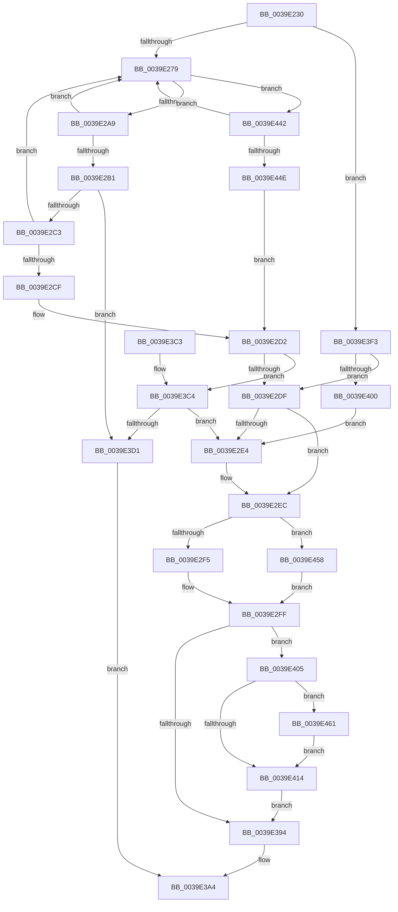

# KiUpdateTimeAssist

- RVA: `0x0039E230`–`0x0039E48A` (길이 `602` bytes)
- VA: `0x000000014039E230`
- 실행 섹션: `.text`
- PDB 이름 있음: `예`; PDB Function 태그: `아니요`
- unwind 정보 RVA: `0x00072E04`
- 디코드: `141`개 명령, `602/602` bytes 표시
- 미해석 바이트: `0` (있으면 어셈블리에 `.byte`로 보존)

> 이 문서는 커널 이미지의 기계어와 PDB 기호를 분석해 생성했습니다. 4번과 5번은 함수 원형과 자료형을 바이너리 사용 방식에서 추정한 C 해석이며 원본 소스 복구 결과는 아닙니다.

## 1. Dependencies

- 직접 호출 지점: **8**; 고유 호출 대상: **6**
- 직접 호출자로 확인된 함수: **3**
- RIP 상대 이미지 참조: **8**

### Outgoing calls
- `0x0039E27C` → [RtlBeginReadTickLock](RtlBeginReadTickLock_function_0039D2A0.md) (function, `0x0039D2A0`)
- `0x0039E286` → [KeQueryPerformanceCounter](../37/KeQueryPerformanceCounter_function_0037E7E0.md) (function, `0x0037E7E0`)
- `0x0039E293` → [KiComputeNewInterruptTime](KiComputeNewInterruptTime_function_0039D330.md) (function, `0x0039D330`)
- `0x0039E2C6` → [RtlWriteTryAcquireTickLock](RtlWriteTryAcquireTickLock_function_0039D3D8.md) (function, `0x0039D3D8`)
- `0x0039E2E7` → [RtlWriteAcquireTickLock](RtlWriteAcquireTickLock_function_0039D3B4.md) (function, `0x0039D3B4`)
- `0x0039E2F7` → [KeQueryPerformanceCounter](../37/KeQueryPerformanceCounter_function_0037E7E0.md) (function, `0x0037E7E0`)
- `0x0039E302` → [KiComputeNewSystemTime](KiComputeNewSystemTime_function_0039D2B8.md) (function, `0x0039D2B8`)
- `0x0039E317` → [KiComputeNewInterruptTime](KiComputeNewInterruptTime_function_0039D330.md) (function, `0x0039D330`)

### Direct callers
- [KeClockInterruptNotify](KeClockInterruptNotify_function_0039A970.md) at `0x0039AE67`
- [KeSynchronizeTimeToQpc](../4F/KeSynchronizeTimeToQpc_function_004F9A70.md) at `0x004F9A8E`
- [KeResumeClockTimerFromIdle](../5B/KeResumeClockTimerFromIdle_function_005BACC4.md) at `0x005BAD8A`

### Static image references
- `0x0039E24D` → RVA `0x00FC5008` (`ALMOSTRO`; read)
- `0x0039E298` → RVA `0x00FC6AF8` (`ALMOSTRO`; read)
- `0x0039E2B6` → RVA `0x00FC7058` (`ALMOSTRO`; read)
- `0x0039E380` → RVA `0x00E66898` (`.data`; read)
- `0x0039E39A` → RVA `0x00E66898` (`.data`; write)
- `0x0039E405` → RVA `0x00FC6AA0` (`ALMOSTRO`; read)
- `0x0039E461` → RVA `0x00FC7318` (`ALMOSTRO`; read)
- `0x0039E471` → RVA `0x00FC6BC6` (`ALMOSTRO`; read)

## 2. Other-region calls and transfers

- 다른 실행 섹션으로 향하는 call: **0**
- 별도 외부 분기/꼬리 이동을 확인하지 못했습니다.

## 3. Assembly (complete function range)

```asm
0039E230  48 8B C4                        mov rax, rsp
0039E233  48 89 58 08                     mov qword ptr [rax + 8], rbx
0039E237  48 89 68 10                     mov qword ptr [rax + 0x10], rbp
0039E23B  48 89 70 18                     mov qword ptr [rax + 0x18], rsi
0039E23F  48 89 78 20                     mov qword ptr [rax + 0x20], rdi
0039E243  41 54                           push r12
0039E245  41 56                           push r14
0039E247  41 57                           push r15
0039E249  48 83 EC 30                     sub rsp, 0x30
0039E24D  48 8B 3D B4 6D C2 00            mov rdi, qword ptr [rip + 0xc26db4]
0039E254  45 32 FF                        xor r15b, r15b
0039E257  48 83 60 D8 00                  and qword ptr [rax - 0x28], 0
0039E25C  48 81 C7 40 03 00 00            add rdi, 0x340
0039E263  4D 8B F1                        mov r14, r9
0039E266  49 8B F0                        mov rsi, r8
0039E269  4C 8B E1                        mov r12, rcx
0039E26C  BD 01 00 00 00                  mov ebp, 1
0039E271  84 D2                           test dl, dl
0039E273  0F 85 7A 01 00 00               jne 0x14039e3f3
0039E279  48 8B CF                        mov rcx, rdi
0039E27C  E8 1F F0 FF FF                  call 0x14039d2a0
0039E281  33 C9                           xor ecx, ecx
0039E283  48 8B D8                        mov rbx, rax
0039E286  E8 55 05 FE FF                  call 0x14037e7e0
0039E28B  48 8D 54 24 20                  lea rdx, [rsp + 0x20]
0039E290  48 8B C8                        mov rcx, rax
0039E293  E8 98 F0 FF FF                  call 0x14039d330
0039E298  44 38 3D 59 88 C2 00            cmp byte ptr [rip + 0xc28859], r15b
0039E29F  48 89 06                        mov qword ptr [rsi], rax
0039E2A2  90                              nop
0039E2A3  0F 84 99 01 00 00               je 0x14039e442
0039E2A9  48 8B 0F                        mov rcx, qword ptr [rdi]
0039E2AC  48 3B CB                        cmp rcx, rbx
0039E2AF  75 C8                           jne 0x14039e279
0039E2B1  4C 8B 4C 24 20                  mov r9, qword ptr [rsp + 0x20]
0039E2B6  4C 3B 0D 9B 8D C2 00            cmp r9, qword ptr [rip + 0xc28d9b]
0039E2BD  0F 86 0E 01 00 00               jbe 0x14039e3d1
0039E2C3  48 8B CF                        mov rcx, rdi
0039E2C6  E8 0D F1 FF FF                  call 0x14039d3d8
0039E2CB  84 C0                           test al, al
0039E2CD  74 AA                           je 0x14039e279
0039E2CF  44 8A FD                        mov r15b, bpl
0039E2D2  80 3D 1F 88 C2 00 00            cmp byte ptr [rip + 0xc2881f], 0
0039E2D9  0F 84 E5 00 00 00               je 0x14039e3c4
0039E2DF  45 84 FF                        test r15b, r15b
0039E2E2  75 08                           jne 0x14039e2ec
0039E2E4  48 8B CF                        mov rcx, rdi
0039E2E7  E8 C8 F0 FF FF                  call 0x14039d3b4
0039E2EC  4D 85 E4                        test r12, r12
0039E2EF  0F 85 63 01 00 00               jne 0x14039e458
0039E2F5  33 C9                           xor ecx, ecx
0039E2F7  E8 E4 04 FE FF                  call 0x14037e7e0
0039E2FC  4C 8B F8                        mov r15, rax
0039E2FF  49 8B CF                        mov rcx, r15
0039E302  E8 B1 EF FF FF                  call 0x14039d2b8
0039E307  48 8D 54 24 20                  lea rdx, [rsp + 0x20]
0039E30C  48 89 44 24 28                  mov qword ptr [rsp + 0x28], rax
0039E311  49 8B CF                        mov rcx, r15
0039E314  48 8B D8                        mov rbx, rax
0039E317  E8 14 F0 FF FF                  call 0x14039d330
0039E31C  8B 4C 24 2C                     mov ecx, dword ptr [rsp + 0x2c]
0039E320  48 89 06                        mov qword ptr [rsi], rax
0039E323  48 8B 15 DE 6C C2 00            mov rdx, qword ptr [rip + 0xc26cde]
0039E32A  89 4A 1C                        mov dword ptr [rdx + 0x1c], ecx
0039E32D  48 8B 0D D4 6C C2 00            mov rcx, qword ptr [rip + 0xc26cd4]
0039E334  48 89 59 14                     mov qword ptr [rcx + 0x14], rbx
0039E338  48 8B 16                        mov rdx, qword ptr [rsi]
0039E33B  48 8B 05 C6 6C C2 00            mov rax, qword ptr [rip + 0xc26cc6]
0039E342  48 8B CA                        mov rcx, rdx
0039E345  48 C1 E9 20                     shr rcx, 0x20
0039E349  89 48 10                        mov dword ptr [rax + 0x10], ecx
0039E34C  48 8B 05 B5 6C C2 00            mov rax, qword ptr [rip + 0xc26cb5]
0039E353  48 89 50 08                     mov qword ptr [rax + 8], rdx
0039E357  48 8B 05 AA 6C C2 00            mov rax, qword ptr [rip + 0xc26caa]
0039E35E  4C 89 B8 48 03 00 00            mov qword ptr [rax + 0x348], r15
0039E365  48 8B 05 9C 6C C2 00            mov rax, qword ptr [rip + 0xc26c9c]
0039E36C  4C 89 B8 50 03 00 00            mov qword ptr [rax + 0x350], r15
0039E373  48 B8 20 03 00 00 80 F7 FF FF   movabs rax, 0xfffff78000000320
0039E37D  4C 8B 10                        mov r10, qword ptr [rax]
0039E380  44 8B 05 11 85 AC 00            mov r8d, dword ptr [rip + 0xac8511]
0039E387  4C 2B 44 24 20                  sub r8, qword ptr [rsp + 0x20]
0039E38C  4D 89 16                        mov qword ptr [r14], r10
0039E38F  4D 85 C0                        test r8, r8
0039E392  7E 71                           jle 0x14039e405
0039E394  48 8B 07                        mov rax, qword ptr [rdi]
0039E397  48 FF C0                        inc rax
0039E39A  44 89 05 F7 84 AC 00            mov dword ptr [rip + 0xac84f7], r8d
0039E3A1  48 89 07                        mov qword ptr [rdi], rax
0039E3A4  48 8B 5C 24 50                  mov rbx, qword ptr [rsp + 0x50]
0039E3A9  48 8B 6C 24 58                  mov rbp, qword ptr [rsp + 0x58]
0039E3AE  48 8B 74 24 60                  mov rsi, qword ptr [rsp + 0x60]
0039E3B3  48 8B 7C 24 68                  mov rdi, qword ptr [rsp + 0x68]
0039E3B8  48 83 C4 30                     add rsp, 0x30
0039E3BC  41 5F                           pop r15
0039E3BE  41 5E                           pop r14
0039E3C0  41 5C                           pop r12
0039E3C2  C3                              ret
0039E3C3  CC                              int3
0039E3C4  4C 3B 0D 8D 8C C2 00            cmp r9, qword ptr [rip + 0xc28c8d]
0039E3CB  0F 87 13 FF FF FF               ja 0x14039e2e4
0039E3D1  48 B8 08 00 00 00 80 F7 FF FF   movabs rax, 0xfffff78000000008
0039E3DB  48 8B 00                        mov rax, qword ptr [rax]
0039E3DE  48 89 06                        mov qword ptr [rsi], rax
0039E3E1  48 B8 20 03 00 00 80 F7 FF FF   movabs rax, 0xfffff78000000320
0039E3EB  48 8B 00                        mov rax, qword ptr [rax]
0039E3EE  49 89 06                        mov qword ptr [r14], rax
0039E3F1  EB B1                           jmp 0x14039e3a4
0039E3F3  44 38 3D FE 86 C2 00            cmp byte ptr [rip + 0xc286fe], r15b
0039E3FA  0F 85 DF FE FF FF               jne 0x14039e2df
0039E400  E9 DF FE FF FF                  jmp 0x14039e2e4
0039E405  44 8B 0D 94 86 C2 00            mov r9d, dword ptr [rip + 0xc28694]
0039E40C  4D 03 C1                        add r8, r9
0039E40F  4D 85 C0                        test r8, r8
0039E412  7E 4D                           jle 0x14039e461
0039E414  49 8D 14 2A                     lea rdx, [r10 + rbp]
0039E418  49 89 16                        mov qword ptr [r14], rdx
0039E41B  48 8B CA                        mov rcx, rdx
0039E41E  48 8B 05 E3 6B C2 00            mov rax, qword ptr [rip + 0xc26be3]
0039E425  48 C1 E9 20                     shr rcx, 0x20
0039E429  89 88 28 03 00 00               mov dword ptr [rax + 0x328], ecx
0039E42F  48 8B 05 D2 6B C2 00            mov rax, qword ptr [rip + 0xc26bd2]
0039E436  48 89 90 20 03 00 00            mov qword ptr [rax + 0x320], rdx
0039E43D  E9 52 FF FF FF                  jmp 0x14039e394
0039E442  48 8B 07                        mov rax, qword ptr [rdi]
0039E445  48 3B C3                        cmp rax, rbx
0039E448  0F 85 2B FE FF FF               jne 0x14039e279
0039E44E  4C 8B 4C 24 20                  mov r9, qword ptr [rsp + 0x20]
0039E453  E9 7A FE FF FF                  jmp 0x14039e2d2
0039E458  4D 8B 3C 24                     mov r15, qword ptr [r12]
0039E45C  E9 9E FE FF FF                  jmp 0x14039e2ff
0039E461  48 8B 05 B0 8E C2 00            mov rax, qword ptr [rip + 0xc28eb0]
0039E468  49 8B C8                        mov rcx, r8
0039E46B  48 F7 D9                        neg rcx
0039E46E  48 F7 E1                        mul rcx
0039E471  8A 0D 4F 87 C2 00               mov cl, byte ptr [rip + 0xc2874f]
0039E477  48 D3 EA                        shr rdx, cl
0039E47A  48 03 D5                        add rdx, rbp
0039E47D  4C 0F AF CA                     imul r9, rdx
0039E481  48 8D 6A 01                     lea rbp, [rdx + 1]
0039E485  4D 03 C1                        add r8, r9
0039E488  EB 8A                           jmp 0x14039e414
```

## 4. C-style interpretation (structured pseudocode)

```c
__int64 __fastcall KiUpdateTimeAssist(__int64 a1, unsigned __int8 a2, __int64 a3, __int64 a4)
{
    __int64 result;
    __int64 v_r15;
    __int64 v_rdi;
    __int64 v_rsp;
    unsigned int v_stack_m1C;
    unsigned __int64 v_stack_m20;
    unsigned __int64 v_stack_m28;
    unsigned __int64 v_stack_p10;
    unsigned __int64 v_stack_p18;
    unsigned __int64 v_stack_p20;
    unsigned __int64 v_stack_p8;

    *(unsigned __int64 *)(v_rsp + 8) = v_rbx;
    *(unsigned __int64 *)(v_rsp + 16) = v_rbp;
    *(unsigned __int64 *)(v_rsp + 24) = v_rsi;
    *(unsigned __int64 *)(v_rsp + 32) = v_rdi;
    v_rsp = (v_rsp) - (48);
    v_r15 = 0;
    v_rdi = (*(unsigned __int64 *)(v_rip + 12742068)) + (832);
    if (a2 != 0) goto loc_0039E3F3;
loc_0039E279:
    result = RtlBeginReadTickLock(v_rdi, a2, a3, a4);
    a1 = 0;
    result = KeQueryPerformanceCounter(a1, a2, a3, a4);
    result = KiComputeNewInterruptTime(result, v_stack_m28, a3, a4);
    *(unsigned __int64 *)(a3) = result;
    if ((*(unsigned __int8 *)(v_rip + 12748889)) == 0) goto loc_0039E442;
    if ((*(unsigned __int64 *)(v_rdi)) != result) goto loc_0039E279;
    if (v_stack_m28 <= (*(unsigned __int64 *)(v_rip + 12750235))) goto loc_0039E3D1;
    result = RtlWriteTryAcquireTickLock(v_rdi, v_stack_m28, a3, v_stack_m28);
    if ((unsigned __int8)(result) == 0) goto loc_0039E279;
loc_0039E2D2:
    if ((*(unsigned __int8 *)(v_rip + 12748831)) == 0) goto loc_0039E3C4;
loc_0039E2DF:
    if (1 == 0) {
        a1 = v_rdi;
        result = RtlWriteAcquireTickLock(a1, v_stack_m28, a3, v_stack_m28);
    }
    if (a1 != 0) goto loc_0039E458;
    a1 = 0;
    result = KeQueryPerformanceCounter(a1, v_stack_m28, a3, v_stack_m28);
loc_0039E2FF:
    result = KiComputeNewSystemTime(result, v_stack_m28, a3, v_stack_m28);
    v_stack_m20 = result;
    result = KiComputeNewInterruptTime(result, v_stack_m28, a3, v_stack_m28);
    *(unsigned __int64 *)(a3) = result;
    *(unsigned int *)(*(unsigned __int64 *)(v_rip + 12741854) + 28) = (unsigned int)((unsigned int)(v_stack_m1C));
    *(unsigned __int64 *)(*(unsigned __int64 *)(v_rip + 12741844) + 20) = result;
    a1 = (*(unsigned __int64 *)(a3)) >> (32);
    *(unsigned int *)(*(unsigned __int64 *)(v_rip + 12741830) + 16) = (unsigned int)(a1);
    *(unsigned __int64 *)(*(unsigned __int64 *)(v_rip + 12741813) + 8) = *(unsigned __int64 *)(a3);
    *(unsigned __int64 *)(*(unsigned __int64 *)(v_rip + 12741802) + 840) = result;
    *(unsigned __int64 *)(*(unsigned __int64 *)(v_rip + 12741788) + 848) = result;
    a3 = ((unsigned int)(*(unsigned int *)(v_rip + 11306257))) - (v_stack_m28);
    *(unsigned __int64 *)(a4) = *(unsigned __int64 *)(*(unsigned __int64 *)(v_rip + 12741788));
    if (condition_is_less_or_equal) goto loc_0039E405;
loc_0039E394:
    result = (*(unsigned __int64 *)(v_rdi)) + 1;
    *(unsigned int *)(v_rip + 11306231) = (unsigned int)(a3);
    *(unsigned __int64 *)(v_rdi) = result;
loc_0039E3A4:
    v_rsp = (v_rsp) + (48);
    return result;
loc_0039E3C4:
    if (v_stack_m28 > (*(unsigned __int64 *)(v_rip + 12749965))) goto loc_0039E2E4;
loc_0039E3D1:
    *(unsigned __int64 *)(v_stack_p18) = *(unsigned __int64 *)(result);
    *(unsigned __int64 *)(a4) = *(unsigned __int64 *)(*(unsigned __int64 *)(result));
    goto loc_0039E3A4;
loc_0039E3F3:
    if ((*(unsigned __int8 *)(v_rip + 12748542)) != ((unsigned __int8)(result))) goto loc_0039E2DF;
    goto loc_0039E2E4;
loc_0039E405:
    a3 = (a3) + ((unsigned int)(*(unsigned int *)(v_rip + 12748436)));
    if (condition_is_less_or_equal) goto loc_0039E461;
loc_0039E414:
    *(unsigned __int64 *)(a4) = *(unsigned __int64 *)(*(unsigned __int64 *)(v_rip + 12741788)) + v_stack_p10 * 1;
    a1 = (*(unsigned __int64 *)(*(unsigned __int64 *)(v_rip + 12741788)) + v_stack_p10 * 1) >> (32);
    *(unsigned int *)(*(unsigned __int64 *)(v_rip + 12741603) + 808) = (unsigned int)(a1);
    *(unsigned __int64 *)(*(unsigned __int64 *)(v_rip + 12741586) + 800) = *(unsigned __int64 *)(*(unsigned __int64 *)(v_rip + 12741788)) + v_stack_p10 * 1;
    goto loc_0039E394;
loc_0039E442:
    if ((*(unsigned __int64 *)(v_stack_p20)) != v_stack_p8) goto loc_0039E279;
    goto loc_0039E2D2;
loc_0039E458:
    goto loc_0039E2FF;
loc_0039E461:
    a1 = -(a3);
    a2 = (*(unsigned __int64 *)(*(unsigned __int64 *)(v_rip + 12741788)) + v_stack_p10 * 1) >> ((unsigned __int8)(*(unsigned __int8 *)(v_rip + 12748623)));
    a2 = (a2) + (v_stack_p10);
    a4 = (v_stack_p20) * (a2);
    a3 = (a3) + (a4);
    goto loc_0039E414;
}
```

## 5. (Beta) C Style

```c
int64_t KiUpdateTimeAssist(int64_t Arg1, uint8_t Arg2, void *Arg3, void *Arg4)
{
    uint8_t *arg3 = (uint8_t *)Arg3;
    uint8_t *arg4 = (uint8_t *)Arg4;

    int64_t result;
    int64_t local_r15;
    int64_t local_rdi;
    int64_t local_rsp;
    uint32_t v_stack_m1C;
    uint64_t v_stack_m20;
    uint64_t v_stack_m28;
    uint64_t v_stack_p10;
    uint64_t v_stack_p18;
    uint64_t v_stack_p20;
    uint64_t v_stack_p8;

    *(uint64_t *)(local_rsp + 0x8) = local_rbx;
    *(uint64_t *)(local_rsp + 0x10) = local_rbp;
    *(uint64_t *)(local_rsp + 0x18) = local_rsi;
    *(uint64_t *)(local_rsp + 0x20) = local_rdi;
    local_rsp = (local_rsp) - (48);
    local_r15 = 0;
    local_rdi = (*(uint64_t *)(v_rip + 0xC26DB4)) + (832);
    if (Arg2 != 0) goto loc_0039E3F3;
loc_0039E279:
    result = RtlBeginReadTickLock(local_rdi, Arg2, Arg3, Arg4);
    Arg1 = 0;
    result = KeQueryPerformanceCounter(Arg1, Arg2, Arg3, Arg4);
    result = KiComputeNewInterruptTime(result, v_stack_m28, Arg3, Arg4);
    *(uint64_t *)(arg3) = result;
    if ((*(uint8_t *)(v_rip + 0xC28859)) == 0) goto loc_0039E442;
    if ((*(uint64_t *)(local_rdi)) != result) goto loc_0039E279;
    if (v_stack_m28 <= (*(uint64_t *)(v_rip + 0xC28D9B))) goto loc_0039E3D1;
    result = RtlWriteTryAcquireTickLock(local_rdi, v_stack_m28, Arg3, v_stack_m28);
    if ((uint8_t)(result) == 0) goto loc_0039E279;
loc_0039E2D2:
    if ((*(uint8_t *)(v_rip + 0xC2881F)) == 0) goto loc_0039E3C4;
loc_0039E2DF:
    if (1 == 0) {
        Arg1 = local_rdi;
        result = RtlWriteAcquireTickLock(Arg1, v_stack_m28, Arg3, v_stack_m28);
    }
    if (Arg1 != 0) goto loc_0039E458;
    Arg1 = 0;
    result = KeQueryPerformanceCounter(Arg1, v_stack_m28, Arg3, v_stack_m28);
loc_0039E2FF:
    result = KiComputeNewSystemTime(result, v_stack_m28, Arg3, v_stack_m28);
    v_stack_m20 = result;
    result = KiComputeNewInterruptTime(result, v_stack_m28, Arg3, v_stack_m28);
    *(uint64_t *)(arg3) = result;
    *(uint32_t *)(*(uint64_t *)(v_rip + 0xC26CDE) + 0x1C) = (uint32_t)((uint32_t)(v_stack_m1C));
    *(uint64_t *)(*(uint64_t *)(v_rip + 0xC26CD4) + 0x14) = result;
    Arg1 = (*(uint64_t *)(arg3)) >> (32);
    *(uint32_t *)(*(uint64_t *)(v_rip + 0xC26CC6) + 0x10) = (uint32_t)(Arg1);
    *(uint64_t *)(*(uint64_t *)(v_rip + 0xC26CB5) + 0x8) = *(uint64_t *)(arg3);
    *(uint64_t *)(*(uint64_t *)(v_rip + 0xC26CAA) + 0x348) = result;
    *(uint64_t *)(*(uint64_t *)(v_rip + 0xC26C9C) + 0x350) = result;
    Arg3 = ((uint32_t)(*(uint32_t *)(v_rip + 0xAC8511))) - (v_stack_m28);
    *(uint64_t *)(arg4) = *(uint64_t *)(*(uint64_t *)(v_rip + 0xC26C9C));
    if (condition_is_less_or_equal) goto loc_0039E405;
loc_0039E394:
    result = (*(uint64_t *)(local_rdi)) + 1;
    *(uint32_t *)(v_rip + 0xAC84F7) = (uint32_t)(Arg3);
    *(uint64_t *)(local_rdi) = result;
loc_0039E3A4:
    local_rsp = (local_rsp) + (48);
    return result;
loc_0039E3C4:
    if (v_stack_m28 > (*(uint64_t *)(v_rip + 0xC28C8D))) goto loc_0039E2E4;
loc_0039E3D1:
    *(uint64_t *)(v_stack_p18) = *(uint64_t *)(result);
    *(uint64_t *)(arg4) = *(uint64_t *)(*(uint64_t *)(result));
    goto loc_0039E3A4;
loc_0039E3F3:
    if ((*(uint8_t *)(v_rip + 0xC286FE)) != ((uint8_t)(result))) goto loc_0039E2DF;
    goto loc_0039E2E4;
loc_0039E405:
    Arg3 = (Arg3) + ((uint32_t)(*(uint32_t *)(v_rip + 0xC28694)));
    if (condition_is_less_or_equal) goto loc_0039E461;
loc_0039E414:
    *(uint64_t *)(arg4) = *(uint64_t *)(*(uint64_t *)(v_rip + 0xC26C9C)) + v_stack_p10 * 1;
    Arg1 = (*(uint64_t *)(*(uint64_t *)(v_rip + 0xC26C9C)) + v_stack_p10 * 1) >> (32);
    *(uint32_t *)(*(uint64_t *)(v_rip + 0xC26BE3) + 0x328) = (uint32_t)(Arg1);
    *(uint64_t *)(*(uint64_t *)(v_rip + 0xC26BD2) + 0x320) = *(uint64_t *)(*(uint64_t *)(v_rip + 0xC26C9C)) + v_stack_p10 * 1;
    goto loc_0039E394;
loc_0039E442:
    if ((*(uint64_t *)(v_stack_p20)) != v_stack_p8) goto loc_0039E279;
    goto loc_0039E2D2;
loc_0039E458:
    goto loc_0039E2FF;
loc_0039E461:
    Arg1 = -(Arg3);
    Arg2 = (*(uint64_t *)(*(uint64_t *)(v_rip + 0xC26C9C)) + v_stack_p10 * 1) >> ((uint8_t)(*(uint8_t *)(v_rip + 0xC2874F)));
    Arg2 = (Arg2) + (v_stack_p10);
    Arg4 = (v_stack_p20) * (Arg2);
    Arg3 = (Arg3) + (Arg4);
    goto loc_0039E414;
}
```

### 관측된 메모리 오프셋

구조체 형식이 확인되지 않은 접근은 인자 기준의 오프셋으로만 기록했습니다.

| 기준 인자 | 오프셋 표현 | 폭 (bit) | 접근 |
|---|---:|---:|---|
| `Arg3` | `+ 0x0` | `64` | `R` |
| `Arg3` | `+ 0x0` | `64` | `W` |
| `Arg4` | `+ 0x0` | `64` | `W` |

## 6. Execution-region graph

[열기: 2D/3D 그래프와 함수 탐색 컨트롤 패널](../../../control-panel.html?section=text&rva=0x0039E230&view=graph)

- 2D 그래프는 위에서 아래로 흐르고, 3D 그래프는 빈 공간을 드래그해 회전합니다. Shift+드래그는 이동, 휠은 확대·축소, 함수 노드 선택은 대상 보고서 이동입니다.

### Static fallback


