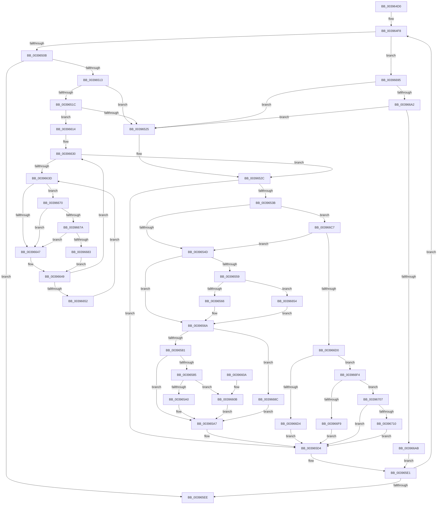

# KiWakeOtherQueueWaiters

- RVA: `0x003964D0`–`0x00396719` (길이 `585` bytes)
- VA: `0x00000001403964D0`
- 실행 섹션: `.text`
- PDB 이름 있음: `예`; PDB Function 태그: `아니요`
- unwind 정보 RVA: `0x00081248`
- 디코드: `148`개 명령, `585/585` bytes 표시
- 미해석 바이트: `0` (있으면 어셈블리에 `.byte`로 보존)

> 이 문서는 커널 이미지의 기계어와 PDB 기호를 분석해 생성했습니다. 4번과 5번은 함수 원형과 자료형을 바이너리 사용 방식에서 추정한 C 해석이며 원본 소스 복구 결과는 아닙니다.

## 1. Dependencies

- 직접 호출 지점: **4**; 고유 호출 대상: **4**
- 직접 호출자로 확인된 함수: **15**
- RIP 상대 이미지 참조: **2**

### Outgoing calls
- `0x0039656D` → [KiRemovePrcbWaitEntry](../25/KiRemovePrcbWaitEntry_function_002502D0.md) (function, `0x002502D0`)
- `0x0039667A` → [KiCheckVpBackingLongSpinWaitHypercall](../30/KiCheckVpBackingLongSpinWaitHypercall_function_0030F490.md) (function, `0x0030F490`)
- `0x00396685` → [HvlNotifyLongSpinWait](../30/HvlNotifyLongSpinWait_function_0030F460.md) (function, `0x0030F460`)
- `0x003966BD` → [KiInsertQueueInternal](../21/KiInsertQueueInternal_function_00219B30.md) (function, `0x00219B30`)

### Direct callers
- [KiInsertQueueInternal](../21/KiInsertQueueInternal_function_00219B30.md) at `0x00219CDF`
- [IoSetIoCompletionEx3](../24/IoSetIoCompletionEx3_function_0024EEE0.md) at `0x0024F1DA`
- [IopCompleteIrpInFileObjectList](../24/IopCompleteIrpInFileObjectList_function_0024F330.md) at `0x0024F5D9`
- [IoSetIoCompletionEx](../24/IoSetIoCompletionEx_function_0024FA80.md) at `0x0024FD09`
- [sub_0024FEBE](../24/Unknown_function_0024FEBE.md) at `0x00250105`
- [AlpcpSignalAndWait](../2F/AlpcpSignalAndWait_function_002F9620.md) at `0x002F9AC7`
- [sub_00343D34](../34/Unknown_function_00343D34.md) at `0x00343DDA`
- [AlpcpSignal](AlpcpSignal_function_003955E0.md) at `0x00395869`
- [AlpcpQueueIoCompletion](AlpcpQueueIoCompletion_function_00397480.md) at `0x0039776D`
- [sub_00397982](Unknown_function_00397982.md) at `0x00397B1B`
- [AlpcpQueueIoCompletionPort](../3F/AlpcpQueueIoCompletionPort_function_003FF760.md) at `0x003FFC5D`
- [IopPassiveInterruptDpc](../46/IopPassiveInterruptDpc_function_00469D40.md) at `0x00469EAD`
- [KeInsertQueue](../46/KeInsertQueue_function_0046C8F0.md) at `0x0046CA46`
- [FsRtlpPostStackOverflow](../58/FsRtlpPostStackOverflow_function_0058351C.md) at `0x00583686`
- [KeInsertHeadQueue](../5B/KeInsertHeadQueue_function_005BE5D0.md) at `0x005BE6C4`

### Static image references
- `0x0039663F` → RVA `0x00FC52AC` (`ALMOSTRO`; reference)
- `0x00396670` → RVA `0x00FC6AB8` (`ALMOSTRO`; read)

## 2. Other-region calls and transfers

- 다른 실행 섹션으로 향하는 call: **0**
- 별도 외부 분기/꼬리 이동을 확인하지 못했습니다.

## 3. Assembly (complete function range)

```asm
003964D0  48 89 5C 24 10                  mov qword ptr [rsp + 0x10], rbx
003964D5  48 89 6C 24 18                  mov qword ptr [rsp + 0x18], rbp
003964DA  56                              push rsi
003964DB  57                              push rdi
003964DC  41 55                           push r13
003964DE  41 56                           push r14
003964E0  41 57                           push r15
003964E2  48 83 EC 20                     sub rsp, 0x20
003964E6  48 8B 72 10                     mov rsi, qword ptr [rdx + 0x10]
003964EA  4C 8B F2                        mov r14, rdx
003964ED  4C 8B F9                        mov r15, rcx
003964F0  4C 89 64 24 50                  mov qword ptr [rsp + 0x50], r12
003964F5  45 33 ED                        xor r13d, r13d
003964F8  48 8B FE                        mov rdi, rsi
003964FB  48 8B 76 08                     mov rsi, qword ptr [rsi + 8]
003964FF  0F B6 47 10                     movzx eax, byte ptr [rdi + 0x10]
00396503  3C 02                           cmp al, 2
00396505  0F 84 8A 01 00 00               je 0x140396695
0039650B  3C 01                           cmp al, 1
0039650D  0F 85 DB 00 00 00               jne 0x1403965ee
00396513  48 8B 07                        mov rax, qword ptr [rdi]
00396516  48 39 78 08                     cmp qword ptr [rax + 8], rdi
0039651A  75 09                           jne 0x140396525
0039651C  48 39 3E                        cmp qword ptr [rsi], rdi
0039651F  0F 84 EF 00 00 00               je 0x140396614
00396525  B9 03 00 00 00                  mov ecx, 3
0039652A  CD 29                           int 0x29
0039652C  0F B6 83 84 01 00 00            movzx eax, byte ptr [rbx + 0x184]
00396533  3C 05                           cmp al, 5
00396535  0F 85 99 00 00 00               jne 0x1403965d4
0039653B  0F B6 4B 70                     movzx ecx, byte ptr [rbx + 0x70]
0039653F  8B C1                           mov eax, ecx
00396541  83 E0 07                        and eax, 7
00396544  83 F8 01                        cmp eax, 1
00396547  0F 85 7A 01 00 00               jne 0x1403966c7
0039654D  48 8B 93 E8 00 00 00            mov rdx, qword ptr [rbx + 0xe8]
00396554  48 85 D2                        test rdx, rdx
00396557  74 11                           je 0x14039656a
00396559  0F B6 02                        movzx eax, byte ptr [rdx]
0039655C  24 7F                           and al, 0x7f
0039655E  3C 15                           cmp al, 0x15
00396560  0F 84 EE 00 00 00               je 0x140396654
00396566  F0 FF 42 28                     lock inc dword ptr [rdx + 0x28]
0039656A  48 8B CB                        mov rcx, rbx
0039656D  E8 5E 9D EB FF                  call 0x1402502d0
00396572  0F B6 83 84 01 00 00            movzx eax, byte ptr [rbx + 0x184]
00396579  3C 01                           cmp al, 1
0039657B  0F 84 0B 01 00 00               je 0x14039668c
00396581  3C 05                           cmp al, 5
00396583  75 22                           jne 0x1403965a7
00396585  48 B8 20 03 00 00 80 F7 FF FF   movabs rax, 0xfffff78000000320
0039658F  8B 08                           mov ecx, dword ptr [rax]
00396591  2B 8B B4 01 00 00               sub ecx, dword ptr [rbx + 0x1b4]
00396597  44 38 AB 87 01 00 00            cmp byte ptr [rbx + 0x187], r13b
0039659E  74 6B                           je 0x14039660b
003965A0  48 01 8B E8 03 00 00            add qword ptr [rbx + 0x3e8], rcx
003965A7  C6 83 84 01 00 00 07            mov byte ptr [rbx + 0x184], 7
003965AE  48 8D 8B D8 00 00 00            lea rcx, [rbx + 0xd8]
003965B5  49 8B 87 08 2D 00 00            mov rax, qword ptr [r15 + 0x2d08]
003965BC  48 89 01                        mov qword ptr [rcx], rax
003965BF  49 89 8F 08 2D 00 00            mov qword ptr [r15 + 0x2d08], rcx
003965C6  4C 89 A3 C8 00 00 00            mov qword ptr [rbx + 0xc8], r12
003965CD  4C 89 AB D0 03 00 00            mov qword ptr [rbx + 0x3d0], r13
003965D4  4C 89 6B 40                     mov qword ptr [rbx + 0x40], r13
003965D8  0F B6 47 11                     movzx eax, byte ptr [rdi + 0x11]
003965DC  FE C0                           inc al
003965DE  88 47 11                        mov byte ptr [rdi + 0x11], al
003965E1  49 8D 46 08                     lea rax, [r14 + 8]
003965E5  48 3B F0                        cmp rsi, rax
003965E8  0F 85 0A FF FF FF               jne 0x1403964f8
003965EE  4C 8B 64 24 50                  mov r12, qword ptr [rsp + 0x50]
003965F3  48 8B 5C 24 58                  mov rbx, qword ptr [rsp + 0x58]
003965F8  48 8B 6C 24 60                  mov rbp, qword ptr [rsp + 0x60]
003965FD  48 83 C4 20                     add rsp, 0x20
00396601  41 5F                           pop r15
00396603  41 5E                           pop r14
00396605  41 5D                           pop r13
00396607  5F                              pop rdi
00396608  5E                              pop rsi
00396609  C3                              ret
0039660A  CC                              int3
0039660B  48 01 8B E0 03 00 00            add qword ptr [rbx + 0x3e0], rcx
00396612  EB 93                           jmp 0x1403965a7
00396614  48 89 06                        mov qword ptr [rsi], rax
00396617  41 8B ED                        mov ebp, r13d
0039661A  48 89 70 08                     mov qword ptr [rax + 8], rsi
0039661E  44 0F B7 67 12                  movzx r12d, word ptr [rdi + 0x12]
00396623  48 8B 5F 18                     mov rbx, qword ptr [rdi + 0x18]
00396627  66 0F 1F 84 00 00 00 00 00      nop word ptr [rax + rax]
00396630  F0 48 0F BA 6B 40 00            lock bts qword ptr [rbx + 0x40], 0
00396637  0F 83 EF FE FF FF               jae 0x14039652c
0039663D  FF C5                           inc ebp
0039663F  85 2D 67 EC C2 00               test dword ptr [rip + 0xc2ec67], ebp
00396645  74 29                           je 0x140396670
00396647  F3 90                           pause
00396649  48 8B 43 40                     mov rax, qword ptr [rbx + 0x40]
0039664D  48 85 C0                        test rax, rax
00396650  74 DE                           je 0x140396630
00396652  EB E9                           jmp 0x14039663d
00396654  8B 83 1C 02 00 00               mov eax, dword ptr [rbx + 0x21c]
0039665A  0F B6 C0                        movzx eax, al
0039665D  89 83 1C 02 00 00               mov dword ptr [rbx + 0x21c], eax
00396663  F0 FF 84 82 18 02 00 00         lock inc dword ptr [rdx + rax*4 + 0x218]
0039666B  E9 FA FE FF FF                  jmp 0x14039656a
00396670  8B 05 42 04 C3 00               mov eax, dword ptr [rip + 0xc30442]
00396676  A8 40                           test al, 0x40
00396678  74 CD                           je 0x140396647
0039667A  E8 11 8E F7 FF                  call 0x14030f490
0039667F  84 C0                           test al, al
00396681  74 C4                           je 0x140396647
00396683  8B CD                           mov ecx, ebp
00396685  E8 D6 8D F7 FF                  call 0x14030f460
0039668A  EB BD                           jmp 0x140396649
0039668C  83 4B 74 02                     or dword ptr [rbx + 0x74], 2
00396690  E9 12 FF FF FF                  jmp 0x1403965a7
00396695  48 8B 07                        mov rax, qword ptr [rdi]
00396698  48 39 78 08                     cmp qword ptr [rax + 8], rdi
0039669C  0F 85 83 FE FF FF               jne 0x140396525
003966A2  48 39 3E                        cmp qword ptr [rsi], rdi
003966A5  0F 85 7A FE FF FF               jne 0x140396525
003966AB  48 89 06                        mov qword ptr [rsi], rax
003966AE  48 8B D7                        mov rdx, rdi
003966B1  48 89 70 08                     mov qword ptr [rax + 8], rsi
003966B5  C6 47 11 05                     mov byte ptr [rdi + 0x11], 5
003966B9  48 8B 4F 18                     mov rcx, qword ptr [rdi + 0x18]
003966BD  E8 6E 34 E8 FF                  call 0x140219b30
003966C2  E9 1A FF FF FF                  jmp 0x1403965e1
003966C7  83 F8 04                        cmp eax, 4
003966CA  0F 84 7D FE FF FF               je 0x14039654d
003966D0  85 C0                           test eax, eax
003966D2  75 20                           jne 0x1403966f4
003966D4  80 E1 FA                        and cl, 0xfa
003966D7  80 C9 02                        or cl, 2
003966DA  88 4B 70                        mov byte ptr [rbx + 0x70], cl
003966DD  4C 89 A3 C8 00 00 00            mov qword ptr [rbx + 0xc8], r12
003966E4  4C 89 AB D0 03 00 00            mov qword ptr [rbx + 0x3d0], r13
003966EB  44 88 6F 11                     mov byte ptr [rdi + 0x11], r13b
003966EF  E9 E0 FE FF FF                  jmp 0x1403965d4
003966F4  83 F8 05                        cmp eax, 5
003966F7  75 0E                           jne 0x140396707
003966F9  80 E1 FE                        and cl, 0xfe
003966FC  80 C9 06                        or cl, 6
003966FF  88 4B 70                        mov byte ptr [rbx + 0x70], cl
00396702  E9 CD FE FF FF                  jmp 0x1403965d4
00396707  83 F8 03                        cmp eax, 3
0039670A  0F 85 C4 FE FF FF               jne 0x1403965d4
00396710  C6 47 11 02                     mov byte ptr [rdi + 0x11], 2
00396714  E9 BB FE FF FF                  jmp 0x1403965d4
```

## 4. C-style interpretation (structured pseudocode)

```c
__int64 __fastcall KiWakeOtherQueueWaiters(__int64 a1, __int64 a2)
{
    __int64 result;
    __int64 v_r13;
    __int64 v_rbp;
    __int64 v_rsp;
    unsigned __int64 v_stack_p10;
    unsigned __int64 v_stack_p18;
    unsigned __int64 v_stack_p8;

    v_stack_p10 = v_rbx;
    v_stack_p18 = v_rbp;
    v_rsp = (v_rsp) - (32);
    v_stack_p8 = v_r12;
    v_r13 = 0;
loc_003964F8:
    if (((unsigned __int8)(*(unsigned __int8 *)(*(unsigned __int64 *)(a2 + 16) + 16))) == 2) goto loc_00396695;
    if (((unsigned __int8)(*(unsigned __int8 *)(*(unsigned __int64 *)(a2 + 16) + 16))) != 1) goto loc_003965EE;
    if ((*(unsigned __int64 *)(*(unsigned __int64 *)(*(unsigned __int64 *)(a2 + 16)) + 8)) != (*(unsigned __int64 *)(a2 + 16))) goto loc_00396525;
    if ((*(unsigned __int64 *)(*(unsigned __int64 *)(*(unsigned __int64 *)(a2 + 16) + 8))) == (*(unsigned __int64 *)(a2 + 16))) goto loc_00396614;
loc_00396525:
loc_0039652C:
    if (((unsigned __int8)(*(unsigned __int8 *)(v_rbx + 388))) != 5) goto loc_003965D4;
    result = (unsigned int)(((unsigned int)((unsigned int)(*(unsigned __int8 *)(v_rbx + 112)))) & (7));
    if (((unsigned int)(result)) != 1) goto loc_003966C7;
loc_0039654D:
    if (*(unsigned __int64 *)(v_rbx + 232) == 0) goto loc_0039656A;
    result = (unsigned __int8)((*(unsigned __int8 *)(*(unsigned __int64 *)(v_rbx + 232))) & (127));
    if (((unsigned __int8)(result)) == 21) goto loc_00396654;
loc_0039656A:
    result = KiRemovePrcbWaitEntry(v_rbx, *(unsigned __int64 *)(v_rbx + 232), a3, a4);
    if (((unsigned __int8)(*(unsigned __int8 *)(v_rbx + 388))) == 1) goto loc_0039668C;
    if (((unsigned __int8)(*(unsigned __int8 *)(v_rbx + 388))) != 5) goto loc_003965A7;
    a1 = (unsigned int)(((unsigned int)(*(unsigned int *)(*(unsigned __int8 *)(v_rbx + 388)))) - (*(unsigned int *)(v_rbx + 436)));
    if ((*(unsigned __int8 *)(v_rbx + 391)) == 0) goto loc_0039660B;
loc_003965A7:
    *(unsigned __int8 *)(v_rbx + 388) = 7;
    *(unsigned __int64 *)(v_rbx + 216) = *(unsigned __int64 *)(a1 + 11528);
    *(unsigned __int64 *)(a1 + 11528) = v_rbx + 216;
    *(unsigned __int64 *)(v_rbx + 200) = v_r12;
    *(unsigned __int64 *)(v_rbx + 976) = 0;
loc_003965D4:
    *(unsigned __int64 *)(v_rbx + 64) = 0;
    result = (unsigned __int8)((*(unsigned __int8 *)(*(unsigned __int64 *)(a2 + 16) + 17)) + 1);
    *(unsigned __int8 *)(*(unsigned __int64 *)(a2 + 16) + 17) = (unsigned __int8)(result);
loc_003965E1:
    if ((*(unsigned __int64 *)(*(unsigned __int64 *)(a2 + 16) + 8)) != (a2 + 8)) goto loc_003964F8;
loc_003965EE:
    v_rsp = (v_rsp) + (32);
    return a2 + 8;
loc_0039660B:
    goto loc_003965A7;
loc_00396614:
    *(unsigned __int64 *)(*(unsigned __int64 *)(*(unsigned __int64 *)(a2 + 16) + 8)) = a2 + 8;
    *(unsigned __int64 *)(a2 + 8 + 8) = *(unsigned __int64 *)(*(unsigned __int64 *)(a2 + 16) + 8);
loc_00396630:
    if (condition_is_above_or_equal) goto loc_0039652C;
loc_0039663D:
    v_rbp = (unsigned int)((0) + 1);
    if (((*(unsigned int *)(v_rip + 12774503)) & ((unsigned int)(v_rbp))) == 0) goto loc_00396670;
loc_00396647:
loc_00396649:
    if (*(unsigned __int64 *)(*(unsigned __int64 *)(*(unsigned __int64 *)(a2 + 16) + 24) + 64) == 0) goto loc_00396630;
    goto loc_0039663D;
loc_00396654:
    *(unsigned int *)(*(unsigned __int64 *)(*(unsigned __int64 *)(a2 + 16) + 24) + 540) = (unsigned int)((unsigned __int8)((unsigned int)(*(unsigned int *)(*(unsigned __int64 *)(*(unsigned __int64 *)(a2 + 16) + 24) + 540))));
    goto loc_0039656A;
loc_00396670:
    if ((((unsigned __int8)((unsigned int)(*(unsigned int *)(v_rip + 12780610)))) & (64)) == 0) goto loc_00396647;
    result = KiCheckVpBackingLongSpinWaitHypercall(v_rbx + 216, *(unsigned __int64 *)(v_rbx + 232), a3, a4);
    if ((unsigned __int8)(result) == 0) goto loc_00396647;
    result = HvlNotifyLongSpinWait((unsigned int)((unsigned int)(v_rbp)), *(unsigned __int64 *)(v_rbx + 232), a3, a4);
    goto loc_00396649;
loc_0039668C:
    goto loc_003965A7;
loc_00396695:
    if ((*(unsigned __int64 *)(*(unsigned __int64 *)(*(unsigned __int64 *)(a2 + 16)) + 8)) != (*(unsigned __int64 *)(a2 + 16))) goto loc_00396525;
    if ((*(unsigned __int64 *)(*(unsigned __int64 *)(*(unsigned __int64 *)(a2 + 16) + 8))) != (*(unsigned __int64 *)(a2 + 16))) goto loc_00396525;
    *(unsigned __int64 *)(*(unsigned __int64 *)(*(unsigned __int64 *)(a2 + 16) + 8)) = *(unsigned __int64 *)(*(unsigned __int64 *)(a2 + 16));
    *(unsigned __int64 *)(*(unsigned __int64 *)(*(unsigned __int64 *)(a2 + 16)) + 8) = *(unsigned __int64 *)(*(unsigned __int64 *)(a2 + 16) + 8);
    *(unsigned __int8 *)(*(unsigned __int64 *)(a2 + 16) + 17) = 5;
    result = KiInsertQueueInternal(*(unsigned __int64 *)(*(unsigned __int64 *)(a2 + 16) + 24), *(unsigned __int64 *)(a2 + 16), a3, a4);
    goto loc_003965E1;
loc_003966C7:
    if (((unsigned int)(result)) == 4) goto loc_0039654D;
    if ((unsigned int)(result) != 0) goto loc_003966F4;
    a1 = (unsigned __int8)((*(unsigned __int64 *)(*(unsigned __int64 *)(a2 + 16) + 24)) & (250));
    a1 = (unsigned __int8)((a1) | (2));
    *(unsigned __int8 *)(*(unsigned __int64 *)(*(unsigned __int64 *)(a2 + 16) + 24) + 112) = (unsigned __int8)(a1);
    *(unsigned __int64 *)(*(unsigned __int64 *)(*(unsigned __int64 *)(a2 + 16) + 24) + 200) = *(unsigned __int16 *)(*(unsigned __int64 *)(a2 + 16) + 18);
    *(unsigned __int64 *)(*(unsigned __int64 *)(*(unsigned __int64 *)(a2 + 16) + 24) + 976) = 0;
    *(unsigned __int8 *)(*(unsigned __int64 *)(a2 + 16) + 17) = 0;
    goto loc_003965D4;
loc_003966F4:
    if (((unsigned int)(result)) != 5) goto loc_00396707;
    a1 = (unsigned __int8)((a1) & (254));
    a1 = (unsigned __int8)((a1) | (6));
    *(unsigned __int8 *)(*(unsigned __int64 *)(*(unsigned __int64 *)(a2 + 16) + 24) + 112) = (unsigned __int8)(a1);
    goto loc_003965D4;
loc_00396707:
    if (((unsigned int)(result)) != 3) goto loc_003965D4;
    *(unsigned __int8 *)(*(unsigned __int64 *)(a2 + 16) + 17) = 2;
    goto loc_003965D4;
}
```

## 5. (Beta) C Style

```c
void *KiWakeOtherQueueWaiters(void *Arg1, void *Arg2)
{
    uint8_t *arg1 = (uint8_t *)Arg1;
    uint8_t *arg2 = (uint8_t *)Arg2;

    int64_t result;
    int64_t local_r13;
    int64_t local_rbp;
    int64_t local_rsp;
    uint64_t v_stack_p10;
    uint64_t v_stack_p18;
    uint64_t v_stack_p8;

    v_stack_p10 = local_rbx;
    v_stack_p18 = local_rbp;
    local_rsp = (local_rsp) - (32);
    v_stack_p8 = local_r12;
    local_r13 = 0;
loc_003964F8:
    if (((uint8_t)(*(uint8_t *)(*(uint64_t *)(arg2 + 0x10) + 0x10))) == 2) goto loc_00396695;
    if (((uint8_t)(*(uint8_t *)(*(uint64_t *)(arg2 + 0x10) + 0x10))) != 1) goto loc_003965EE;
    if ((*(uint64_t *)(*(uint64_t *)(*(uint64_t *)(arg2 + 0x10)) + 0x8)) != (*(uint64_t *)(arg2 + 0x10))) goto loc_00396525;
    if ((*(uint64_t *)(*(uint64_t *)(*(uint64_t *)(arg2 + 0x10) + 0x8))) == (*(uint64_t *)(arg2 + 0x10))) goto loc_00396614;
loc_00396525:
loc_0039652C:
    if (((uint8_t)(*(uint8_t *)(local_rbx + 0x184))) != 5) goto loc_003965D4;
    result = (uint32_t)(((uint32_t)((uint32_t)(*(uint8_t *)(local_rbx + 0x70)))) & (7));
    if (((uint32_t)(result)) != 1) goto loc_003966C7;
loc_0039654D:
    if (*(uint64_t *)(local_rbx + 0xE8) == 0) goto loc_0039656A;
    result = (uint8_t)((*(uint8_t *)(*(uint64_t *)(local_rbx + 0xE8))) & (127));
    if (((uint8_t)(result)) == 21) goto loc_00396654;
loc_0039656A:
    result = KiRemovePrcbWaitEntry(local_rbx, *(uint64_t *)(local_rbx + 0xE8), a3, a4);
    if (((uint8_t)(*(uint8_t *)(local_rbx + 0x184))) == 1) goto loc_0039668C;
    if (((uint8_t)(*(uint8_t *)(local_rbx + 0x184))) != 5) goto loc_003965A7;
    Arg1 = (uint32_t)(((uint32_t)(*(uint32_t *)(*(uint8_t *)(local_rbx + 0x184)))) - (*(uint32_t *)(local_rbx + 0x1B4)));
    if ((*(uint8_t *)(local_rbx + 0x187)) == 0) goto loc_0039660B;
loc_003965A7:
    *(uint8_t *)(local_rbx + 0x184) = 7;
    *(uint64_t *)(local_rbx + 0xD8) = *(uint64_t *)(arg1 + 0x2D08);
    *(uint64_t *)(arg1 + 0x2D08) = local_rbx + 216;
    *(uint64_t *)(local_rbx + 0xC8) = local_r12;
    *(uint64_t *)(local_rbx + 0x3D0) = 0;
loc_003965D4:
    *(uint64_t *)(local_rbx + 0x40) = 0;
    result = (uint8_t)((*(uint8_t *)(*(uint64_t *)(arg2 + 0x10) + 0x11)) + 1);
    *(uint8_t *)(*(uint64_t *)(arg2 + 0x10) + 0x11) = (uint8_t)(result);
loc_003965E1:
    if ((*(uint64_t *)(*(uint64_t *)(arg2 + 0x10) + 0x8)) != (Arg2 + 8)) goto loc_003964F8;
loc_003965EE:
    local_rsp = (local_rsp) + (32);
    return Arg2 + 8;
loc_0039660B:
    goto loc_003965A7;
loc_00396614:
    *(void **)(*(uint64_t *)(*(uint64_t *)(arg2 + 0x10) + 0x8)) = Arg2 + 8;
    *(uint64_t *)(arg2 + 0x8 + 0x8) = *(uint64_t *)(*(uint64_t *)(arg2 + 0x10) + 0x8);
loc_00396630:
    if (condition_is_above_or_equal) goto loc_0039652C;
loc_0039663D:
    local_rbp = (uint32_t)((0) + 1);
    if (((*(uint32_t *)(v_rip + 0xC2EC67)) & ((uint32_t)(local_rbp))) == 0) goto loc_00396670;
loc_00396647:
loc_00396649:
    if (*(uint64_t *)(*(uint64_t *)(*(uint64_t *)(arg2 + 0x10) + 0x18) + 0x40) == 0) goto loc_00396630;
    goto loc_0039663D;
loc_00396654:
    *(uint32_t *)(*(uint64_t *)(*(uint64_t *)(arg2 + 0x10) + 0x18) + 0x21C) = (uint32_t)((uint8_t)((uint32_t)(*(uint32_t *)(*(uint64_t *)(*(uint64_t *)(arg2 + 0x10) + 0x18) + 0x21C))));
    goto loc_0039656A;
loc_00396670:
    if ((((uint8_t)((uint32_t)(*(uint32_t *)(v_rip + 0xC30442)))) & (64)) == 0) goto loc_00396647;
    result = KiCheckVpBackingLongSpinWaitHypercall(local_rbx + 216, *(uint64_t *)(local_rbx + 0xE8), a3, a4);
    if ((uint8_t)(result) == 0) goto loc_00396647;
    result = HvlNotifyLongSpinWait((uint32_t)((uint32_t)(local_rbp)), *(uint64_t *)(local_rbx + 0xE8), a3, a4);
    goto loc_00396649;
loc_0039668C:
    goto loc_003965A7;
loc_00396695:
    if ((*(uint64_t *)(*(uint64_t *)(*(uint64_t *)(arg2 + 0x10)) + 0x8)) != (*(uint64_t *)(arg2 + 0x10))) goto loc_00396525;
    if ((*(uint64_t *)(*(uint64_t *)(*(uint64_t *)(arg2 + 0x10) + 0x8))) != (*(uint64_t *)(arg2 + 0x10))) goto loc_00396525;
    *(uint64_t *)(*(uint64_t *)(*(uint64_t *)(arg2 + 0x10) + 0x8)) = *(uint64_t *)(*(uint64_t *)(arg2 + 0x10));
    *(uint64_t *)(*(uint64_t *)(*(uint64_t *)(arg2 + 0x10)) + 0x8) = *(uint64_t *)(*(uint64_t *)(arg2 + 0x10) + 0x8);
    *(uint8_t *)(*(uint64_t *)(arg2 + 0x10) + 0x11) = 5;
    result = KiInsertQueueInternal(*(uint64_t *)(*(uint64_t *)(arg2 + 0x10) + 0x18), *(uint64_t *)(arg2 + 0x10), a3, a4);
    goto loc_003965E1;
loc_003966C7:
    if (((uint32_t)(result)) == 4) goto loc_0039654D;
    if ((uint32_t)(result) != 0) goto loc_003966F4;
    Arg1 = (uint8_t)((*(uint64_t *)(*(uint64_t *)(arg2 + 0x10) + 0x18)) & (250));
    Arg1 = (uint8_t)((Arg1) | (2));
    *(uint8_t *)(*(uint64_t *)(*(uint64_t *)(arg2 + 0x10) + 0x18) + 0x70) = (uint8_t)(Arg1);
    *(uint64_t *)(*(uint64_t *)(*(uint64_t *)(arg2 + 0x10) + 0x18) + 0xC8) = *(uint16_t *)(*(uint64_t *)(arg2 + 0x10) + 0x12);
    *(uint64_t *)(*(uint64_t *)(*(uint64_t *)(arg2 + 0x10) + 0x18) + 0x3D0) = 0;
    *(uint8_t *)(*(uint64_t *)(arg2 + 0x10) + 0x11) = 0;
    goto loc_003965D4;
loc_003966F4:
    if (((uint32_t)(result)) != 5) goto loc_00396707;
    Arg1 = (uint8_t)((Arg1) & (254));
    Arg1 = (uint8_t)((Arg1) | (6));
    *(uint8_t *)(*(uint64_t *)(*(uint64_t *)(arg2 + 0x10) + 0x18) + 0x70) = (uint8_t)(Arg1);
    goto loc_003965D4;
loc_00396707:
    if (((uint32_t)(result)) != 3) goto loc_003965D4;
    *(uint8_t *)(*(uint64_t *)(arg2 + 0x10) + 0x11) = 2;
    goto loc_003965D4;
}
```

### 관측된 메모리 오프셋

구조체 형식이 확인되지 않은 접근은 인자 기준의 오프셋으로만 기록했습니다.

| 기준 인자 | 오프셋 표현 | 폭 (bit) | 접근 |
|---|---:|---:|---|
| `Arg1` | `+ 0x2D08` | `64` | `R` |
| `Arg1` | `+ 0x2D08` | `64` | `W` |
| `Arg2` | `+ 0x8` | `64` | `R` |
| `Arg2` | `+ 0x10` | `64` | `R` |

## 6. Execution-region graph

[열기: 2D/3D 그래프와 함수 탐색 컨트롤 패널](../../../control-panel.html?section=text&rva=0x003964D0&view=graph)

- 2D 그래프는 위에서 아래로 흐르고, 3D 그래프는 빈 공간을 드래그해 회전합니다. Shift+드래그는 이동, 휠은 확대·축소, 함수 노드 선택은 대상 보고서 이동입니다.

### Static fallback


