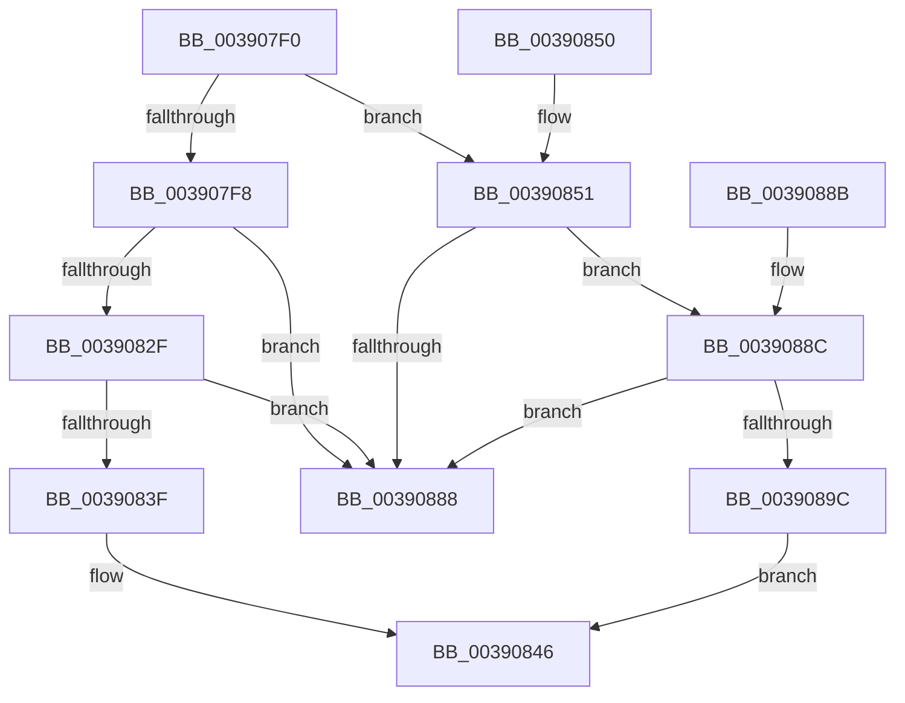

# MmRaisePoolQuota

- RVA: `0x003907F0`–`0x003908A5` (길이 `181` bytes)
- VA: `0x00000001403907F0`
- 실행 섹션: `.text`
- PDB 이름 있음: `예`; PDB Function 태그: `아니요`
- unwind 정보 RVA: `0x000DB714`
- 디코드: `48`개 명령, `181/181` bytes 표시
- 미해석 바이트: `0` (있으면 어셈블리에 `.byte`로 보존)

> 이 문서는 커널 이미지의 기계어와 PDB 기호를 분석해 생성했습니다. 4번과 5번은 함수 원형과 자료형을 바이너리 사용 방식에서 추정한 C 해석이며 원본 소스 복구 결과는 아닙니다.

## 1. Dependencies

- 직접 호출 지점: **0**; 고유 호출 대상: **0**
- 직접 호출자로 확인된 함수: **1**
- RIP 상대 이미지 참조: **8**

### Outgoing calls
- 직접 디코드된 call 명령이 없습니다.

### Direct callers
- [PspExpandQuota](PspExpandQuota_function_00390660.md) at `0x003906CD`

### Static image references
- `0x003907F8` → RVA `0x00E2CB48` (`.data`; read)
- `0x00390802` → RVA `0x00E2CB40` (`.data`; read)
- `0x0039082F` → RVA `0x00E2CBD8` (`.data`; read)
- `0x0039083F` → RVA `0x00E2CBD8` (`.data`; write)
- `0x00390851` → RVA `0x00E37650` (`.data`; read)
- `0x0039085B` → RVA `0x00E37660` (`.data`; read)
- `0x0039088C` → RVA `0x00E2CBD0` (`.data`; read)
- `0x0039089C` → RVA `0x00E2CBD0` (`.data`; write)

## 2. Other-region calls and transfers

- 다른 실행 섹션으로 향하는 call: **0**
- 별도 외부 분기/꼬리 이동을 확인하지 못했습니다.

## 3. Assembly (complete function range)

```asm
003907F0  4C 8B DA                        mov r11, rdx
003907F3  83 F9 01                        cmp ecx, 1
003907F6  74 59                           je 0x140390851
003907F8  48 8B 05 49 C3 A9 00            mov rax, qword ptr [rip + 0xa9c349]
003907FF  4D 85 C0                        test r8, r8
00390802  48 8B 15 37 C3 A9 00            mov rdx, qword ptr [rip + 0xa9c337]
00390809  41 BA 00 00 01 00               mov r10d, 0x10000
0039080F  4D 0F 45 D0                     cmovne r10, r8
00390813  48 2B D0                        sub rdx, rax
00390816  41 B8 00 00 10 00               mov r8d, 0x100000
0039081C  49 8B CA                        mov rcx, r10
0039081F  4D 3B D0                        cmp r10, r8
00390822  49 0F 42 C8                     cmovb rcx, r8
00390826  48 C1 E9 0C                     shr rcx, 0xc
0039082A  48 3B D1                        cmp rdx, rcx
0039082D  76 59                           jbe 0x140390888
0039082F  48 8B 0D A2 C3 A9 00            mov rcx, qword ptr [rip + 0xa9c3a2]
00390836  49 8D 14 0A                     lea rdx, [r10 + rcx]
0039083A  48 3B D1                        cmp rdx, rcx
0039083D  72 49                           jb 0x140390888
0039083F  48 89 15 92 C3 A9 00            mov qword ptr [rip + 0xa9c392], rdx
00390846  4B 8D 0C 13                     lea rcx, [r11 + r10]
0039084A  B0 01                           mov al, 1
0039084C  49 89 09                        mov qword ptr [r9], rcx
0039084F  C3                              ret
00390850  CC                              int3
00390851  48 8B 05 F8 6D AA 00            mov rax, qword ptr [rip + 0xaa6df8]
00390858  4D 85 C0                        test r8, r8
0039085B  48 8B 0D FE 6D AA 00            mov rcx, qword ptr [rip + 0xaa6dfe]
00390862  41 BA 00 00 08 00               mov r10d, 0x80000
00390868  4D 0F 45 D0                     cmovne r10, r8
0039086C  48 2B C8                        sub rcx, rax
0039086F  41 B8 00 00 10 00               mov r8d, 0x100000
00390875  49 8B C2                        mov rax, r10
00390878  4D 3B D0                        cmp r10, r8
0039087B  49 0F 42 C0                     cmovb rax, r8
0039087F  48 C1 E8 0C                     shr rax, 0xc
00390883  48 3B C8                        cmp rcx, rax
00390886  77 04                           ja 0x14039088c
00390888  32 C0                           xor al, al
0039088A  C3                              ret
0039088B  CC                              int3
0039088C  48 8B 05 3D C3 A9 00            mov rax, qword ptr [rip + 0xa9c33d]
00390893  49 8D 0C 02                     lea rcx, [r10 + rax]
00390897  48 3B C8                        cmp rcx, rax
0039089A  72 EC                           jb 0x140390888
0039089C  48 89 0D 2D C3 A9 00            mov qword ptr [rip + 0xa9c32d], rcx
003908A3  EB A1                           jmp 0x140390846
```

## 4. C-style interpretation (structured pseudocode)

```c
__int64 __fastcall MmRaisePoolQuota(int a1, __int64 a2, __int64 a3, __int64 a4)
{
    __int64 result;
    __int64 v_r10;

    if (a1 == 1) goto loc_00390851;
    v_r10 = (unsigned int)(0x10000ULL);
    if (a3 != 0) { v_r10 = a3; }
    a2 = (*(unsigned __int64 *)(v_rip + 11125559)) - (*(unsigned __int64 *)(v_rip + 11125577));
    a1 = v_r10;
    if (v_r10 < ((unsigned int)(0x100000ULL))) { a1 = (unsigned int)(0x100000ULL); }
    a1 = (a1) >> (12);
    if (a2 <= a1) goto loc_00390888;
    if ((v_r10 + *(unsigned __int64 *)(v_rip + 11125666) * 1) < (*(unsigned __int64 *)(v_rip + 11125666))) goto loc_00390888;
    *(unsigned __int64 *)(v_rip + 11125650) = v_r10 + *(unsigned __int64 *)(v_rip + 11125666) * 1;
loc_00390846:
    *(unsigned __int64 *)(a4) = a2 + v_r10 * 1;
    return 1;
loc_00390851:
    v_r10 = (unsigned int)(0x80000ULL);
    if ((unsigned int)(0x100000ULL) != 0) { v_r10 = (unsigned int)(0x100000ULL); }
    a1 = (*(unsigned __int64 *)(v_rip + 11169278)) - (*(unsigned __int64 *)(v_rip + 11169272));
    result = v_r10;
    if (v_r10 < ((unsigned int)(0x100000ULL))) { result = (unsigned int)(0x100000ULL); }
    result = (result) >> (12);
    if (a1 > result) goto loc_0039088C;
loc_00390888:
    result = 0;
    return result;
loc_0039088C:
    if ((v_r10 + *(unsigned __int64 *)(v_rip + 11125565) * 1) < (*(unsigned __int64 *)(v_rip + 11125565))) goto loc_00390888;
    *(unsigned __int64 *)(v_rip + 11125549) = v_r10 + *(unsigned __int64 *)(v_rip + 11125565) * 1;
    goto loc_00390846;
}
```

## 5. (Beta) C Style

```c
int64_t MmRaisePoolQuota(int32_t Arg1, void *Arg2, int64_t Arg3, void *Arg4)
{
    uint8_t *arg2 = (uint8_t *)Arg2;
    uint8_t *arg4 = (uint8_t *)Arg4;

    int64_t result;
    int64_t local_r10;

    if (Arg1 == 1) goto loc_00390851;
    local_r10 = (uint32_t)(0x10000ULL);
    if (Arg3 != 0) { local_r10 = Arg3; }
    Arg2 = (*(uint64_t *)(v_rip + 0xA9C337)) - (*(uint64_t *)(v_rip + 0xA9C349));
    Arg1 = local_r10;
    if (local_r10 < ((uint32_t)(0x100000ULL))) { Arg1 = (uint32_t)(0x100000ULL); }
    Arg1 = (Arg1) >> (12);
    if (Arg2 <= Arg1) goto loc_00390888;
    if ((local_r10 + *(uint64_t *)(v_rip + 0xA9C3A2) * 1) < (*(uint64_t *)(v_rip + 0xA9C3A2))) goto loc_00390888;
    *(uint64_t *)(v_rip + 0xA9C392) = local_r10 + *(uint64_t *)(v_rip + 0xA9C3A2) * 1;
loc_00390846:
    *(void **)(arg4) = Arg2 + local_r10 * 1;
    return 1;
loc_00390851:
    local_r10 = (uint32_t)(0x80000ULL);
    if ((uint32_t)(0x100000ULL) != 0) { local_r10 = (uint32_t)(0x100000ULL); }
    Arg1 = (*(uint64_t *)(v_rip + 0xAA6DFE)) - (*(uint64_t *)(v_rip + 0xAA6DF8));
    result = local_r10;
    if (local_r10 < ((uint32_t)(0x100000ULL))) { result = (uint32_t)(0x100000ULL); }
    result = (result) >> (12);
    if (Arg1 > result) goto loc_0039088C;
loc_00390888:
    result = 0;
    return result;
loc_0039088C:
    if ((local_r10 + *(uint64_t *)(v_rip + 0xA9C33D) * 1) < (*(uint64_t *)(v_rip + 0xA9C33D))) goto loc_00390888;
    *(uint64_t *)(v_rip + 0xA9C32D) = local_r10 + *(uint64_t *)(v_rip + 0xA9C33D) * 1;
    goto loc_00390846;
}
```

### 관측된 메모리 오프셋

구조체 형식이 확인되지 않은 접근은 인자 기준의 오프셋으로만 기록했습니다.

| 기준 인자 | 오프셋 표현 | 폭 (bit) | 접근 |
|---|---:|---:|---|
| `Arg2` | `+ 0x0 + r10*1` | `64` | `R` |
| `Arg4` | `+ 0x0` | `64` | `W` |

## 6. Execution-region graph

[열기: 2D/3D 그래프와 함수 탐색 컨트롤 패널](../../../control-panel.html?section=text&rva=0x003907F0&view=graph)

- 2D 그래프는 위에서 아래로 흐르고, 3D 그래프는 빈 공간을 드래그해 회전합니다. Shift+드래그는 이동, 휠은 확대·축소, 함수 노드 선택은 대상 보고서 이동입니다.

### Static fallback


