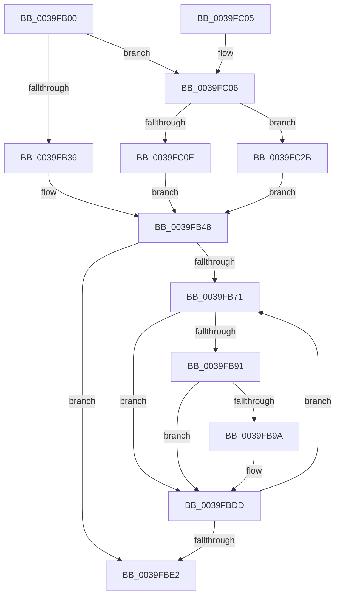

# PerfInfoLogInterrupt

- RVA: `0x0039FB00`–`0x0039FC44` (길이 `324` bytes)
- VA: `0x000000014039FB00`
- 실행 섹션: `.text`
- PDB 이름 있음: `예`; PDB Function 태그: `아니요`
- unwind 정보 RVA: `0x00081D48`
- 디코드: `75`개 명령, `324/324` bytes 표시
- 미해석 바이트: `0` (있으면 어셈블리에 `.byte`로 보존)

> 이 문서는 커널 이미지의 기계어와 PDB 기호를 분석해 생성했습니다. 4번과 5번은 함수 원형과 자료형을 바이너리 사용 방식에서 추정한 C 해석이며 원본 소스 복구 결과는 아닙니다.

## 1. Dependencies

- 직접 호출 지점: **2**; 고유 호출 대상: **2**
- 직접 호출자로 확인된 함수: **4**
- RIP 상대 이미지 참조: **2**

### Outgoing calls
- `0x0039FBD8` → [EtwpLogKernelEvent](../25/EtwpLogKernelEvent_function_0025CC00.md) (function, `0x0025CC00`)
- `0x0039FBEA` → [_security_check_cookie](../6A/_security_check_cookie_function_006AC640.md) (function, `0x006AC640`)

### Direct callers
- [KiInvokeInterruptServiceRoutine](KiInvokeInterruptServiceRoutine_function_0039F8E0.md) at `0x0039F9FB`
- [KiScanInterruptObjectList](../6B/KiScanInterruptObjectList_function_006B3860.md) at `0x006B3930`
- [KiInterruptSubDispatch](../6B/KiInterruptSubDispatch_function_006B3990.md) at `0x006B3A1A`
- [KiInterruptSubDispatchNoLock](../6B/KiInterruptSubDispatchNoLock_function_006B3A30.md) at `0x006B3AB7`

### Static image references
- `0x0039FB14` → RVA `0x00E0A740` (`.data`; read)
- `0x0039FB48` → RVA `0x00FC6AA8` (`ALMOSTRO`; read)

## 2. Other-region calls and transfers

- 다른 실행 섹션으로 향하는 call: **0**
- 별도 외부 분기/꼬리 이동을 확인하지 못했습니다.

## 3. Assembly (complete function range)

```asm
0039FB00  48 89 5C 24 08                  mov qword ptr [rsp + 8], rbx
0039FB05  48 89 6C 24 10                  mov qword ptr [rsp + 0x10], rbp
0039FB0A  48 89 74 24 18                  mov qword ptr [rsp + 0x18], rsi
0039FB0F  57                              push rdi
0039FB10  48 83 EC 70                     sub rsp, 0x70
0039FB14  48 8B 05 25 AC A6 00            mov rax, qword ptr [rip + 0xa6ac25]
0039FB1B  48 33 C4                        xor rax, rsp
0039FB1E  48 89 44 24 68                  mov qword ptr [rsp + 0x68], rax
0039FB23  33 ED                           xor ebp, ebp
0039FB25  49 8B F0                        mov rsi, r8
0039FB28  89 6C 24 3C                     mov dword ptr [rsp + 0x3c], ebp
0039FB2C  40 38 69 5D                     cmp byte ptr [rcx + 0x5d], bpl
0039FB30  0F 85 D0 00 00 00               jne 0x14039fc06
0039FB36  48 8B 41 18                     mov rax, qword ptr [rcx + 0x18]
0039FB3A  44 8D 4D 0C                     lea r9d, [rbp + 0xc]
0039FB3E  48 89 44 24 30                  mov qword ptr [rsp + 0x30], rax
0039FB43  BF 5F 0F 00 00                  mov edi, 0xf5f
0039FB48  48 8B 1D 59 6F C2 00            mov rbx, qword ptr [rip + 0xc26f59]
0039FB4F  48 8D 44 24 30                  lea rax, [rsp + 0x30]
0039FB54  89 54 24 38                     mov dword ptr [rsp + 0x38], edx
0039FB58  48 89 44 24 58                  mov qword ptr [rsp + 0x58], rax
0039FB5D  44 89 4C 24 60                  mov dword ptr [rsp + 0x60], r9d
0039FB62  8B 9B A8 11 00 00               mov ebx, dword ptr [rbx + 0x11a8]
0039FB68  0F BC CB                        bsf ecx, ebx
0039FB6B  89 6C 24 64                     mov dword ptr [rsp + 0x64], ebp
0039FB6F  74 71                           je 0x14039fbe2
0039FB71  48 8B 15 30 6F C2 00            mov rdx, qword ptr [rip + 0xc26f30]
0039FB78  8D 43 FF                        lea eax, [rbx - 1]
0039FB7B  23 D8                           and ebx, eax
0039FB7D  44 8B C1                        mov r8d, ecx
0039FB80  8B C1                           mov eax, ecx
0039FB82  48 C1 E0 05                     shl rax, 5
0039FB86  48 05 CC 11 00 00               add rax, 0x11cc
0039FB8C  48 03 C2                        add rax, rdx
0039FB8F  74 4C                           je 0x14039fbdd
0039FB91  F7 40 04 00 40 00 00            test dword ptr [rax + 4], 0x4000
0039FB98  74 43                           je 0x14039fbdd
0039FB9A  0F B6 84 4A 99 11 00 00         movzx eax, byte ptr [rdx + rcx*2 + 0x1199]
0039FBA2  41 B9 02 00 00 00               mov r9d, 2
0039FBA8  48 FF C8                        dec rax
0039FBAB  48 C7 44 24 50 08 00 00 00      mov qword ptr [rsp + 0x50], 8
0039FBB4  C7 44 24 28 02 0A 50 00         mov dword ptr [rsp + 0x28], 0x500a02
0039FBBC  66 89 7C 24 20                  mov word ptr [rsp + 0x20], di
0039FBC1  48 8D 0C C6                     lea rcx, [rsi + rax*8]
0039FBC5  48 89 4C 24 48                  mov qword ptr [rsp + 0x48], rcx
0039FBCA  48 8D 4C 24 48                  lea rcx, [rsp + 0x48]
0039FBCF  46 0F B6 84 42 98 11 00 00      movzx r8d, byte ptr [rdx + r8*2 + 0x1198]
0039FBD8  E8 23 D0 EB FF                  call 0x14025cc00
0039FBDD  0F BC CB                        bsf ecx, ebx
0039FBE0  75 8F                           jne 0x14039fb71
0039FBE2  48 8B 4C 24 68                  mov rcx, qword ptr [rsp + 0x68]
0039FBE7  48 33 CC                        xor rcx, rsp
0039FBEA  E8 51 CA 30 00                  call 0x1406ac640
0039FBEF  4C 8D 5C 24 70                  lea r11, [rsp + 0x70]
0039FBF4  49 8B 5B 10                     mov rbx, qword ptr [r11 + 0x10]
0039FBF8  49 8B 6B 18                     mov rbp, qword ptr [r11 + 0x18]
0039FBFC  49 8B 73 20                     mov rsi, qword ptr [r11 + 0x20]
0039FC00  49 8B E3                        mov rsp, r11
0039FC03  5F                              pop rdi
0039FC04  C3                              ret
0039FC05  CC                              int3
0039FC06  48 8B 41 20                     mov rax, qword ptr [rcx + 0x20]
0039FC0A  48 85 C0                        test rax, rax
0039FC0D  74 1C                           je 0x14039fc2b
0039FC0F  48 89 44 24 30                  mov qword ptr [rsp + 0x30], rax
0039FC14  BF 32 0F 00 00                  mov edi, 0xf32
0039FC19  8B 41 28                        mov eax, dword ptr [rcx + 0x28]
0039FC1C  41 B9 10 00 00 00               mov r9d, 0x10
0039FC22  89 44 24 3C                     mov dword ptr [rsp + 0x3c], eax
0039FC26  E9 1D FF FF FF                  jmp 0x14039fb48
0039FC2B  48 8B 41 18                     mov rax, qword ptr [rcx + 0x18]
0039FC2F  BF 43 0F 00 00                  mov edi, 0xf43
0039FC34  48 89 44 24 30                  mov qword ptr [rsp + 0x30], rax
0039FC39  41 B9 0C 00 00 00               mov r9d, 0xc
0039FC3F  E9 04 FF FF FF                  jmp 0x14039fb48
```

## 4. C-style interpretation (structured pseudocode)

```c
__int64 __fastcall PerfInfoLogInterrupt(__int64 a1, int a2, __int64 a3)
{
    __int64 result;
    __int64 v_rbp;
    __int64 v_rbx;
    __int64 v_rsp;
    unsigned __int64 v_stack_m10;
    unsigned int v_stack_m14;
    unsigned int v_stack_m18;
    unsigned __int64 v_stack_m20;
    unsigned __int64 v_stack_m28;
    unsigned __int64 v_stack_m30;
    unsigned int v_stack_m34;
    unsigned int v_stack_m3C;
    unsigned int v_stack_m40;
    unsigned __int64 v_stack_m48;
    unsigned int v_stack_m50;
    unsigned __int16 v_stack_m58;
    unsigned __int64 v_stack_m8;
    unsigned __int64 v_stack_p10;
    unsigned __int64 v_stack_p18;
    unsigned __int64 v_stack_p8;

    v_stack_p8 = v_rbx;
    v_stack_p10 = v_rbp;
    v_stack_p18 = v_rsi;
    v_rsp = (v_rsp) - (112);
    result = (*(unsigned __int64 *)(v_rip + 10923045)) ^ (v_rsp);
    v_stack_m10 = result;
    v_rbp = 0;
    v_stack_m3C = 0;
    if ((*(unsigned __int8 *)(a1 + 93)) != 0) goto loc_0039FC06;
    v_stack_m48 = *(unsigned __int64 *)(a1 + 24);
loc_0039FB48:
    v_stack_m40 = a2;
    v_stack_m20 = v_stack_m48;
    v_stack_m18 = (unsigned int)(v_rbp + 12);
    v_stack_m14 = 0;
    if ((*(unsigned __int8 *)(a1 + 93)) == 0) goto loc_0039FBE2;
loc_0039FB71:
    v_rbx = (unsigned int)(((unsigned int)(*(unsigned int *)(*(unsigned __int64 *)(v_rip + 12742489) + 4520))) & ((unsigned int)((unsigned int)(*(unsigned int *)(*(unsigned __int64 *)(v_rip + 12742489) + 4520)) - 1)));
    result = ((unsigned int)((unsigned int)(a1))) << (5);
    result = (result) + (0x11CCULL);
    result = (result) + (*(unsigned __int64 *)(v_rip + 12742448));
    if (condition_is_equal) goto loc_0039FBDD;
    if (((*(unsigned int *)(result + 4)) & (0x4000ULL)) != 0) {
        result = *(unsigned __int8 *)(*(unsigned __int64 *)(v_rip + 12742448) + a1 * 2 + 4505);
        a4 = 2;
        result = (result) - 1;
        v_stack_m28 = 8;
        v_stack_m50 = 0x500A02ULL;
        v_stack_m58 = (unsigned __int16)((unsigned int)(0xF5FULL));
        a1 = a3 + result * 8;
        v_stack_m30 = a1;
        a1 = v_stack_m30;
        a3 = *(unsigned __int8 *)(*(unsigned __int64 *)(v_rip + 12742448) + (unsigned int)((unsigned int)(a1)) * 2 + 4504);
        result = EtwpLogKernelEvent(a1, *(unsigned __int64 *)(v_rip + 12742448), a3, a4);
    }
    if (((*(unsigned int *)(result + 4)) & (0x4000ULL)) != 0) goto loc_0039FB71;
loc_0039FBE2:
    a1 = (v_stack_m10) ^ (v_rsp);
    result = _security_check_cookie(a1, *(unsigned __int64 *)(v_rip + 12742448), a3, a4);
    return result;
loc_0039FC06:
    if (*(unsigned __int64 *)(a1 + 32) == 0) goto loc_0039FC2B;
    v_stack_m40 = *(unsigned __int64 *)(a1 + 32);
    v_stack_m34 = (unsigned int)((unsigned int)(*(unsigned int *)(a1 + 40)));
    goto loc_0039FB48;
loc_0039FC2B:
    v_stack_m40 = *(unsigned __int64 *)(a1 + 24);
    goto loc_0039FB48;
}
```

## 5. (Beta) C Style

```c
int64_t PerfInfoLogInterrupt(void *Arg1, int32_t Arg2, void *Arg3)
{
    uint8_t *arg1 = (uint8_t *)Arg1;
    uint8_t *arg3 = (uint8_t *)Arg3;

    int64_t result;
    int64_t local_rbp;
    int64_t local_rbx;
    int64_t local_rsp;
    uint64_t v_stack_m10;
    uint32_t v_stack_m14;
    uint32_t v_stack_m18;
    uint64_t v_stack_m20;
    uint64_t v_stack_m28;
    uint64_t v_stack_m30;
    uint32_t v_stack_m34;
    uint32_t v_stack_m3C;
    uint32_t v_stack_m40;
    uint64_t v_stack_m48;
    uint32_t v_stack_m50;
    uint16_t v_stack_m58;
    uint64_t v_stack_m8;
    uint64_t v_stack_p10;
    uint64_t v_stack_p18;
    uint64_t v_stack_p8;

    v_stack_p8 = local_rbx;
    v_stack_p10 = local_rbp;
    v_stack_p18 = local_rsi;
    local_rsp = (local_rsp) - (112);
    result = (*(uint64_t *)(v_rip + 0xA6AC25)) ^ (local_rsp);
    v_stack_m10 = result;
    local_rbp = 0;
    v_stack_m3C = 0;
    if ((*(uint8_t *)(arg1 + 0x5D)) != 0) goto loc_0039FC06;
    v_stack_m48 = *(uint64_t *)(arg1 + 0x18);
loc_0039FB48:
    v_stack_m40 = Arg2;
    v_stack_m20 = v_stack_m48;
    v_stack_m18 = (uint32_t)(local_rbp + 12);
    v_stack_m14 = 0;
    if ((*(uint8_t *)(arg1 + 0x5D)) == 0) goto loc_0039FBE2;
loc_0039FB71:
    local_rbx = (uint32_t)(((uint32_t)(*(uint32_t *)(*(uint64_t *)(v_rip + 0xC26F59) + 0x11A8))) & ((uint32_t)((uint32_t)(*(uint32_t *)(*(uint64_t *)(v_rip + 0xC26F59) + 0x11A8)) - 1)));
    result = ((uint32_t)((uint32_t)(Arg1))) << (5);
    result = (result) + (0x11CCULL);
    result = (result) + (*(uint64_t *)(v_rip + 0xC26F30));
    if (condition_is_equal) goto loc_0039FBDD;
    if (((*(uint32_t *)(result + 0x4)) & (0x4000ULL)) != 0) {
        result = *(uint8_t *)(*(uint64_t *)(v_rip + 0xC26F30) + arg1 * 2 + 0x1199);
        a4 = 2;
        result = (result) - 1;
        v_stack_m28 = 8;
        v_stack_m50 = 0x500A02ULL;
        v_stack_m58 = (uint16_t)((uint32_t)(0xF5FULL));
        Arg1 = Arg3 + result * 8;
        v_stack_m30 = Arg1;
        Arg1 = v_stack_m30;
        Arg3 = *(uint8_t *)(*(uint64_t *)(v_rip + 0xC26F30) + (uint32_t)((uint32_t)(arg1)) * 2 + 0x1198);
        result = EtwpLogKernelEvent(Arg1, *(uint64_t *)(v_rip + 0xC26F30), Arg3, a4);
    }
    if (((*(uint32_t *)(result + 0x4)) & (0x4000ULL)) != 0) goto loc_0039FB71;
loc_0039FBE2:
    Arg1 = (v_stack_m10) ^ (local_rsp);
    result = _security_check_cookie(Arg1, *(uint64_t *)(v_rip + 0xC26F30), Arg3, a4);
    return result;
loc_0039FC06:
    if (*(uint64_t *)(arg1 + 0x20) == 0) goto loc_0039FC2B;
    v_stack_m40 = *(uint64_t *)(arg1 + 0x20);
    v_stack_m34 = (uint32_t)((uint32_t)(*(uint32_t *)(arg1 + 0x28)));
    goto loc_0039FB48;
loc_0039FC2B:
    v_stack_m40 = *(uint64_t *)(arg1 + 0x18);
    goto loc_0039FB48;
}
```

### 관측된 메모리 오프셋

구조체 형식이 확인되지 않은 접근은 인자 기준의 오프셋으로만 기록했습니다.

| 기준 인자 | 오프셋 표현 | 폭 (bit) | 접근 |
|---|---:|---:|---|
| `Arg1` | `+ 0x18` | `64` | `R` |
| `Arg1` | `+ 0x20` | `64` | `R` |
| `Arg1` | `+ 0x28` | `32` | `R` |
| `Arg1` | `+ 0x5D` | `8` | `R` |
| `Arg3` | `+ 0x0 + rax*8` | `64` | `R` |

## 6. Execution-region graph

[열기: 2D/3D 그래프와 함수 탐색 컨트롤 패널](../../../control-panel.html?section=text&rva=0x0039FB00&view=graph)

- 2D 그래프는 위에서 아래로 흐르고, 3D 그래프는 빈 공간을 드래그해 회전합니다. Shift+드래그는 이동, 휠은 확대·축소, 함수 노드 선택은 대상 보고서 이동입니다.

### Static fallback


