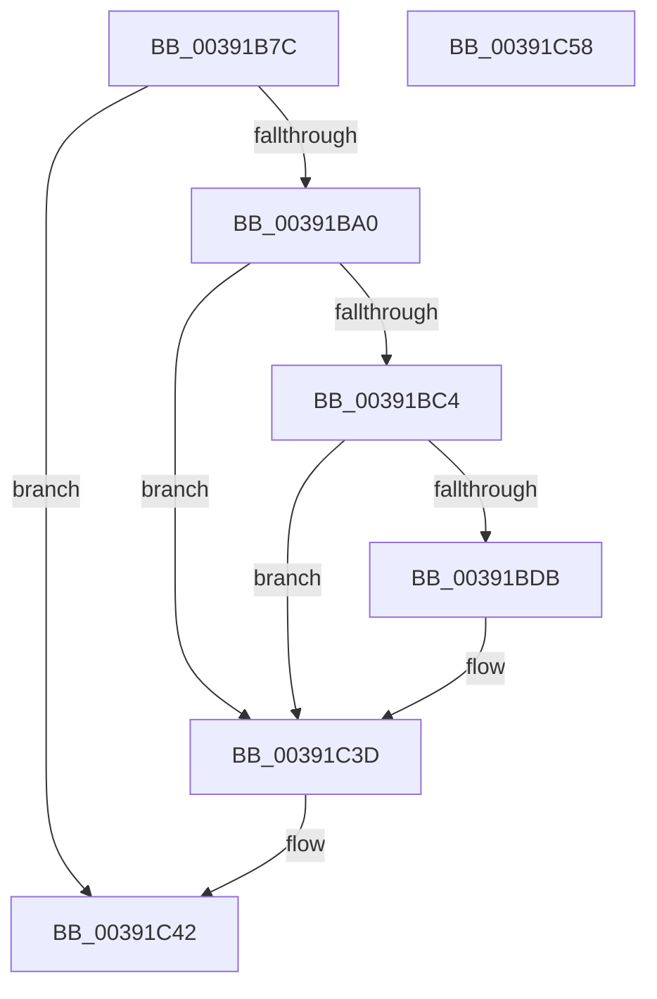

# PoDeviceReleaseIrp

- RVA: `0x00391B7C`–`0x00391C59` (길이 `221` bytes)
- VA: `0x0000000140391B7C`
- 실행 섹션: `.text`
- PDB 이름 있음: `예`; PDB Function 태그: `아니요`
- unwind 정보 RVA: `0x00080C0C`
- 디코드: `47`개 명령, `221/221` bytes 표시
- 미해석 바이트: `0` (있으면 어셈블리에 `.byte`로 보존)

> 이 문서는 커널 이미지의 기계어와 PDB 기호를 분석해 생성했습니다. 4번과 5번은 함수 원형과 자료형을 바이너리 사용 방식에서 추정한 C 해석이며 원본 소스 복구 결과는 아닙니다.

## 1. Dependencies

- 직접 호출 지점: **3**; 고유 호출 대상: **3**
- 직접 호출자로 확인된 함수: **2**
- RIP 상대 이미지 참조: **4**

### Outgoing calls
- `0x00391BD2` → [EtwEventEnabled](EtwEventEnabled_function_00392450.md) (function, `0x00392450`)
- `0x00391C38` → [EtwWriteEx](../25/EtwWriteEx_function_0025F0D0.md) (function, `0x0025F0D0`)
- `0x00391C4A` → [_security_check_cookie](../6A/_security_check_cookie_function_006AC640.md) (function, `0x006AC640`)

### Direct callers
- [IopfCompleteRequest](../29/IopfCompleteRequest_function_0029B5F8.md) at `0x0029B664`
- [IopfCompleteRequest](../29/IopfCompleteRequest_function_0029B5F8.md) at `0x0029B7BA`
- [PoHandleIrp](../47/PoHandleIrp_function_004709D0.md) at `0x00470AE8`

### Static image references
- `0x00391B85` → RVA `0x00E0A740` (`.data`; read)
- `0x00391BA0` → RVA `0x00E67858` (`.data`; read)
- `0x00391BC4` → RVA `0x00F0B408` (`.data`; read)
- `0x00391BCB` → RVA `0x000112A0` (`.rdata`; read)

## 2. Other-region calls and transfers

- 다른 실행 섹션으로 향하는 call: **0**
- 별도 외부 분기/꼬리 이동을 확인하지 못했습니다.

## 3. Assembly (complete function range)

```asm
00391B7C  40 53                           push rbx
00391B7E  48 81 EC 80 00 00 00            sub rsp, 0x80
00391B85  48 8B 05 B4 8B A7 00            mov rax, qword ptr [rip + 0xa78bb4]
00391B8C  48 33 C4                        xor rax, rsp
00391B8F  48 89 44 24 70                  mov qword ptr [rsp + 0x70], rax
00391B94  80 EA 02                        sub dl, 2
00391B97  80 FA 01                        cmp dl, 1
00391B9A  0F 87 A2 00 00 00               ja 0x140391c42
00391BA0  80 3D B1 5C AD 00 00            cmp byte ptr [rip + 0xad5cb1], 0
00391BA7  48 0F BE 41 42                  movsx rax, byte ptr [rcx + 0x42]
00391BAC  4C 89 44 24 48                  mov qword ptr [rsp + 0x48], r8
00391BB1  48 89 4C 24 40                  mov qword ptr [rsp + 0x40], rcx
00391BB6  48 8D 14 C0                     lea rdx, [rax + rax*8]
00391BBA  48 8B 9C D1 C8 00 00 00         mov rbx, qword ptr [rcx + rdx*8 + 0xc8]
00391BC2  74 79                           je 0x140391c3d
00391BC4  48 8B 0D 3D 98 B7 00            mov rcx, qword ptr [rip + 0xb7983d]
00391BCB  48 8D 15 CE F6 C7 FF            lea rdx, [rip - 0x380932]
00391BD2  E8 79 08 00 00                  call 0x140392450
00391BD7  84 C0                           test al, al
00391BD9  74 62                           je 0x140391c3d
00391BDB  83 64 24 5C 00                  and dword ptr [rsp + 0x5c], 0
00391BE0  48 8D 44 24 40                  lea rax, [rsp + 0x40]
00391BE5  83 64 24 6C 00                  and dword ptr [rsp + 0x6c], 0
00391BEA  48 8D 15 AF F6 C7 FF            lea rdx, [rip - 0x380951]
00391BF1  48 89 44 24 50                  mov qword ptr [rsp + 0x50], rax
00391BF6  B9 08 00 00 00                  mov ecx, 8
00391BFB  48 8D 44 24 48                  lea rax, [rsp + 0x48]
00391C00  89 4C 24 58                     mov dword ptr [rsp + 0x58], ecx
00391C04  48 89 44 24 60                  mov qword ptr [rsp + 0x60], rax
00391C09  45 33 C9                        xor r9d, r9d
00391C0C  48 8D 44 24 50                  lea rax, [rsp + 0x50]
00391C11  89 4C 24 68                     mov dword ptr [rsp + 0x68], ecx
00391C15  48 8B 0D EC 97 B7 00            mov rcx, qword ptr [rip + 0xb797ec]
00391C1C  45 33 C0                        xor r8d, r8d
00391C1F  48 89 44 24 38                  mov qword ptr [rsp + 0x38], rax
00391C24  C7 44 24 30 02 00 00 00         mov dword ptr [rsp + 0x30], 2
00391C2C  48 83 64 24 28 00               and qword ptr [rsp + 0x28], 0
00391C32  48 83 64 24 20 00               and qword ptr [rsp + 0x20], 0
00391C38  E8 93 D4 EC FF                  call 0x14025f0d0
00391C3D  48 83 63 28 00                  and qword ptr [rbx + 0x28], 0
00391C42  48 8B 4C 24 70                  mov rcx, qword ptr [rsp + 0x70]
00391C47  48 33 CC                        xor rcx, rsp
00391C4A  E8 F1 A9 31 00                  call 0x1406ac640
00391C4F  48 81 C4 80 00 00 00            add rsp, 0x80
00391C56  5B                              pop rbx
00391C57  C3                              ret
00391C58  CC                              int3
```

## 4. C-style interpretation (structured pseudocode)

```c
__int64 __fastcall PoDeviceReleaseIrp(__int64 a1, unsigned __int8 a2, __int64 a3, int a4)
{
    __int64 result;
    __int64 v_rsp;
    unsigned __int64 v_stack_m18;
    unsigned int v_stack_m1C;
    unsigned int v_stack_m20;
    unsigned __int64 v_stack_m28;
    unsigned int v_stack_m2C;
    unsigned int v_stack_m30;
    unsigned __int64 v_stack_m38;
    unsigned __int64 v_stack_m40;
    unsigned __int64 v_stack_m48;
    unsigned __int64 v_stack_m50;
    unsigned int v_stack_m58;
    unsigned __int64 v_stack_m60;
    unsigned __int64 v_stack_m68;

    v_rsp = (v_rsp) - (128);
    result = (*(unsigned __int64 *)(v_rip + 10980276)) ^ (v_rsp);
    v_stack_m18 = result;
    a2 = (unsigned __int8)((a2) - (2));
    if (a2 > 1) goto loc_00391C42;
    v_stack_m40 = a3;
    v_stack_m48 = a1;
    if ((*(unsigned __int8 *)(v_rip + 11361457)) == 0) goto loc_00391C3D;
    result = EtwEventEnabled(*(unsigned __int64 *)(v_rip + 12032061), v_rip - 3672370, a3, a4);
    if ((unsigned __int8)(result) != 0) {
        result = v_stack_m48;
        a2 = v_rip - 3672401;
        v_stack_m38 = result;
        a1 = 8;
        result = v_stack_m40;
        v_stack_m30 = (unsigned int)(a1);
        v_stack_m28 = result;
        a4 = 0;
        result = v_stack_m38;
        v_stack_m20 = (unsigned int)(a1);
        a1 = *(unsigned __int64 *)(v_rip + 12031980);
        a3 = 0;
        v_stack_m50 = result;
        v_stack_m58 = 2;
        result = EtwWriteEx(a1, a2, a3, a4);
    }
loc_00391C42:
    a1 = (v_stack_m18) ^ (v_rsp);
    result = _security_check_cookie(a1, a2, a3, a4);
    v_rsp = (v_rsp) + (128);
    return result;
}
```

## 5. (Beta) C Style

```c
int64_t PoDeviceReleaseIrp(void *Arg1, uint8_t Arg2, int64_t Arg3, int32_t Arg4)
{
    uint8_t *arg1 = (uint8_t *)Arg1;

    int64_t result;
    int64_t local_rsp;
    uint64_t v_stack_m18;
    uint32_t v_stack_m1C;
    uint32_t v_stack_m20;
    uint64_t v_stack_m28;
    uint32_t v_stack_m2C;
    uint32_t v_stack_m30;
    uint64_t v_stack_m38;
    uint64_t v_stack_m40;
    uint64_t v_stack_m48;
    uint64_t v_stack_m50;
    uint32_t v_stack_m58;
    uint64_t v_stack_m60;
    uint64_t v_stack_m68;

    local_rsp = (local_rsp) - (128);
    result = (*(uint64_t *)(v_rip + 0xA78BB4)) ^ (local_rsp);
    v_stack_m18 = result;
    Arg2 = (uint8_t)((Arg2) - (2));
    if (Arg2 > 1) goto loc_00391C42;
    v_stack_m40 = Arg3;
    v_stack_m48 = Arg1;
    if ((*(uint8_t *)(v_rip + 0xAD5CB1)) == 0) goto loc_00391C3D;
    result = EtwEventEnabled(*(uint64_t *)(v_rip + 0xB7983D), v_rip - 3672370, Arg3, Arg4);
    if ((uint8_t)(result) != 0) {
        result = v_stack_m48;
        Arg2 = v_rip - 3672401;
        v_stack_m38 = result;
        Arg1 = 8;
        result = v_stack_m40;
        v_stack_m30 = (uint32_t)(Arg1);
        v_stack_m28 = result;
        Arg4 = 0;
        result = v_stack_m38;
        v_stack_m20 = (uint32_t)(Arg1);
        Arg1 = *(uint64_t *)(v_rip + 0xB797EC);
        Arg3 = 0;
        v_stack_m50 = result;
        v_stack_m58 = 2;
        result = EtwWriteEx(Arg1, Arg2, Arg3, Arg4);
    }
loc_00391C42:
    Arg1 = (v_stack_m18) ^ (local_rsp);
    result = _security_check_cookie(Arg1, Arg2, Arg3, Arg4);
    local_rsp = (local_rsp) + (128);
    return result;
}
```

### 관측된 메모리 오프셋

구조체 형식이 확인되지 않은 접근은 인자 기준의 오프셋으로만 기록했습니다.

| 기준 인자 | 오프셋 표현 | 폭 (bit) | 접근 |
|---|---:|---:|---|
| `Arg1` | `+ 0x42` | `8` | `R` |
| `Arg1` | `+ 0xC8 + rdx*8` | `64` | `R` |

## 6. Execution-region graph

[열기: 2D/3D 그래프와 함수 탐색 컨트롤 패널](../../../control-panel.html?section=text&rva=0x00391B7C&view=graph)

- 2D 그래프는 위에서 아래로 흐르고, 3D 그래프는 빈 공간을 드래그해 회전합니다. Shift+드래그는 이동, 휠은 확대·축소, 함수 노드 선택은 대상 보고서 이동입니다.

### Static fallback


