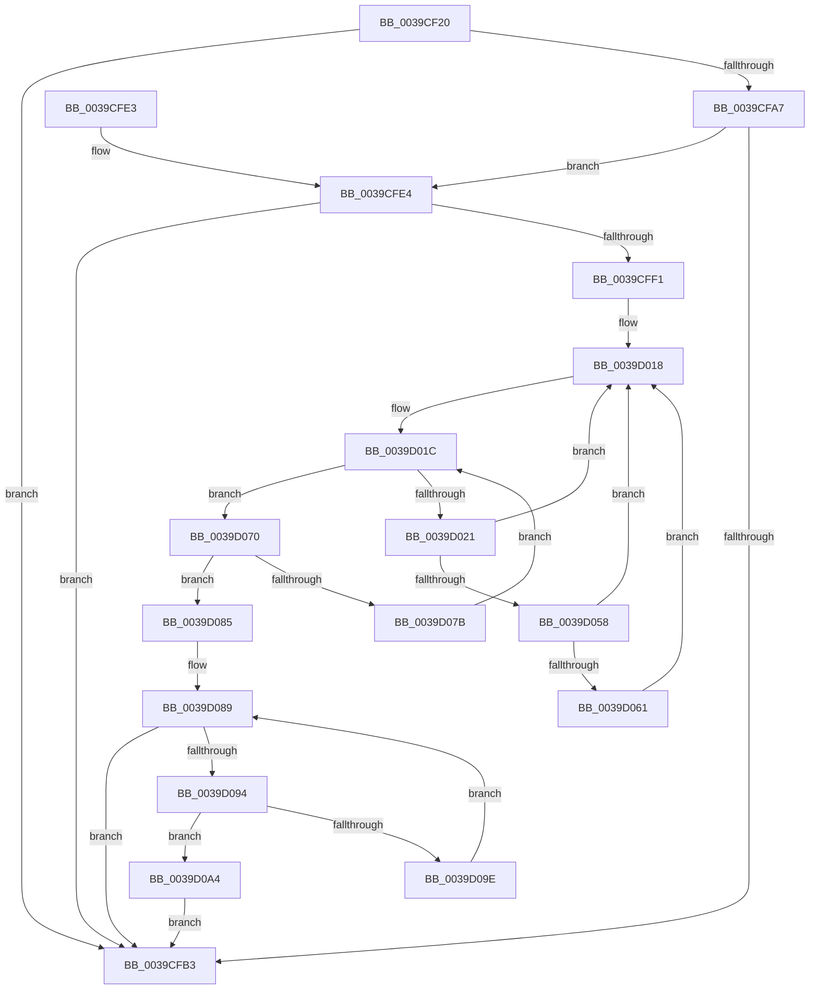

# PoExecuteIdleCheck

- RVA: `0x0039CF20`–`0x0039D0C6` (길이 `422` bytes)
- VA: `0x000000014039CF20`
- 실행 섹션: `.text`
- PDB 이름 있음: `예`; PDB Function 태그: `아니요`
- unwind 정보 RVA: `0x00081A34`
- 디코드: `107`개 명령, `422/422` bytes 표시
- 미해석 바이트: `0` (있으면 어셈블리에 `.byte`로 보존)

> 이 문서는 커널 이미지의 기계어와 PDB 기호를 분석해 생성했습니다. 4번과 5번은 함수 원형과 자료형을 바이너리 사용 방식에서 추정한 C 해석이며 원본 소스 복구 결과는 아닙니다.

## 1. Dependencies

- 직접 호출 지점: **10**; 고유 호출 대상: **7**
- 직접 호출자로 확인된 함수: **2**
- RIP 상대 이미지 참조: **6**

### Outgoing calls
- `0x0039CF68` → [memset](../6C/memset_function_006C6C40.md) (function, `0x006C6C40`)
- `0x0039CF77` → [memset](../6C/memset_function_006C6C40.md) (function, `0x006C6C40`)
- `0x0039CF96` → [memset](../6C/memset_function_006C6C40.md) (function, `0x006C6C40`)
- `0x0039CFBD` → [_security_check_cookie](../6A/_security_check_cookie_function_006AC640.md) (function, `0x006AC640`)
- `0x0039CFE8` → [PpmGetIdleConstrainedMask](../4B/PpmGetIdleConstrainedMask_function_004BCC5C.md) (function, `0x004BCC5C`)
- `0x0039D00B` → [memset](../6C/memset_function_006C6C40.md) (function, `0x006C6C40`)
- `0x0039D045` → [KeGetPrcb](../2D/KeGetPrcb_function_002D85D0.md) (function, `0x002D85D0`)
- `0x0039D069` → [KeAddProcessorAffinityEx](../25/KeAddProcessorAffinityEx_function_0025B6F0.md) (function, `0x0025B6F0`)
- `0x0039D0B0` → [PpmEventAffinityMask](../5D/PpmEventAffinityMask_function_005DA500.md) (function, `0x005DA500`)
- `0x0039D0BC` → [HalRequestIpi](../2D/HalRequestIpi_function_002D1720.md) (function, `0x002D1720`)

### Direct callers
- [KeClockInterruptNotify](KeClockInterruptNotify_function_0039A970.md) at `0x0039AB3A`
- [KiUpdateTime](KiUpdateTime_function_0039B530.md) at `0x0039B873`

### Static image references
- `0x0039CF46` → RVA `0x00E0A740` (`.data`; read)
- `0x0039CF9B` → RVA `0x00FC6F60` (`ALMOSTRO`; read)
- `0x0039CFA7` → RVA `0x00FC72E0` (`ALMOSTRO`; read)
- `0x0039CFF4` → RVA `0x00FC72E0` (`ALMOSTRO`; write)
- `0x0039D037` → RVA `0x00F231B8` (`.data`; read)
- `0x0039D0A9` → RVA `0x00011350` (`.rdata`; read)

## 2. Other-region calls and transfers

- 다른 실행 섹션으로 향하는 call: **0**
- 별도 외부 분기/꼬리 이동을 확인하지 못했습니다.

## 3. Assembly (complete function range)

```asm
0039CF20  48 8B C4                        mov rax, rsp
0039CF23  48 89 58 08                     mov qword ptr [rax + 8], rbx
0039CF27  48 89 70 10                     mov qword ptr [rax + 0x10], rsi
0039CF2B  48 89 78 18                     mov qword ptr [rax + 0x18], rdi
0039CF2F  4C 89 60 20                     mov qword ptr [rax + 0x20], r12
0039CF33  55                              push rbp
0039CF34  41 56                           push r14
0039CF36  41 57                           push r15
0039CF38  48 8D A8 88 FE FF FF            lea rbp, [rax - 0x178]
0039CF3F  48 81 EC 60 02 00 00            sub rsp, 0x260
0039CF46  48 8B 05 F3 D7 A6 00            mov rax, qword ptr [rip + 0xa6d7f3]
0039CF4D  48 33 C4                        xor rax, rsp
0039CF50  48 89 85 50 01 00 00            mov qword ptr [rbp + 0x150], rax
0039CF57  48 8B F1                        mov rsi, rcx
0039CF5A  BB 00 01 00 00                  mov ebx, 0x100
0039CF5F  44 8B C3                        mov r8d, ebx
0039CF62  48 8D 4D 48                     lea rcx, [rbp + 0x48]
0039CF66  33 D2                           xor edx, edx
0039CF68  E8 D3 9C 32 00                  call 0x1406c6c40
0039CF6D  44 8B C3                        mov r8d, ebx
0039CF70  48 8D 4C 24 38                  lea rcx, [rsp + 0x38]
0039CF75  33 D2                           xor edx, edx
0039CF77  E8 C4 9C 32 00                  call 0x1406c6c40
0039CF7C  44 8B C3                        mov r8d, ebx
0039CF7F  48 C7 45 40 01 00 20 00         mov qword ptr [rbp + 0x40], 0x200001
0039CF87  33 D2                           xor edx, edx
0039CF89  48 8D 4D 48                     lea rcx, [rbp + 0x48]
0039CF8D  41 BC 01 00 00 00               mov r12d, 1
0039CF93  45 33 FF                        xor r15d, r15d
0039CF96  E8 A5 9C 32 00                  call 0x1406c6c40
0039CF9B  48 8B 0D BE 9F C2 00            mov rcx, qword ptr [rip + 0xc29fbe]
0039CFA2  48 85 C9                        test rcx, rcx
0039CFA5  74 0C                           je 0x14039cfb3
0039CFA7  48 03 0D 32 A3 C2 00            add rcx, qword ptr [rip + 0xc2a332]
0039CFAE  48 3B CE                        cmp rcx, rsi
0039CFB1  72 31                           jb 0x14039cfe4
0039CFB3  48 8B 8D 50 01 00 00            mov rcx, qword ptr [rbp + 0x150]
0039CFBA  48 33 CC                        xor rcx, rsp
0039CFBD  E8 7E F6 30 00                  call 0x1406ac640
0039CFC2  4C 8D 9C 24 60 02 00 00         lea r11, [rsp + 0x260]
0039CFCA  49 8B 5B 20                     mov rbx, qword ptr [r11 + 0x20]
0039CFCE  49 8B 73 28                     mov rsi, qword ptr [r11 + 0x28]
0039CFD2  49 8B 7B 30                     mov rdi, qword ptr [r11 + 0x30]
0039CFD6  4D 8B 63 38                     mov r12, qword ptr [r11 + 0x38]
0039CFDA  49 8B E3                        mov rsp, r11
0039CFDD  41 5F                           pop r15
0039CFDF  41 5E                           pop r14
0039CFE1  5D                              pop rbp
0039CFE2  C3                              ret
0039CFE3  CC                              int3
0039CFE4  48 8D 4D 40                     lea rcx, [rbp + 0x40]
0039CFE8  E8 6F FC 11 00                  call 0x1404bcc5c
0039CFED  84 C0                           test al, al
0039CFEF  74 C2                           je 0x14039cfb3
0039CFF1  4C 8B C3                        mov r8, rbx
0039CFF4  48 89 35 E5 A2 C2 00            mov qword ptr [rip + 0xc2a2e5], rsi
0039CFFB  33 D2                           xor edx, edx
0039CFFD  48 C7 44 24 30 01 00 20 00      mov qword ptr [rsp + 0x30], 0x200001
0039D006  48 8D 4C 24 38                  lea rcx, [rsp + 0x38]
0039D00B  E8 30 9C 32 00                  call 0x1406c6c40
0039D010  48 8B 7D 48                     mov rdi, qword ptr [rbp + 0x48]
0039D014  41 0F B7 DF                     movzx ebx, r15w
0039D018  0F B7 4D 40                     movzx ecx, word ptr [rbp + 0x40]
0039D01C  48 85 FF                        test rdi, rdi
0039D01F  74 4F                           je 0x14039d070
0039D021  48 0F BC D7                     bsf rdx, rdi
0039D025  0F B7 CB                        movzx ecx, bx
0039D028  0F B6 C2                        movzx eax, dl
0039D02B  C1 E1 06                        shl ecx, 6
0039D02E  48 0F B3 C7                     btr rdi, rax
0039D032  0F B6 C2                        movzx eax, dl
0039D035  03 C8                           add ecx, eax
0039D037  48 8B 05 7A 61 B8 00            mov rax, qword ptr [rip + 0xb8617a]
0039D03E  44 8B 34 88                     mov r14d, dword ptr [rax + rcx*4]
0039D042  41 8B CE                        mov ecx, r14d
0039D045  E8 86 B5 F3 FF                  call 0x1402d85d0
0039D04A  65 48 8B 0C 25 20 00 00 00      mov rcx, qword ptr gs:[0x20]
0039D053  48 3B C1                        cmp rax, rcx
0039D056  74 C0                           je 0x14039d018
0039D058  48 39 B0 70 88 00 00            cmp qword ptr [rax + 0x8870], rsi
0039D05F  77 B7                           ja 0x14039d018
0039D061  41 8B D6                        mov edx, r14d
0039D064  48 8D 4C 24 30                  lea rcx, [rsp + 0x30]
0039D069  E8 82 E6 EB FF                  call 0x14025b6f0
0039D06E  EB A8                           jmp 0x14039d018
0039D070  66 41 03 DC                     add bx, r12w
0039D074  0F B7 C3                        movzx eax, bx
0039D077  3B C1                           cmp eax, ecx
0039D079  73 0A                           jae 0x14039d085
0039D07B  0F B7 C3                        movzx eax, bx
0039D07E  48 8B 7C C5 48                  mov rdi, qword ptr [rbp + rax*8 + 0x48]
0039D083  EB 97                           jmp 0x14039d01c
0039D085  41 0F B7 CF                     movzx ecx, r15w
0039D089  66 3B 4C 24 30                  cmp cx, word ptr [rsp + 0x30]
0039D08E  0F 83 1F FF FF FF               jae 0x14039cfb3
0039D094  0F B7 C1                        movzx eax, cx
0039D097  4C 39 7C C4 38                  cmp qword ptr [rsp + rax*8 + 0x38], r15
0039D09C  75 06                           jne 0x14039d0a4
0039D09E  66 41 03 CC                     add cx, r12w
0039D0A2  EB E5                           jmp 0x14039d089
0039D0A4  48 8D 54 24 30                  lea rdx, [rsp + 0x30]
0039D0A9  48 8D 0D A0 42 C7 FF            lea rcx, [rip - 0x38bd60]
0039D0B0  E8 4B D4 23 00                  call 0x1405da500
0039D0B5  48 8D 54 24 30                  lea rdx, [rsp + 0x30]
0039D0BA  33 C9                           xor ecx, ecx
0039D0BC  E8 5F 46 F3 FF                  call 0x1402d1720
0039D0C1  E9 ED FE FF FF                  jmp 0x14039cfb3
```

## 4. C-style interpretation (structured pseudocode)

```c
__int64 __fastcall PoExecuteIdleCheck(__int64 a1, int a2)
{
    __int64 result;
    __int64 v_r15;
    __int64 v_rbx;
    __int64 v_rsp;
    unsigned __int64 v_stack_m18;
    unsigned __int64 v_stack_m228;
    unsigned __int64 v_stack_m230;
    unsigned __int64 v_stack_m240;

    *(unsigned __int64 *)(v_rsp + 8) = v_rbx;
    *(unsigned __int64 *)(v_rsp + 16) = v_rsi;
    *(unsigned __int64 *)(v_rsp + 24) = v_rdi;
    *(unsigned __int64 *)(v_rsp + 32) = v_r12;
    v_rsp = (v_rsp) - (608);
    result = (*(unsigned __int64 *)(v_rip + 10934259)) ^ (v_rsp);
    *(unsigned __int64 *)(v_rsp - 376 + 336) = result;
    a2 = 0;
    result = memset(v_rsp - 376 + 72, a2, 256, a4);
    a2 = 0;
    result = memset(v_stack_m240, a2, 256, a4);
    *(unsigned __int64 *)(v_rsp - 376 + 64) = 0x200001ULL;
    a2 = 0;
    v_r15 = 0;
    result = memset(v_rsp - 376 + 72, a2, 256, a4);
    if (*(unsigned __int64 *)(v_rip + 12754878) == 0) goto loc_0039CFB3;
    a1 = (*(unsigned __int64 *)(v_rip + 12754878)) + (*(unsigned __int64 *)(v_rip + 12755762));
    if (a1 < a1) goto loc_0039CFE4;
loc_0039CFB3:
    a1 = (*(unsigned __int64 *)(v_rsp - 376 + 336)) ^ (v_rsp);
    result = _security_check_cookie(a1, a2, 256, a4);
    return result;
loc_0039CFE4:
    result = PpmGetIdleConstrainedMask(v_rsp - 376 + 64, a2, 256, a4);
    if ((unsigned __int8)(result) == 0) goto loc_0039CFB3;
    *(unsigned __int64 *)(v_rip + 12755685) = *(unsigned __int64 *)(v_stack_m18 + 40);
    a2 = 0;
    v_stack_m230 = 0x200001ULL;
    result = memset(v_stack_m228, a2, *(unsigned __int64 *)(v_stack_m18 + 32), a4);
loc_0039D018:
loc_0039D01C:
    if (*(unsigned __int64 *)(v_rsp - 376 + 72) == 0) goto loc_0039D070;
    a1 = (unsigned int)((0) << (6));
    a1 = (unsigned int)((a1) + (0));
    result = KeGetPrcb((unsigned int)((unsigned int)((unsigned int)(*(unsigned int *)(*(unsigned __int64 *)(v_rip + 12083578) + a1 * 4)))), a2, *(unsigned __int64 *)(v_stack_m18 + 32), a4);
    if (result == (*(unsigned __int64 *)(gs_base + (0 + 32)))) goto loc_0039D018;
    if ((*(unsigned __int64 *)(result + 34928)) > (*(unsigned __int64 *)(v_stack_m18 + 40))) goto loc_0039D018;
    result = KeAddProcessorAffinityEx(v_stack_m230, (unsigned int)((unsigned int)((unsigned int)(*(unsigned int *)(*(unsigned __int64 *)(v_rip + 12083578) + a1 * 4)))), *(unsigned __int64 *)(v_stack_m18 + 32), a4);
    goto loc_0039D018;
loc_0039D070:
    v_rbx = (unsigned __int16)((0) + ((unsigned __int16)(*(unsigned __int64 *)(v_stack_m18 + 56))));
    if (((unsigned int)((unsigned __int16)(v_rbx))) >= ((unsigned int)(v_stack_m230))) goto loc_0039D085;
    goto loc_0039D01C;
loc_0039D085:
loc_0039D089:
    if (0 >= v_stack_m230) goto loc_0039CFB3;
    if ((*(unsigned __int64 *)(v_stack_m18 + 0 * 8 + 56)) != 0) goto loc_0039D0A4;
    a1 = (unsigned __int16)((0) + ((unsigned __int16)(*(unsigned __int64 *)(v_stack_m18 + 56))));
    goto loc_0039D089;
loc_0039D0A4:
    result = PpmEventAffinityMask(v_rip - 3718496, v_stack_m230, *(unsigned __int64 *)(v_stack_m18 + 32), a4);
    a1 = 0;
    result = HalRequestIpi(a1, v_stack_m230, *(unsigned __int64 *)(v_stack_m18 + 32), a4);
    goto loc_0039CFB3;
}
```

## 5. (Beta) C Style

```c
int64_t PoExecuteIdleCheck(int64_t Arg1, int32_t Arg2)
{
    int64_t result;
    int64_t local_r15;
    int64_t local_rbx;
    int64_t local_rsp;
    uint64_t v_stack_m18;
    uint64_t v_stack_m228;
    uint64_t v_stack_m230;
    uint64_t v_stack_m240;

    *(uint64_t *)(local_rsp + 0x8) = local_rbx;
    *(uint64_t *)(local_rsp + 0x10) = local_rsi;
    *(uint64_t *)(local_rsp + 0x18) = local_rdi;
    *(uint64_t *)(local_rsp + 0x20) = local_r12;
    local_rsp = (local_rsp) - (608);
    result = (*(uint64_t *)(v_rip + 0xA6D7F3)) ^ (local_rsp);
    *(uint64_t *)(local_rsp - 0x178 + 0x150) = result;
    Arg2 = 0;
    result = memset(local_rsp - 376 + 72, Arg2, 256, a4);
    Arg2 = 0;
    result = memset(v_stack_m240, Arg2, 256, a4);
    *(uint64_t *)(local_rsp - 0x178 + 0x40) = 0x200001ULL;
    Arg2 = 0;
    local_r15 = 0;
    result = memset(local_rsp - 376 + 72, Arg2, 256, a4);
    if (*(uint64_t *)(v_rip + 0xC29FBE) == 0) goto loc_0039CFB3;
    Arg1 = (*(uint64_t *)(v_rip + 0xC29FBE)) + (*(uint64_t *)(v_rip + 0xC2A332));
    if (Arg1 < Arg1) goto loc_0039CFE4;
loc_0039CFB3:
    Arg1 = (*(uint64_t *)(local_rsp - 0x178 + 0x150)) ^ (local_rsp);
    result = _security_check_cookie(Arg1, Arg2, 256, a4);
    return result;
loc_0039CFE4:
    result = PpmGetIdleConstrainedMask(local_rsp - 376 + 64, Arg2, 256, a4);
    if ((uint8_t)(result) == 0) goto loc_0039CFB3;
    *(uint64_t *)(v_rip + 0xC2A2E5) = *(uint64_t *)(v_stack_m18 + 0x28);
    Arg2 = 0;
    v_stack_m230 = 0x200001ULL;
    result = memset(v_stack_m228, Arg2, *(uint64_t *)(v_stack_m18 + 0x20), a4);
loc_0039D018:
loc_0039D01C:
    if (*(uint64_t *)(local_rsp - 0x178 + 0x48) == 0) goto loc_0039D070;
    Arg1 = (uint32_t)((0) << (6));
    Arg1 = (uint32_t)((Arg1) + (0));
    result = KeGetPrcb((uint32_t)((uint32_t)((uint32_t)(*(uint32_t *)(*(uint64_t *)(v_rip + 0xB8617A) + Arg1 * 4)))), Arg2, *(uint64_t *)(v_stack_m18 + 0x20), a4);
    if (result == (*(uint64_t *)(gs_base + (0 + 0x20)))) goto loc_0039D018;
    if ((*(uint64_t *)(result + 0x8870)) > (*(uint64_t *)(v_stack_m18 + 0x28))) goto loc_0039D018;
    result = KeAddProcessorAffinityEx(v_stack_m230, (uint32_t)((uint32_t)((uint32_t)(*(uint32_t *)(*(uint64_t *)(v_rip + 0xB8617A) + Arg1 * 4)))), *(uint64_t *)(v_stack_m18 + 0x20), a4);
    goto loc_0039D018;
loc_0039D070:
    local_rbx = (uint16_t)((0) + ((uint16_t)(*(uint64_t *)(v_stack_m18 + 0x38))));
    if (((uint32_t)((uint16_t)(local_rbx))) >= ((uint32_t)(v_stack_m230))) goto loc_0039D085;
    goto loc_0039D01C;
loc_0039D085:
loc_0039D089:
    if (0 >= v_stack_m230) goto loc_0039CFB3;
    if ((*(uint64_t *)(v_stack_m18 + 0x0 * 8 + 0x38)) != 0) goto loc_0039D0A4;
    Arg1 = (uint16_t)((0) + ((uint16_t)(*(uint64_t *)(v_stack_m18 + 0x38))));
    goto loc_0039D089;
loc_0039D0A4:
    result = PpmEventAffinityMask(v_rip - 3718496, v_stack_m230, *(uint64_t *)(v_stack_m18 + 0x20), a4);
    Arg1 = 0;
    result = HalRequestIpi(Arg1, v_stack_m230, *(uint64_t *)(v_stack_m18 + 0x20), a4);
    goto loc_0039CFB3;
}
```

## 6. Execution-region graph

[열기: 2D/3D 그래프와 함수 탐색 컨트롤 패널](../../../control-panel.html?section=text&rva=0x0039CF20&view=graph)

- 2D 그래프는 위에서 아래로 흐르고, 3D 그래프는 빈 공간을 드래그해 회전합니다. Shift+드래그는 이동, 휠은 확대·축소, 함수 노드 선택은 대상 보고서 이동입니다.

### Static fallback


