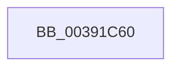

# PoSetProcessorQos

- RVA: `0x00391C60`–`0x00391C8E` (길이 `46` bytes)
- VA: `0x0000000140391C60`
- 실행 섹션: `.text`
- PDB 이름 있음: `예`; PDB Function 태그: `예`
- unwind 정보 RVA: `0x00080C20`
- 디코드: `13`개 명령, `46/46` bytes 표시
- 미해석 바이트: `0` (있으면 어셈블리에 `.byte`로 보존)

> 이 문서는 커널 이미지의 기계어와 PDB 기호를 분석해 생성했습니다. 4번과 5번은 함수 원형과 자료형을 바이너리 사용 방식에서 추정한 C 해석이며 원본 소스 복구 결과는 아닙니다.

## 1. Dependencies

- 직접 호출 지점: **0**; 고유 호출 대상: **0**
- 직접 호출자로 확인된 함수: **1**
- RIP 상대 이미지 참조: **0**

### Outgoing calls
- 직접 디코드된 call 명령이 없습니다.

### Direct callers
- [KiCheckForPendingQosUpdate](KiCheckForPendingQosUpdate_function_0039DD48.md) at `0x0039DDCD`
- [KiCheckForPendingQosUpdate](KiCheckForPendingQosUpdate_function_0039DD48.md) at `0x0039DE94`

### Static image references
- 디코드된 RIP-relative 메모리 참조가 없습니다.

## 2. Other-region calls and transfers

- 다른 실행 섹션으로 향하는 call: **0**
- call이 아닌 외부 분기/꼬리 이동: **1**
  - `0x00391C88` → [sub_00391D59](Unknown_function_00391D59.md) (`tail-transfer`)

## 3. Assembly (complete function range)

```asm
00391C60  48 89 5C 24 10                  mov qword ptr [rsp + 0x10], rbx
00391C65  48 89 6C 24 18                  mov qword ptr [rsp + 0x18], rbp
00391C6A  57                              push rdi
00391C6B  41 56                           push r14
00391C6D  41 57                           push r15
00391C6F  48 83 EC 20                     sub rsp, 0x20
00391C73  48 63 FA                        movsxd rdi, edx
00391C76  45 32 FF                        xor r15b, r15b
00391C79  45 32 F6                        xor r14b, r14b
00391C7C  48 8B D9                        mov rbx, rcx
00391C7F  40 B5 01                        mov bpl, 1
00391C82  3B B9 40 8A 00 00               cmp edi, dword ptr [rcx + 0x8a40]
00391C88  0F 84 CB 00 00 00               je 0x140391d59
```

## 4. C-style interpretation (structured pseudocode)

```c
void __fastcall PoSetProcessorQos(__int64 a1, int a2)
{
    __int64 v_r14;
    __int64 v_r15;
    __int64 v_rsp;
    unsigned __int64 v_stack_p10;
    unsigned __int64 v_stack_p18;

    v_stack_p10 = v_rbx;
    v_stack_p18 = v_rbp;
    v_rsp = (v_rsp) - (32);
    v_r15 = 0;
    v_r14 = 0;
}
```

## 5. (Beta) C Style

```c
void PoSetProcessorQos(void *Arg1, int32_t Arg2)
{
    uint8_t *arg1 = (uint8_t *)Arg1;

    int64_t local_r14;
    int64_t local_r15;
    int64_t local_rsp;
    uint64_t v_stack_p10;
    uint64_t v_stack_p18;

    v_stack_p10 = local_rbx;
    v_stack_p18 = local_rbp;
    local_rsp = (local_rsp) - (32);
    local_r15 = 0;
    local_r14 = 0;
}
```

### 관측된 메모리 오프셋

구조체 형식이 확인되지 않은 접근은 인자 기준의 오프셋으로만 기록했습니다.

| 기준 인자 | 오프셋 표현 | 폭 (bit) | 접근 |
|---|---:|---:|---|
| `Arg1` | `+ 0x8A40` | `32` | `R` |

## 6. Execution-region graph

[열기: 2D/3D 그래프와 함수 탐색 컨트롤 패널](../../../control-panel.html?section=text&rva=0x00391C60&view=graph)

- 2D 그래프는 위에서 아래로 흐르고, 3D 그래프는 빈 공간을 드래그해 회전합니다. Shift+드래그는 이동, 휠은 확대·축소, 함수 노드 선택은 대상 보고서 이동입니다.

### Static fallback


