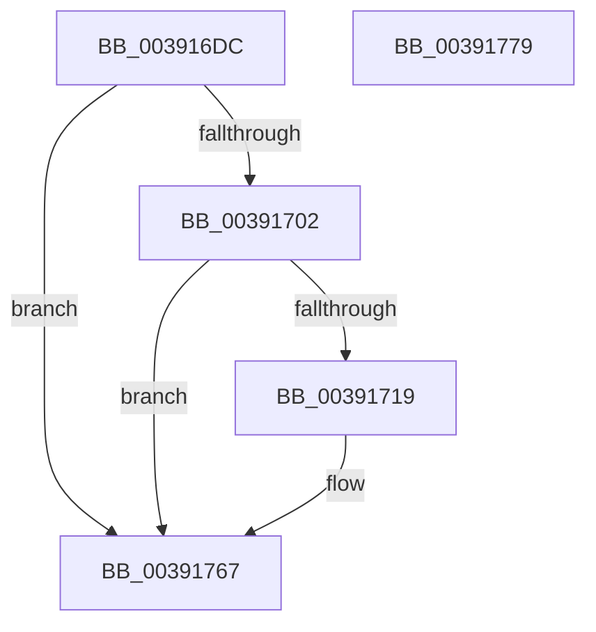

# PoTraceSystemTimerResolutionUpdate

- RVA: `0x003916DC`–`0x0039177A` (길이 `158` bytes)
- VA: `0x00000001403916DC`
- 실행 섹션: `.text`
- PDB 이름 있음: `예`; PDB Function 태그: `아니요`
- unwind 정보 RVA: `0x00080A9C`
- 디코드: `33`개 명령, `158/158` bytes 표시
- 미해석 바이트: `0` (있으면 어셈블리에 `.byte`로 보존)

> 이 문서는 커널 이미지의 기계어와 PDB 기호를 분석해 생성했습니다. 4번과 5번은 함수 원형과 자료형을 바이너리 사용 방식에서 추정한 C 해석이며 원본 소스 복구 결과는 아닙니다.

## 1. Dependencies

- 직접 호출 지점: **3**; 고유 호출 대상: **3**
- 직접 호출자로 확인된 함수: **1**
- RIP 상대 이미지 참조: **5**

### Outgoing calls
- `0x00391710` → [EtwEventEnabled](EtwEventEnabled_function_00392450.md) (function, `0x00392450`)
- `0x00391762` → [EtwWriteEx](../25/EtwWriteEx_function_0025F0D0.md) (function, `0x0025F0D0`)
- `0x0039176F` → [_security_check_cookie](../6A/_security_check_cookie_function_006AC640.md) (function, `0x006AC640`)

### Direct callers
- [ExpUpdateTimerResolution](ExpUpdateTimerResolution_function_003914A0.md) at `0x00391679`

### Static image references
- `0x003916E0` → RVA `0x00E0A740` (`.data`; read)
- `0x003916EF` → RVA `0x00E67858` (`.data`; read)
- `0x003916F6` → RVA `0x00FC6BB8` (`ALMOSTRO`; read)
- `0x00391702` → RVA `0x00F0B408` (`.data`; read)
- `0x00391709` → RVA `0x000112B0` (`.rdata`; read)

## 2. Other-region calls and transfers

- 다른 실행 섹션으로 향하는 call: **0**
- 별도 외부 분기/꼬리 이동을 확인하지 못했습니다.

## 3. Assembly (complete function range)

```asm
003916DC  48 83 EC 68                     sub rsp, 0x68
003916E0  48 8B 05 59 90 A7 00            mov rax, qword ptr [rip + 0xa79059]
003916E7  48 33 C4                        xor rax, rsp
003916EA  48 89 44 24 58                  mov qword ptr [rsp + 0x58], rax
003916EF  80 3D 62 61 AD 00 00            cmp byte ptr [rip + 0xad6162], 0
003916F6  8B 05 BC 54 C3 00               mov eax, dword ptr [rip + 0xc354bc]
003916FC  89 44 24 40                     mov dword ptr [rsp + 0x40], eax
00391700  74 65                           je 0x140391767
00391702  48 8B 0D FF 9C B7 00            mov rcx, qword ptr [rip + 0xb79cff]
00391709  48 8D 15 A0 FB C7 FF            lea rdx, [rip - 0x380460]
00391710  E8 3B 0D 00 00                  call 0x140392450
00391715  84 C0                           test al, al
00391717  74 4E                           je 0x140391767
00391719  83 64 24 54 00                  and dword ptr [rsp + 0x54], 0
0039171E  48 8D 44 24 40                  lea rax, [rsp + 0x40]
00391723  48 8B 0D DE 9C B7 00            mov rcx, qword ptr [rip + 0xb79cde]
0039172A  48 8D 15 7F FB C7 FF            lea rdx, [rip - 0x380481]
00391731  48 89 44 24 48                  mov qword ptr [rsp + 0x48], rax
00391736  45 33 C9                        xor r9d, r9d
00391739  48 8D 44 24 48                  lea rax, [rsp + 0x48]
0039173E  C7 44 24 50 04 00 00 00         mov dword ptr [rsp + 0x50], 4
00391746  48 89 44 24 38                  mov qword ptr [rsp + 0x38], rax
0039174B  45 33 C0                        xor r8d, r8d
0039174E  C7 44 24 30 01 00 00 00         mov dword ptr [rsp + 0x30], 1
00391756  48 83 64 24 28 00               and qword ptr [rsp + 0x28], 0
0039175C  48 83 64 24 20 00               and qword ptr [rsp + 0x20], 0
00391762  E8 69 D9 EC FF                  call 0x14025f0d0
00391767  48 8B 4C 24 58                  mov rcx, qword ptr [rsp + 0x58]
0039176C  48 33 CC                        xor rcx, rsp
0039176F  E8 CC AE 31 00                  call 0x1406ac640
00391774  48 83 C4 68                     add rsp, 0x68
00391778  C3                              ret
00391779  CC                              int3
```

## 4. C-style interpretation (structured pseudocode)

```c
__int64 __fastcall PoTraceSystemTimerResolutionUpdate(__int64 a1, __int64 a2, int a3, int a4)
{
    __int64 result;
    __int64 v_rsp;
    unsigned __int64 v_stack_m10;
    unsigned int v_stack_m14;
    unsigned int v_stack_m18;
    unsigned __int64 v_stack_m20;
    unsigned int v_stack_m28;
    unsigned __int64 v_stack_m30;
    unsigned int v_stack_m38;
    unsigned __int64 v_stack_m40;
    unsigned __int64 v_stack_m48;

    v_rsp = (v_rsp) - (104);
    result = (*(unsigned __int64 *)(v_rip + 10981465)) ^ (v_rsp);
    v_stack_m10 = result;
    v_stack_m28 = (unsigned int)((unsigned int)(*(unsigned int *)(v_rip + 12801212)));
    if ((*(unsigned __int8 *)(v_rip + 11362658)) == 0) goto loc_00391767;
    result = EtwEventEnabled(*(unsigned __int64 *)(v_rip + 12033279), v_rip - 3671136, a3, a4);
    if ((unsigned __int8)(result) != 0) {
        result = v_stack_m28;
        a1 = *(unsigned __int64 *)(v_rip + 12033246);
        a2 = v_rip - 3671169;
        v_stack_m20 = result;
        a4 = 0;
        result = v_stack_m20;
        v_stack_m18 = 4;
        v_stack_m30 = result;
        a3 = 0;
        v_stack_m38 = 1;
        result = EtwWriteEx(a1, a2, a3, a4);
    }
    a1 = (v_stack_m10) ^ (v_rsp);
    result = _security_check_cookie(a1, a2, a3, a4);
    v_rsp = (v_rsp) + (104);
    return result;
}
```

## 5. (Beta) C Style

```c
int64_t PoTraceSystemTimerResolutionUpdate(int64_t Arg1, int64_t Arg2, int32_t Arg3, int32_t Arg4)
{
    int64_t result;
    int64_t local_rsp;
    uint64_t v_stack_m10;
    uint32_t v_stack_m14;
    uint32_t v_stack_m18;
    uint64_t v_stack_m20;
    uint32_t v_stack_m28;
    uint64_t v_stack_m30;
    uint32_t v_stack_m38;
    uint64_t v_stack_m40;
    uint64_t v_stack_m48;

    local_rsp = (local_rsp) - (104);
    result = (*(uint64_t *)(v_rip + 0xA79059)) ^ (local_rsp);
    v_stack_m10 = result;
    v_stack_m28 = (uint32_t)((uint32_t)(*(uint32_t *)(v_rip + 0xC354BC)));
    if ((*(uint8_t *)(v_rip + 0xAD6162)) == 0) goto loc_00391767;
    result = EtwEventEnabled(*(uint64_t *)(v_rip + 0xB79CFF), v_rip - 3671136, Arg3, Arg4);
    if ((uint8_t)(result) != 0) {
        result = v_stack_m28;
        Arg1 = *(uint64_t *)(v_rip + 0xB79CDE);
        Arg2 = v_rip - 3671169;
        v_stack_m20 = result;
        Arg4 = 0;
        result = v_stack_m20;
        v_stack_m18 = 4;
        v_stack_m30 = result;
        Arg3 = 0;
        v_stack_m38 = 1;
        result = EtwWriteEx(Arg1, Arg2, Arg3, Arg4);
    }
    Arg1 = (v_stack_m10) ^ (local_rsp);
    result = _security_check_cookie(Arg1, Arg2, Arg3, Arg4);
    local_rsp = (local_rsp) + (104);
    return result;
}
```

## 6. Execution-region graph

[열기: 2D/3D 그래프와 함수 탐색 컨트롤 패널](../../../control-panel.html?section=text&rva=0x003916DC&view=graph)

- 2D 그래프는 위에서 아래로 흐르고, 3D 그래프는 빈 공간을 드래그해 회전합니다. Shift+드래그는 이동, 휠은 확대·축소, 함수 노드 선택은 대상 보고서 이동입니다.

### Static fallback


