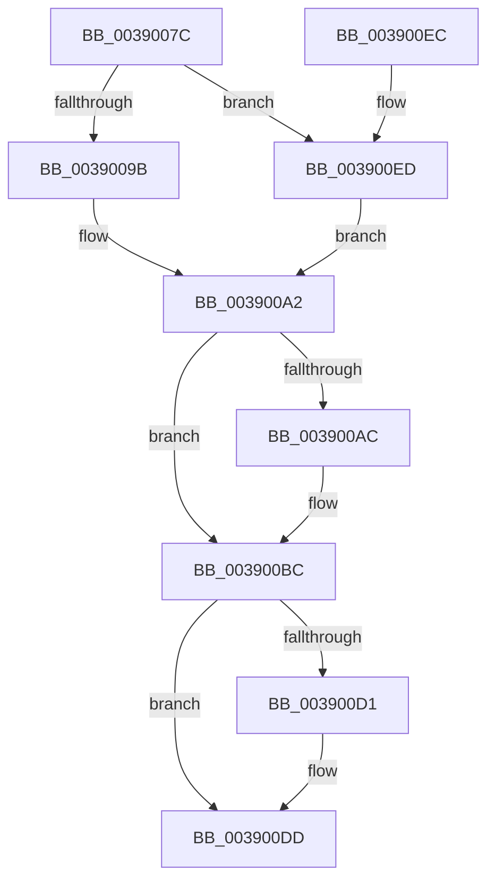

# PopDecrementPowerSettingPendingUpdates

- RVA: `0x0039007C`–`0x00390105` (길이 `137` bytes)
- VA: `0x000000014039007C`
- 실행 섹션: `.text`
- PDB 이름 있음: `예`; PDB Function 태그: `아니요`
- unwind 정보 RVA: `0x0007EC14`
- 디코드: `34`개 명령, `137/137` bytes 표시
- 미해석 바이트: `0` (있으면 어셈블리에 `.byte`로 보존)

> 이 문서는 커널 이미지의 기계어와 PDB 기호를 분석해 생성했습니다. 4번과 5번은 함수 원형과 자료형을 바이너리 사용 방식에서 추정한 C 해석이며 원본 소스 복구 결과는 아닙니다.

## 1. Dependencies

- 직접 호출 지점: **4**; 고유 호출 대상: **4**
- 직접 호출자로 확인된 함수: **2**
- RIP 상대 이미지 참조: **7**

### Outgoing calls
- `0x0039008F` → [KeAcquireSpinLockRaiseToDpc](../20/KeAcquireSpinLockRaiseToDpc_function_00208470.md) (function, `0x00208470`)
- `0x003900B7` → [PopDeepSleepClearDisengageReason](PopDeepSleepClearDisengageReason_function_0039010C.md) (function, `0x0039010C`)
- `0x003900C3` → [KxReleaseSpinLock](../20/KxReleaseSpinLock_function_00206670.md) (function, `0x00206670`)
- `0x003900D8` → [KiLowerIrqlProcessIrqlFlags](../4F/KiLowerIrqlProcessIrqlFlags_function_004F5698.md) (function, `0x004F5698`)

### Direct callers
- [PopSetPowerSettingValue](../../page/91/PopSetPowerSettingValue_function_00914E54.md) at `0x00914FBD`
- [PopDispatchPowerSettingCallbacks](../../page/91/PopDispatchPowerSettingCallbacks_function_00916190.md) at `0x009161B1`
- [PopDispatchPowerSettingCallbacks](../../page/91/PopDispatchPowerSettingCallbacks_function_00916190.md) at `0x00916247`

### Static image references
- `0x00390088` → RVA `0x00F0C6B0` (`.data`; read)
- `0x0039009B` → RVA `0x00F0C694` (`.data`; read/write)
- `0x003900A2` → RVA `0x00F0C694` (`.data`; read)
- `0x003900AC` → RVA `0x00F0C698` (`.data`; read/write)
- `0x003900C8` → RVA `0x00FC6D20` (`ALMOSTRO`; read)
- `0x003900ED` → RVA `0x00F0C690` (`.data`; read)
- `0x003900FC` → RVA `0x00F0C690` (`.data`; read/write)

## 2. Other-region calls and transfers

- 다른 실행 섹션으로 향하는 call: **0**
- 별도 외부 분기/꼬리 이동을 확인하지 못했습니다.

## 3. Assembly (complete function range)

```asm
0039007C  48 89 5C 24 08                  mov qword ptr [rsp + 8], rbx
00390081  57                              push rdi
00390082  48 83 EC 20                     sub rsp, 0x20
00390086  8A D9                           mov bl, cl
00390088  48 8D 0D 21 C6 B7 00            lea rcx, [rip + 0xb7c621]
0039008F  E8 DC 83 E7 FF                  call 0x140208470
00390094  0F B6 F8                        movzx edi, al
00390097  84 DB                           test bl, bl
00390099  75 52                           jne 0x1403900ed
0039009B  F0 FF 0D F2 C5 B7 00            lock dec dword ptr [rip + 0xb7c5f2]
003900A2  8B 05 EC C5 B7 00               mov eax, dword ptr [rip + 0xb7c5ec]
003900A8  85 C0                           test eax, eax
003900AA  75 10                           jne 0x1403900bc
003900AC  48 83 25 E4 C5 B7 00 00         and qword ptr [rip + 0xb7c5e4], 0
003900B4  8D 48 03                        lea ecx, [rax + 3]
003900B7  E8 50 00 00 00                  call 0x14039010c
003900BC  48 8D 0D ED C5 B7 00            lea rcx, [rip + 0xb7c5ed]
003900C3  E8 A8 65 E7 FF                  call 0x140206670
003900C8  83 3D 51 6C C3 00 00            cmp dword ptr [rip + 0xc36c51], 0
003900CF  74 0C                           je 0x1403900dd
003900D1  44 0F 20 C1                     mov rcx, cr8
003900D5  40 8A D7                        mov dl, dil
003900D8  E8 BB 55 16 00                  call 0x1404f5698
003900DD  44 0F 22 C7                     mov cr8, rdi
003900E1  48 8B 5C 24 30                  mov rbx, qword ptr [rsp + 0x30]
003900E6  48 83 C4 20                     add rsp, 0x20
003900EA  5F                              pop rdi
003900EB  C3                              ret
003900EC  CC                              int3
003900ED  8B 05 9D C5 B7 00               mov eax, dword ptr [rip + 0xb7c59d]
003900F3  F7 D8                           neg eax
003900F5  F0 01 05 98 C5 B7 00            lock add dword ptr [rip + 0xb7c598], eax
003900FC  83 25 8D C5 B7 00 00            and dword ptr [rip + 0xb7c58d], 0
00390103  EB 9D                           jmp 0x1403900a2
```

## 4. C-style interpretation (structured pseudocode)

```c
__int64 __fastcall PopDecrementPowerSettingPendingUpdates(unsigned __int8 a1)
{
    __int64 result;
    __int64 v_rsp;
    unsigned __int64 v_stack_p8;

    v_stack_p8 = v_rbx;
    v_rsp = (v_rsp) - (32);
    result = KeAcquireSpinLockRaiseToDpc(v_rip + 12043809, a2, a3, a4);
    if (a1 != 0) goto loc_003900ED;
loc_003900A2:
    result = (unsigned int)(*(unsigned int *)(v_rip + 12043756));
    if ((unsigned int)((unsigned int)(*(unsigned int *)(v_rip + 12043756))) == 0) {
        a1 = (unsigned int)(*(unsigned int *)(v_rip + 12043756)) + 3;
        result = PopDeepSleepClearDisengageReason(a1, a2, a3, a4);
    }
    result = KxReleaseSpinLock(v_rip + 12043757, a2, a3, a4);
    if ((*(unsigned int *)(v_rip + 12807249)) != 0) {
        a1 = v_cr8;
        a2 = (unsigned __int8)((unsigned __int8)(result));
        result = KiLowerIrqlProcessIrqlFlags(a1, a2, a3, a4);
    }
    v_rsp = (v_rsp) + (32);
    return result;
loc_003900ED:
    result = (unsigned int)(-((unsigned int)(*(unsigned int *)(v_rip + 12043677))));
    goto loc_003900A2;
}
```

## 5. (Beta) C Style

```c
int64_t PopDecrementPowerSettingPendingUpdates(uint8_t Arg1)
{
    int64_t result;
    int64_t local_rsp;
    uint64_t v_stack_p8;

    v_stack_p8 = local_rbx;
    local_rsp = (local_rsp) - (32);
    result = KeAcquireSpinLockRaiseToDpc(v_rip + 12043809, a2, a3, a4);
    if (Arg1 != 0) goto loc_003900ED;
loc_003900A2:
    result = (uint32_t)(*(uint32_t *)(v_rip + 0xB7C5EC));
    if ((uint32_t)((uint32_t)(*(uint32_t *)(v_rip + 0xB7C5EC))) == 0) {
        Arg1 = (uint32_t)(*(uint32_t *)(v_rip + 0xB7C5EC)) + 3;
        result = PopDeepSleepClearDisengageReason(Arg1, a2, a3, a4);
    }
    result = KxReleaseSpinLock(v_rip + 12043757, a2, a3, a4);
    if ((*(uint32_t *)(v_rip + 0xC36C51)) != 0) {
        Arg1 = v_cr8;
        a2 = (uint8_t)((uint8_t)(result));
        result = KiLowerIrqlProcessIrqlFlags(Arg1, a2, a3, a4);
    }
    local_rsp = (local_rsp) + (32);
    return result;
loc_003900ED:
    result = (uint32_t)(-((uint32_t)(*(uint32_t *)(v_rip + 0xB7C59D))));
    goto loc_003900A2;
}
```

## 6. Execution-region graph

[열기: 2D/3D 그래프와 함수 탐색 컨트롤 패널](../../../control-panel.html?section=text&rva=0x0039007C&view=graph)

- 2D 그래프는 위에서 아래로 흐르고, 3D 그래프는 빈 공간을 드래그해 회전합니다. Shift+드래그는 이동, 휠은 확대·축소, 함수 노드 선택은 대상 보고서 이동입니다.

### Static fallback


