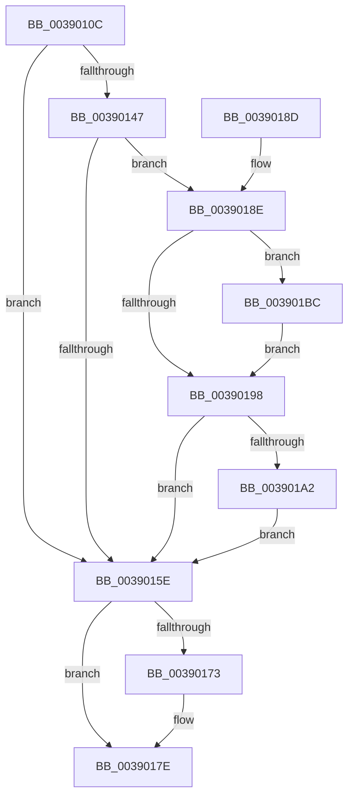

# PopDeepSleepClearDisengageReason

- RVA: `0x0039010C`–`0x003901CA` (길이 `190` bytes)
- VA: `0x000000014039010C`
- 실행 섹션: `.text`
- PDB 이름 있음: `예`; PDB Function 태그: `아니요`
- unwind 정보 RVA: `0x00080918`
- 디코드: `49`개 명령, `190/190` bytes 표시
- 미해석 바이트: `0` (있으면 어셈블리에 `.byte`로 보존)

> 이 문서는 커널 이미지의 기계어와 PDB 기호를 분석해 생성했습니다. 4번과 5번은 함수 원형과 자료형을 바이너리 사용 방식에서 추정한 C 해석이며 원본 소스 복구 결과는 아닙니다.

## 1. Dependencies

- 직접 호출 지점: **7**; 고유 호출 대상: **7**
- 직접 호출자로 확인된 함수: **13**
- RIP 상대 이미지 참조: **9**

### Outgoing calls
- `0x0039011F` → [KeAcquireSpinLockRaiseToDpc](../20/KeAcquireSpinLockRaiseToDpc_function_00208470.md) (function, `0x00208470`)
- `0x00390147` → [PopDiagTraceClearDeepSleepConstraint](PopDiagTraceClearDeepSleepConstraint_function_00390A44.md) (function, `0x00390A44`)
- `0x00390150` → [PopDeepSleepResiliencyPhaseAccountingUpdate](PopDeepSleepResiliencyPhaseAccountingUpdate_function_003901D0.md) (function, `0x003901D0`)
- `0x00390165` → [KxReleaseSpinLock](../20/KxReleaseSpinLock_function_00206670.md) (function, `0x00206670`)
- `0x00390179` → [KiLowerIrqlProcessIrqlFlags](../4F/KiLowerIrqlProcessIrqlFlags_function_004F5698.md) (function, `0x004F5698`)
- `0x003901B5` → [ExQueueWorkItem](../2F/ExQueueWorkItem_function_002F9520.md) (function, `0x002F9520`)
- `0x003901BC` → [KeSetForceIdle](../48/KeSetForceIdle_function_0048D5A8.md) (function, `0x0048D5A8`)

### Direct callers
- [PopDequeueQuerySetIrp](../26/PopDequeueQuerySetIrp_function_0026EC34.md) at `0x0026ED65`
- [PopFxPlatformStateAvailable](../30/PopFxPlatformStateAvailable_function_00303F6C.md) at `0x0030401B`
- [PpmUpdatePlatformIdleVeto](../30/PpmUpdatePlatformIdleVeto_function_003047E0.md) at `0x00304909`
- [PopDecrementPowerSettingPendingUpdates](PopDecrementPowerSettingPendingUpdates_function_0039007C.md) at `0x003900B7`
- [PopSetPowerActionState](../4B/PopSetPowerActionState_function_004BC8A8.md) at `0x004BC8CE`
- [PopThermalEventTransitionEnableDeepSleep](../4F/PopThermalEventTransitionEnableDeepSleep_function_004FB584.md) at `0x004FB5BA`
- [PopThermalEventTransitionTimerCallback](../5D/PopThermalEventTransitionTimerCallback_function_005D5550.md) at `0x005D5572`
- [PopDirectedDripsWorkerRoutine](../../page/75/PopDirectedDripsWorkerRoutine_function_00757DF0.md) at `0x00757E8B`
- [PopIdleAoAcDozeToS4](../../page/76/PopIdleAoAcDozeToS4_function_00768790.md) at `0x0076885A`
- [PopCheckResiliencyScenarios](../../page/A3/PopCheckResiliencyScenarios_function_00A31718.md) at `0x00A31848`
- [PopDirectedDripsHandleResiliencyNotification](../../page/A4/PopDirectedDripsHandleResiliencyNotification_function_00A4DC3C.md) at `0x00A4DD20`
- [PopPowerInformationInternal](../../page/A8/PopPowerInformationInternal_function_00A8B7C0.md) at `0x00A8C3CF`
- [PopEnforceDeepSleep](../../page/AC/PopEnforceDeepSleep_function_00AC3E1C.md) at `0x00AC3E7D`
- [PopEnforceDeepSleep](../../page/AC/PopEnforceDeepSleep_function_00AC3E1C.md) at `0x00AC3E84`

### Static image references
- `0x00390118` → RVA `0x00F09328` (`.data`; read)
- `0x00390124` → RVA `0x00F09330` (`.data`; read)
- `0x0039013C` → RVA `0x00F09330` (`.data`; write)
- `0x0039016A` → RVA `0x00FC6D20` (`ALMOSTRO`; read)
- `0x0039018E` → RVA `0x00F0C9D8` (`.data`; read)
- `0x00390198` → RVA `0x00F09320` (`.data`; read)
- `0x003901A7` → RVA `0x00F09320` (`.data`; write)
- `0x003901AE` → RVA `0x00F09300` (`.data`; read)
- `0x003901C1` → RVA `0x00F0C9C8` (`.data`; write)

## 2. Other-region calls and transfers

- 다른 실행 섹션으로 향하는 call: **0**
- 별도 외부 분기/꼬리 이동을 확인하지 못했습니다.

## 3. Assembly (complete function range)

```asm
0039010C  48 89 5C 24 08                  mov qword ptr [rsp + 8], rbx
00390111  57                              push rdi
00390112  48 83 EC 20                     sub rsp, 0x20
00390116  8B F9                           mov edi, ecx
00390118  48 8D 0D 09 92 B7 00            lea rcx, [rip + 0xb79209]
0039011F  E8 4C 83 E7 FF                  call 0x140208470
00390124  44 8B 05 05 92 B7 00            mov r8d, dword ptr [rip + 0xb79205]
0039012B  8B CF                           mov ecx, edi
0039012D  BA 01 00 00 00                  mov edx, 1
00390132  0F B6 D8                        movzx ebx, al
00390135  D3 E2                           shl edx, cl
00390137  F7 D2                           not edx
00390139  41 23 D0                        and edx, r8d
0039013C  89 15 EE 91 B7 00               mov dword ptr [rip + 0xb791ee], edx
00390142  44 3B C2                        cmp r8d, edx
00390145  74 17                           je 0x14039015e
00390147  E8 F8 08 00 00                  call 0x140390a44
0039014C  33 D2                           xor edx, edx
0039014E  8B CF                           mov ecx, edi
00390150  E8 7B 00 00 00                  call 0x1403901d0
00390155  83 3D D4 91 B7 00 00            cmp dword ptr [rip + 0xb791d4], 0
0039015C  74 30                           je 0x14039018e
0039015E  48 8D 0D C3 91 B7 00            lea rcx, [rip + 0xb791c3]
00390165  E8 06 65 E7 FF                  call 0x140206670
0039016A  83 3D AF 6B C3 00 00            cmp dword ptr [rip + 0xc36baf], 0
00390171  74 0B                           je 0x14039017e
00390173  44 0F 20 C1                     mov rcx, cr8
00390177  8A D3                           mov dl, bl
00390179  E8 1A 55 16 00                  call 0x1404f5698
0039017E  44 0F 22 C3                     mov cr8, rbx
00390182  48 8B 5C 24 30                  mov rbx, qword ptr [rsp + 0x30]
00390187  48 83 C4 20                     add rsp, 0x20
0039018B  5F                              pop rdi
0039018C  C3                              ret
0039018D  CC                              int3
0039018E  8B 05 44 C8 B7 00               mov eax, dword ptr [rip + 0xb7c844]
00390194  A8 04                           test al, 4
00390196  75 24                           jne 0x1403901bc
00390198  8A 05 82 91 B7 00               mov al, byte ptr [rip + 0xb79182]
0039019E  84 C0                           test al, al
003901A0  75 BC                           jne 0x14039015e
003901A2  BA 01 00 00 00                  mov edx, 1
003901A7  C6 05 72 91 B7 00 01            mov byte ptr [rip + 0xb79172], 1
003901AE  48 8D 0D 4B 91 B7 00            lea rcx, [rip + 0xb7914b]
003901B5  E8 66 93 F6 FF                  call 0x1402f9520
003901BA  EB A2                           jmp 0x14039015e
003901BC  E8 E7 D3 0F 00                  call 0x14048d5a8
003901C1  C6 05 00 C8 B7 00 01            mov byte ptr [rip + 0xb7c800], 1
003901C8  EB CE                           jmp 0x140390198
```

## 4. C-style interpretation (structured pseudocode)

```c
__int64 __fastcall PopDeepSleepClearDisengageReason(int a1)
{
    __int64 result;
    __int64 v_rsp;
    unsigned __int64 v_stack_p8;

    v_stack_p8 = v_rbx;
    v_rsp = (v_rsp) - (32);
    result = KeAcquireSpinLockRaiseToDpc(v_rip + 12030473, a2, a3, a4);
    a2 = (unsigned int)((1) << ((unsigned __int8)((unsigned int)((unsigned int)((unsigned int)(a1))))));
    a2 = (unsigned int)(~(a2));
    a2 = (unsigned int)((a2) & ((unsigned int)((unsigned int)(*(unsigned int *)(v_rip + 12030469)))));
    *(unsigned int *)(v_rip + 12030446) = (unsigned int)(a2);
    if (((unsigned int)((unsigned int)(*(unsigned int *)(v_rip + 12030469)))) == ((unsigned int)(a2))) goto loc_0039015E;
    result = PopDiagTraceClearDeepSleepConstraint((unsigned int)((unsigned int)((unsigned int)(a1))), a2, (unsigned int)(*(unsigned int *)(v_rip + 12030469)), a4);
    a2 = 0;
    result = PopDeepSleepResiliencyPhaseAccountingUpdate((unsigned int)((unsigned int)((unsigned int)(a1))), a2, (unsigned int)(*(unsigned int *)(v_rip + 12030469)), a4);
    if ((*(unsigned int *)(v_rip + 12030420)) == 0) goto loc_0039018E;
loc_0039015E:
    result = KxReleaseSpinLock(v_rip + 12030403, a2, (unsigned int)(*(unsigned int *)(v_rip + 12030469)), a4);
    if ((*(unsigned int *)(v_rip + 12807087)) != 0) {
        a1 = v_cr8;
        a2 = (unsigned __int8)((unsigned __int8)(result));
        result = KiLowerIrqlProcessIrqlFlags(a1, a2, (unsigned int)(*(unsigned int *)(v_rip + 12030469)), a4);
    }
    v_rsp = (v_rsp) + (32);
    return result;
loc_0039018E:
    if ((((unsigned __int8)((unsigned int)(*(unsigned int *)(v_rip + 12044356)))) & (4)) != 0) goto loc_003901BC;
loc_00390198:
    if ((unsigned __int8)(*(unsigned __int8 *)(v_rip + 12030338)) != 0) goto loc_0039015E;
    *(unsigned __int8 *)(v_rip + 12030322) = 1;
    result = ExQueueWorkItem(v_rip + 12030283, 1, (unsigned int)(*(unsigned int *)(v_rip + 12030469)), a4);
    goto loc_0039015E;
loc_003901BC:
    result = KeSetForceIdle(v_rip + 12030283, 1, (unsigned int)(*(unsigned int *)(v_rip + 12030469)), a4);
    *(unsigned __int8 *)(v_rip + 12044288) = 1;
    goto loc_00390198;
}
```

## 5. (Beta) C Style

```c
int64_t PopDeepSleepClearDisengageReason(int32_t Arg1)
{
    int64_t result;
    int64_t local_rsp;
    uint64_t v_stack_p8;

    v_stack_p8 = local_rbx;
    local_rsp = (local_rsp) - (32);
    result = KeAcquireSpinLockRaiseToDpc(v_rip + 12030473, a2, a3, a4);
    a2 = (uint32_t)((1) << ((uint8_t)((uint32_t)((uint32_t)((uint32_t)(Arg1))))));
    a2 = (uint32_t)(~(a2));
    a2 = (uint32_t)((a2) & ((uint32_t)((uint32_t)(*(uint32_t *)(v_rip + 0xB79205)))));
    *(uint32_t *)(v_rip + 0xB791EE) = (uint32_t)(a2);
    if (((uint32_t)((uint32_t)(*(uint32_t *)(v_rip + 0xB79205)))) == ((uint32_t)(a2))) goto loc_0039015E;
    result = PopDiagTraceClearDeepSleepConstraint((uint32_t)((uint32_t)((uint32_t)(Arg1))), a2, (uint32_t)(*(uint32_t *)(v_rip + 0xB79205)), a4);
    a2 = 0;
    result = PopDeepSleepResiliencyPhaseAccountingUpdate((uint32_t)((uint32_t)((uint32_t)(Arg1))), a2, (uint32_t)(*(uint32_t *)(v_rip + 0xB79205)), a4);
    if ((*(uint32_t *)(v_rip + 0xB791D4)) == 0) goto loc_0039018E;
loc_0039015E:
    result = KxReleaseSpinLock(v_rip + 12030403, a2, (uint32_t)(*(uint32_t *)(v_rip + 0xB79205)), a4);
    if ((*(uint32_t *)(v_rip + 0xC36BAF)) != 0) {
        Arg1 = v_cr8;
        a2 = (uint8_t)((uint8_t)(result));
        result = KiLowerIrqlProcessIrqlFlags(Arg1, a2, (uint32_t)(*(uint32_t *)(v_rip + 0xB79205)), a4);
    }
    local_rsp = (local_rsp) + (32);
    return result;
loc_0039018E:
    if ((((uint8_t)((uint32_t)(*(uint32_t *)(v_rip + 0xB7C844)))) & (4)) != 0) goto loc_003901BC;
loc_00390198:
    if ((uint8_t)(*(uint8_t *)(v_rip + 0xB79182)) != 0) goto loc_0039015E;
    *(uint8_t *)(v_rip + 0xB79172) = 1;
    result = ExQueueWorkItem(v_rip + 12030283, 1, (uint32_t)(*(uint32_t *)(v_rip + 0xB79205)), a4);
    goto loc_0039015E;
loc_003901BC:
    result = KeSetForceIdle(v_rip + 12030283, 1, (uint32_t)(*(uint32_t *)(v_rip + 0xB79205)), a4);
    *(uint8_t *)(v_rip + 0xB7C800) = 1;
    goto loc_00390198;
}
```

## 6. Execution-region graph

[열기: 2D/3D 그래프와 함수 탐색 컨트롤 패널](../../../control-panel.html?section=text&rva=0x0039010C&view=graph)

- 2D 그래프는 위에서 아래로 흐르고, 3D 그래프는 빈 공간을 드래그해 회전합니다. Shift+드래그는 이동, 휠은 확대·축소, 함수 노드 선택은 대상 보고서 이동입니다.

### Static fallback


