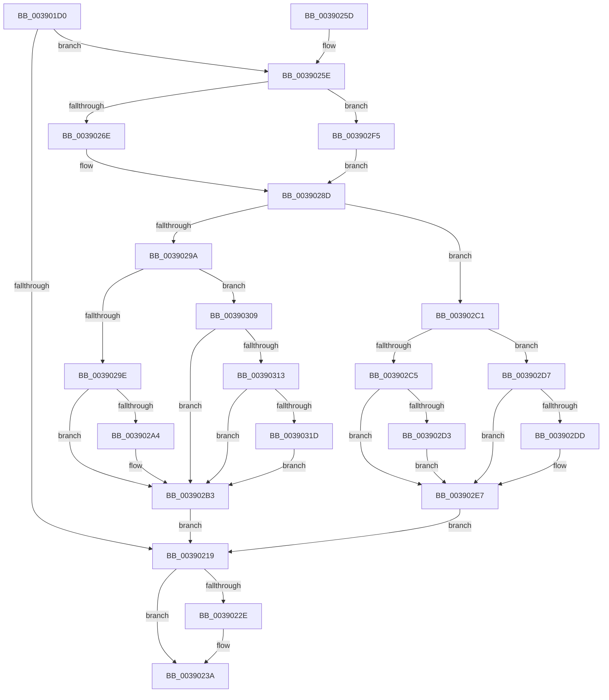

# PopDeepSleepResiliencyPhaseAccountingUpdate

- RVA: `0x003901D0`–`0x00390324` (길이 `340` bytes)
- VA: `0x00000001403901D0`
- 실행 섹션: `.text`
- PDB 이름 있음: `예`; PDB Function 태그: `아니요`
- unwind 정보 RVA: `0x00080928`
- 디코드: `96`개 명령, `340/340` bytes 표시
- 미해석 바이트: `0` (있으면 어셈블리에 `.byte`로 보존)

> 이 문서는 커널 이미지의 기계어와 PDB 기호를 분석해 생성했습니다. 4번과 5번은 함수 원형과 자료형을 바이너리 사용 방식에서 추정한 C 해석이며 원본 소스 복구 결과는 아닙니다.

## 1. Dependencies

- 직접 호출 지점: **6**; 고유 호출 대상: **6**
- 직접 호출자로 확인된 함수: **2**
- RIP 상대 이미지 참조: **5**

### Outgoing calls
- `0x00390206` → [KeAcquireSpinLockRaiseToDpc](../20/KeAcquireSpinLockRaiseToDpc_function_00208470.md) (function, `0x00208470`)
- `0x00390220` → [KxReleaseSpinLock](../20/KxReleaseSpinLock_function_00206670.md) (function, `0x00206670`)
- `0x00390235` → [KiLowerIrqlProcessIrqlFlags](../4F/KiLowerIrqlProcessIrqlFlags_function_004F5698.md) (function, `0x004F5698`)
- `0x00390260` → [KeQueryPerformanceCounter](../37/KeQueryPerformanceCounter_function_0037E7E0.md) (function, `0x0037E7E0`)
- `0x003902B7` → [PopDeepSleepResiliencyPhaseAccountingBegin](../4A/PopDeepSleepResiliencyPhaseAccountingBegin_function_004A72B4.md) (function, `0x004A72B4`)
- `0x003902EB` → [PopDeepSleepResiliencyPhaseAccountingEnd](../4A/PopDeepSleepResiliencyPhaseAccountingEnd_function_004AF6C8.md) (function, `0x004AF6C8`)

### Direct callers
- [PopDeepSleepSetDisengageReason](../38/PopDeepSleepSetDisengageReason_function_0038FEC4.md) at `0x0038FF3D`
- [PopDeepSleepClearDisengageReason](PopDeepSleepClearDisengageReason_function_0039010C.md) at `0x00390150`

### Static image references
- `0x003901FF` → RVA `0x00F0CA58` (`.data`; read)
- `0x0039020B` → RVA `0x00F0C7DC` (`.data`; read)
- `0x00390225` → RVA `0x00FC6D20` (`ALMOSTRO`; read)
- `0x0039026E` → RVA `0x00F0C740` (`.data`; read)
- `0x003902A4` → RVA `0x00F09330` (`.data`; read)

## 2. Other-region calls and transfers

- 다른 실행 섹션으로 향하는 call: **0**
- 별도 외부 분기/꼬리 이동을 확인하지 못했습니다.

## 3. Assembly (complete function range)

```asm
003901D0  48 8B C4                        mov rax, rsp
003901D3  48 89 58 08                     mov qword ptr [rax + 8], rbx
003901D7  48 89 68 10                     mov qword ptr [rax + 0x10], rbp
003901DB  48 89 70 18                     mov qword ptr [rax + 0x18], rsi
003901DF  48 89 78 20                     mov qword ptr [rax + 0x20], rdi
003901E3  41 54                           push r12
003901E5  41 56                           push r14
003901E7  41 57                           push r15
003901E9  48 83 EC 20                     sub rsp, 0x20
003901ED  4C 63 F9                        movsxd r15, ecx
003901F0  33 FF                           xor edi, edi
003901F2  41 8B CF                        mov ecx, r15d
003901F5  44 8A E2                        mov r12b, dl
003901F8  33 DB                           xor ebx, ebx
003901FA  8D 77 01                        lea esi, [rdi + 1]
003901FD  D3 E6                           shl esi, cl
003901FF  48 8D 0D 52 C8 B7 00            lea rcx, [rip + 0xb7c852]
00390206  E8 65 82 E7 FF                  call 0x140208470
0039020B  8B 2D CB C5 B7 00               mov ebp, dword ptr [rip + 0xb7c5cb]
00390211  44 0F B6 F0                     movzx r14d, al
00390215  85 F5                           test ebp, esi
00390217  75 45                           jne 0x14039025e
00390219  48 8D 0D 38 C8 B7 00            lea rcx, [rip + 0xb7c838]
00390220  E8 4B 64 E7 FF                  call 0x140206670
00390225  83 3D F4 6A C3 00 00            cmp dword ptr [rip + 0xc36af4], 0
0039022C  74 0C                           je 0x14039023a
0039022E  44 0F 20 C1                     mov rcx, cr8
00390232  41 8A D6                        mov dl, r14b
00390235  E8 5E 54 16 00                  call 0x1404f5698
0039023A  45 0F 22 C6                     mov cr8, r14
0039023E  48 8B 5C 24 40                  mov rbx, qword ptr [rsp + 0x40]
00390243  48 8B 6C 24 48                  mov rbp, qword ptr [rsp + 0x48]
00390248  48 8B 74 24 50                  mov rsi, qword ptr [rsp + 0x50]
0039024D  48 8B 7C 24 58                  mov rdi, qword ptr [rsp + 0x58]
00390252  48 83 C4 20                     add rsp, 0x20
00390256  41 5F                           pop r15
00390258  41 5E                           pop r14
0039025A  41 5C                           pop r12
0039025C  C3                              ret
0039025D  CC                              int3
0039025E  33 C9                           xor ecx, ecx
00390260  E8 7B E5 FE FF                  call 0x14037e7e0
00390265  45 84 E4                        test r12b, r12b
00390268  0F 85 87 00 00 00               jne 0x1403902f5
0039026E  48 8D 0D CB C4 B7 00            lea rcx, [rip + 0xb7c4cb]
00390275  4C 8D 81 A0 00 00 00            lea r8, [rcx + 0xa0]
0039027C  4F 8D 04 F8                     lea r8, [r8 + r15*8]
00390280  49 2B 00                        sub rax, qword ptr [r8]
00390283  4A 01 84 F9 F8 00 00 00         add qword ptr [rcx + r15*8 + 0xf8], rax
0039028B  33 C0                           xor eax, eax
0039028D  49 89 00                        mov qword ptr [r8], rax
00390290  8B C6                           mov eax, esi
00390292  83 E0 03                        and eax, 3
00390295  45 84 E4                        test r12b, r12b
00390298  75 27                           jne 0x1403902c1
0039029A  85 C0                           test eax, eax
0039029C  75 6B                           jne 0x140390309
0039029E  40 F6 C6 40                     test sil, 0x40
003902A2  74 0F                           je 0x1403902b3
003902A4  F6 05 85 90 B7 00 40            test byte ptr [rip + 0xb79085], 0x40
003902AB  B8 BC 07 00 00                  mov eax, 0x7bc
003902B0  0F 44 F8                        cmove edi, eax
003902B3  B2 01                           mov dl, 1
003902B5  8B CF                           mov ecx, edi
003902B7  E8 F8 6F 11 00                  call 0x1404a72b4
003902BC  E9 58 FF FF FF                  jmp 0x140390219
003902C1  85 C0                           test eax, eax
003902C3  74 12                           je 0x1403902d7
003902C5  8B DD                           mov ebx, ebp
003902C7  B8 BC 07 00 00                  mov eax, 0x7bc
003902CC  83 E3 40                        and ebx, 0x40
003902CF  85 E8                           test eax, ebp
003902D1  74 14                           je 0x1403902e7
003902D3  0B D8                           or ebx, eax
003902D5  EB 10                           jmp 0x1403902e7
003902D7  40 F6 C6 40                     test sil, 0x40
003902DB  74 0A                           je 0x1403902e7
003902DD  B8 BC 07 00 00                  mov eax, 0x7bc
003902E2  85 E8                           test eax, ebp
003902E4  0F 45 D8                        cmovne ebx, eax
003902E7  B2 01                           mov dl, 1
003902E9  8B CB                           mov ecx, ebx
003902EB  E8 D8 F3 11 00                  call 0x1404af6c8
003902F0  E9 24 FF FF FF                  jmp 0x140390219
003902F5  4C 8D 05 44 C4 B7 00            lea r8, [rip + 0xb7c444]
003902FC  4D 8D 80 A0 00 00 00            lea r8, [r8 + 0xa0]
00390303  4F 8D 04 F8                     lea r8, [r8 + r15*8]
00390307  EB 84                           jmp 0x14039028d
00390309  8B 05 21 90 B7 00               mov eax, dword ptr [rip + 0xb79021]
0039030F  A8 03                           test al, 3
00390311  75 A0                           jne 0x1403902b3
00390313  BF 40 00 00 00                  mov edi, 0x40
00390318  40 84 C7                        test dil, al
0039031B  75 96                           jne 0x1403902b3
0039031D  BF FC 07 00 00                  mov edi, 0x7fc
00390322  EB 8F                           jmp 0x1403902b3
```

## 4. C-style interpretation (structured pseudocode)

```c
__int64 __fastcall PopDeepSleepResiliencyPhaseAccountingUpdate(int a1, unsigned __int8 a2)
{
    __int64 result;
    __int64 v_rbx;
    __int64 v_rdi;
    __int64 v_rsi;
    __int64 v_rsp;
    unsigned __int64 v_stack_p10;
    unsigned __int64 v_stack_p18;
    unsigned __int64 v_stack_p20;
    unsigned __int64 v_stack_p8;

    *(unsigned __int64 *)(v_rsp + 8) = v_rbx;
    *(unsigned __int64 *)(v_rsp + 16) = v_rbp;
    *(unsigned __int64 *)(v_rsp + 24) = v_rsi;
    *(unsigned __int64 *)(v_rsp + 32) = v_rdi;
    v_rsp = (v_rsp) - (32);
    v_rdi = 0;
    v_rbx = 0;
    v_rsi = (unsigned int)((v_rdi + 1) << ((unsigned __int8)((unsigned int)((unsigned int)((int)(a1))))));
    result = KeAcquireSpinLockRaiseToDpc(v_rip + 12044370, a2, a3, a4);
    if ((((unsigned int)((unsigned int)(*(unsigned int *)(v_rip + 12043723)))) & ((unsigned int)(v_rsi))) != 0) goto loc_0039025E;
loc_00390219:
    result = KxReleaseSpinLock(v_rip + 12044344, a2, a3, a4);
    if ((*(unsigned int *)(v_rip + 12806900)) != 0) {
        a1 = v_cr8;
        a2 = (unsigned __int8)((unsigned __int8)(result));
        result = KiLowerIrqlProcessIrqlFlags(a1, a2, a3, a4);
    }
    v_rsp = (v_rsp) + (32);
    return result;
loc_0039025E:
    a1 = 0;
    result = KeQueryPerformanceCounter(a1, a2, a3, a4);
    if (a2 != 0) goto loc_003902F5;
    result = (result) - (*(unsigned __int64 *)(v_rip + 12043467 + 160 + (int)(a1) * 8));
    result = 0;
loc_0039028D:
    *(unsigned __int64 *)(v_rip + 12043467 + 160 + (int)(a1) * 8) = 0;
    result = (unsigned int)(((unsigned int)((unsigned int)(v_stack_p18))) & (3));
    if (a2 != 0) goto loc_003902C1;
    if ((unsigned int)(result) != 0) goto loc_00390309;
    v_rdi = v_stack_p20;
    if ((((unsigned __int8)(v_stack_p18)) & (64)) != 0) {
        result = 0x7BCULL;
        v_rdi = v_stack_p20;
        if (((*(unsigned __int8 *)(v_rip + 12030085)) & (64)) == 0) { v_rdi = (unsigned int)(result); }
    }
    result = PopDeepSleepResiliencyPhaseAccountingBegin((unsigned int)((unsigned int)(v_rdi)), 1, v_rip + 12043467 + 160 + (int)(a1) * 8, a4);
    goto loc_00390219;
loc_003902C1:
    if ((unsigned int)(result) == 0) goto loc_003902D7;
    v_rbx = (unsigned int)(((unsigned int)((unsigned int)(v_stack_p10))) & (64));
    if ((((unsigned int)((unsigned int)(0x7BCULL))) & ((unsigned int)(v_stack_p10))) == 0) goto loc_003902E7;
    v_rbx = (unsigned int)((v_rbx) | ((unsigned int)((unsigned int)(0x7BCULL))));
    goto loc_003902E7;
loc_003902D7:
    result = (unsigned int)(0x7BCULL);
    if ((((unsigned __int8)(v_stack_p18)) & (64)) != 0) {
        result = 0x7BCULL;
        if ((((unsigned int)(result)) & ((unsigned int)(v_stack_p10))) != 0) { v_rbx = (unsigned int)(result); }
    }
    result = PopDeepSleepResiliencyPhaseAccountingEnd((unsigned int)((unsigned int)(v_rbx)), 1, v_rip + 12043467 + 160 + (int)(a1) * 8, a4);
    goto loc_00390219;
loc_003902F5:
    goto loc_0039028D;
loc_00390309:
    if ((((unsigned __int8)((unsigned int)(*(unsigned int *)(v_rip + 12029985)))) & (3)) != 0) goto loc_003902B3;
    if (((64) & ((unsigned __int8)((unsigned int)(*(unsigned int *)(v_rip + 12029985))))) != 0) goto loc_003902B3;
    goto loc_003902B3;
}
```

## 5. (Beta) C Style

```c
int64_t PopDeepSleepResiliencyPhaseAccountingUpdate(int32_t Arg1, uint8_t Arg2)
{
    int64_t result;
    int64_t local_rbx;
    int64_t local_rdi;
    int64_t local_rsi;
    int64_t local_rsp;
    uint64_t v_stack_p10;
    uint64_t v_stack_p18;
    uint64_t v_stack_p20;
    uint64_t v_stack_p8;

    *(uint64_t *)(local_rsp + 0x8) = local_rbx;
    *(uint64_t *)(local_rsp + 0x10) = local_rbp;
    *(uint64_t *)(local_rsp + 0x18) = local_rsi;
    *(uint64_t *)(local_rsp + 0x20) = local_rdi;
    local_rsp = (local_rsp) - (32);
    local_rdi = 0;
    local_rbx = 0;
    local_rsi = (uint32_t)((local_rdi + 1) << ((uint8_t)((uint32_t)((uint32_t)((int32_t)(Arg1))))));
    result = KeAcquireSpinLockRaiseToDpc(v_rip + 12044370, Arg2, a3, a4);
    if ((((uint32_t)((uint32_t)(*(uint32_t *)(v_rip + 0xB7C5CB)))) & ((uint32_t)(local_rsi))) != 0) goto loc_0039025E;
loc_00390219:
    result = KxReleaseSpinLock(v_rip + 12044344, Arg2, a3, a4);
    if ((*(uint32_t *)(v_rip + 0xC36AF4)) != 0) {
        Arg1 = v_cr8;
        Arg2 = (uint8_t)((uint8_t)(result));
        result = KiLowerIrqlProcessIrqlFlags(Arg1, Arg2, a3, a4);
    }
    local_rsp = (local_rsp) + (32);
    return result;
loc_0039025E:
    Arg1 = 0;
    result = KeQueryPerformanceCounter(Arg1, Arg2, a3, a4);
    if (Arg2 != 0) goto loc_003902F5;
    result = (result) - (*(uint64_t *)(v_rip + 0xB7C4CB + 0xA0 + (int32_t)(Arg1) * 8));
    result = 0;
loc_0039028D:
    *(uint64_t *)(v_rip + 0xB7C4CB + 0xA0 + (int32_t)(Arg1) * 8) = 0;
    result = (uint32_t)(((uint32_t)((uint32_t)(v_stack_p18))) & (3));
    if (Arg2 != 0) goto loc_003902C1;
    if ((uint32_t)(result) != 0) goto loc_00390309;
    local_rdi = v_stack_p20;
    if ((((uint8_t)(v_stack_p18)) & (64)) != 0) {
        result = 0x7BCULL;
        local_rdi = v_stack_p20;
        if (((*(uint8_t *)(v_rip + 0xB79085)) & (64)) == 0) { local_rdi = (uint32_t)(result); }
    }
    result = PopDeepSleepResiliencyPhaseAccountingBegin((uint32_t)((uint32_t)(local_rdi)), 1, v_rip + 12043467 + 160 + (int32_t)(Arg1) * 8, a4);
    goto loc_00390219;
loc_003902C1:
    if ((uint32_t)(result) == 0) goto loc_003902D7;
    local_rbx = (uint32_t)(((uint32_t)((uint32_t)(v_stack_p10))) & (64));
    if ((((uint32_t)((uint32_t)(0x7BCULL))) & ((uint32_t)(v_stack_p10))) == 0) goto loc_003902E7;
    local_rbx = (uint32_t)((local_rbx) | ((uint32_t)((uint32_t)(0x7BCULL))));
    goto loc_003902E7;
loc_003902D7:
    result = (uint32_t)(0x7BCULL);
    if ((((uint8_t)(v_stack_p18)) & (64)) != 0) {
        result = 0x7BCULL;
        if ((((uint32_t)(result)) & ((uint32_t)(v_stack_p10))) != 0) { local_rbx = (uint32_t)(result); }
    }
    result = PopDeepSleepResiliencyPhaseAccountingEnd((uint32_t)((uint32_t)(local_rbx)), 1, v_rip + 12043467 + 160 + (int32_t)(Arg1) * 8, a4);
    goto loc_00390219;
loc_003902F5:
    goto loc_0039028D;
loc_00390309:
    if ((((uint8_t)((uint32_t)(*(uint32_t *)(v_rip + 0xB79021)))) & (3)) != 0) goto loc_003902B3;
    if (((64) & ((uint8_t)((uint32_t)(*(uint32_t *)(v_rip + 0xB79021))))) != 0) goto loc_003902B3;
    goto loc_003902B3;
}
```

## 6. Execution-region graph

[열기: 2D/3D 그래프와 함수 탐색 컨트롤 패널](../../../control-panel.html?section=text&rva=0x003901D0&view=graph)

- 2D 그래프는 위에서 아래로 흐르고, 3D 그래프는 빈 공간을 드래그해 회전합니다. Shift+드래그는 이동, 휠은 확대·축소, 함수 노드 선택은 대상 보고서 이동입니다.

### Static fallback


