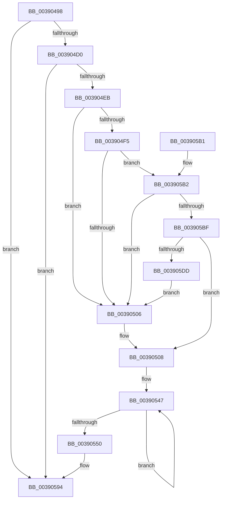

# PopDiagTraceDeviceAcquireIrp

- RVA: `0x00390498`–`0x003905E2` (길이 `330` bytes)
- VA: `0x0000000140390498`
- 실행 섹션: `.text`
- PDB 이름 있음: `예`; PDB Function 태그: `아니요`
- unwind 정보 RVA: `0x00080968`
- 디코드: `72`개 명령, `330/330` bytes 표시
- 미해석 바이트: `0` (있으면 어셈블리에 `.byte`로 보존)

> 이 문서는 커널 이미지의 기계어와 PDB 기호를 분석해 생성했습니다. 4번과 5번은 함수 원형과 자료형을 바이너리 사용 방식에서 추정한 C 해석이며 원본 소스 복구 결과는 아닙니다.

## 1. Dependencies

- 직접 호출 지점: **4**; 고유 호출 대상: **4**
- 직접 호출자로 확인된 함수: **1**
- RIP 상대 이미지 참조: **5**

### Outgoing calls
- `0x003904DE` → [EtwEventEnabled](EtwEventEnabled_function_00392450.md) (function, `0x00392450`)
- `0x0039058F` → [EtwWriteEx](../25/EtwWriteEx_function_0025F0D0.md) (function, `0x0025F0D0`)
- `0x0039059B` → [_security_check_cookie](../6A/_security_check_cookie_function_006AC640.md) (function, `0x006AC640`)
- `0x003905CB` → [RtlStringCbCopyNW](RtlStringCbCopyNW_function_003905E8.md) (function, `0x003905E8`)

### Direct callers
- [PoDeviceAcquireIrp](../38/PoDeviceAcquireIrp_function_0038FF88.md) at `0x0038FFB1`

### Static image references
- `0x003904AF` → RVA `0x00E0A740` (`.data`; read)
- `0x003904C4` → RVA `0x00E67858` (`.data`; read)
- `0x003904D0` → RVA `0x00F0B408` (`.data`; read)
- `0x003904D7` → RVA `0x00011270` (`.rdata`; read)
- `0x00390525` → RVA `0x006C8EC0` (` ?? ::FNODOBFM::`string'`; read)

## 2. Other-region calls and transfers

- 다른 실행 섹션으로 향하는 call: **0**
- 별도 외부 분기/꼬리 이동을 확인하지 못했습니다.

## 3. Assembly (complete function range)

```asm
00390498  48 89 5C 24 18                  mov qword ptr [rsp + 0x18], rbx
0039049D  48 89 4C 24 08                  mov qword ptr [rsp + 8], rcx
003904A2  55                              push rbp
003904A3  48 8D 6C 24 F0                  lea rbp, [rsp - 0x10]
003904A8  48 81 EC 10 01 00 00            sub rsp, 0x110
003904AF  48 8B 05 8A A2 A7 00            mov rax, qword ptr [rip + 0xa7a28a]
003904B6  48 33 C4                        xor rax, rsp
003904B9  48 89 45 00                     mov qword ptr [rbp], rax
003904BD  33 DB                           xor ebx, ebx
003904BF  48 89 54 24 40                  mov qword ptr [rsp + 0x40], rdx
003904C4  38 1D 8E 73 AD 00               cmp byte ptr [rip + 0xad738e], bl
003904CA  0F 84 C4 00 00 00               je 0x140390594
003904D0  48 8B 0D 31 AF B7 00            mov rcx, qword ptr [rip + 0xb7af31]
003904D7  48 8D 15 92 0D C8 FF            lea rdx, [rip - 0x37f26e]
003904DE  E8 6D 1F 00 00                  call 0x140392450
003904E3  84 C0                           test al, al
003904E5  0F 84 A9 00 00 00               je 0x140390594
003904EB  48 8B 44 24 40                  mov rax, qword ptr [rsp + 0x40]
003904F0  48 85 C0                        test rax, rax
003904F3  74 11                           je 0x140390506
003904F5  48 8B 40 08                     mov rax, qword ptr [rax + 8]
003904F9  4C 8B 40 40                     mov r8, qword ptr [rax + 0x40]
003904FD  4D 85 C0                        test r8, r8
00390500  0F 85 AC 00 00 00               jne 0x1403905b2
00390506  8B C3                           mov eax, ebx
00390508  85 C0                           test eax, eax
0039050A  48 C7 44 24 50 08 00 00 00      mov qword ptr [rsp + 0x50], 8
00390513  48 8D 45 20                     lea rax, [rbp + 0x20]
00390517  48 C7 44 24 60 08 00 00 00      mov qword ptr [rsp + 0x60], 8
00390520  48 89 44 24 48                  mov qword ptr [rsp + 0x48], rax
00390525  48 8D 15 94 89 33 00            lea rdx, [rip + 0x338994]
0039052C  48 8D 44 24 40                  lea rax, [rsp + 0x40]
00390531  48 8D 4D 80                     lea rcx, [rbp - 0x80]
00390535  48 89 44 24 58                  mov qword ptr [rsp + 0x58], rax
0039053A  48 0F 44 CA                     cmove rcx, rdx
0039053E  48 83 C8 FF                     or rax, 0xffffffffffffffff
00390542  48 89 4C 24 68                  mov qword ptr [rsp + 0x68], rcx
00390547  48 FF C0                        inc rax
0039054A  66 39 1C 41                     cmp word ptr [rcx + rax*2], bx
0039054E  75 F7                           jne 0x140390547
00390550  48 8B 0D B1 AE B7 00            mov rcx, qword ptr [rip + 0xb7aeb1]
00390557  8D 04 45 02 00 00 00            lea eax, [rax*2 + 2]
0039055E  89 44 24 70                     mov dword ptr [rsp + 0x70], eax
00390562  48 8D 15 07 0D C8 FF            lea rdx, [rip - 0x37f2f9]
00390569  48 8D 44 24 48                  lea rax, [rsp + 0x48]
0039056E  89 5C 24 74                     mov dword ptr [rsp + 0x74], ebx
00390572  48 89 44 24 38                  mov qword ptr [rsp + 0x38], rax
00390577  45 33 C9                        xor r9d, r9d
0039057A  C7 44 24 30 03 00 00 00         mov dword ptr [rsp + 0x30], 3
00390582  45 33 C0                        xor r8d, r8d
00390585  48 89 5C 24 28                  mov qword ptr [rsp + 0x28], rbx
0039058A  48 89 5C 24 20                  mov qword ptr [rsp + 0x20], rbx
0039058F  E8 3C EB EC FF                  call 0x14025f0d0
00390594  48 8B 4D 00                     mov rcx, qword ptr [rbp]
00390598  48 33 CC                        xor rcx, rsp
0039059B  E8 A0 C0 31 00                  call 0x1406ac640
003905A0  48 8B 9C 24 30 01 00 00         mov rbx, qword ptr [rsp + 0x130]
003905A8  48 81 C4 10 01 00 00            add rsp, 0x110
003905AF  5D                              pop rbp
003905B0  C3                              ret
003905B1  CC                              int3
003905B2  0F B7 48 38                     movzx ecx, word ptr [rax + 0x38]
003905B6  66 85 C9                        test cx, cx
003905B9  0F 84 47 FF FF FF               je 0x140390506
003905BF  44 8B C9                        mov r9d, ecx
003905C2  BA 80 00 00 00                  mov edx, 0x80
003905C7  48 8D 4D 80                     lea rcx, [rbp - 0x80]
003905CB  E8 18 00 00 00                  call 0x1403905e8
003905D0  85 C0                           test eax, eax
003905D2  B8 01 00 00 00                  mov eax, 1
003905D7  0F 89 2B FF FF FF               jns 0x140390508
003905DD  E9 24 FF FF FF                  jmp 0x140390506
```

## 4. C-style interpretation (structured pseudocode)

```c
__int64 __fastcall PopDiagTraceDeviceAcquireIrp(__int64 a1, __int64 a2, __int64 a3, int a4)
{
    __int64 result;
    __int64 v_rbx;
    __int64 v_rsp;
    unsigned __int64 v_stack_m18;
    unsigned __int64 v_stack_m98;
    unsigned int v_stack_mA4;
    unsigned int v_stack_mA8;
    unsigned __int64 v_stack_mB0;
    unsigned __int64 v_stack_mB8;
    unsigned __int64 v_stack_mC0;
    unsigned __int64 v_stack_mC8;
    unsigned __int64 v_stack_mD0;
    unsigned __int64 v_stack_mD8;
    unsigned __int64 v_stack_mE0;
    unsigned int v_stack_mE8;
    unsigned __int64 v_stack_mF0;
    unsigned __int64 v_stack_mF8;
    unsigned __int64 v_stack_p18;
    unsigned __int64 v_stack_p8;

    v_stack_p18 = v_rbx;
    v_stack_p8 = a1;
    v_rsp = (v_rsp) - (272);
    result = (*(unsigned __int64 *)(v_rip + 10986122)) ^ (v_rsp);
    v_stack_m18 = result;
    v_rbx = 0;
    v_stack_mD8 = a2;
    if ((*(unsigned __int8 *)(v_rip + 11367310)) == 0) goto loc_00390594;
    result = EtwEventEnabled(*(unsigned __int64 *)(v_rip + 12037937), v_rip - 3666542, a3, a4);
    if ((unsigned __int8)(result) == 0) goto loc_00390594;
    if (v_stack_mD8 == 0) goto loc_00390506;
    if (*(unsigned __int64 *)(*(unsigned __int64 *)(v_stack_mD8 + 8) + 64) != 0) goto loc_003905B2;
loc_00390506:
loc_00390508:
    v_stack_mC8 = 8;
    v_stack_mB8 = 8;
    v_stack_mD0 = v_stack_p8;
    v_stack_mC0 = v_stack_mD8;
    a1 = v_stack_m98;
    if (0 == 0) { a1 = v_rip + 3377556; }
    result = (v_stack_mD8) | (-1);
    v_stack_mB0 = a1;
loc_00390547:
    result = (result) + 1;
    if ((*(unsigned __int16 *)(a1 + result * 2)) != 0) goto loc_00390547;
    v_stack_mA8 = (unsigned int)(result * 2 + 2);
    v_stack_mA4 = 0;
    v_stack_mE0 = v_stack_mD0;
    a4 = 0;
    v_stack_mE8 = 3;
    a3 = 0;
    v_stack_mF0 = 0;
    v_stack_mF8 = 0;
    result = EtwWriteEx(*(unsigned __int64 *)(v_rip + 12037809), v_rip - 3666681, a3, a4);
loc_00390594:
    a1 = (v_stack_m18) ^ (v_rsp);
    result = _security_check_cookie(a1, v_rip - 3666681, a3, a4);
    v_rsp = (v_rsp) + (272);
    return result;
loc_003905B2:
    if ((unsigned __int16)(*(unsigned __int16 *)(result + 56)) == 0) goto loc_00390506;
    result = RtlStringCbCopyNW(v_stack_m98, 128, a3, (unsigned int)((unsigned int)(*(unsigned __int16 *)(result + 56))));
    if (!sign_flag) goto loc_00390508;
    goto loc_00390506;
}
```

## 5. (Beta) C Style

```c
int64_t PopDiagTraceDeviceAcquireIrp(int64_t Arg1, int64_t Arg2, int64_t Arg3, int32_t Arg4)
{
    int64_t result;
    int64_t local_rbx;
    int64_t local_rsp;
    uint64_t v_stack_m18;
    uint64_t v_stack_m98;
    uint32_t v_stack_mA4;
    uint32_t v_stack_mA8;
    uint64_t v_stack_mB0;
    uint64_t v_stack_mB8;
    uint64_t v_stack_mC0;
    uint64_t v_stack_mC8;
    uint64_t v_stack_mD0;
    uint64_t v_stack_mD8;
    uint64_t v_stack_mE0;
    uint32_t v_stack_mE8;
    uint64_t v_stack_mF0;
    uint64_t v_stack_mF8;
    uint64_t v_stack_p18;
    uint64_t v_stack_p8;

    v_stack_p18 = local_rbx;
    v_stack_p8 = Arg1;
    local_rsp = (local_rsp) - (272);
    result = (*(uint64_t *)(v_rip + 0xA7A28A)) ^ (local_rsp);
    v_stack_m18 = result;
    local_rbx = 0;
    v_stack_mD8 = Arg2;
    if ((*(uint8_t *)(v_rip + 0xAD738E)) == 0) goto loc_00390594;
    result = EtwEventEnabled(*(uint64_t *)(v_rip + 0xB7AF31), v_rip - 3666542, Arg3, Arg4);
    if ((uint8_t)(result) == 0) goto loc_00390594;
    if (v_stack_mD8 == 0) goto loc_00390506;
    if (*(uint64_t *)(*(uint64_t *)(v_stack_mD8 + 0x8) + 0x40) != 0) goto loc_003905B2;
loc_00390506:
loc_00390508:
    v_stack_mC8 = 8;
    v_stack_mB8 = 8;
    v_stack_mD0 = v_stack_p8;
    v_stack_mC0 = v_stack_mD8;
    Arg1 = v_stack_m98;
    if (0 == 0) { Arg1 = v_rip + 3377556; }
    result = (v_stack_mD8) | (-1);
    v_stack_mB0 = Arg1;
loc_00390547:
    result = (result) + 1;
    if ((*(uint16_t *)(Arg1 + result * 2)) != 0) goto loc_00390547;
    v_stack_mA8 = (uint32_t)(result * 2 + 2);
    v_stack_mA4 = 0;
    v_stack_mE0 = v_stack_mD0;
    Arg4 = 0;
    v_stack_mE8 = 3;
    Arg3 = 0;
    v_stack_mF0 = 0;
    v_stack_mF8 = 0;
    result = EtwWriteEx(*(uint64_t *)(v_rip + 0xB7AEB1), v_rip - 3666681, Arg3, Arg4);
loc_00390594:
    Arg1 = (v_stack_m18) ^ (local_rsp);
    result = _security_check_cookie(Arg1, v_rip - 3666681, Arg3, Arg4);
    local_rsp = (local_rsp) + (272);
    return result;
loc_003905B2:
    if ((uint16_t)(*(uint16_t *)(result + 0x38)) == 0) goto loc_00390506;
    result = RtlStringCbCopyNW(v_stack_m98, 128, Arg3, (uint32_t)((uint32_t)(*(uint16_t *)(result + 0x38))));
    if (!sign_flag) goto loc_00390508;
    goto loc_00390506;
}
```

## 6. Execution-region graph

[열기: 2D/3D 그래프와 함수 탐색 컨트롤 패널](../../../control-panel.html?section=text&rva=0x00390498&view=graph)

- 2D 그래프는 위에서 아래로 흐르고, 3D 그래프는 빈 공간을 드래그해 회전합니다. Shift+드래그는 이동, 휠은 확대·축소, 함수 노드 선택은 대상 보고서 이동입니다.

### Static fallback


