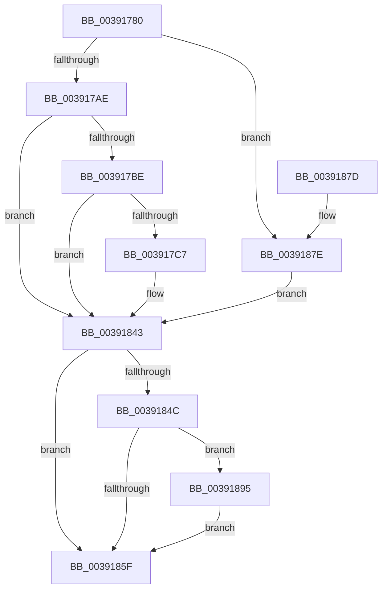

# PopDiagTraceFxDevicePowerRequirement

- RVA: `0x00391780`–`0x00391902` (길이 `386` bytes)
- VA: `0x0000000140391780`
- 실행 섹션: `.text`
- PDB 이름 있음: `예`; PDB Function 태그: `아니요`
- unwind 정보 RVA: `0x00080AB0`
- 디코드: `76`개 명령, `386/386` bytes 표시
- 미해석 바이트: `0` (있으면 어셈블리에 `.byte`로 보존)

> 이 문서는 커널 이미지의 기계어와 PDB 기호를 분석해 생성했습니다. 4번과 5번은 함수 원형과 자료형을 바이너리 사용 방식에서 추정한 C 해석이며 원본 소스 복구 결과는 아닙니다.

## 1. Dependencies

- 직접 호출 지점: **4**; 고유 호출 대상: **4**
- 직접 호출자로 확인된 함수: **5**
- RIP 상대 이미지 참조: **5**

### Outgoing calls
- `0x00391856` → [EtwEventEnabled](EtwEventEnabled_function_00392450.md) (function, `0x00392450`)
- `0x00391867` → [_security_check_cookie](../6A/_security_check_cookie_function_006AC640.md) (function, `0x006AC640`)
- `0x0039188E` → [PopFxAddLogEntry](PopFxAddLogEntry_function_00390B94.md) (function, `0x00390B94`)
- `0x003918F8` → [EtwWriteEx](../25/EtwWriteEx_function_0025F0D0.md) (function, `0x0025F0D0`)

### Direct callers
- [sub_002BD41B](../2B/Unknown_function_002BD41B.md) at `0x002BD4D1`
- [sub_002BD95A](../2B/Unknown_function_002BD95A.md) at `0x002BDBD8`
- [sub_002BD95A](../2B/Unknown_function_002BD95A.md) at `0x002BDC58`
- [PopFxIdleTimeoutDpcRoutine](../49/PopFxIdleTimeoutDpcRoutine_function_00492B80.md) at `0x00492BF4`
- [PopFxDeliverDevicePowerRequired](../49/PopFxDeliverDevicePowerRequired_function_00492C4C.md) at `0x00492C6D`
- [sub_006F985C](../6F/Unknown_function_006F985C.md) at `0x006F987A`

### Static image references
- `0x0039178D` → RVA `0x00E0A740` (`.data`; read)
- `0x003917AE` → RVA `0x00011280` (`.rdata`; read)
- `0x00391843` → RVA `0x00E67858` (`.data`; read)
- `0x0039184C` → RVA `0x00F0B408` (`.data`; read)
- `0x00391880` → RVA `0x00011320` (`.rdata`; read)

## 2. Other-region calls and transfers

- 다른 실행 섹션으로 향하는 call: **0**
- 별도 외부 분기/꼬리 이동을 확인하지 못했습니다.

## 3. Assembly (complete function range)

```asm
00391780  48 89 5C 24 10                  mov qword ptr [rsp + 0x10], rbx
00391785  57                              push rdi
00391786  48 81 EC 80 00 00 00            sub rsp, 0x80
0039178D  48 8B 05 AC 8F A7 00            mov rax, qword ptr [rip + 0xa78fac]
00391794  48 33 C4                        xor rax, rsp
00391797  48 89 44 24 70                  mov qword ptr [rsp + 0x70], rax
0039179C  41 0F B6 F8                     movzx edi, r8b
003917A0  48 89 4C 24 48                  mov qword ptr [rsp + 0x48], rcx
003917A5  80 FA 01                        cmp dl, 1
003917A8  0F 85 D0 00 00 00               jne 0x14039187e
003917AE  48 8D 1D CB FA C7 FF            lea rbx, [rip - 0x380535]
003917B5  48 85 C9                        test rcx, rcx
003917B8  0F 84 85 00 00 00               je 0x140391843
003917BE  4C 8B 49 50                     mov r9, qword ptr [rcx + 0x50]
003917C2  4D 85 C9                        test r9, r9
003917C5  74 7C                           je 0x140391843
003917C7  B8 01 00 00 00                  mov eax, 1
003917CC  F0 41 0F C1 81 80 03 00 00      lock xadd dword ptr [r9 + 0x380], eax
003917D5  33 D2                           xor edx, edx
003917D7  41 F7 B1 70 03 00 00            div dword ptr [r9 + 0x370]
003917DE  48 A1 08 00 00 00 80 F7 FF FF   movabs rax, qword ptr [0xfffff78000000008]
003917E8  4C 8D 04 52                     lea r8, [rdx + rdx*2]
003917EC  49 8B 91 78 03 00 00            mov rdx, qword ptr [r9 + 0x378]
003917F3  4A 89 04 C2                     mov qword ptr [rdx + r8*8], rax
003917F7  66 42 C7 44 C2 08 04 00         mov word ptr [rdx + r8*8 + 8], 4
003917FF  65 48 8B 04 25 20 00 00 00      mov rax, qword ptr gs:[0x20]
00391808  0F B7 48 24                     movzx ecx, word ptr [rax + 0x24]
0039180C  66 42 89 4C C2 0A               mov word ptr [rdx + r8*8 + 0xa], cx
00391812  65 48 8B 04 25 88 01 00 00      mov rax, qword ptr gs:[0x188]
0039181B  0F B7 88 08 05 00 00            movzx ecx, word ptr [rax + 0x508]
00391822  66 42 89 4C C2 0C               mov word ptr [rdx + r8*8 + 0xc], cx
00391828  65 48 8B 04 25 88 01 00 00      mov rax, qword ptr gs:[0x188]
00391831  0F B7 88 10 05 00 00            movzx ecx, word ptr [rax + 0x510]
00391838  66 42 89 4C C2 0E               mov word ptr [rdx + r8*8 + 0xe], cx
0039183E  4A 89 7C C2 10                  mov qword ptr [rdx + r8*8 + 0x10], rdi
00391843  80 3D 0E 60 AD 00 00            cmp byte ptr [rip + 0xad600e], 0
0039184A  74 13                           je 0x14039185f
0039184C  48 8B 0D B5 9B B7 00            mov rcx, qword ptr [rip + 0xb79bb5]
00391853  48 8B D3                        mov rdx, rbx
00391856  E8 F5 0B 00 00                  call 0x140392450
0039185B  84 C0                           test al, al
0039185D  75 36                           jne 0x140391895
0039185F  48 8B 4C 24 70                  mov rcx, qword ptr [rsp + 0x70]
00391864  48 33 CC                        xor rcx, rsp
00391867  E8 D4 AD 31 00                  call 0x1406ac640
0039186C  48 8B 9C 24 98 00 00 00         mov rbx, qword ptr [rsp + 0x98]
00391874  48 81 C4 80 00 00 00            add rsp, 0x80
0039187B  5F                              pop rdi
0039187C  C3                              ret
0039187D  CC                              int3
0039187E  33 D2                           xor edx, edx
00391880  48 8D 1D 99 FA C7 FF            lea rbx, [rip - 0x380567]
00391887  4C 8B CF                        mov r9, rdi
0039188A  44 8D 42 05                     lea r8d, [rdx + 5]
0039188E  E8 01 F3 FF FF                  call 0x140390b94
00391893  EB AE                           jmp 0x140391843
00391895  83 64 24 5C 00                  and dword ptr [rsp + 0x5c], 0
0039189A  48 8D 44 24 48                  lea rax, [rsp + 0x48]
0039189F  83 64 24 6C 00                  and dword ptr [rsp + 0x6c], 0
003918A4  41 B9 01 00 00 00               mov r9d, 1
003918AA  48 8B 0D 57 9B B7 00            mov rcx, qword ptr [rip + 0xb79b57]
003918B1  45 33 C0                        xor r8d, r8d
003918B4  48 89 44 24 50                  mov qword ptr [rsp + 0x50], rax
003918B9  48 8B D3                        mov rdx, rbx
003918BC  48 8D 44 24 40                  lea rax, [rsp + 0x40]
003918C1  89 7C 24 40                     mov dword ptr [rsp + 0x40], edi
003918C5  48 89 44 24 60                  mov qword ptr [rsp + 0x60], rax
003918CA  48 8D 44 24 50                  lea rax, [rsp + 0x50]
003918CF  48 89 44 24 38                  mov qword ptr [rsp + 0x38], rax
003918D4  C7 44 24 30 02 00 00 00         mov dword ptr [rsp + 0x30], 2
003918DC  48 83 64 24 28 00               and qword ptr [rsp + 0x28], 0
003918E2  48 83 64 24 20 00               and qword ptr [rsp + 0x20], 0
003918E8  C7 44 24 58 08 00 00 00         mov dword ptr [rsp + 0x58], 8
003918F0  C7 44 24 68 04 00 00 00         mov dword ptr [rsp + 0x68], 4
003918F8  E8 D3 D7 EC FF                  call 0x14025f0d0
003918FD  E9 5D FF FF FF                  jmp 0x14039185f
```

## 4. C-style interpretation (structured pseudocode)

```c
__int64 __fastcall PopDiagTraceFxDevicePowerRequirement(__int64 a1, int a2, unsigned __int8 a3)
{
    __int64 result;
    __int64 v_rsp;
    unsigned __int64 v_stack_m18;
    unsigned __int64 v_stack_m40;
    unsigned __int64 v_stack_p10;
    unsigned __int64 v_stack_p20;
    unsigned __int64 v_stack_p28;
    unsigned int v_stack_p30;
    unsigned __int64 v_stack_p38;
    unsigned __int64 v_stack_p40;
    unsigned __int64 v_stack_p48;
    unsigned __int64 v_stack_p50;
    unsigned int v_stack_p58;
    unsigned int v_stack_p5C;
    unsigned __int64 v_stack_p60;
    unsigned int v_stack_p68;
    unsigned int v_stack_p6C;

    v_stack_p10 = v_rbx;
    v_rsp = (v_rsp) - (128);
    result = (*(unsigned __int64 *)(v_rip + 10981292)) ^ (v_rsp);
    v_stack_m18 = result;
    v_stack_m40 = a1;
    if (((unsigned __int8)(a2)) != 1) goto loc_0039187E;
    if (a1 == 0) goto loc_00391843;
    if (*(unsigned __int64 *)(a1 + 80) != 0) {
        result = 1;
        a2 = 0;
        a3 = a2 + a2 * 2;
        a2 = *(unsigned __int64 *)(*(unsigned __int64 *)(a1 + 80) + 888);
        *(unsigned __int64 *)(a2 + a3 * 8) = result;
        *(unsigned __int16 *)(a2 + a3 * 8 + 8) = 4;
        result = *(unsigned __int64 *)(gs_base + (0 + 32));
        a1 = *(unsigned __int16 *)(result + 36);
        *(unsigned __int16 *)(a2 + a3 * 8 + 10) = (unsigned __int16)(a1);
        result = *(unsigned __int64 *)(gs_base + (0 + 392));
        a1 = *(unsigned __int16 *)(result + 1288);
        *(unsigned __int16 *)(a2 + a3 * 8 + 12) = (unsigned __int16)(a1);
        result = *(unsigned __int64 *)(gs_base + (0 + 392));
        a1 = *(unsigned __int16 *)(result + 1296);
        *(unsigned __int16 *)(a2 + a3 * 8 + 14) = (unsigned __int16)(a1);
        *(unsigned __int64 *)(a2 + a3 * 8 + 16) = a3;
    }
    if ((*(unsigned __int8 *)(v_rip + 11362318)) == 0) goto loc_0039185F;
    result = EtwEventEnabled(*(unsigned __int64 *)(v_rip + 12032949), v_rip - 3671349, a3, *(unsigned __int64 *)(a1 + 80));
    if ((unsigned __int8)(result) != 0) goto loc_00391895;
loc_0039185F:
    a1 = (v_stack_m18) ^ (v_rsp);
    result = _security_check_cookie(a1, v_rip - 3671349, a3, *(unsigned __int64 *)(a1 + 80));
    v_rsp = (v_rsp) + (128);
    return result;
loc_0039187E:
    a2 = 0;
    result = PopFxAddLogEntry(a1, a2, a2 + 5, a3);
    goto loc_00391843;
loc_00391895:
    a3 = 0;
    v_stack_p50 = v_stack_p48;
    v_stack_p40 = 0;
    v_stack_p60 = v_stack_p40;
    v_stack_p38 = v_stack_p50;
    v_stack_p30 = 2;
    v_stack_p58 = 8;
    v_stack_p68 = 4;
    result = EtwWriteEx(*(unsigned __int64 *)(v_rip + 12032855), v_rip - 3671399, a3, 1);
    goto loc_0039185F;
}
```

## 5. (Beta) C Style

```c
int64_t PopDiagTraceFxDevicePowerRequirement(int64_t Arg1, int32_t Arg2, uint8_t Arg3)
{
    int64_t result;
    int64_t local_rsp;
    uint64_t v_stack_m18;
    uint64_t v_stack_m40;
    uint64_t v_stack_p10;
    uint64_t v_stack_p20;
    uint64_t v_stack_p28;
    uint32_t v_stack_p30;
    uint64_t v_stack_p38;
    uint64_t v_stack_p40;
    uint64_t v_stack_p48;
    uint64_t v_stack_p50;
    uint32_t v_stack_p58;
    uint32_t v_stack_p5C;
    uint64_t v_stack_p60;
    uint32_t v_stack_p68;
    uint32_t v_stack_p6C;

    v_stack_p10 = local_rbx;
    local_rsp = (local_rsp) - (128);
    result = (*(uint64_t *)(v_rip + 0xA78FAC)) ^ (local_rsp);
    v_stack_m18 = result;
    v_stack_m40 = Arg1;
    if (((uint8_t)(Arg2)) != 1) goto loc_0039187E;
    if (Arg1 == 0) goto loc_00391843;
    if (*(uint64_t *)(Arg1 + 0x50) != 0) {
        result = 1;
        Arg2 = 0;
        Arg3 = Arg2 + Arg2 * 2;
        Arg2 = *(uint64_t *)(*(uint64_t *)(Arg1 + 0x50) + 0x378);
        *(uint64_t *)(Arg2 + Arg3 * 8) = result;
        *(uint16_t *)(Arg2 + Arg3 * 8 + 0x8) = 4;
        result = *(uint64_t *)(gs_base + (0 + 0x20));
        Arg1 = *(uint16_t *)(result + 0x24);
        *(uint16_t *)(Arg2 + Arg3 * 8 + 0xA) = (uint16_t)(Arg1);
        result = *(uint64_t *)(gs_base + (0 + 0x188));
        Arg1 = *(uint16_t *)(result + 0x508);
        *(uint16_t *)(Arg2 + Arg3 * 8 + 0xC) = (uint16_t)(Arg1);
        result = *(uint64_t *)(gs_base + (0 + 0x188));
        Arg1 = *(uint16_t *)(result + 0x510);
        *(uint16_t *)(Arg2 + Arg3 * 8 + 0xE) = (uint16_t)(Arg1);
        *(uint64_t *)(Arg2 + Arg3 * 8 + 0x10) = Arg3;
    }
    if ((*(uint8_t *)(v_rip + 0xAD600E)) == 0) goto loc_0039185F;
    result = EtwEventEnabled(*(uint64_t *)(v_rip + 0xB79BB5), v_rip - 3671349, Arg3, *(uint64_t *)(Arg1 + 0x50));
    if ((uint8_t)(result) != 0) goto loc_00391895;
loc_0039185F:
    Arg1 = (v_stack_m18) ^ (local_rsp);
    result = _security_check_cookie(Arg1, v_rip - 3671349, Arg3, *(uint64_t *)(Arg1 + 0x50));
    local_rsp = (local_rsp) + (128);
    return result;
loc_0039187E:
    Arg2 = 0;
    result = PopFxAddLogEntry(Arg1, Arg2, Arg2 + 5, Arg3);
    goto loc_00391843;
loc_00391895:
    Arg3 = 0;
    v_stack_p50 = v_stack_p48;
    v_stack_p40 = 0;
    v_stack_p60 = v_stack_p40;
    v_stack_p38 = v_stack_p50;
    v_stack_p30 = 2;
    v_stack_p58 = 8;
    v_stack_p68 = 4;
    result = EtwWriteEx(*(uint64_t *)(v_rip + 0xB79B57), v_rip - 3671399, Arg3, 1);
    goto loc_0039185F;
}
```

## 6. Execution-region graph

[열기: 2D/3D 그래프와 함수 탐색 컨트롤 패널](../../../control-panel.html?section=text&rva=0x00391780&view=graph)

- 2D 그래프는 위에서 아래로 흐르고, 3D 그래프는 빈 공간을 드래그해 회전합니다. Shift+드래그는 이동, 휠은 확대·축소, 함수 노드 선택은 대상 보고서 이동입니다.

### Static fallback


