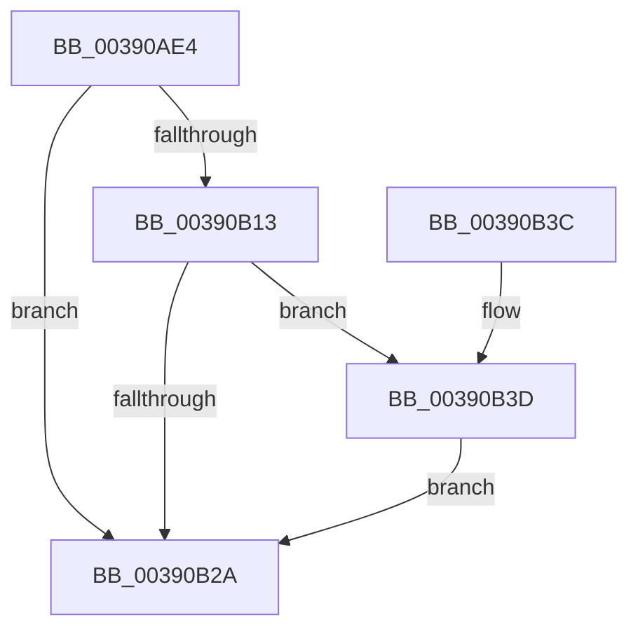

# PopDiagTraceFxDevicePowered

- RVA: `0x00390AE4`–`0x00390B8D` (길이 `169` bytes)
- VA: `0x0000000140390AE4`
- 실행 섹션: `.text`
- PDB 이름 있음: `예`; PDB Function 태그: `아니요`
- unwind 정보 RVA: `0x000809D0`
- 디코드: `37`개 명령, `169/169` bytes 표시
- 미해석 바이트: `0` (있으면 어셈블리에 `.byte`로 보존)

> 이 문서는 커널 이미지의 기계어와 PDB 기호를 분석해 생성했습니다. 4번과 5번은 함수 원형과 자료형을 바이너리 사용 방식에서 추정한 C 해석이며 원본 소스 복구 결과는 아닙니다.

## 1. Dependencies

- 직접 호출 지점: **4**; 고유 호출 대상: **4**
- 직접 호출자로 확인된 함수: **1**
- RIP 상대 이미지 참조: **4**

### Outgoing calls
- `0x00390B05` → [PopFxAddLogEntry](PopFxAddLogEntry_function_00390B94.md) (function, `0x00390B94`)
- `0x00390B21` → [EtwEventEnabled](EtwEventEnabled_function_00392450.md) (function, `0x00392450`)
- `0x00390B32` → [_security_check_cookie](../6A/_security_check_cookie_function_006AC640.md) (function, `0x006AC640`)
- `0x00390B86` → [EtwWriteEx](../25/EtwWriteEx_function_0025F0D0.md) (function, `0x0025F0D0`)

### Direct callers
- [PopFxCompleteDevicePowerRequired](PopFxCompleteDevicePowerRequired_function_003908AC.md) at `0x003908DC`

### Static image references
- `0x00390AE8` → RVA `0x00E0A740` (`.data`; read)
- `0x00390B0A` → RVA `0x00E67858` (`.data`; read)
- `0x00390B13` → RVA `0x00F0B408` (`.data`; read)
- `0x00390B1A` → RVA `0x00011330` (`.rdata`; read)

## 2. Other-region calls and transfers

- 다른 실행 섹션으로 향하는 call: **0**
- 별도 외부 분기/꼬리 이동을 확인하지 못했습니다.

## 3. Assembly (complete function range)

```asm
00390AE4  48 83 EC 68                     sub rsp, 0x68
00390AE8  48 8B 05 51 9C A7 00            mov rax, qword ptr [rip + 0xa79c51]
00390AEF  48 33 C4                        xor rax, rsp
00390AF2  48 89 44 24 58                  mov qword ptr [rsp + 0x58], rax
00390AF7  45 33 C9                        xor r9d, r9d
00390AFA  48 89 4C 24 40                  mov qword ptr [rsp + 0x40], rcx
00390AFF  33 D2                           xor edx, edx
00390B01  45 8D 41 07                     lea r8d, [r9 + 7]
00390B05  E8 8A 00 00 00                  call 0x140390b94
00390B0A  44 38 0D 47 6D AD 00            cmp byte ptr [rip + 0xad6d47], r9b
00390B11  74 17                           je 0x140390b2a
00390B13  48 8B 0D EE A8 B7 00            mov rcx, qword ptr [rip + 0xb7a8ee]
00390B1A  48 8D 15 0F 08 C8 FF            lea rdx, [rip - 0x37f7f1]
00390B21  E8 2A 19 00 00                  call 0x140392450
00390B26  84 C0                           test al, al
00390B28  75 13                           jne 0x140390b3d
00390B2A  48 8B 4C 24 58                  mov rcx, qword ptr [rsp + 0x58]
00390B2F  48 33 CC                        xor rcx, rsp
00390B32  E8 09 BB 31 00                  call 0x1406ac640
00390B37  48 83 C4 68                     add rsp, 0x68
00390B3B  C3                              ret
00390B3C  CC                              int3
00390B3D  83 64 24 54 00                  and dword ptr [rsp + 0x54], 0
00390B42  48 8D 44 24 40                  lea rax, [rsp + 0x40]
00390B47  48 8B 0D BA A8 B7 00            mov rcx, qword ptr [rip + 0xb7a8ba]
00390B4E  48 8D 15 DB 07 C8 FF            lea rdx, [rip - 0x37f825]
00390B55  48 89 44 24 48                  mov qword ptr [rsp + 0x48], rax
00390B5A  41 B9 01 00 00 00               mov r9d, 1
00390B60  48 8D 44 24 48                  lea rax, [rsp + 0x48]
00390B65  C7 44 24 50 08 00 00 00         mov dword ptr [rsp + 0x50], 8
00390B6D  48 89 44 24 38                  mov qword ptr [rsp + 0x38], rax
00390B72  45 33 C0                        xor r8d, r8d
00390B75  44 89 4C 24 30                  mov dword ptr [rsp + 0x30], r9d
00390B7A  48 83 64 24 28 00               and qword ptr [rsp + 0x28], 0
00390B80  48 83 64 24 20 00               and qword ptr [rsp + 0x20], 0
00390B86  E8 45 E5 EC FF                  call 0x14025f0d0
00390B8B  EB 9D                           jmp 0x140390b2a
```

## 4. C-style interpretation (structured pseudocode)

```c
__int64 __fastcall PopDiagTraceFxDevicePowered(__int64 a1, int a2, __int64 a3, int a4)
{
    __int64 result;
    __int64 v_rsp;
    unsigned __int64 v_stack_m10;
    unsigned __int64 v_stack_m28;
    unsigned __int64 v_stack_p20;
    unsigned __int64 v_stack_p28;
    unsigned int v_stack_p30;
    unsigned __int64 v_stack_p38;
    unsigned __int64 v_stack_p40;
    unsigned __int64 v_stack_p48;
    unsigned int v_stack_p50;
    unsigned int v_stack_p54;

    v_rsp = (v_rsp) - (104);
    result = (*(unsigned __int64 *)(v_rip + 10984529)) ^ (v_rsp);
    v_stack_m10 = result;
    a4 = 0;
    v_stack_m28 = a1;
    a2 = 0;
    result = PopFxAddLogEntry(a1, a2, a4 + 7, a4);
    if ((*(unsigned __int8 *)(v_rip + 11365703)) == 0) goto loc_00390B2A;
    result = EtwEventEnabled(*(unsigned __int64 *)(v_rip + 12036334), v_rip - 3667953, a4 + 7, a4);
    if ((unsigned __int8)(result) != 0) goto loc_00390B3D;
loc_00390B2A:
    a1 = (v_stack_m10) ^ (v_rsp);
    result = _security_check_cookie(a1, v_rip - 3667953, a4 + 7, a4);
    v_rsp = (v_rsp) + (104);
    return result;
loc_00390B3D:
    v_stack_p48 = v_stack_p40;
    v_stack_p50 = 8;
    v_stack_p38 = v_stack_p48;
    a3 = 0;
    v_stack_p30 = 1;
    result = EtwWriteEx(*(unsigned __int64 *)(v_rip + 12036282), v_rip - 3668005, a3, 1);
    goto loc_00390B2A;
}
```

## 5. (Beta) C Style

```c
int64_t PopDiagTraceFxDevicePowered(int64_t Arg1, int32_t Arg2, int64_t Arg3, int32_t Arg4)
{
    int64_t result;
    int64_t local_rsp;
    uint64_t v_stack_m10;
    uint64_t v_stack_m28;
    uint64_t v_stack_p20;
    uint64_t v_stack_p28;
    uint32_t v_stack_p30;
    uint64_t v_stack_p38;
    uint64_t v_stack_p40;
    uint64_t v_stack_p48;
    uint32_t v_stack_p50;
    uint32_t v_stack_p54;

    local_rsp = (local_rsp) - (104);
    result = (*(uint64_t *)(v_rip + 0xA79C51)) ^ (local_rsp);
    v_stack_m10 = result;
    Arg4 = 0;
    v_stack_m28 = Arg1;
    Arg2 = 0;
    result = PopFxAddLogEntry(Arg1, Arg2, Arg4 + 7, Arg4);
    if ((*(uint8_t *)(v_rip + 0xAD6D47)) == 0) goto loc_00390B2A;
    result = EtwEventEnabled(*(uint64_t *)(v_rip + 0xB7A8EE), v_rip - 3667953, Arg4 + 7, Arg4);
    if ((uint8_t)(result) != 0) goto loc_00390B3D;
loc_00390B2A:
    Arg1 = (v_stack_m10) ^ (local_rsp);
    result = _security_check_cookie(Arg1, v_rip - 3667953, Arg4 + 7, Arg4);
    local_rsp = (local_rsp) + (104);
    return result;
loc_00390B3D:
    v_stack_p48 = v_stack_p40;
    v_stack_p50 = 8;
    v_stack_p38 = v_stack_p48;
    Arg3 = 0;
    v_stack_p30 = 1;
    result = EtwWriteEx(*(uint64_t *)(v_rip + 0xB7A8BA), v_rip - 3668005, Arg3, 1);
    goto loc_00390B2A;
}
```

## 6. Execution-region graph

[열기: 2D/3D 그래프와 함수 탐색 컨트롤 패널](../../../control-panel.html?section=text&rva=0x00390AE4&view=graph)

- 2D 그래프는 위에서 아래로 흐르고, 3D 그래프는 빈 공간을 드래그해 회전합니다. Shift+드래그는 이동, 휠은 확대·축소, 함수 노드 선택은 대상 보고서 이동입니다.

### Static fallback


