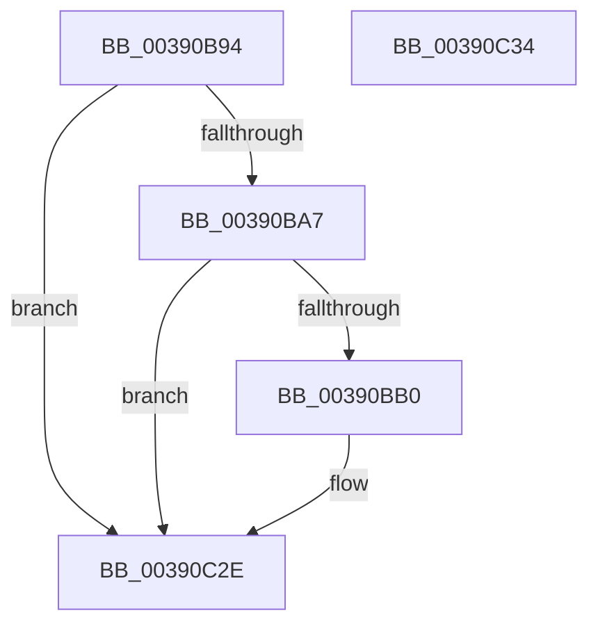

# PopFxAddLogEntry

- RVA: `0x00390B94`–`0x00390C35` (길이 `161` bytes)
- VA: `0x0000000140390B94`
- 실행 섹션: `.text`
- PDB 이름 있음: `예`; PDB Function 태그: `아니요`
- unwind 정보 RVA: `0x00071750`
- 디코드: `31`개 명령, `161/161` bytes 표시
- 미해석 바이트: `0` (있으면 어셈블리에 `.byte`로 보존)

> 이 문서는 커널 이미지의 기계어와 PDB 기호를 분석해 생성했습니다. 4번과 5번은 함수 원형과 자료형을 바이너리 사용 방식에서 추정한 C 해석이며 원본 소스 복구 결과는 아닙니다.

## 1. Dependencies

- 직접 호출 지점: **0**; 고유 호출 대상: **0**
- 직접 호출자로 확인된 함수: **28**
- RIP 상대 이미지 참조: **0**

### Outgoing calls
- 직접 디코드된 call 명령이 없습니다.

### Direct callers
- [PopDiagTraceFxDevicePowerState](../26/PopDiagTraceFxDevicePowerState_function_0026DBC4.md) at `0x0026DBED`
- [PopDiagTraceIrpFinish](../26/PopDiagTraceIrpFinish_function_0026F2A8.md) at `0x0026F36C`
- [sub_002BD95A](../2B/Unknown_function_002BD95A.md) at `0x002BDAFD`
- [sub_002BD95A](../2B/Unknown_function_002BD95A.md) at `0x002BDB36`
- [sub_002BD95A](../2B/Unknown_function_002BD95A.md) at `0x002BDC94`
- [sub_002BD95A](../2B/Unknown_function_002BD95A.md) at `0x002BDD6C`
- [sub_002BD95A](../2B/Unknown_function_002BD95A.md) at `0x002BDDAB`
- [PopPluginComponentIdleState](../2B/PopPluginComponentIdleState_function_002BE310.md) at `0x002BE441`
- [PopPluginNotifyIdleState](../2B/PopPluginNotifyIdleState_function_002BFCA0.md) at `0x002BFD22`
- [PopFxIdleWorker](../2C/PopFxIdleWorker_function_002C04A0.md) at `0x002C0598`
- [PopFxAllocatePowerIrp](../2C/PopFxAllocatePowerIrp_function_002C0920.md) at `0x002C0ACB`
- [PopFxCompleteDevicePowerRequired](PopFxCompleteDevicePowerRequired_function_003908AC.md) at `0x003908F4`
- [PopFxCompleteDevicePowerRequired](PopFxCompleteDevicePowerRequired_function_003908AC.md) at `0x0039094D`
- [PopDiagTraceFxDevicePowered](PopDiagTraceFxDevicePowered_function_00390AE4.md) at `0x00390B05`
- [PopDiagTraceFxDevicePowerRequirement](PopDiagTraceFxDevicePowerRequirement_function_00391780.md) at `0x0039188E`
- [PoFxCompleteIdleCondition](../46/PoFxCompleteIdleCondition_function_00461CC0.md) at `0x00461D0B`
- [PoFxCompleteIdleState](../46/PoFxCompleteIdleState_function_004666C0.md) at `0x00466720`
- [PopDiagTraceIrpStart](../47/PopDiagTraceIrpStart_function_0047CBBC.md) at `0x0047CD7F`
- [PopFxIdleTimeoutDpcRoutine](../49/PopFxIdleTimeoutDpcRoutine_function_00492B80.md) at `0x00492C2B`
- [PoFxCompleteDevicePowerNotRequired](../4A/PoFxCompleteDevicePowerNotRequired_function_004A3BE0.md) at `0x004A3C22`
- [PopFxCompleteComponentPerfState](../4C/PopFxCompleteComponentPerfState_function_004C1750.md) at `0x004C17F6`
- [PopFxIssueComponentPerfStateChanges](../4C/PopFxIssueComponentPerfStateChanges_function_004C1940.md) at `0x004C1AE2`
- [PopFxIssueComponentPerfStateChanges](../4C/PopFxIssueComponentPerfStateChanges_function_004C1940.md) at `0x004C1B3D`
- [PopFxIssueComponentPerfStateChanges](../4C/PopFxIssueComponentPerfStateChanges_function_004C1940.md) at `0x004C1B4D`
- [PopFxHandleDirectedPowerTransition](../4C/PopFxHandleDirectedPowerTransition_function_004C405C.md) at `0x004C4104`
- [PopDiagTraceFxDeviceDirectedTransition](../4C/PopDiagTraceFxDeviceDirectedTransition_function_004C4130.md) at `0x004C4159`
- [PopDiagTraceFxDeviceDirectedCompletion](../4E/PopDiagTraceFxDeviceDirectedCompletion_function_004E04AC.md) at `0x004E04DC`
- [PopFxCompleteDirectedPowerTransition](../4F/PopFxCompleteDirectedPowerTransition_function_004FB330.md) at `0x004FB3BC`
- [PopDiagTraceFxComponentResidency](../5D/PopDiagTraceFxComponentResidency_function_005D677C.md) at `0x005D67AB`
- [PopDiagTraceFxComponentWake](../5D/PopDiagTraceFxComponentWake_function_005D6860.md) at `0x005D6895`
- [sub_006F985C](../6F/Unknown_function_006F985C.md) at `0x006F98B5`
- [PopDiagTraceFxDeviceStartPowerManagement](../../page/76/PopDiagTraceFxDeviceStartPowerManagement_function_00761610.md) at `0x00761631`
- [PopDiagTraceFxDeviceUnregistration](../../page/76/PopDiagTraceFxDeviceUnregistration_function_007616AC.md) at `0x007616DC`
- [PopFxTraceDeviceRegistration](../../page/A6/PopFxTraceDeviceRegistration_function_00A6F888.md) at `0x00A6F9E0`
- [PopFxTracePerfRegistration](../../page/AD/PopFxTracePerfRegistration_function_00AD81B0.md) at `0x00AD8205`

### Static image references
- 디코드된 RIP-relative 메모리 참조가 없습니다.

## 2. Other-region calls and transfers

- 다른 실행 섹션으로 향하는 call: **0**
- 별도 외부 분기/꼬리 이동을 확인하지 못했습니다.

## 3. Assembly (complete function range)

```asm
00390B94  48 89 5C 24 08                  mov qword ptr [rsp + 8], rbx
00390B99  45 8B D8                        mov r11d, r8d
00390B9C  8B DA                           mov ebx, edx
00390B9E  48 85 C9                        test rcx, rcx
00390BA1  0F 84 87 00 00 00               je 0x140390c2e
00390BA7  4C 8B 51 50                     mov r10, qword ptr [rcx + 0x50]
00390BAB  4D 85 D2                        test r10, r10
00390BAE  74 7E                           je 0x140390c2e
00390BB0  B8 01 00 00 00                  mov eax, 1
00390BB5  F0 41 0F C1 82 80 03 00 00      lock xadd dword ptr [r10 + 0x380], eax
00390BBE  33 D2                           xor edx, edx
00390BC0  41 F7 B2 70 03 00 00            div dword ptr [r10 + 0x370]
00390BC7  48 A1 08 00 00 00 80 F7 FF FF   movabs rax, qword ptr [0xfffff78000000008]
00390BD1  4C 8D 04 52                     lea r8, [rdx + rdx*2]
00390BD5  49 8B 92 78 03 00 00            mov rdx, qword ptr [r10 + 0x378]
00390BDC  4A 89 04 C2                     mov qword ptr [rdx + r8*8], rax
00390BE0  46 88 5C C2 08                  mov byte ptr [rdx + r8*8 + 8], r11b
00390BE5  42 88 5C C2 09                  mov byte ptr [rdx + r8*8 + 9], bl
00390BEA  65 48 8B 04 25 20 00 00 00      mov rax, qword ptr gs:[0x20]
00390BF3  0F B7 48 24                     movzx ecx, word ptr [rax + 0x24]
00390BF7  66 42 89 4C C2 0A               mov word ptr [rdx + r8*8 + 0xa], cx
00390BFD  65 48 8B 04 25 88 01 00 00      mov rax, qword ptr gs:[0x188]
00390C06  0F B7 88 08 05 00 00            movzx ecx, word ptr [rax + 0x508]
00390C0D  66 42 89 4C C2 0C               mov word ptr [rdx + r8*8 + 0xc], cx
00390C13  65 48 8B 04 25 88 01 00 00      mov rax, qword ptr gs:[0x188]
00390C1C  0F B7 88 10 05 00 00            movzx ecx, word ptr [rax + 0x510]
00390C23  66 42 89 4C C2 0E               mov word ptr [rdx + r8*8 + 0xe], cx
00390C29  4E 89 4C C2 10                  mov qword ptr [rdx + r8*8 + 0x10], r9
00390C2E  48 8B 5C 24 08                  mov rbx, qword ptr [rsp + 8]
00390C33  C3                              ret
00390C34  CC                              int3
```

## 4. C-style interpretation (structured pseudocode)

```c
__int64 __fastcall PopFxAddLogEntry(__int64 a1, int a2, int a3, __int64 a4)
{
    __int64 result;
    unsigned __int64 v_stack_p8;

    v_stack_p8 = v_rbx;
    if (a1 == 0) goto loc_00390C2E;
    if (*(unsigned __int64 *)(a1 + 80) != 0) {
        result = 1;
        a2 = 0;
        a3 = a2 + a2 * 2;
        a2 = *(unsigned __int64 *)(*(unsigned __int64 *)(a1 + 80) + 888);
        *(unsigned __int64 *)(a2 + a3 * 8) = result;
        *(unsigned __int8 *)(a2 + a3 * 8 + 8) = (unsigned __int8)((unsigned int)(a3));
        *(unsigned __int8 *)(a2 + a3 * 8 + 9) = (unsigned __int8)((unsigned int)(a2));
        result = *(unsigned __int64 *)(gs_base + (0 + 32));
        a1 = *(unsigned __int16 *)(result + 36);
        *(unsigned __int16 *)(a2 + a3 * 8 + 10) = (unsigned __int16)(a1);
        result = *(unsigned __int64 *)(gs_base + (0 + 392));
        a1 = *(unsigned __int16 *)(result + 1288);
        *(unsigned __int16 *)(a2 + a3 * 8 + 12) = (unsigned __int16)(a1);
        result = *(unsigned __int64 *)(gs_base + (0 + 392));
        a1 = *(unsigned __int16 *)(result + 1296);
        *(unsigned __int16 *)(a2 + a3 * 8 + 14) = (unsigned __int16)(a1);
        *(unsigned __int64 *)(a2 + a3 * 8 + 16) = a4;
    }
    return result;
}
```

## 5. (Beta) C Style

```c
int64_t PopFxAddLogEntry(int64_t Arg1, int32_t Arg2, int32_t Arg3, int64_t Arg4)
{
    int64_t result;
    uint64_t v_stack_p8;

    v_stack_p8 = local_rbx;
    if (Arg1 == 0) goto loc_00390C2E;
    if (*(uint64_t *)(Arg1 + 0x50) != 0) {
        result = 1;
        Arg2 = 0;
        Arg3 = Arg2 + Arg2 * 2;
        Arg2 = *(uint64_t *)(*(uint64_t *)(Arg1 + 0x50) + 0x378);
        *(uint64_t *)(Arg2 + Arg3 * 8) = result;
        *(uint8_t *)(Arg2 + Arg3 * 8 + 0x8) = (uint8_t)((uint32_t)(Arg3));
        *(uint8_t *)(Arg2 + Arg3 * 8 + 0x9) = (uint8_t)((uint32_t)(Arg2));
        result = *(uint64_t *)(gs_base + (0 + 0x20));
        Arg1 = *(uint16_t *)(result + 0x24);
        *(uint16_t *)(Arg2 + Arg3 * 8 + 0xA) = (uint16_t)(Arg1);
        result = *(uint64_t *)(gs_base + (0 + 0x188));
        Arg1 = *(uint16_t *)(result + 0x508);
        *(uint16_t *)(Arg2 + Arg3 * 8 + 0xC) = (uint16_t)(Arg1);
        result = *(uint64_t *)(gs_base + (0 + 0x188));
        Arg1 = *(uint16_t *)(result + 0x510);
        *(uint16_t *)(Arg2 + Arg3 * 8 + 0xE) = (uint16_t)(Arg1);
        *(uint64_t *)(Arg2 + Arg3 * 8 + 0x10) = Arg4;
    }
    return result;
}
```

## 6. Execution-region graph

[열기: 2D/3D 그래프와 함수 탐색 컨트롤 패널](../../../control-panel.html?section=text&rva=0x00390B94&view=graph)

- 2D 그래프는 위에서 아래로 흐르고, 3D 그래프는 빈 공간을 드래그해 회전합니다. Shift+드래그는 이동, 휠은 확대·축소, 함수 노드 선택은 대상 보고서 이동입니다.

### Static fallback


