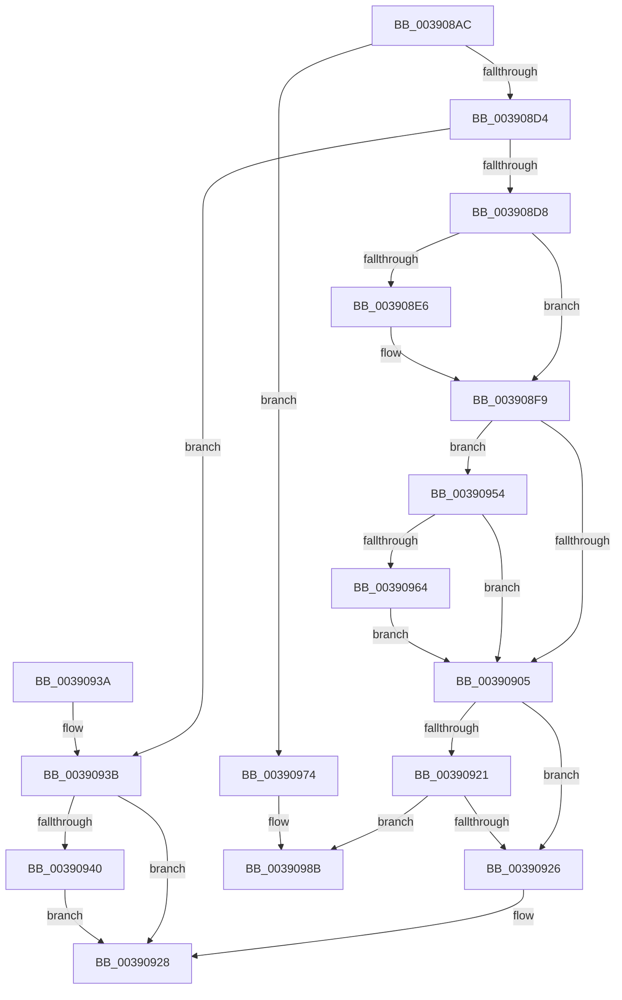

# PopFxCompleteDevicePowerRequired

- RVA: `0x003908AC`–`0x0039099E` (길이 `242` bytes)
- VA: `0x00000001403908AC`
- 실행 섹션: `.text`
- PDB 이름 있음: `예`; PDB Function 태그: `아니요`
- unwind 정보 RVA: `0x000809BC`
- 디코드: `72`개 명령, `242/242` bytes 표시
- 미해석 바이트: `0` (있으면 어셈블리에 `.byte`로 보존)

> 이 문서는 커널 이미지의 기계어와 PDB 기호를 분석해 생성했습니다. 4번과 5번은 함수 원형과 자료형을 바이너리 사용 방식에서 추정한 C 해석이며 원본 소스 복구 결과는 아닙니다.

## 1. Dependencies

- 직접 호출 지점: **7**; 고유 호출 대상: **5**
- 직접 호출자로 확인된 함수: **3**
- RIP 상대 이미지 참조: **0**

### Outgoing calls
- `0x003908DC` → [PopDiagTraceFxDevicePowered](PopDiagTraceFxDevicePowered_function_00390AE4.md) (function, `0x00390AE4`)
- `0x003908F4` → [PopFxAddLogEntry](PopFxAddLogEntry_function_00390B94.md) (function, `0x00390B94`)
- `0x00390918` → [PopPepProcessEvent](../24/PopPepProcessEvent_function_0024B930.md) (function, `0x0024B930`)
- `0x0039094D` → [PopFxAddLogEntry](PopFxAddLogEntry_function_00390B94.md) (function, `0x00390B94`)
- `0x0039096D` → [PopPepUpdateConstraints](../26/PopPepUpdateConstraints_function_0026F5C8.md) (function, `0x0026F5C8`)
- `0x00390985` → [PopFxBugCheck](../2B/PopFxBugCheck_function_002BFC6C.md) (function, `0x002BFC6C`)
- `0x00390998` → [PopFxBugCheck](../2B/PopFxBugCheck_function_002BFC6C.md) (function, `0x002BFC6C`)

### Direct callers
- [PopFxHandleReportDevicePoweredOn](../26/PopFxHandleReportDevicePoweredOn_function_0026D980.md) at `0x0026DB98`
- [sub_002BD95A](../2B/Unknown_function_002BD95A.md) at `0x002BDBB2`
- [PopFxDeliverDevicePowerRequired](../49/PopFxDeliverDevicePowerRequired_function_00492C4C.md) at `0x00492C95`

### Static image references
- 디코드된 RIP-relative 메모리 참조가 없습니다.

## 2. Other-region calls and transfers

- 다른 실행 섹션으로 향하는 call: **0**
- 별도 외부 분기/꼬리 이동을 확인하지 못했습니다.

## 3. Assembly (complete function range)

```asm
003908AC  48 89 5C 24 08                  mov qword ptr [rsp + 8], rbx
003908B1  48 89 74 24 10                  mov qword ptr [rsp + 0x10], rsi
003908B6  57                              push rdi
003908B7  48 83 EC 30                     sub rsp, 0x30
003908BB  33 DB                           xor ebx, ebx
003908BD  48 8B F2                        mov rsi, rdx
003908C0  83 C8 FF                        or eax, 0xffffffff
003908C3  48 8B F9                        mov rdi, rcx
003908C6  F0 0F C1 41 24                  lock xadd dword ptr [rcx + 0x24], eax
003908CB  83 E8 01                        sub eax, 1
003908CE  0F 88 A0 00 00 00               js 0x140390974
003908D4  85 C0                           test eax, eax
003908D6  75 63                           jne 0x14039093b
003908D8  48 8B 49 30                     mov rcx, qword ptr [rcx + 0x30]
003908DC  E8 03 02 00 00                  call 0x140390ae4
003908E1  48 85 F6                        test rsi, rsi
003908E4  75 13                           jne 0x1403908f9
003908E6  48 8B 4F 30                     mov rcx, qword ptr [rdi + 0x30]
003908EA  44 8D 4B 01                     lea r9d, [rbx + 1]
003908EE  33 D2                           xor edx, edx
003908F0  44 8D 43 10                     lea r8d, [rbx + 0x10]
003908F4  E8 9B 02 00 00                  call 0x140390b94
003908F9  48 8B 7F 38                     mov rdi, qword ptr [rdi + 0x38]
003908FD  39 9F 84 00 00 00               cmp dword ptr [rdi + 0x84], ebx
00390903  7F 4F                           jg 0x140390954
00390905  41 B9 06 00 00 00               mov r9d, 6
0039090B  48 89 74 24 28                  mov qword ptr [rsp + 0x28], rsi
00390910  45 33 C0                        xor r8d, r8d
00390913  33 D2                           xor edx, edx
00390915  48 8B CF                        mov rcx, rdi
00390918  E8 13 B0 EB FF                  call 0x14024b930
0039091D  84 C0                           test al, al
0039091F  74 05                           je 0x140390926
00390921  48 85 F6                        test rsi, rsi
00390924  74 65                           je 0x14039098b
00390926  8A D8                           mov bl, al
00390928  48 8B 74 24 48                  mov rsi, qword ptr [rsp + 0x48]
0039092D  8A C3                           mov al, bl
0039092F  48 8B 5C 24 40                  mov rbx, qword ptr [rsp + 0x40]
00390934  48 83 C4 30                     add rsp, 0x30
00390938  5F                              pop rdi
00390939  C3                              ret
0039093A  CC                              int3
0039093B  48 85 F6                        test rsi, rsi
0039093E  74 E8                           je 0x140390928
00390940  48 8B 49 30                     mov rcx, qword ptr [rcx + 0x30]
00390944  45 33 C9                        xor r9d, r9d
00390947  33 D2                           xor edx, edx
00390949  45 8D 41 10                     lea r8d, [r9 + 0x10]
0039094D  E8 42 02 00 00                  call 0x140390b94
00390952  EB D4                           jmp 0x140390928
00390954  83 C8 FF                        or eax, 0xffffffff
00390957  F0 0F C1 87 84 00 00 00         lock xadd dword ptr [rdi + 0x84], eax
0039095F  83 F8 01                        cmp eax, 1
00390962  75 A1                           jne 0x140390905
00390964  44 8A C0                        mov r8b, al
00390967  8D 50 03                        lea edx, [rax + 3]
0039096A  48 8B CF                        mov rcx, rdi
0039096D  E8 56 EC ED FF                  call 0x14026f5c8
00390972  EB 91                           jmp 0x140390905
00390974  41 B9 01 00 00 00               mov r9d, 1
0039097A  45 33 C0                        xor r8d, r8d
0039097D  48 8B D7                        mov rdx, rdi
00390980  B9 13 06 00 00                  mov ecx, 0x613
00390985  E8 E2 F2 F2 FF                  call 0x1402bfc6c
0039098A  CC                              int3
0039098B  45 33 C9                        xor r9d, r9d
0039098E  45 33 C0                        xor r8d, r8d
00390991  33 D2                           xor edx, edx
00390993  B9 12 06 00 00                  mov ecx, 0x612
00390998  E8 CF F2 F2 FF                  call 0x1402bfc6c
0039099D  CC                              int3
```

## 4. C-style interpretation (structured pseudocode)

```c
__int64 __fastcall PopFxCompleteDevicePowerRequired(__int64 a1, __int64 a2)
{
    __int64 result;
    __int64 v_rbx;
    __int64 v_rsp;
    unsigned __int64 v_stack_m10;
    unsigned __int64 v_stack_p10;
    unsigned __int64 v_stack_p8;

    v_stack_p8 = v_rbx;
    v_stack_p10 = v_rsi;
    v_rsp = (v_rsp) - (48);
    v_rbx = 0;
    result = (unsigned int)((result) | (0xFFFFFFFFULL));
    result = (unsigned int)((result) - (1));
    if (sign_flag) goto loc_00390974;
    if ((unsigned int)(result) != 0) goto loc_0039093B;
    result = PopDiagTraceFxDevicePowered(*(unsigned __int64 *)(a1 + 48), a2, a3, a4);
    if (a2 == 0) {
        a1 = *(unsigned __int64 *)(a1 + 48);
        a4 = v_rbx + 1;
        a2 = 0;
        a3 = v_rbx + 16;
        result = PopFxAddLogEntry(a1, a2, a3, a4);
    }
    if ((*(unsigned int *)(*(unsigned __int64 *)(a1 + 56) + 132)) > 0) goto loc_00390954;
loc_00390905:
    v_stack_m10 = 0;
    a3 = 0;
    a2 = 0;
    result = PopPepProcessEvent(*(unsigned __int64 *)(a1 + 56), a2, a3, 6);
    if ((unsigned __int8)(result) == 0) goto loc_00390926;
    if (0 == 0) goto loc_0039098B;
loc_00390926:
loc_00390928:
    v_rsp = (v_rsp) + (48);
    return (unsigned __int8)((unsigned __int8)(result));
loc_0039093B:
    if (v_stack_p10 == 0) goto loc_00390928;
    a4 = 0;
    a2 = 0;
    result = PopFxAddLogEntry(*(unsigned __int64 *)(*(unsigned __int64 *)(a1 + 56) + 48), a2, a4 + 16, a4);
    goto loc_00390928;
loc_00390954:
    result = (unsigned int)((result) | (0xFFFFFFFFULL));
    if (((unsigned int)(result)) != 1) goto loc_00390905;
    result = PopPepUpdateConstraints(*(unsigned __int64 *)(a1 + 56), result + 3, (unsigned __int8)(result), a4);
    goto loc_00390905;
loc_00390974:
    a3 = 0;
    result = PopFxBugCheck((unsigned int)(0x613ULL), *(unsigned __int64 *)(a1 + 56), a3, 1);
loc_0039098B:
    a4 = 0;
    a3 = 0;
    a2 = 0;
    result = PopFxBugCheck((unsigned int)(0x612ULL), a2, a3, a4);
    return result;
}
```

## 5. (Beta) C Style

```c
int64_t PopFxCompleteDevicePowerRequired(void *Arg1, int64_t Arg2)
{
    uint8_t *arg1 = (uint8_t *)Arg1;

    int64_t result;
    int64_t local_rbx;
    int64_t local_rsp;
    uint64_t v_stack_m10;
    uint64_t v_stack_p10;
    uint64_t v_stack_p8;

    v_stack_p8 = local_rbx;
    v_stack_p10 = local_rsi;
    local_rsp = (local_rsp) - (48);
    local_rbx = 0;
    result = (uint32_t)((result) | (0xFFFFFFFFULL));
    result = (uint32_t)((result) - (1));
    if (sign_flag) goto loc_00390974;
    if ((uint32_t)(result) != 0) goto loc_0039093B;
    result = PopDiagTraceFxDevicePowered(*(uint64_t *)(arg1 + 0x30), Arg2, a3, a4);
    if (Arg2 == 0) {
        Arg1 = *(uint64_t *)(arg1 + 0x30);
        a4 = local_rbx + 1;
        Arg2 = 0;
        a3 = local_rbx + 16;
        result = PopFxAddLogEntry(Arg1, Arg2, a3, a4);
    }
    if ((*(uint32_t *)(*(uint64_t *)(arg1 + 0x38) + 0x84)) > 0) goto loc_00390954;
loc_00390905:
    v_stack_m10 = 0;
    a3 = 0;
    Arg2 = 0;
    result = PopPepProcessEvent(*(uint64_t *)(arg1 + 0x38), Arg2, a3, 6);
    if ((uint8_t)(result) == 0) goto loc_00390926;
    if (0 == 0) goto loc_0039098B;
loc_00390926:
loc_00390928:
    local_rsp = (local_rsp) + (48);
    return (uint8_t)((uint8_t)(result));
loc_0039093B:
    if (v_stack_p10 == 0) goto loc_00390928;
    a4 = 0;
    Arg2 = 0;
    result = PopFxAddLogEntry(*(uint64_t *)(*(uint64_t *)(arg1 + 0x38) + 0x30), Arg2, a4 + 16, a4);
    goto loc_00390928;
loc_00390954:
    result = (uint32_t)((result) | (0xFFFFFFFFULL));
    if (((uint32_t)(result)) != 1) goto loc_00390905;
    result = PopPepUpdateConstraints(*(uint64_t *)(arg1 + 0x38), result + 3, (uint8_t)(result), a4);
    goto loc_00390905;
loc_00390974:
    a3 = 0;
    result = PopFxBugCheck((uint32_t)(0x613ULL), *(uint64_t *)(arg1 + 0x38), a3, 1);
loc_0039098B:
    a4 = 0;
    a3 = 0;
    Arg2 = 0;
    result = PopFxBugCheck((uint32_t)(0x612ULL), Arg2, a3, a4);
    return result;
}
```

### 관측된 메모리 오프셋

구조체 형식이 확인되지 않은 접근은 인자 기준의 오프셋으로만 기록했습니다.

| 기준 인자 | 오프셋 표현 | 폭 (bit) | 접근 |
|---|---:|---:|---|
| `Arg1` | `+ 0x24` | `32` | `R/W` |
| `Arg1` | `+ 0x30` | `64` | `R` |
| `Arg1` | `+ 0x38` | `64` | `R` |

## 6. Execution-region graph

[열기: 2D/3D 그래프와 함수 탐색 컨트롤 패널](../../../control-panel.html?section=text&rva=0x003908AC&view=graph)

- 2D 그래프는 위에서 아래로 흐르고, 3D 그래프는 빈 공간을 드래그해 회전합니다. Shift+드래그는 이동, 휠은 확대·축소, 함수 노드 선택은 대상 보고서 이동입니다.

### Static fallback


