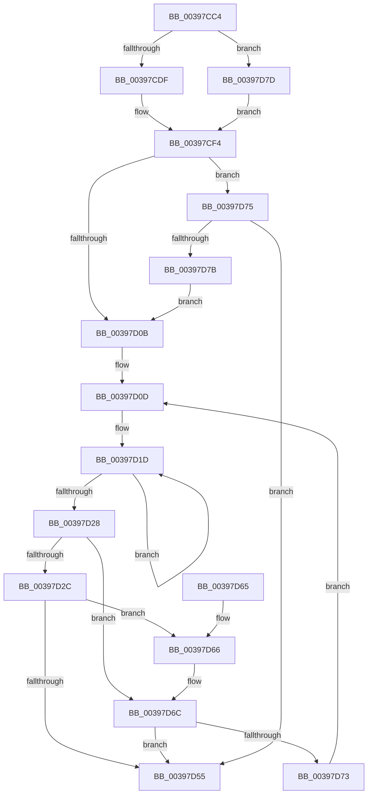

# PopFxRequestWorkerInternal

- RVA: `0x00397CC4`–`0x00397D86` (길이 `194` bytes)
- VA: `0x0000000140397CC4`
- 실행 섹션: `.text`
- PDB 이름 있음: `예`; PDB Function 태그: `아니요`
- unwind 정보 RVA: `0x00065748`
- 디코드: `58`개 명령, `194/194` bytes 표시
- 미해석 바이트: `0` (있으면 어셈블리에 `.byte`로 보존)

> 이 문서는 커널 이미지의 기계어와 PDB 기호를 분석해 생성했습니다. 4번과 5번은 함수 원형과 자료형을 바이너리 사용 방식에서 추정한 C 해석이며 원본 소스 복구 결과는 아닙니다.

## 1. Dependencies

- 직접 호출 지점: **2**; 고유 호출 대상: **2**
- 직접 호출자로 확인된 함수: **2**
- RIP 상대 이미지 참조: **3**

### Outgoing calls
- `0x00397D01` → [KeReleaseSemaphore](KeReleaseSemaphore_function_00397080.md) (function, `0x00397080`)
- `0x00397D4C` → [ExpTryQueueWorkItem](ExpTryQueueWorkItem_function_0039801C.md) (function, `0x0039801C`)

### Direct callers
- [PopPepComponentSetLatency](../2B/PopPepComponentSetLatency_function_002BF3D8.md) at `0x002BF58D`
- [PopFxRequestWorker](../5D/PopFxRequestWorker_function_005D3670.md) at `0x005D3676`

### Static image references
- `0x00397CE2` → RVA `0x00F0E580` (`.data`; read)
- `0x00397CE9` → RVA `0x00F0E2A0` (`.data`; read)
- `0x00397D41` → RVA `0x00FC6EA0` (`ALMOSTRO`; read)

## 2. Other-region calls and transfers

- 다른 실행 섹션으로 향하는 call: **0**
- 별도 외부 분기/꼬리 이동을 확인하지 못했습니다.

## 3. Assembly (complete function range)

```asm
00397CC4  48 89 5C 24 08                  mov qword ptr [rsp + 8], rbx
00397CC9  48 89 74 24 10                  mov qword ptr [rsp + 0x10], rsi
00397CCE  57                              push rdi
00397CCF  48 83 EC 20                     sub rsp, 0x20
00397CD3  48 8B F9                        mov rdi, rcx
00397CD6  48 85 C9                        test rcx, rcx
00397CD9  0F 85 9E 00 00 00               jne 0x140397d7d
00397CDF  F6 C2 01                        test dl, 1
00397CE2  48 8D 05 97 68 B7 00            lea rax, [rip + 0xb76897]
00397CE9  48 8D 1D B0 65 B7 00            lea rbx, [rip + 0xb765b0]
00397CF0  48 0F 45 D8                     cmovne rbx, rax
00397CF4  45 33 C9                        xor r9d, r9d
00397CF7  48 8D 4B 40                     lea rcx, [rbx + 0x40]
00397CFB  33 D2                           xor edx, edx
00397CFD  45 8D 41 01                     lea r8d, [r9 + 1]
00397D01  E8 7A F3 FF FF                  call 0x140397080
00397D06  48 85 FF                        test rdi, rdi
00397D09  75 6A                           jne 0x140397d75
00397D0B  33 F6                           xor esi, esi
00397D0D  8B CE                           mov ecx, esi
00397D0F  BF 01 00 00 00                  mov edi, 1
00397D14  D3 E7                           shl edi, cl
00397D16  0F 0D 4B 60                     prefetchw byte ptr [rbx + 0x60]
00397D1A  8B 43 60                        mov eax, dword ptr [rbx + 0x60]
00397D1D  8B C8                           mov ecx, eax
00397D1F  0B CF                           or ecx, edi
00397D21  F0 0F B1 4B 60                  lock cmpxchg dword ptr [rbx + 0x60], ecx
00397D26  75 F5                           jne 0x140397d1d
00397D28  85 C7                           test edi, eax
00397D2A  75 40                           jne 0x140397d6c
00397D2C  45 33 C9                        xor r9d, r9d
00397D2F  8B CE                           mov ecx, esi
00397D31  48 83 C1 0E                     add rcx, 0xe
00397D35  45 8D 41 30                     lea r8d, [r9 + 0x30]
00397D39  48 8D 0C B1                     lea rcx, [rcx + rsi*4]
00397D3D  48 8D 14 CB                     lea rdx, [rbx + rcx*8]
00397D41  48 8B 0D 58 F1 C2 00            mov rcx, qword ptr [rip + 0xc2f158]
00397D48  48 8B 49 10                     mov rcx, qword ptr [rcx + 0x10]
00397D4C  E8 CB 02 00 00                  call 0x14039801c
00397D51  84 C0                           test al, al
00397D53  74 11                           je 0x140397d66
00397D55  48 8B 5C 24 30                  mov rbx, qword ptr [rsp + 0x30]
00397D5A  48 8B 74 24 38                  mov rsi, qword ptr [rsp + 0x38]
00397D5F  48 83 C4 20                     add rsp, 0x20
00397D63  5F                              pop rdi
00397D64  C3                              ret
00397D65  CC                              int3
00397D66  F7 D7                           not edi
00397D68  F0 21 7B 60                     lock and dword ptr [rbx + 0x60], edi
00397D6C  FF C6                           inc esi
00397D6E  83 FE 04                        cmp esi, 4
00397D71  73 E2                           jae 0x140397d55
00397D73  EB 98                           jmp 0x140397d0d
00397D75  F6 47 18 01                     test byte ptr [rdi + 0x18], 1
00397D79  74 DA                           je 0x140397d55
00397D7B  EB 8E                           jmp 0x140397d0b
00397D7D  48 8D 59 78                     lea rbx, [rcx + 0x78]
00397D81  E9 6E FF FF FF                  jmp 0x140397cf4
```

## 4. C-style interpretation (structured pseudocode)

```c
__int64 __fastcall PopFxRequestWorkerInternal(__int64 a1, int a2, __int64 a3, int a4)
{
    __int64 result;
    __int64 v_rbx;
    __int64 v_rdi;
    __int64 v_rsi;
    __int64 v_rsp;
    unsigned __int64 v_stack_p10;
    unsigned __int64 v_stack_p8;

    v_stack_p8 = v_rbx;
    v_stack_p10 = v_rsi;
    v_rsp = (v_rsp) - (32);
    if (a1 != 0) goto loc_00397D7D;
    v_rbx = v_rip + 12019120;
    if ((((unsigned __int8)(a2)) & (1)) != 0) { v_rbx = v_rip + 12019863; }
loc_00397CF4:
    a4 = 0;
    a2 = 0;
    result = KeReleaseSemaphore(v_rbx + 64, a2, a4 + 1, a4);
    if (a1 != 0) goto loc_00397D75;
loc_00397D0B:
    v_rsi = 0;
loc_00397D0D:
    v_rdi = (unsigned int)((1) << (0));
loc_00397D1D:
    a1 = (unsigned int)(((unsigned int)((unsigned int)((unsigned int)(*(unsigned int *)(v_rbx + 96))))) | ((unsigned int)(v_rdi)));
    if (condition_is_not_equal) goto loc_00397D1D;
    if ((((unsigned int)(v_rdi)) & ((unsigned int)((unsigned int)(*(unsigned int *)(v_rbx + 96))))) != 0) goto loc_00397D6C;
    a4 = 0;
    a1 = (0) + (14);
    result = ExpTryQueueWorkItem(*(unsigned __int64 *)(*(unsigned __int64 *)(v_rip + 12775768) + 16), v_rbx + a1 + v_rsi * 4 * 8, a4 + 48, a4);
    if ((unsigned __int8)(result) == 0) goto loc_00397D66;
loc_00397D55:
    v_rsp = (v_rsp) + (32);
    return result;
loc_00397D66:
    v_rdi = (unsigned int)(~(v_rdi));
loc_00397D6C:
    v_rsi = (unsigned int)((v_stack_p10) + 1);
    if (((unsigned int)(v_rsi)) >= 4) goto loc_00397D55;
    goto loc_00397D0D;
loc_00397D75:
    if (((*(unsigned __int8 *)(v_rdi + 24)) & (1)) == 0) goto loc_00397D55;
    goto loc_00397D0B;
loc_00397D7D:
    goto loc_00397CF4;
}
```

## 5. (Beta) C Style

```c
int64_t PopFxRequestWorkerInternal(int64_t Arg1, int32_t Arg2, int64_t Arg3, int32_t Arg4)
{
    int64_t result;
    int64_t local_rbx;
    int64_t local_rdi;
    int64_t local_rsi;
    int64_t local_rsp;
    uint64_t v_stack_p10;
    uint64_t v_stack_p8;

    v_stack_p8 = local_rbx;
    v_stack_p10 = local_rsi;
    local_rsp = (local_rsp) - (32);
    if (Arg1 != 0) goto loc_00397D7D;
    local_rbx = v_rip + 12019120;
    if ((((uint8_t)(Arg2)) & (1)) != 0) { local_rbx = v_rip + 12019863; }
loc_00397CF4:
    Arg4 = 0;
    Arg2 = 0;
    result = KeReleaseSemaphore(local_rbx + 64, Arg2, Arg4 + 1, Arg4);
    if (Arg1 != 0) goto loc_00397D75;
loc_00397D0B:
    local_rsi = 0;
loc_00397D0D:
    local_rdi = (uint32_t)((1) << (0));
loc_00397D1D:
    Arg1 = (uint32_t)(((uint32_t)((uint32_t)((uint32_t)(*(uint32_t *)(local_rbx + 0x60))))) | ((uint32_t)(local_rdi)));
    if (condition_is_not_equal) goto loc_00397D1D;
    if ((((uint32_t)(local_rdi)) & ((uint32_t)((uint32_t)(*(uint32_t *)(local_rbx + 0x60))))) != 0) goto loc_00397D6C;
    Arg4 = 0;
    Arg1 = (0) + (14);
    result = ExpTryQueueWorkItem(*(uint64_t *)(*(uint64_t *)(v_rip + 0xC2F158) + 0x10), local_rbx + Arg1 + local_rsi * 4 * 8, Arg4 + 48, Arg4);
    if ((uint8_t)(result) == 0) goto loc_00397D66;
loc_00397D55:
    local_rsp = (local_rsp) + (32);
    return result;
loc_00397D66:
    local_rdi = (uint32_t)(~(local_rdi));
loc_00397D6C:
    local_rsi = (uint32_t)((v_stack_p10) + 1);
    if (((uint32_t)(local_rsi)) >= 4) goto loc_00397D55;
    goto loc_00397D0D;
loc_00397D75:
    if (((*(uint8_t *)(local_rdi + 0x18)) & (1)) == 0) goto loc_00397D55;
    goto loc_00397D0B;
loc_00397D7D:
    goto loc_00397CF4;
}
```

## 6. Execution-region graph

[열기: 2D/3D 그래프와 함수 탐색 컨트롤 패널](../../../control-panel.html?section=text&rva=0x00397CC4&view=graph)

- 2D 그래프는 위에서 아래로 흐르고, 3D 그래프는 빈 공간을 드래그해 회전합니다. Shift+드래그는 이동, 휠은 확대·축소, 함수 노드 선택은 대상 보고서 이동입니다.

### Static fallback


