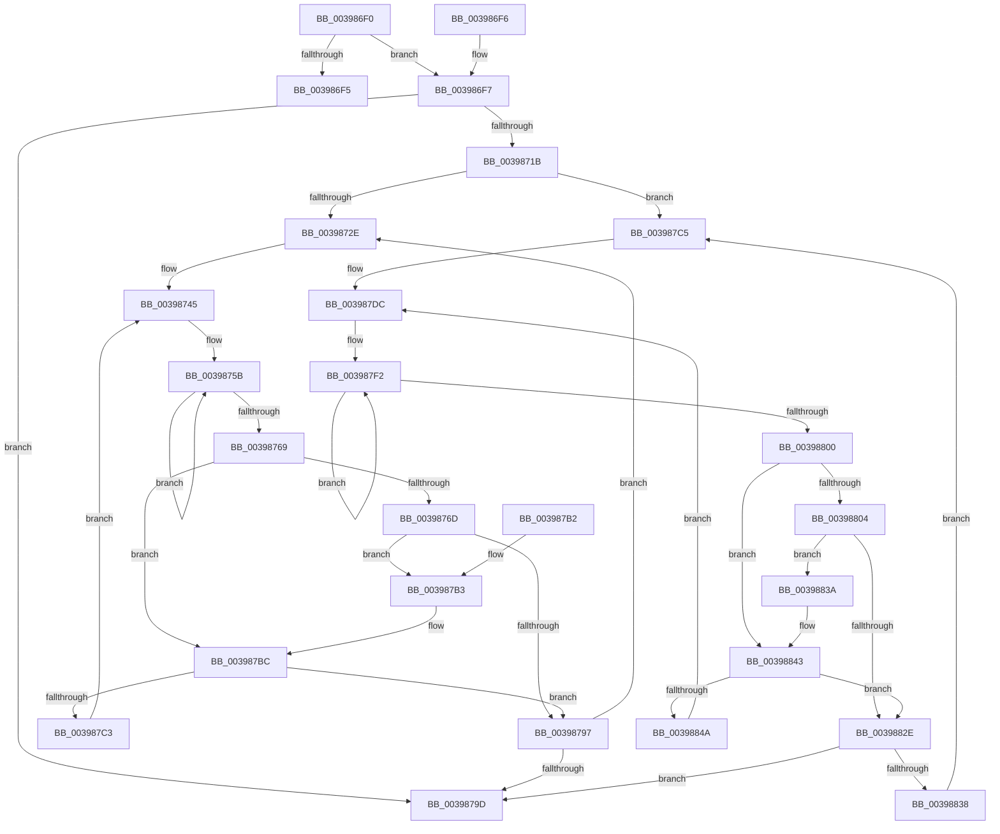

# PopPepRequestWork

- RVA: `0x003986F0`–`0x0039884C` (길이 `348` bytes)
- VA: `0x00000001403986F0`
- 실행 섹션: `.text`
- PDB 이름 있음: `예`; PDB Function 태그: `아니요`
- unwind 정보 RVA: `0x00081514`
- 디코드: `95`개 명령, `348/348` bytes 표시
- 미해석 바이트: `0` (있으면 어셈블리에 `.byte`로 보존)

> 이 문서는 커널 이미지의 기계어와 PDB 기호를 분석해 생성했습니다. 4번과 5번은 함수 원형과 자료형을 바이너리 사용 방식에서 추정한 C 해석이며 원본 소스 복구 결과는 아닙니다.

## 1. Dependencies

- 직접 호출 지점: **4**; 고유 호출 대상: **2**
- 직접 호출자로 확인된 함수: **7**
- RIP 상대 이미지 참조: **8**

### Outgoing calls
- `0x0039873E` → [KeReleaseSemaphore](KeReleaseSemaphore_function_00397080.md) (function, `0x00397080`)
- `0x0039878E` → [ExpTryQueueWorkItem](ExpTryQueueWorkItem_function_0039801C.md) (function, `0x0039801C`)
- `0x003987D5` → [KeReleaseSemaphore](KeReleaseSemaphore_function_00397080.md) (function, `0x00397080`)
- `0x00398825` → [ExpTryQueueWorkItem](ExpTryQueueWorkItem_function_0039801C.md) (function, `0x0039801C`)

### Direct callers
- [PopPepProcessEvent](../24/PopPepProcessEvent_function_0024B930.md) at `0x0024C463`
- [PopPepSurprisePowerOn](../26/PopPepSurprisePowerOn_function_0026E480.md) at `0x0026E517`
- [PopPepUpdateConstraints](../26/PopPepUpdateConstraints_function_0026F5C8.md) at `0x0026F693`
- [PopPepIdleTimeoutRoutine](../45/PopPepIdleTimeoutRoutine_function_00458E10.md) at `0x00458F64`
- [PopPepCompleteComponentIdleState](../4D/PopPepCompleteComponentIdleState_function_004D8EC4.md) at `0x004D8F3D`
- [PopPepComponentSetResidency](../5D/PopPepComponentSetResidency_function_005DC9A4.md) at `0x005DCA6D`
- [PopPepComponentSetWakeHint](../5D/PopPepComponentSetWakeHint_function_005DCAA0.md) at `0x005DCB60`

### Static image references
- `0x0039871E` → RVA `0x00000000` (`image boundary/outside`; read)
- `0x00398731` → RVA `0x00F0E2E0` (`.data`; read)
- `0x0039874E` → RVA `0x00F0E300` (`.data`; read)
- `0x0039877F` → RVA `0x00FC6EA0` (`ALMOSTRO`; read)
- `0x003987B5` → RVA `0x00F0E300` (`.data`; read/write)
- `0x003987C8` → RVA `0x00F0E5C0` (`.data`; read)
- `0x003987E5` → RVA `0x00F0E5E0` (`.data`; read)
- `0x0039883C` → RVA `0x00F0E5E0` (`.data`; read/write)

## 2. Other-region calls and transfers

- 다른 실행 섹션으로 향하는 call: **0**
- 별도 외부 분기/꼬리 이동을 확인하지 못했습니다.

## 3. Assembly (complete function range)

```asm
003986F0  44 3B C2                        cmp r8d, edx
003986F3  77 02                           ja 0x1403986f7
003986F5  C3                              ret
003986F6  CC                              int3
003986F7  48 89 5C 24 08                  mov qword ptr [rsp + 8], rbx
003986FC  48 89 6C 24 10                  mov qword ptr [rsp + 0x10], rbp
00398701  48 89 74 24 18                  mov qword ptr [rsp + 0x18], rsi
00398706  57                              push rdi
00398707  48 83 EC 20                     sub rsp, 0x20
0039870B  48 8B 41 18                     mov rax, qword ptr [rcx + 0x18]
0039870F  83 E0 20                        and eax, 0x20
00398712  44 2B C2                        sub r8d, edx
00398715  0F 84 82 00 00 00               je 0x14039879d
0039871B  41 8B F0                        mov esi, r8d
0039871E  48 8D 2D DB 78 C6 FF            lea rbp, [rip - 0x398725]
00398725  48 85 C0                        test rax, rax
00398728  0F 85 97 00 00 00               jne 0x1403987c5
0039872E  45 33 C9                        xor r9d, r9d
00398731  48 8D 0D A8 5B B7 00            lea rcx, [rip + 0xb75ba8]
00398738  33 D2                           xor edx, edx
0039873A  45 8D 41 01                     lea r8d, [r9 + 1]
0039873E  E8 3D E9 FF FF                  call 0x140397080
00398743  33 FF                           xor edi, edi
00398745  8B CF                           mov ecx, edi
00398747  BB 01 00 00 00                  mov ebx, 1
0039874C  D3 E3                           shl ebx, cl
0039874E  0F 0D 0D AB 5B B7 00            prefetchw byte ptr [rip + 0xb75bab]
00398755  8B 05 A5 5B B7 00               mov eax, dword ptr [rip + 0xb75ba5]
0039875B  8B C8                           mov ecx, eax
0039875D  0B CB                           or ecx, ebx
0039875F  F0 0F B1 0D 99 5B B7 00         lock cmpxchg dword ptr [rip + 0xb75b99], ecx
00398767  75 F2                           jne 0x14039875b
00398769  85 C3                           test ebx, eax
0039876B  75 4F                           jne 0x1403987bc
0039876D  48 8D 0C BF                     lea rcx, [rdi + rdi*4]
00398771  45 33 C9                        xor r9d, r9d
00398774  48 8D 95 10 E3 F0 00            lea rdx, [rbp + 0xf0e310]
0039877B  48 8D 14 CA                     lea rdx, [rdx + rcx*8]
0039877F  48 8B 0D 1A E7 C2 00            mov rcx, qword ptr [rip + 0xc2e71a]
00398786  45 8D 41 30                     lea r8d, [r9 + 0x30]
0039878A  48 8B 49 10                     mov rcx, qword ptr [rcx + 0x10]
0039878E  E8 89 F8 FF FF                  call 0x14039801c
00398793  84 C0                           test al, al
00398795  74 1C                           je 0x1403987b3
00398797  48 83 EE 01                     sub rsi, 1
0039879B  75 91                           jne 0x14039872e
0039879D  48 8B 5C 24 30                  mov rbx, qword ptr [rsp + 0x30]
003987A2  48 8B 6C 24 38                  mov rbp, qword ptr [rsp + 0x38]
003987A7  48 8B 74 24 40                  mov rsi, qword ptr [rsp + 0x40]
003987AC  48 83 C4 20                     add rsp, 0x20
003987B0  5F                              pop rdi
003987B1  C3                              ret
003987B2  CC                              int3
003987B3  F7 D3                           not ebx
003987B5  F0 21 1D 44 5B B7 00            lock and dword ptr [rip + 0xb75b44], ebx
003987BC  FF C7                           inc edi
003987BE  83 FF 04                        cmp edi, 4
003987C1  73 D4                           jae 0x140398797
003987C3  EB 80                           jmp 0x140398745
003987C5  45 33 C9                        xor r9d, r9d
003987C8  48 8D 0D F1 5D B7 00            lea rcx, [rip + 0xb75df1]
003987CF  33 D2                           xor edx, edx
003987D1  45 8D 41 01                     lea r8d, [r9 + 1]
003987D5  E8 A6 E8 FF FF                  call 0x140397080
003987DA  33 FF                           xor edi, edi
003987DC  8B CF                           mov ecx, edi
003987DE  BB 01 00 00 00                  mov ebx, 1
003987E3  D3 E3                           shl ebx, cl
003987E5  0F 0D 0D F4 5D B7 00            prefetchw byte ptr [rip + 0xb75df4]
003987EC  8B 05 EE 5D B7 00               mov eax, dword ptr [rip + 0xb75dee]
003987F2  8B C8                           mov ecx, eax
003987F4  0B CB                           or ecx, ebx
003987F6  F0 0F B1 0D E2 5D B7 00         lock cmpxchg dword ptr [rip + 0xb75de2], ecx
003987FE  75 F2                           jne 0x1403987f2
00398800  85 C3                           test ebx, eax
00398802  75 3F                           jne 0x140398843
00398804  48 8D 0C BF                     lea rcx, [rdi + rdi*4]
00398808  45 33 C9                        xor r9d, r9d
0039880B  48 8D 95 F0 E5 F0 00            lea rdx, [rbp + 0xf0e5f0]
00398812  48 8D 14 CA                     lea rdx, [rdx + rcx*8]
00398816  48 8B 0D 83 E6 C2 00            mov rcx, qword ptr [rip + 0xc2e683]
0039881D  45 8D 41 30                     lea r8d, [r9 + 0x30]
00398821  48 8B 49 10                     mov rcx, qword ptr [rcx + 0x10]
00398825  E8 F2 F7 FF FF                  call 0x14039801c
0039882A  84 C0                           test al, al
0039882C  74 0C                           je 0x14039883a
0039882E  48 83 EE 01                     sub rsi, 1
00398832  0F 84 65 FF FF FF               je 0x14039879d
00398838  EB 8B                           jmp 0x1403987c5
0039883A  F7 D3                           not ebx
0039883C  F0 21 1D 9D 5D B7 00            lock and dword ptr [rip + 0xb75d9d], ebx
00398843  FF C7                           inc edi
00398845  83 FF 04                        cmp edi, 4
00398848  73 E4                           jae 0x14039882e
0039884A  EB 90                           jmp 0x1403987dc
```

## 4. C-style interpretation (structured pseudocode)

```c
__int64 __fastcall PopPepRequestWork(__int64 a1, int a2, int a3, int a4)
{
    __int64 result;
    __int64 v_rbx;
    __int64 v_rdi;
    __int64 v_rsi;
    __int64 v_rsp;
    unsigned __int64 v_stack_p10;
    unsigned __int64 v_stack_p18;
    unsigned __int64 v_stack_p8;

    if (a3 > a2) goto loc_003986F7;
    return result;
loc_003986F7:
    v_stack_p8 = v_rbx;
    v_stack_p10 = v_rbp;
    v_stack_p18 = v_rsi;
    v_rsp = (v_rsp) - (32);
    result = (unsigned int)((*(unsigned __int64 *)(a1 + 24)) & (32));
    a3 = (unsigned int)((a3) - (a2));
    if (condition_is_equal) goto loc_0039879D;
    if (result != 0) goto loc_003987C5;
loc_0039872E:
    a4 = 0;
    a2 = 0;
    result = KeReleaseSemaphore(v_rip + 12016552, a2, a4 + 1, a4);
    v_rdi = 0;
loc_00398745:
    v_rbx = (unsigned int)((1) << (0));
loc_0039875B:
    a1 = (unsigned int)(((unsigned int)((unsigned int)((unsigned int)(*(unsigned int *)(v_rip + 12016549))))) | ((unsigned int)(v_rbx)));
    if (condition_is_not_equal) goto loc_0039875B;
    if ((((unsigned int)(v_rbx)) & ((unsigned int)((unsigned int)(*(unsigned int *)(v_rip + 12016549))))) != 0) goto loc_003987BC;
    a4 = 0;
    result = ExpTryQueueWorkItem(*(unsigned __int64 *)(*(unsigned __int64 *)(v_rip + 12773146) + 16), v_rip - 3770149 + 15786768 + v_rdi + v_rdi * 4 * 8, a4 + 48, a4);
    if ((unsigned __int8)(result) == 0) goto loc_003987B3;
loc_00398797:
    v_rsi = ((unsigned int)(a3)) - (1);
    if (condition_is_not_equal) goto loc_0039872E;
loc_0039879D:
    v_rsp = (v_rsp) + (32);
    return result;
loc_003987B3:
    v_rbx = (unsigned int)(~(v_stack_p8));
loc_003987BC:
    v_rdi = (unsigned int)((v_rdi) + 1);
    if (((unsigned int)(v_rdi)) >= 4) goto loc_00398797;
    goto loc_00398745;
loc_003987C5:
    a4 = 0;
    a2 = 0;
    result = KeReleaseSemaphore(v_rip + 12017137, a2, a4 + 1, a4);
    v_rdi = 0;
loc_003987DC:
    v_rbx = (unsigned int)((1) << (0));
loc_003987F2:
    a1 = (unsigned int)(((unsigned int)((unsigned int)((unsigned int)(*(unsigned int *)(v_rip + 12017134))))) | ((unsigned int)(v_rbx)));
    if (condition_is_not_equal) goto loc_003987F2;
    if ((((unsigned int)(v_rbx)) & ((unsigned int)((unsigned int)(*(unsigned int *)(v_rip + 12017134))))) != 0) goto loc_00398843;
    a4 = 0;
    result = ExpTryQueueWorkItem(*(unsigned __int64 *)(*(unsigned __int64 *)(v_rip + 12772995) + 16), v_stack_p10 + 15787504 + v_rdi + v_rdi * 4 * 8, a4 + 48, a4);
    if ((unsigned __int8)(result) == 0) goto loc_0039883A;
loc_0039882E:
    v_rsi = (v_stack_p18) - (1);
    if (condition_is_equal) goto loc_0039879D;
    goto loc_003987C5;
loc_0039883A:
    v_rbx = (unsigned int)(~(v_rbx));
loc_00398843:
    v_rdi = (unsigned int)((v_rdi) + 1);
    if (((unsigned int)(v_rdi)) >= 4) goto loc_0039882E;
    goto loc_003987DC;
}
```

## 5. (Beta) C Style

```c
int64_t PopPepRequestWork(void *Arg1, int32_t Arg2, int32_t Arg3, int32_t Arg4)
{
    uint8_t *arg1 = (uint8_t *)Arg1;

    int64_t result;
    int64_t local_rbx;
    int64_t local_rdi;
    int64_t local_rsi;
    int64_t local_rsp;
    uint64_t v_stack_p10;
    uint64_t v_stack_p18;
    uint64_t v_stack_p8;

    if (Arg3 > Arg2) goto loc_003986F7;
    return result;
loc_003986F7:
    v_stack_p8 = local_rbx;
    v_stack_p10 = local_rbp;
    v_stack_p18 = local_rsi;
    local_rsp = (local_rsp) - (32);
    result = (uint32_t)((*(uint64_t *)(arg1 + 0x18)) & (32));
    Arg3 = (uint32_t)((Arg3) - (Arg2));
    if (condition_is_equal) goto loc_0039879D;
    if (result != 0) goto loc_003987C5;
loc_0039872E:
    Arg4 = 0;
    Arg2 = 0;
    result = KeReleaseSemaphore(v_rip + 12016552, Arg2, Arg4 + 1, Arg4);
    local_rdi = 0;
loc_00398745:
    local_rbx = (uint32_t)((1) << (0));
loc_0039875B:
    Arg1 = (uint32_t)(((uint32_t)((uint32_t)((uint32_t)(*(uint32_t *)(v_rip + 0xB75BA5))))) | ((uint32_t)(local_rbx)));
    if (condition_is_not_equal) goto loc_0039875B;
    if ((((uint32_t)(local_rbx)) & ((uint32_t)((uint32_t)(*(uint32_t *)(v_rip + 0xB75BA5))))) != 0) goto loc_003987BC;
    Arg4 = 0;
    result = ExpTryQueueWorkItem(*(uint64_t *)(*(uint64_t *)(v_rip + 0xC2E71A) + 0x10), v_rip - 3770149 + 15786768 + local_rdi + local_rdi * 4 * 8, Arg4 + 48, Arg4);
    if ((uint8_t)(result) == 0) goto loc_003987B3;
loc_00398797:
    local_rsi = ((uint32_t)(Arg3)) - (1);
    if (condition_is_not_equal) goto loc_0039872E;
loc_0039879D:
    local_rsp = (local_rsp) + (32);
    return result;
loc_003987B3:
    local_rbx = (uint32_t)(~(v_stack_p8));
loc_003987BC:
    local_rdi = (uint32_t)((local_rdi) + 1);
    if (((uint32_t)(local_rdi)) >= 4) goto loc_00398797;
    goto loc_00398745;
loc_003987C5:
    Arg4 = 0;
    Arg2 = 0;
    result = KeReleaseSemaphore(v_rip + 12017137, Arg2, Arg4 + 1, Arg4);
    local_rdi = 0;
loc_003987DC:
    local_rbx = (uint32_t)((1) << (0));
loc_003987F2:
    Arg1 = (uint32_t)(((uint32_t)((uint32_t)((uint32_t)(*(uint32_t *)(v_rip + 0xB75DEE))))) | ((uint32_t)(local_rbx)));
    if (condition_is_not_equal) goto loc_003987F2;
    if ((((uint32_t)(local_rbx)) & ((uint32_t)((uint32_t)(*(uint32_t *)(v_rip + 0xB75DEE))))) != 0) goto loc_00398843;
    Arg4 = 0;
    result = ExpTryQueueWorkItem(*(uint64_t *)(*(uint64_t *)(v_rip + 0xC2E683) + 0x10), v_stack_p10 + 15787504 + local_rdi + local_rdi * 4 * 8, Arg4 + 48, Arg4);
    if ((uint8_t)(result) == 0) goto loc_0039883A;
loc_0039882E:
    local_rsi = (v_stack_p18) - (1);
    if (condition_is_equal) goto loc_0039879D;
    goto loc_003987C5;
loc_0039883A:
    local_rbx = (uint32_t)(~(local_rbx));
loc_00398843:
    local_rdi = (uint32_t)((local_rdi) + 1);
    if (((uint32_t)(local_rdi)) >= 4) goto loc_0039882E;
    goto loc_003987DC;
}
```

### 관측된 메모리 오프셋

구조체 형식이 확인되지 않은 접근은 인자 기준의 오프셋으로만 기록했습니다.

| 기준 인자 | 오프셋 표현 | 폭 (bit) | 접근 |
|---|---:|---:|---|
| `Arg1` | `+ 0x18` | `64` | `R` |

## 6. Execution-region graph

[열기: 2D/3D 그래프와 함수 탐색 컨트롤 패널](../../../control-panel.html?section=text&rva=0x003986F0&view=graph)

- 2D 그래프는 위에서 아래로 흐르고, 3D 그래프는 빈 공간을 드래그해 회전합니다. Shift+드래그는 이동, 휠은 확대·축소, 함수 노드 선택은 대상 보고서 이동입니다.

### Static fallback


