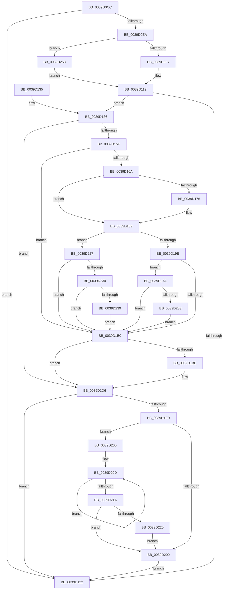

# PpmExecutePeriodicPerfCheck

- RVA: `0x0039D0CC`–`0x0039D298` (길이 `460` bytes)
- VA: `0x000000014039D0CC`
- 실행 섹션: `.text`
- PDB 이름 있음: `예`; PDB Function 태그: `아니요`
- unwind 정보 RVA: `0x00081A60`
- 디코드: `114`개 명령, `460/460` bytes 표시
- 미해석 바이트: `0` (있으면 어셈블리에 `.byte`로 보존)

> 이 문서는 커널 이미지의 기계어와 PDB 기호를 분석해 생성했습니다. 4번과 5번은 함수 원형과 자료형을 바이너리 사용 방식에서 추정한 C 해석이며 원본 소스 복구 결과는 아닙니다.

## 1. Dependencies

- 직접 호출 지점: **6**; 고유 호출 대상: **6**
- 직접 호출자로 확인된 함수: **2**
- RIP 상대 이미지 참조: **10**

### Outgoing calls
- `0x0039D136` → [KeDisableInterrupts](../21/KeDisableInterrupts_function_00217BE0.md) (function, `0x00217BE0`)
- `0x0039D145` → [KeAcquireSpinLockAtDpcLevel](../20/KeAcquireSpinLockAtDpcLevel_function_00208430.md) (function, `0x00208430`)
- `0x0039D1D1` → [KeInsertQueueDpc](../20/KeInsertQueueDpc_function_00207C50.md) (function, `0x00207C50`)
- `0x0039D1DD` → [KxReleaseSpinLock](../20/KxReleaseSpinLock_function_00206670.md) (function, `0x00206670`)
- `0x0039D220` → [KiRemoveSystemWorkPriorityKick](../26/KiRemoveSystemWorkPriorityKick_function_002631D0.md) (function, `0x002631D0`)
- `0x0039D26D` → [RtlGetInterruptTimePrecise](../20/RtlGetInterruptTimePrecise_function_0020A4C0.md) (function, `0x0020A4C0`)

### Direct callers
- [KiUpdateTime](KiUpdateTime_function_0039B530.md) at `0x0039B886`
- [PpmCheckTimerCallback](../5D/PpmCheckTimerCallback_function_005D85B0.md) at `0x005D85F7`

### Static image references
- `0x0039D0DE` → RVA `0x00F0B270` (`.data`; read)
- `0x0039D0EA` → RVA `0x00F0B3E8` (`.data`; read)
- `0x0039D0F7` → RVA `0x00FC6B7C` (`ALMOSTRO`; read)
- `0x0039D107` → RVA `0x00F0B268` (`.data`; read)
- `0x0039D13B` → RVA `0x00F0B340` (`.data`; read)
- `0x0039D14A` → RVA `0x00F0B348` (`.data`; read)
- `0x0039D176` → RVA `0x00FC6AA0` (`ALMOSTRO`; read)
- `0x0039D1C0` → RVA `0x00F0B2C0` (`.data`; read)
- `0x0039D1CA` → RVA `0x00F0B348` (`.data`; write)
- `0x0039D253` → RVA `0x00FC6B3C` (`ALMOSTRO`; read)

## 2. Other-region calls and transfers

- 다른 실행 섹션으로 향하는 call: **0**
- 별도 외부 분기/꼬리 이동을 확인하지 못했습니다.

## 3. Assembly (complete function range)

```asm
0039D0CC  48 89 5C 24 18                  mov qword ptr [rsp + 0x18], rbx
0039D0D1  48 89 6C 24 20                  mov qword ptr [rsp + 0x20], rbp
0039D0D6  56                              push rsi
0039D0D7  57                              push rdi
0039D0D8  41 56                           push r14
0039D0DA  48 83 EC 20                     sub rsp, 0x20
0039D0DE  48 8B 35 8B E1 B6 00            mov rsi, qword ptr [rip + 0xb6e18b]
0039D0E5  48 85 F6                        test rsi, rsi
0039D0E8  74 38                           je 0x14039d122
0039D0EA  83 3D F7 E2 B6 00 00            cmp dword ptr [rip + 0xb6e2f7], 0
0039D0F1  0F 85 5C 01 00 00               jne 0x14039d253
0039D0F7  8B 1D 7F 9A C2 00               mov ebx, dword ptr [rip + 0xc29a7f]
0039D0FD  48 BF 08 00 00 00 80 F7 FF FF   movabs rdi, 0xfffff78000000008
0039D107  48 39 1D 5A E1 B6 00            cmp qword ptr [rip + 0xb6e15a], rbx
0039D10E  48 0F 47 1D 52 E1 B6 00         cmova rbx, qword ptr [rip + 0xb6e152]
0039D116  48 8B 3F                        mov rdi, qword ptr [rdi]
0039D119  48 8D 2C 33                     lea rbp, [rbx + rsi]
0039D11D  48 3B EF                        cmp rbp, rdi
0039D120  76 14                           jbe 0x14039d136
0039D122  48 8B 5C 24 50                  mov rbx, qword ptr [rsp + 0x50]
0039D127  48 8B 6C 24 58                  mov rbp, qword ptr [rsp + 0x58]
0039D12C  48 83 C4 20                     add rsp, 0x20
0039D130  41 5E                           pop r14
0039D132  5F                              pop rdi
0039D133  5E                              pop rsi
0039D134  C3                              ret
0039D135  CC                              int3
0039D136  E8 A5 AA E7 FF                  call 0x140217be0
0039D13B  48 8D 0D FE E1 B6 00            lea rcx, [rip + 0xb6e1fe]
0039D142  44 8A F0                        mov r14b, al
0039D145  E8 E6 B2 E6 FF                  call 0x140208430
0039D14A  4C 8B 0D F7 E1 B6 00            mov r9, qword ptr [rip + 0xb6e1f7]
0039D151  48 8B C3                        mov rax, rbx
0039D154  48 D1 E8                        shr rax, 1
0039D157  49 03 C1                        add rax, r9
0039D15A  48 3B C7                        cmp rax, rdi
0039D15D  77 77                           ja 0x14039d1d6
0039D15F  33 D2                           xor edx, edx
0039D161  4C 8B C7                        mov r8, rdi
0039D164  48 83 FE 01                     cmp rsi, 1
0039D168  74 46                           je 0x14039d1b0
0039D16A  44 8B 15 77 E2 B6 00            mov r10d, dword ptr [rip + 0xb6e277]
0039D171  45 85 D2                        test r10d, r10d
0039D174  75 13                           jne 0x14039d189
0039D176  8B 05 24 99 C2 00               mov eax, dword ptr [rip + 0xc29924]
0039D17C  48 03 C3                        add rax, rbx
0039D17F  48 03 C6                        add rax, rsi
0039D182  48 3B C7                        cmp rax, rdi
0039D185  4C 0F 47 C5                     cmova r8, rbp
0039D189  49 8B C8                        mov rcx, r8
0039D18C  48 2B CB                        sub rcx, rbx
0039D18F  48 2B CE                        sub rcx, rsi
0039D192  45 85 D2                        test r10d, r10d
0039D195  0F 85 8C 00 00 00               jne 0x14039d227
0039D19B  8B 05 FF 98 C2 00               mov eax, dword ptr [rip + 0xc298ff]
0039D1A1  49 03 C1                        add rax, r9
0039D1A4  48 03 C3                        add rax, rbx
0039D1A7  48 3B C7                        cmp rax, rdi
0039D1AA  0F 82 CA 00 00 00               jb 0x14039d27a
0039D1B0  48 8B C6                        mov rax, rsi
0039D1B3  F0 4C 0F B1 05 B4 E0 B6 00      lock cmpxchg qword ptr [rip + 0xb6e0b4], r8
0039D1BC  75 18                           jne 0x14039d1d6
0039D1BE  8B D2                           mov edx, edx
0039D1C0  48 8D 0D F9 E0 B6 00            lea rcx, [rip + 0xb6e0f9]
0039D1C7  45 33 C0                        xor r8d, r8d
0039D1CA  48 89 3D 77 E1 B6 00            mov qword ptr [rip + 0xb6e177], rdi
0039D1D1  E8 7A AA E6 FF                  call 0x140207c50
0039D1D6  48 8D 0D 63 E1 B6 00            lea rcx, [rip + 0xb6e163]
0039D1DD  E8 8E 94 E6 FF                  call 0x140206670
0039D1E2  45 84 F6                        test r14b, r14b
0039D1E5  0F 84 37 FF FF FF               je 0x14039d122
0039D1EB  65 48 8B 0C 25 20 00 00 00      mov rcx, qword ptr gs:[0x20]
0039D1F4  4C 8B 81 B8 8E 00 00            mov r8, qword ptr [rcx + 0x8eb8]
0039D1FB  4D 85 C0                        test r8, r8
0039D1FE  75 06                           jne 0x14039d206
0039D200  FB                              sti
0039D201  E9 1C FF FF FF                  jmp 0x14039d122
0039D206  41 0F 0D 08                     prefetchw byte ptr [r8]
0039D20A  41 8B 00                        mov eax, dword ptr [r8]
0039D20D  8B D0                           mov edx, eax
0039D20F  0F BA F2 15                     btr edx, 0x15
0039D213  F0 41 0F B1 10                  lock cmpxchg dword ptr [r8], edx
0039D218  75 F3                           jne 0x14039d20d
0039D21A  0F BA E0 15                     bt eax, 0x15
0039D21E  73 E0                           jae 0x14039d200
0039D220  E8 AB 5F EC FF                  call 0x1402631d0
0039D225  EB D9                           jmp 0x14039d200
0039D227  49 8D 04 19                     lea rax, [r9 + rbx]
0039D22B  48 3B C7                        cmp rax, rdi
0039D22E  73 80                           jae 0x14039d1b0
0039D230  48 3B CB                        cmp rcx, rbx
0039D233  0F 82 77 FF FF FF               jb 0x14039d1b0
0039D239  B8 80 96 98 00                  mov eax, 0x989680
0039D23E  48 3B C8                        cmp rcx, rax
0039D241  48 0F 43 C8                     cmovae rcx, rax
0039D245  48 8B C1                        mov rax, rcx
0039D248  48 F7 F3                        div rbx
0039D24B  48 8B D0                        mov rdx, rax
0039D24E  E9 5D FF FF FF                  jmp 0x14039d1b0
0039D253  8B 1D E3 98 C2 00               mov ebx, dword ptr [rip + 0xc298e3]
0039D259  48 8D 4C 24 40                  lea rcx, [rsp + 0x40]
0039D25E  48 39 1D 03 E0 B6 00            cmp qword ptr [rip + 0xb6e003], rbx
0039D265  48 0F 47 1D FB DF B6 00         cmova rbx, qword ptr [rip + 0xb6dffb]
0039D26D  E8 4E D2 E6 FF                  call 0x14020a4c0
0039D272  48 8B F8                        mov rdi, rax
0039D275  E9 9F FE FF FF                  jmp 0x14039d119
0039D27A  48 3B CB                        cmp rcx, rbx
0039D27D  0F 82 2D FF FF FF               jb 0x14039d1b0
0039D283  48 8B C1                        mov rax, rcx
0039D286  48 F7 F3                        div rbx
0039D289  BA 40 00 00 00                  mov edx, 0x40
0039D28E  3B C2                           cmp eax, edx
0039D290  0F 42 D0                        cmovb edx, eax
0039D293  E9 18 FF FF FF                  jmp 0x14039d1b0
```

## 4. C-style interpretation (structured pseudocode)

```c
__int64 __fastcall PpmExecutePeriodicPerfCheck(__int64 a1, int a2)
{
    __int64 result;
    __int64 v_rbx;
    __int64 v_rsp;
    unsigned __int64 v_stack_p18;
    unsigned __int64 v_stack_p20;
    unsigned __int64 v_stack_p40;

    v_stack_p18 = v_rbx;
    v_stack_p20 = v_rbp;
    v_rsp = (v_rsp) - (32);
    if (*(unsigned __int64 *)(v_rip + 11985291) == 0) goto loc_0039D122;
    if ((*(unsigned int *)(v_rip + 11985655)) != 0) goto loc_0039D253;
    v_rbx = (unsigned int)(*(unsigned int *)(v_rip + 12753535));
    if ((*(unsigned __int64 *)(v_rip + 11985242)) > ((unsigned int)(*(unsigned int *)(v_rip + 12753535)))) { v_rbx = *(unsigned __int64 *)(v_rip + 11985234); }
loc_0039D119:
    if ((v_rbx + *(unsigned __int64 *)(v_rip + 11985291) * 1) <= (*(unsigned __int64 *)(v_rdi))) goto loc_0039D136;
loc_0039D122:
    v_rsp = (v_rsp) + (32);
    return result;
loc_0039D136:
    result = KeDisableInterrupts(a1, a2, a3, a4);
    result = KeAcquireSpinLockAtDpcLevel(v_rip + 11985406, a2, a3, a4);
    result = (v_stack_p18) >> (1);
    result = (result) + (*(unsigned __int64 *)(v_rip + 11985399));
    if (result > (*(unsigned __int64 *)(v_rdi))) goto loc_0039D1D6;
    a2 = 0;
    if ((*(unsigned __int64 *)(v_rip + 11985291)) == 1) goto loc_0039D1B0;
    if ((unsigned int)((unsigned int)(*(unsigned int *)(v_rip + 11985527))) == 0) {
        result = *(unsigned int *)(v_rip + 12753188);
        result = (result) + (v_stack_p18);
        result = (result) + (*(unsigned __int64 *)(v_rip + 11985291));
        a3 = *(unsigned __int64 *)(v_rdi);
        if (result > (*(unsigned __int64 *)(v_rdi))) { a3 = v_stack_p20; }
    }
    a1 = (a3) - (v_stack_p18);
    a1 = (a1) - (*(unsigned __int64 *)(v_rip + 11985291));
    if ((unsigned int)((unsigned int)(*(unsigned int *)(v_rip + 11985527))) != 0) goto loc_0039D227;
    result = ((unsigned int)(*(unsigned int *)(v_rip + 12753151))) + (*(unsigned __int64 *)(v_rip + 11985399));
    result = (result) + (v_stack_p18);
    if (result < (*(unsigned __int64 *)(v_rdi))) goto loc_0039D27A;
loc_0039D1B0:
    result = *(unsigned __int64 *)(v_rip + 11985291);
    if (result == (*(unsigned __int64 *)(v_rdi))) {
        a2 = 0;
        a1 = v_rip + 11985145;
        a3 = 0;
        *(unsigned __int64 *)(v_rip + 11985271) = *(unsigned __int64 *)(v_rdi);
        result = KeInsertQueueDpc(a1, a2, a3, *(unsigned __int64 *)(v_rip + 11985399));
    }
    result = KxReleaseSpinLock(v_rip + 11985251, a2, a3, *(unsigned __int64 *)(v_rip + 11985399));
    if ((unsigned __int8)((unsigned __int8)(result)) == 0) goto loc_0039D122;
    if (*(unsigned __int64 *)(*(unsigned __int64 *)(gs_base + (0 + 32)) + 36536) != 0) goto loc_0039D206;
loc_0039D200:
    goto loc_0039D122;
loc_0039D206:
loc_0039D20D:
    if (*(unsigned __int64 *)(*(unsigned __int64 *)(gs_base + (0 + 32)) + 36536) != 0) goto loc_0039D20D;
    if (condition_is_above_or_equal) goto loc_0039D200;
    result = KiRemoveSystemWorkPriorityKick(*(unsigned __int64 *)(gs_base + (0 + 32)), (unsigned int)((unsigned int)((unsigned int)(*(unsigned int *)(*(unsigned __int64 *)(*(unsigned __int64 *)(gs_base + (0 + 32)) + 36536))))), *(unsigned __int64 *)(*(unsigned __int64 *)(gs_base + (0 + 32)) + 36536), *(unsigned __int64 *)(v_rip + 11985399));
    goto loc_0039D200;
loc_0039D227:
    if ((*(unsigned __int64 *)(v_rip + 11985399) + v_stack_p18 * 1) >= (*(unsigned __int64 *)(v_rdi))) goto loc_0039D1B0;
    if ((*(unsigned __int64 *)(gs_base + (0 + 32))) < v_stack_p18) goto loc_0039D1B0;
    a1 = *(unsigned __int64 *)(gs_base + (0 + 32));
    if ((*(unsigned __int64 *)(gs_base + (0 + 32))) >= ((unsigned int)(0x989680ULL))) { a1 = (unsigned int)(0x989680ULL); }
    goto loc_0039D1B0;
loc_0039D253:
    v_rbx = (unsigned int)(*(unsigned int *)(v_rip + 12753123));
    if ((*(unsigned __int64 *)(v_rip + 11984899)) > ((unsigned int)(*(unsigned int *)(v_rip + 12753123)))) { v_rbx = *(unsigned __int64 *)(v_rip + 11984891); }
    result = RtlGetInterruptTimePrecise(v_stack_p40, a1, *(unsigned __int64 *)(*(unsigned __int64 *)(gs_base + (0 + 32)) + 36536), *(unsigned __int64 *)(v_rip + 11985399));
    goto loc_0039D119;
loc_0039D27A:
    if (v_stack_p40 < v_rbx) goto loc_0039D1B0;
    a2 = 64;
    if (((unsigned int)(v_stack_p40)) < 64) { a2 = (unsigned int)(v_stack_p40); }
    goto loc_0039D1B0;
}
```

## 5. (Beta) C Style

```c
int64_t PpmExecutePeriodicPerfCheck(int64_t Arg1, int32_t Arg2)
{
    int64_t result;
    int64_t local_rbx;
    int64_t local_rsp;
    uint64_t v_stack_p18;
    uint64_t v_stack_p20;
    uint64_t v_stack_p40;

    v_stack_p18 = local_rbx;
    v_stack_p20 = local_rbp;
    local_rsp = (local_rsp) - (32);
    if (*(uint64_t *)(v_rip + 0xB6E18B) == 0) goto loc_0039D122;
    if ((*(uint32_t *)(v_rip + 0xB6E2F7)) != 0) goto loc_0039D253;
    local_rbx = (uint32_t)(*(uint32_t *)(v_rip + 0xC29A7F));
    if ((*(uint64_t *)(v_rip + 0xB6E15A)) > ((uint32_t)(*(uint32_t *)(v_rip + 0xC29A7F)))) { local_rbx = *(uint64_t *)(v_rip + 0xB6E152); }
loc_0039D119:
    if ((local_rbx + *(uint64_t *)(v_rip + 0xB6E18B) * 1) <= (*(uint64_t *)(local_rdi))) goto loc_0039D136;
loc_0039D122:
    local_rsp = (local_rsp) + (32);
    return result;
loc_0039D136:
    result = KeDisableInterrupts(Arg1, Arg2, a3, a4);
    result = KeAcquireSpinLockAtDpcLevel(v_rip + 11985406, Arg2, a3, a4);
    result = (v_stack_p18) >> (1);
    result = (result) + (*(uint64_t *)(v_rip + 0xB6E1F7));
    if (result > (*(uint64_t *)(local_rdi))) goto loc_0039D1D6;
    Arg2 = 0;
    if ((*(uint64_t *)(v_rip + 0xB6E18B)) == 1) goto loc_0039D1B0;
    if ((uint32_t)((uint32_t)(*(uint32_t *)(v_rip + 0xB6E277))) == 0) {
        result = *(uint32_t *)(v_rip + 0xC29924);
        result = (result) + (v_stack_p18);
        result = (result) + (*(uint64_t *)(v_rip + 0xB6E18B));
        a3 = *(uint64_t *)(local_rdi);
        if (result > (*(uint64_t *)(local_rdi))) { a3 = v_stack_p20; }
    }
    Arg1 = (a3) - (v_stack_p18);
    Arg1 = (Arg1) - (*(uint64_t *)(v_rip + 0xB6E18B));
    if ((uint32_t)((uint32_t)(*(uint32_t *)(v_rip + 0xB6E277))) != 0) goto loc_0039D227;
    result = ((uint32_t)(*(uint32_t *)(v_rip + 0xC298FF))) + (*(uint64_t *)(v_rip + 0xB6E1F7));
    result = (result) + (v_stack_p18);
    if (result < (*(uint64_t *)(local_rdi))) goto loc_0039D27A;
loc_0039D1B0:
    result = *(uint64_t *)(v_rip + 0xB6E18B);
    if (result == (*(uint64_t *)(local_rdi))) {
        Arg2 = 0;
        Arg1 = v_rip + 11985145;
        a3 = 0;
        *(uint64_t *)(v_rip + 0xB6E177) = *(uint64_t *)(local_rdi);
        result = KeInsertQueueDpc(Arg1, Arg2, a3, *(uint64_t *)(v_rip + 0xB6E1F7));
    }
    result = KxReleaseSpinLock(v_rip + 11985251, Arg2, a3, *(uint64_t *)(v_rip + 0xB6E1F7));
    if ((uint8_t)((uint8_t)(result)) == 0) goto loc_0039D122;
    if (*(uint64_t *)(*(uint64_t *)(gs_base + (0 + 0x20)) + 0x8EB8) != 0) goto loc_0039D206;
loc_0039D200:
    goto loc_0039D122;
loc_0039D206:
loc_0039D20D:
    if (*(uint64_t *)(*(uint64_t *)(gs_base + (0 + 0x20)) + 0x8EB8) != 0) goto loc_0039D20D;
    if (condition_is_above_or_equal) goto loc_0039D200;
    result = KiRemoveSystemWorkPriorityKick(*(uint64_t *)(gs_base + (0 + 0x20)), (uint32_t)((uint32_t)((uint32_t)(*(uint32_t *)(*(uint64_t *)(*(uint64_t *)(gs_base + (0 + 0x20)) + 0x8EB8))))), *(uint64_t *)(*(uint64_t *)(gs_base + (0 + 0x20)) + 0x8EB8), *(uint64_t *)(v_rip + 0xB6E1F7));
    goto loc_0039D200;
loc_0039D227:
    if ((*(uint64_t *)(v_rip + 0xB6E1F7) + v_stack_p18 * 1) >= (*(uint64_t *)(local_rdi))) goto loc_0039D1B0;
    if ((*(uint64_t *)(gs_base + (0 + 0x20))) < v_stack_p18) goto loc_0039D1B0;
    Arg1 = *(uint64_t *)(gs_base + (0 + 0x20));
    if ((*(uint64_t *)(gs_base + (0 + 0x20))) >= ((uint32_t)(0x989680ULL))) { Arg1 = (uint32_t)(0x989680ULL); }
    goto loc_0039D1B0;
loc_0039D253:
    local_rbx = (uint32_t)(*(uint32_t *)(v_rip + 0xC298E3));
    if ((*(uint64_t *)(v_rip + 0xB6E003)) > ((uint32_t)(*(uint32_t *)(v_rip + 0xC298E3)))) { local_rbx = *(uint64_t *)(v_rip + 0xB6DFFB); }
    result = RtlGetInterruptTimePrecise(v_stack_p40, Arg1, *(uint64_t *)(*(uint64_t *)(gs_base + (0 + 0x20)) + 0x8EB8), *(uint64_t *)(v_rip + 0xB6E1F7));
    goto loc_0039D119;
loc_0039D27A:
    if (v_stack_p40 < local_rbx) goto loc_0039D1B0;
    Arg2 = 64;
    if (((uint32_t)(v_stack_p40)) < 64) { Arg2 = (uint32_t)(v_stack_p40); }
    goto loc_0039D1B0;
}
```

## 6. Execution-region graph

[열기: 2D/3D 그래프와 함수 탐색 컨트롤 패널](../../../control-panel.html?section=text&rva=0x0039D0CC&view=graph)

- 2D 그래프는 위에서 아래로 흐르고, 3D 그래프는 빈 공간을 드래그해 회전합니다. Shift+드래그는 이동, 휠은 확대·축소, 함수 노드 선택은 대상 보고서 이동입니다.

### Static fallback


