# PsBoostThreadIoEx

- RVA: `0x00392C00`–`0x00392EEA` (길이 `746` bytes)
- VA: `0x0000000140392C00`
- 실행 섹션: `.text`
- PDB 이름 있음: `예`; PDB Function 태그: `아니요`
- unwind 정보 RVA: `0x00080D24`
- 디코드: `183`개 명령, `746/746` bytes 표시
- 미해석 바이트: `0` (있으면 어셈블리에 `.byte`로 보존)

> 이 문서는 커널 이미지의 기계어와 PDB 기호를 분석해 생성했습니다. 4번과 5번은 함수 원형과 자료형을 바이너리 사용 방식에서 추정한 C 해석이며 원본 소스 복구 결과는 아닙니다.

## 1. Dependencies

- 직접 호출 지점: **12**; 고유 호출 대상: **9**
- 직접 호출자로 확인된 함수: **20**
- RIP 상대 이미지 참조: **4**

### Outgoing calls
- `0x00392CD3` → [KiAbThreadInsertList](../21/KiAbThreadInsertList_function_0021F0E0.md) (function, `0x0021F0E0`)
- `0x00392CDF` → [KiAbQueueAutoBoostDpc](../20/KiAbQueueAutoBoostDpc_function_002074D0.md) (function, `0x002074D0`)
- `0x00392CF4` → [KiLowerIrqlProcessIrqlFlags](../4F/KiLowerIrqlProcessIrqlFlags_function_004F5698.md) (function, `0x004F5698`)
- `0x00392D51` → [ExAllocatePool2](../../poolcode/B8/ExAllocatePool2_function_00B820F0.md) (function, `0x00B820F0`)
- `0x00392D6C` → [RtlCaptureStackBackTrace](../2F/RtlCaptureStackBackTrace_function_002F9FF0.md) (function, `0x002F9FF0`)
- `0x00392D8C` → [KeAcquireSpinLockRaiseToDpc](../20/KeAcquireSpinLockRaiseToDpc_function_00208470.md) (function, `0x00208470`)
- `0x00392DA0` → [KiRaiseIrqlProcessIrqlFlags](../4F/KiRaiseIrqlProcessIrqlFlags_function_004F56FC.md) (function, `0x004F56FC`)
- `0x00392DE4` → [KiLowerIrqlProcessIrqlFlags](../4F/KiLowerIrqlProcessIrqlFlags_function_004F5698.md) (function, `0x004F5698`)
- `0x00392E11` → [KiReleaseSpinLockInstrumented](KiReleaseSpinLockInstrumented_function_00392EF0.md) (function, `0x00392EF0`)
- `0x00392E4E` → [ExFreePoolWithTag](../../poolcode/B8/ExFreePoolWithTag_function_00B82870.md) (function, `0x00B82870`)
- `0x00392E90` → [ExFreePoolWithTag](../../poolcode/B8/ExFreePoolWithTag_function_00B82870.md) (function, `0x00B82870`)
- `0x00392EB2` → [ExFreePoolWithTag](../../poolcode/B8/ExFreePoolWithTag_function_00B82870.md) (function, `0x00B82870`)

### Direct callers
- [sub_00210BCA](../21/Unknown_function_00210BCA.md) at `0x00210BF0`
- [ExpAcquireResourceSharedLite](../21/ExpAcquireResourceSharedLite_function_00212040.md) at `0x002131C9`
- [sub_00215166](../21/Unknown_function_00215166.md) at `0x00215748`
- [sub_00215F5C](../21/Unknown_function_00215F5C.md) at `0x00216043`
- [sub_0021F36F](../21/Unknown_function_0021F36F.md) at `0x0021F4F4`
- [sub_0021F36F](../21/Unknown_function_0021F36F.md) at `0x0021F590`
- [sub_00220023](../22/Unknown_function_00220023.md) at `0x00220056`
- [sub_00220023](../22/Unknown_function_00220023.md) at `0x002200F9`
- [sub_002209D5](../22/Unknown_function_002209D5.md) at `0x00220A08`
- [sub_002209D5](../22/Unknown_function_002209D5.md) at `0x00220AAB`
- [ExpSetResourceOwnerPointerEx](../34/ExpSetResourceOwnerPointerEx_function_00343E20.md) at `0x0034425A`
- [ExpSetResourceOwnerPointerEx](../34/ExpSetResourceOwnerPointerEx_function_00343E20.md) at `0x00344298`
- [ExpSetResourceOwnerPointerEx](../34/ExpSetResourceOwnerPointerEx_function_00343E20.md) at `0x003442E2`
- [ExpSetResourceOwnerPointerEx](../34/ExpSetResourceOwnerPointerEx_function_00343E20.md) at `0x00344318`
- [sub_0038BBFB](../38/Unknown_function_0038BBFB.md) at `0x0038BD45`
- [sub_0038BBFB](../38/Unknown_function_0038BBFB.md) at `0x0038BDA9`
- [sub_0038BEEF](../38/Unknown_function_0038BEEF.md) at `0x0038BFE3`
- [CcAcquireByteRangeForWrite](../40/CcAcquireByteRangeForWrite_function_00401E74.md) at `0x0040281C`
- [CcAcquireByteRangeForWrite](../40/CcAcquireByteRangeForWrite_function_00401E74.md) at `0x004028E9`
- [FsRtlpWaitForIoAtEof](../41/FsRtlpWaitForIoAtEof_function_00415298.md) at `0x00415310`
- [FsRtlpWaitForIoAtEof](../41/FsRtlpWaitForIoAtEof_function_00415298.md) at `0x00415460`
- [FsRtlpModifyThreadPriorities](../48/FsRtlpModifyThreadPriorities_function_0048B098.md) at `0x0048B0FF`
- [FsRtlpModifyThreadPriorities](../48/FsRtlpModifyThreadPriorities_function_0048B098.md) at `0x0048B181`
- [FsRtlpDoBoost](../48/FsRtlpDoBoost_function_0048B198.md) at `0x0048B24A`
- [IoBoostThreadIo](../4B/IoBoostThreadIo_function_004BE560.md) at `0x004BE583`
- [IoBoostThreadIo](../4B/IoBoostThreadIo_function_004BE560.md) at `0x004BE598`
- [CcBoostLowPriorityWorkerThread](../57/CcBoostLowPriorityWorkerThread_function_0057B704.md) at `0x0057B801`
- [ExEnterPriorityRegionAndAcquireResourceExclusive](../65/ExEnterPriorityRegionAndAcquireResourceExclusive_function_00658D40.md) at `0x00658D61`
- [ExReleaseResourceAndLeavePriorityRegion](../65/ExReleaseResourceAndLeavePriorityRegion_function_00658DA0.md) at `0x00658DBF`
- [sub_006E5438](../6E/Unknown_function_006E5438.md) at `0x006E544B`
- [sub_006F937E](../6F/Unknown_function_006F937E.md) at `0x006F943B`

### Static image references
- `0x00392C21` → RVA `0x00FC6F88` (`ALMOSTRO`; read)
- `0x00392CAC` → RVA `0x00FC6D20` (`ALMOSTRO`; read)
- `0x00392DC5` → RVA `0x00FC6B06` (`ALMOSTRO`; read)
- `0x00392DFF` → RVA `0x00F0DE58` (`.data`; read)

## 2. Other-region calls and transfers

- 다른 실행 섹션으로 향하는 call: **4**
  - `0x00392D51` → [ExAllocatePool2](../../poolcode/B8/ExAllocatePool2_function_00B820F0.md) (`.text` → `POOLCODE`)
  - `0x00392E4E` → [ExFreePoolWithTag](../../poolcode/B8/ExFreePoolWithTag_function_00B82870.md) (`.text` → `POOLCODE`)
  - `0x00392E90` → [ExFreePoolWithTag](../../poolcode/B8/ExFreePoolWithTag_function_00B82870.md) (`.text` → `POOLCODE`)
  - `0x00392EB2` → [ExFreePoolWithTag](../../poolcode/B8/ExFreePoolWithTag_function_00B82870.md) (`.text` → `POOLCODE`)
- 별도 외부 분기/꼬리 이동을 확인하지 못했습니다.

## 3. Assembly (complete function range)

```asm
00392C00  48 89 5C 24 08                  mov qword ptr [rsp + 8], rbx
00392C05  48 89 6C 24 10                  mov qword ptr [rsp + 0x10], rbp
00392C0A  48 89 74 24 18                  mov qword ptr [rsp + 0x18], rsi
00392C0F  57                              push rdi
00392C10  41 54                           push r12
00392C12  41 55                           push r13
00392C14  41 56                           push r14
00392C16  41 57                           push r15
00392C18  48 83 EC 20                     sub rsp, 0x20
00392C1C  33 DB                           xor ebx, ebx
00392C1E  45 32 FF                        xor r15b, r15b
00392C21  39 1D 61 43 C3 00               cmp dword ptr [rip + 0xc34361], ebx
00392C27  49 8B F1                        mov rsi, r9
00392C2A  41 0F B6 E8                     movzx ebp, r8b
00392C2E  44 0F B6 E2                     movzx r12d, dl
00392C32  48 8B F9                        mov rdi, rcx
00392C35  44 8B EB                        mov r13d, ebx
00392C38  44 8D 73 01                     lea r14d, [rbx + 1]
00392C3C  0F 85 FD 00 00 00               jne 0x140392d3f
00392C42  45 84 C0                        test r8b, r8b
00392C45  0F 85 F8 00 00 00               jne 0x140392d43
00392C4B  48 8D B1 10 06 00 00            lea rsi, [rcx + 0x610]
00392C52  45 84 E4                        test r12b, r12b
00392C55  0F 84 A7 00 00 00               je 0x140392d02
00392C5B  39 9F E0 05 00 00               cmp dword ptr [rdi + 0x5e0], ebx
00392C61  0F 84 59 01 00 00               je 0x140392dc0
00392C67  BB FF FF FF FF                  mov ebx, 0xffffffff
00392C6C  F0 0F C1 9F E0 05 00 00         lock xadd dword ptr [rdi + 0x5e0], ebx
00392C74  FF CB                           dec ebx
00392C76  40 84 ED                        test bpl, bpl
00392C79  0F 85 99 01 00 00               jne 0x140392e18
00392C7F  85 DB                           test ebx, ebx
00392C81  0F 85 9A 00 00 00               jne 0x140392d21
00392C87  45 84 E4                        test r12b, r12b
00392C8A  0F 85 91 00 00 00               jne 0x140392d21
00392C90  0F B6 87 18 03 00 00            movzx eax, byte ptr [rdi + 0x318]
00392C97  84 C0                           test al, al
00392C99  0F 84 82 00 00 00               je 0x140392d21
00392C9F  44 0F 20 C3                     mov rbx, cr8
00392CA3  B8 02 00 00 00                  mov eax, 2
00392CA8  44 0F 22 C0                     mov cr8, rax
00392CAC  83 3D 6D 40 C3 00 00            cmp dword ptr [rip + 0xc3406d], 0
00392CB3  0F 85 E1 00 00 00               jne 0x140392d9a
00392CB9  65 48 8B 34 25 20 00 00 00      mov rsi, qword ptr gs:[0x20]
00392CC2  4C 8D 87 28 03 00 00            lea r8, [rdi + 0x328]
00392CC9  48 8B CF                        mov rcx, rdi
00392CCC  48 8D 96 78 91 00 00            lea rdx, [rsi + 0x9178]
00392CD3  E8 08 C4 E8 FF                  call 0x14021f0e0
00392CD8  85 C0                           test eax, eax
00392CDA  74 08                           je 0x140392ce4
00392CDC  48 8B CE                        mov rcx, rsi
00392CDF  E8 EC 47 E7 FF                  call 0x1402074d0
00392CE4  83 3D 35 40 C3 00 00            cmp dword ptr [rip + 0xc34035], 0
00392CEB  74 0C                           je 0x140392cf9
00392CED  44 0F 20 C1                     mov rcx, cr8
00392CF1  0F B6 D3                        movzx edx, bl
00392CF4  E8 9F 29 16 00                  call 0x1404f5698
00392CF9  0F B6 C3                        movzx eax, bl
00392CFC  44 0F 22 C0                     mov cr8, rax
00392D00  EB 1F                           jmp 0x140392d21
00392D02  F0 44 0F C1 B7 E0 05 00 00      lock xadd dword ptr [rdi + 0x5e0], r14d
00392D0B  41 8D 5E 01                     lea ebx, [r14 + 1]
00392D0F  40 84 ED                        test bpl, bpl
00392D12  0F 85 A1 01 00 00               jne 0x140392eb9
00392D18  83 FB 01                        cmp ebx, 1
00392D1B  0F 84 66 FF FF FF               je 0x140392c87
00392D21  48 8B 5C 24 50                  mov rbx, qword ptr [rsp + 0x50]
00392D26  48 8B 6C 24 58                  mov rbp, qword ptr [rsp + 0x58]
00392D2B  48 8B 74 24 60                  mov rsi, qword ptr [rsp + 0x60]
00392D30  48 83 C4 20                     add rsp, 0x20
00392D34  41 5F                           pop r15
00392D36  41 5E                           pop r14
00392D38  41 5D                           pop r13
00392D3A  41 5C                           pop r12
00392D3C  5F                              pop rdi
00392D3D  C3                              ret
00392D3E  CC                              int3
00392D3F  41 0F B6 EE                     movzx ebp, r14b
00392D43  BA 70 00 00 00                  mov edx, 0x70
00392D48  41 B8 42 6F 6F 73               mov r8d, 0x736f6f42
00392D4E  8D 4A D0                        lea ecx, [rdx - 0x30]
00392D51  E8 9A F3 7E 00                  call 0x140b820f0
00392D56  4C 8B E8                        mov r13, rax
00392D59  48 85 C0                        test rax, rax
00392D5C  74 24                           je 0x140392d82
00392D5E  45 33 C9                        xor r9d, r9d
00392D61  4C 8D 40 10                     lea r8, [rax + 0x10]
00392D65  41 8B CE                        mov ecx, r14d
00392D68  41 8D 51 0A                     lea edx, [r9 + 0xa]
00392D6C  E8 7F 72 F6 FF                  call 0x1402f9ff0
00392D71  65 48 8B 04 25 88 01 00 00      mov rax, qword ptr gs:[0x188]
00392D7A  49 89 45 60                     mov qword ptr [r13 + 0x60], rax
00392D7E  49 89 75 68                     mov qword ptr [r13 + 0x68], rsi
00392D82  48 8D B7 10 06 00 00            lea rsi, [rdi + 0x610]
00392D89  48 8B CE                        mov rcx, rsi
00392D8C  E8 DF 56 E7 FF                  call 0x140208470
00392D91  44 0F B6 F8                     movzx r15d, al
00392D95  E9 B8 FE FF FF                  jmp 0x140392c52
00392D9A  0F B6 D0                        movzx edx, al
00392D9D  0F B6 CB                        movzx ecx, bl
00392DA0  E8 57 29 16 00                  call 0x1404f56fc
00392DA5  E9 0F FF FF FF                  jmp 0x140392cb9
00392DAA  49 89 45 00                     mov qword ptr [r13], rax
00392DAE  49 89 4D 08                     mov qword ptr [r13 + 8], rcx
00392DB2  4C 89 29                        mov qword ptr [rcx], r13
00392DB5  4C 89 68 08                     mov qword ptr [rax + 8], r13
00392DB9  48 8D B7 10 06 00 00            lea rsi, [rdi + 0x610]
00392DC0  40 84 ED                        test bpl, bpl
00392DC3  74 2C                           je 0x140392df1
00392DC5  F6 05 3A 3D C3 00 01            test byte ptr [rip + 0xc33d3a], 1
00392DCC  75 31                           jne 0x140392dff
00392DCE  F0 48 83 26 00                  lock and qword ptr [rsi], 0
00392DD3  83 3D 46 3F C3 00 00            cmp dword ptr [rip + 0xc33f46], 0
00392DDA  74 0D                           je 0x140392de9
00392DDC  44 0F 20 C1                     mov rcx, cr8
00392DE0  41 0F B6 D7                     movzx edx, r15b
00392DE4  E8 AF 28 16 00                  call 0x1404f5698
00392DE9  41 0F B6 C7                     movzx eax, r15b
00392DED  44 0F 22 C0                     mov cr8, rax
00392DF1  45 84 E4                        test r12b, r12b
00392DF4  0F 85 85 FE FF FF               jne 0x140392c7f
00392DFA  E9 19 FF FF FF                  jmp 0x140392d18
00392DFF  8B 05 53 B0 B7 00               mov eax, dword ptr [rip + 0xb7b053]
00392E05  85 C0                           test eax, eax
00392E07  75 C5                           jne 0x140392dce
00392E09  48 8B 54 24 48                  mov rdx, qword ptr [rsp + 0x48]
00392E0E  48 8B CE                        mov rcx, rsi
00392E11  E8 DA 00 00 00                  call 0x140392ef0
00392E16  EB BB                           jmp 0x140392dd3
00392E18  83 BF E0 05 00 00 00            cmp dword ptr [rdi + 0x5e0], 0
00392E1F  74 20                           je 0x140392e41
00392E21  4D 85 ED                        test r13, r13
00392E24  74 93                           je 0x140392db9
00392E26  48 8D 87 00 06 00 00            lea rax, [rdi + 0x600]
00392E2D  48 8B 48 08                     mov rcx, qword ptr [rax + 8]
00392E31  48 39 01                        cmp qword ptr [rcx], rax
00392E34  0F 84 70 FF FF FF               je 0x140392daa
00392E3A  B9 03 00 00 00                  mov ecx, 3
00392E3F  CD 29                           int 0x29
00392E41  4D 85 ED                        test r13, r13
00392E44  74 0D                           je 0x140392e53
00392E46  BA 42 6F 6F 73                  mov edx, 0x736f6f42
00392E4B  49 8B CD                        mov rcx, r13
00392E4E  E8 1D FA 7E 00                  call 0x140b82870
00392E53  48 8D B7 F0 05 00 00            lea rsi, [rdi + 0x5f0]
00392E5A  48 8B 0E                        mov rcx, qword ptr [rsi]
00392E5D  48 3B CE                        cmp rcx, rsi
00392E60  75 35                           jne 0x140392e97
00392E62  48 8D B7 00 06 00 00            lea rsi, [rdi + 0x600]
00392E69  48 8B 0E                        mov rcx, qword ptr [rsi]
00392E6C  48 3B CE                        cmp rcx, rsi
00392E6F  0F 84 44 FF FF FF               je 0x140392db9
00392E75  48 8B 01                        mov rax, qword ptr [rcx]
00392E78  48 39 71 08                     cmp qword ptr [rcx + 8], rsi
00392E7C  75 BC                           jne 0x140392e3a
00392E7E  48 39 48 08                     cmp qword ptr [rax + 8], rcx
00392E82  75 B6                           jne 0x140392e3a
00392E84  48 89 06                        mov qword ptr [rsi], rax
00392E87  BA 42 6F 6F 73                  mov edx, 0x736f6f42
00392E8C  48 89 70 08                     mov qword ptr [rax + 8], rsi
00392E90  E8 DB F9 7E 00                  call 0x140b82870
00392E95  EB D2                           jmp 0x140392e69
00392E97  48 8B 01                        mov rax, qword ptr [rcx]
00392E9A  48 39 71 08                     cmp qword ptr [rcx + 8], rsi
00392E9E  75 9A                           jne 0x140392e3a
00392EA0  48 39 48 08                     cmp qword ptr [rax + 8], rcx
00392EA4  75 94                           jne 0x140392e3a
00392EA6  48 89 06                        mov qword ptr [rsi], rax
00392EA9  BA 42 6F 6F 73                  mov edx, 0x736f6f42
00392EAE  48 89 70 08                     mov qword ptr [rax + 8], rsi
00392EB2  E8 B9 F9 7E 00                  call 0x140b82870
00392EB7  EB A1                           jmp 0x140392e5a
00392EB9  4D 85 ED                        test r13, r13
00392EBC  0F 84 FE FE FF FF               je 0x140392dc0
00392EC2  48 8D 87 F0 05 00 00            lea rax, [rdi + 0x5f0]
00392EC9  48 8B 48 08                     mov rcx, qword ptr [rax + 8]
00392ECD  48 39 01                        cmp qword ptr [rcx], rax
00392ED0  0F 85 64 FF FF FF               jne 0x140392e3a
00392ED6  49 89 45 00                     mov qword ptr [r13], rax
00392EDA  49 89 4D 08                     mov qword ptr [r13 + 8], rcx
00392EDE  4C 89 29                        mov qword ptr [rcx], r13
00392EE1  4C 89 68 08                     mov qword ptr [rax + 8], r13
00392EE5  E9 DB FE FF FF                  jmp 0x140392dc5
```

## 4. C-style interpretation (structured pseudocode)

```c
__int64 __fastcall PsBoostThreadIoEx(__int64 a1, unsigned __int8 a2, unsigned __int8 a3, __int64 a4)
{
    __int64 result;
    __int64 v_r15;
    __int64 v_rbx;
    __int64 v_rsp;
    unsigned __int64 v_stack_p10;
    unsigned __int64 v_stack_p18;
    unsigned __int64 v_stack_p48;
    unsigned __int64 v_stack_p8;

    v_stack_p8 = v_rbx;
    v_stack_p10 = v_rbp;
    v_stack_p18 = v_rsi;
    v_rsp = (v_rsp) - (32);
    v_rbx = 0;
    v_r15 = 0;
    if ((*(unsigned int *)(v_rip + 12796769)) != 0) goto loc_00392D3F;
    if (a3 != 0) goto loc_00392D43;
loc_00392C52:
    if (a2 == 0) goto loc_00392D02;
    if ((*(unsigned int *)(a1 + 1504)) == 0) goto loc_00392DC0;
    v_rbx = (unsigned int)(((unsigned int)(0xFFFFFFFFULL)) - 1);
    if (a3 != 0) goto loc_00392E18;
loc_00392C7F:
    if ((unsigned int)(v_rbx) != 0) goto loc_00392D21;
loc_00392C87:
    if (a2 != 0) goto loc_00392D21;
    if ((unsigned __int8)(*(unsigned __int8 *)(a1 + 792)) == 0) goto loc_00392D21;
    if ((*(unsigned int *)(v_rip + 12796013)) != 0) goto loc_00392D9A;
loc_00392CB9:
    result = KiAbThreadInsertList(a1, *(unsigned __int64 *)(gs_base + (0 + 32)) + 37240, a1 + 808, a4);
    if ((unsigned int)(result) != 0) {
        a1 = *(unsigned __int64 *)(gs_base + (0 + 32));
        result = KiAbQueueAutoBoostDpc(a1, *(unsigned __int64 *)(gs_base + (0 + 32)) + 37240, a1 + 808, a4);
    }
    if ((*(unsigned int *)(v_rip + 12795957)) != 0) {
        a1 = 2;
        a2 = (unsigned __int8)(v_cr8);
        result = KiLowerIrqlProcessIrqlFlags(a1, a2, a1 + 808, a4);
    }
    goto loc_00392D21;
loc_00392D02:
    if (a3 != 0) goto loc_00392EB9;
loc_00392D18:
    if (((unsigned int)(v_rbx + 1 + 1)) == 1) goto loc_00392C87;
loc_00392D21:
    v_rsp = (v_rsp) + (32);
    return (unsigned __int8)(v_cr8);
loc_00392D3F:
loc_00392D43:
    result = ExAllocatePool2(112 - 48, 112, (unsigned int)(0x736F6F42ULL), a4);
    if (result != 0) {
        a4 = 0;
        a3 = result + 16;
        a1 = (unsigned int)(v_rbx + 1);
        a2 = a4 + 10;
        result = RtlCaptureStackBackTrace(a1, a2, a3, a4);
        result = *(unsigned __int64 *)(gs_base + (0 + 392));
        *(unsigned __int64 *)(result + 96) = result;
        *(unsigned __int64 *)(result + 104) = v_stack_p18;
    }
    result = KeAcquireSpinLockRaiseToDpc(a1 + 1552, a2, a3, a4);
    goto loc_00392C52;
loc_00392D9A:
    result = KiRaiseIrqlProcessIrqlFlags((unsigned __int8)(v_stack_p8), (unsigned __int8)(result), a3, a4);
    goto loc_00392CB9;
loc_00392DAA:
    *(unsigned __int64 *)(result) = result;
    *(unsigned __int64 *)(result + 8) = (unsigned __int8)(v_stack_p8);
    *(unsigned __int64 *)((unsigned __int8)(v_stack_p8)) = result;
    *(unsigned __int64 *)(result + 8) = result;
loc_00392DB9:
loc_00392DC0:
    if ((unsigned __int8)((unsigned __int8)(v_rbx + 1)) == 0) goto loc_00392DF1;
loc_00392DC5:
    if (((*(unsigned __int8 *)(v_rip + 12795194)) & (1)) != 0) goto loc_00392DFF;
loc_00392DCE:
loc_00392DD3:
    if ((*(unsigned int *)(v_rip + 12795718)) != 0) {
        a1 = (unsigned __int8)(v_cr8);
        a2 = (unsigned __int8)((unsigned __int8)(result));
        result = KiLowerIrqlProcessIrqlFlags(a1, a2, a3, a4);
    }
loc_00392DF1:
    if (a2 != 0) goto loc_00392C7F;
    goto loc_00392D18;
loc_00392DFF:
    if ((unsigned int)((unsigned int)(*(unsigned int *)(v_rip + 12038227))) != 0) goto loc_00392DCE;
    result = KiReleaseSpinLockInstrumented(a1 + 1552, v_stack_p48, a3, a4);
    goto loc_00392DD3;
loc_00392E18:
    if ((*(unsigned int *)(a1 + 1504)) == 0) goto loc_00392E41;
    if (result == 0) goto loc_00392DB9;
    if ((*(unsigned __int64 *)(*(unsigned __int64 *)(a1 + 1536 + 8))) == (a1 + 1536)) goto loc_00392DAA;
loc_00392E3A:
loc_00392E41:
    result = a1 + 1536;
    if (result != 0) {
        a2 = 0x736F6F42ULL;
        a1 = result;
        result = ExFreePoolWithTag(a1, a2, a3, a4);
    }
loc_00392E5A:
    if ((*(unsigned __int64 *)(a1 + 1520)) != (a1 + 1520)) goto loc_00392E97;
loc_00392E69:
    if ((*(unsigned __int64 *)(a1 + 1536)) == (a1 + 1536)) goto loc_00392DB9;
    if ((*(unsigned __int64 *)(*(unsigned __int64 *)(a1 + 1536) + 8)) != (a1 + 1536)) goto loc_00392E3A;
    if ((*(unsigned __int64 *)(*(unsigned __int64 *)(*(unsigned __int64 *)(a1 + 1536)) + 8)) != (*(unsigned __int64 *)(a1 + 1536))) goto loc_00392E3A;
    *(unsigned __int64 *)(a1 + 1536) = *(unsigned __int64 *)(*(unsigned __int64 *)(a1 + 1536));
    *(unsigned __int64 *)(*(unsigned __int64 *)(*(unsigned __int64 *)(a1 + 1536)) + 8) = a1 + 1536;
    result = ExFreePoolWithTag(*(unsigned __int64 *)(a1 + 1536), (unsigned int)(0x736F6F42ULL), a3, a4);
    goto loc_00392E69;
loc_00392E97:
    if ((*(unsigned __int64 *)(*(unsigned __int64 *)(a1 + 1536) + 8)) != (a1 + 1536)) goto loc_00392E3A;
    if ((*(unsigned __int64 *)(*(unsigned __int64 *)(*(unsigned __int64 *)(a1 + 1536)) + 8)) != (*(unsigned __int64 *)(a1 + 1536))) goto loc_00392E3A;
    *(unsigned __int64 *)(a1 + 1536) = *(unsigned __int64 *)(*(unsigned __int64 *)(a1 + 1536));
    *(unsigned __int64 *)(*(unsigned __int64 *)(*(unsigned __int64 *)(a1 + 1536)) + 8) = a1 + 1536;
    result = ExFreePoolWithTag(*(unsigned __int64 *)(a1 + 1536), (unsigned int)(0x736F6F42ULL), a3, a4);
    goto loc_00392E5A;
loc_00392EB9:
    if (result == 0) goto loc_00392DC0;
    if ((*(unsigned __int64 *)(*(unsigned __int64 *)(a1 + 1520 + 8))) != (a1 + 1520)) goto loc_00392E3A;
    *(unsigned __int64 *)(result) = a1 + 1520;
    *(unsigned __int64 *)(result + 8) = *(unsigned __int64 *)(a1 + 1520 + 8);
    *(unsigned __int64 *)(*(unsigned __int64 *)(a1 + 1520 + 8)) = result;
    *(unsigned __int64 *)(a1 + 1520 + 8) = result;
    goto loc_00392DC5;
}
```

## 5. (Beta) C Style

```c
int64_t PsBoostThreadIoEx(void *Arg1, uint8_t Arg2, uint8_t Arg3, int64_t Arg4)
{
    uint8_t *arg1 = (uint8_t *)Arg1;

    int64_t result;
    int64_t local_r15;
    int64_t local_rbx;
    int64_t local_rsp;
    uint64_t v_stack_p10;
    uint64_t v_stack_p18;
    uint64_t v_stack_p48;
    uint64_t v_stack_p8;

    v_stack_p8 = local_rbx;
    v_stack_p10 = local_rbp;
    v_stack_p18 = local_rsi;
    local_rsp = (local_rsp) - (32);
    local_rbx = 0;
    local_r15 = 0;
    if ((*(uint32_t *)(v_rip + 0xC34361)) != 0) goto loc_00392D3F;
    if (Arg3 != 0) goto loc_00392D43;
loc_00392C52:
    if (Arg2 == 0) goto loc_00392D02;
    if ((*(uint32_t *)(arg1 + 0x5E0)) == 0) goto loc_00392DC0;
    local_rbx = (uint32_t)(((uint32_t)(0xFFFFFFFFULL)) - 1);
    if (Arg3 != 0) goto loc_00392E18;
loc_00392C7F:
    if ((uint32_t)(local_rbx) != 0) goto loc_00392D21;
loc_00392C87:
    if (Arg2 != 0) goto loc_00392D21;
    if ((uint8_t)(*(uint8_t *)(arg1 + 0x318)) == 0) goto loc_00392D21;
    if ((*(uint32_t *)(v_rip + 0xC3406D)) != 0) goto loc_00392D9A;
loc_00392CB9:
    result = KiAbThreadInsertList(Arg1, *(uint64_t *)(gs_base + (0 + 0x20)) + 37240, Arg1 + 808, Arg4);
    if ((uint32_t)(result) != 0) {
        Arg1 = *(uint64_t *)(gs_base + (0 + 0x20));
        result = KiAbQueueAutoBoostDpc(Arg1, *(uint64_t *)(gs_base + (0 + 0x20)) + 37240, Arg1 + 808, Arg4);
    }
    if ((*(uint32_t *)(v_rip + 0xC34035)) != 0) {
        Arg1 = 2;
        Arg2 = (uint8_t)(v_cr8);
        result = KiLowerIrqlProcessIrqlFlags(Arg1, Arg2, Arg1 + 808, Arg4);
    }
    goto loc_00392D21;
loc_00392D02:
    if (Arg3 != 0) goto loc_00392EB9;
loc_00392D18:
    if (((uint32_t)(local_rbx + 1 + 1)) == 1) goto loc_00392C87;
loc_00392D21:
    local_rsp = (local_rsp) + (32);
    return (uint8_t)(v_cr8);
loc_00392D3F:
loc_00392D43:
    result = ExAllocatePool2(112 - 48, 112, (uint32_t)(0x736F6F42ULL), Arg4);
    if (result != 0) {
        Arg4 = 0;
        Arg3 = result + 16;
        Arg1 = (uint32_t)(local_rbx + 1);
        Arg2 = Arg4 + 10;
        result = RtlCaptureStackBackTrace(Arg1, Arg2, Arg3, Arg4);
        result = *(uint64_t *)(gs_base + (0 + 0x188));
        *(uint64_t *)(result + 0x60) = result;
        *(uint64_t *)(result + 0x68) = v_stack_p18;
    }
    result = KeAcquireSpinLockRaiseToDpc(Arg1 + 1552, Arg2, Arg3, Arg4);
    goto loc_00392C52;
loc_00392D9A:
    result = KiRaiseIrqlProcessIrqlFlags((uint8_t)(v_stack_p8), (uint8_t)(result), Arg3, Arg4);
    goto loc_00392CB9;
loc_00392DAA:
    *(uint64_t *)(result) = result;
    *(uint64_t *)(result + 0x8) = (uint8_t)(v_stack_p8);
    *(uint64_t *)((uint8_t)(v_stack_p8)) = result;
    *(uint64_t *)(result + 0x8) = result;
loc_00392DB9:
loc_00392DC0:
    if ((uint8_t)((uint8_t)(local_rbx + 1)) == 0) goto loc_00392DF1;
loc_00392DC5:
    if (((*(uint8_t *)(v_rip + 0xC33D3A)) & (1)) != 0) goto loc_00392DFF;
loc_00392DCE:
loc_00392DD3:
    if ((*(uint32_t *)(v_rip + 0xC33F46)) != 0) {
        Arg1 = (uint8_t)(v_cr8);
        Arg2 = (uint8_t)((uint8_t)(result));
        result = KiLowerIrqlProcessIrqlFlags(Arg1, Arg2, Arg3, Arg4);
    }
loc_00392DF1:
    if (Arg2 != 0) goto loc_00392C7F;
    goto loc_00392D18;
loc_00392DFF:
    if ((uint32_t)((uint32_t)(*(uint32_t *)(v_rip + 0xB7B053))) != 0) goto loc_00392DCE;
    result = KiReleaseSpinLockInstrumented(Arg1 + 1552, v_stack_p48, Arg3, Arg4);
    goto loc_00392DD3;
loc_00392E18:
    if ((*(uint32_t *)(arg1 + 0x5E0)) == 0) goto loc_00392E41;
    if (result == 0) goto loc_00392DB9;
    if ((*(uint64_t *)(*(uint64_t *)(arg1 + 0x600 + 0x8))) == (Arg1 + 1536)) goto loc_00392DAA;
loc_00392E3A:
loc_00392E41:
    result = Arg1 + 1536;
    if (result != 0) {
        Arg2 = 0x736F6F42ULL;
        Arg1 = result;
        result = ExFreePoolWithTag(Arg1, Arg2, Arg3, Arg4);
    }
loc_00392E5A:
    if ((*(uint64_t *)(arg1 + 0x5F0)) != (Arg1 + 1520)) goto loc_00392E97;
loc_00392E69:
    if ((*(uint64_t *)(arg1 + 0x600)) == (Arg1 + 1536)) goto loc_00392DB9;
    if ((*(uint64_t *)(*(uint64_t *)(arg1 + 0x600) + 0x8)) != (Arg1 + 1536)) goto loc_00392E3A;
    if ((*(uint64_t *)(*(uint64_t *)(*(uint64_t *)(arg1 + 0x600)) + 0x8)) != (*(uint64_t *)(arg1 + 0x600))) goto loc_00392E3A;
    *(uint64_t *)(arg1 + 0x600) = *(uint64_t *)(*(uint64_t *)(arg1 + 0x600));
    *(void **)(*(uint64_t *)(*(uint64_t *)(arg1 + 0x600)) + 0x8) = Arg1 + 1536;
    result = ExFreePoolWithTag(*(uint64_t *)(arg1 + 0x600), (uint32_t)(0x736F6F42ULL), Arg3, Arg4);
    goto loc_00392E69;
loc_00392E97:
    if ((*(uint64_t *)(*(uint64_t *)(arg1 + 0x600) + 0x8)) != (Arg1 + 1536)) goto loc_00392E3A;
    if ((*(uint64_t *)(*(uint64_t *)(*(uint64_t *)(arg1 + 0x600)) + 0x8)) != (*(uint64_t *)(arg1 + 0x600))) goto loc_00392E3A;
    *(uint64_t *)(arg1 + 0x600) = *(uint64_t *)(*(uint64_t *)(arg1 + 0x600));
    *(void **)(*(uint64_t *)(*(uint64_t *)(arg1 + 0x600)) + 0x8) = Arg1 + 1536;
    result = ExFreePoolWithTag(*(uint64_t *)(arg1 + 0x600), (uint32_t)(0x736F6F42ULL), Arg3, Arg4);
    goto loc_00392E5A;
loc_00392EB9:
    if (result == 0) goto loc_00392DC0;
    if ((*(uint64_t *)(*(uint64_t *)(arg1 + 0x5F0 + 0x8))) != (Arg1 + 1520)) goto loc_00392E3A;
    *(void **)(result) = Arg1 + 1520;
    *(uint64_t *)(result + 0x8) = *(uint64_t *)(arg1 + 0x5F0 + 0x8);
    *(uint64_t *)(*(uint64_t *)(arg1 + 0x5F0 + 0x8)) = result;
    *(uint64_t *)(arg1 + 0x5F0 + 0x8) = result;
    goto loc_00392DC5;
}
```

### 관측된 메모리 오프셋

구조체 형식이 확인되지 않은 접근은 인자 기준의 오프셋으로만 기록했습니다.

| 기준 인자 | 오프셋 표현 | 폭 (bit) | 접근 |
|---|---:|---:|---|
| `Arg1` | `+ 0x0` | `64` | `R` |
| `Arg1` | `+ 0x0` | `64` | `R/W` |
| `Arg1` | `+ 0x0` | `64` | `W` |
| `Arg1` | `+ 0x8` | `64` | `R` |
| `Arg1` | `+ 0x8` | `64` | `W` |
| `Arg1` | `+ 0x318` | `8` | `R` |
| `Arg1` | `+ 0x328` | `64` | `R` |
| `Arg1` | `+ 0x5E0` | `32` | `R` |
| `Arg1` | `+ 0x5E0` | `32` | `R/W` |
| `Arg1` | `+ 0x5F0` | `64` | `R` |
| `Arg1` | `+ 0x600` | `64` | `R` |
| `Arg1` | `+ 0x610` | `64` | `R` |

## 6. Execution-region graph

[열기: 2D/3D 그래프와 함수 탐색 컨트롤 패널](../../../control-panel.html?section=text&rva=0x00392C00&view=graph)

- 2D 그래프는 위에서 아래로 흐르고, 3D 그래프는 빈 공간을 드래그해 회전합니다. Shift+드래그는 이동, 휠은 확대·축소, 함수 노드 선택은 대상 보고서 이동입니다.

### Static fallback

```mermaid
flowchart TD
  bb_00392C00[BB_00392C00]
  bb_00392C42[BB_00392C42]
  bb_00392C4B[BB_00392C4B]
  bb_00392C52[BB_00392C52]
  bb_00392C5B[BB_00392C5B]
  bb_00392C67[BB_00392C67]
  bb_00392C7F[BB_00392C7F]
  bb_00392C87[BB_00392C87]
  bb_00392C90[BB_00392C90]
  bb_00392C9F[BB_00392C9F]
  bb_00392CB9[BB_00392CB9]
  bb_00392CDC[BB_00392CDC]
  bb_00392CE4[BB_00392CE4]
  bb_00392CED[BB_00392CED]
  bb_00392CF9[BB_00392CF9]
  bb_00392D02[BB_00392D02]
  bb_00392D18[BB_00392D18]
  bb_00392D21[BB_00392D21]
  bb_00392D3E[BB_00392D3E]
  bb_00392D3F[BB_00392D3F]
  bb_00392D43[BB_00392D43]
  bb_00392D5E[BB_00392D5E]
  bb_00392D82[BB_00392D82]
  bb_00392D9A[BB_00392D9A]
  bb_00392DAA[BB_00392DAA]
  bb_00392DB9[BB_00392DB9]
  bb_00392DC0[BB_00392DC0]
  bb_00392DC5[BB_00392DC5]
  bb_00392DCE[BB_00392DCE]
  bb_00392DD3[BB_00392DD3]
  bb_00392DDC[BB_00392DDC]
  bb_00392DE9[BB_00392DE9]
  bb_00392DF1[BB_00392DF1]
  bb_00392DFA[BB_00392DFA]
  bb_00392DFF[BB_00392DFF]
  bb_00392E09[BB_00392E09]
  bb_00392E18[BB_00392E18]
  bb_00392E21[BB_00392E21]
  bb_00392E26[BB_00392E26]
  bb_00392E3A[BB_00392E3A]
  bb_00392E41[BB_00392E41]
  bb_00392E46[BB_00392E46]
  bb_00392E53[BB_00392E53]
  bb_00392E5A[BB_00392E5A]
  bb_00392E62[BB_00392E62]
  bb_00392E69[BB_00392E69]
  bb_00392E75[BB_00392E75]
  bb_00392E7E[BB_00392E7E]
  bb_00392E84[BB_00392E84]
  bb_00392E97[BB_00392E97]
  bb_00392EA0[BB_00392EA0]
  bb_00392EA6[BB_00392EA6]
  bb_00392EB9[BB_00392EB9]
  bb_00392EC2[BB_00392EC2]
  bb_00392ED6[BB_00392ED6]
  bb_00392C00 -->|branch| bb_00392D3F
  bb_00392C00 -->|fallthrough| bb_00392C42
  bb_00392C42 -->|branch| bb_00392D43
  bb_00392C42 -->|fallthrough| bb_00392C4B
  bb_00392C4B -->|flow| bb_00392C52
  bb_00392C52 -->|branch| bb_00392D02
  bb_00392C52 -->|fallthrough| bb_00392C5B
  bb_00392C5B -->|branch| bb_00392DC0
  bb_00392C5B -->|fallthrough| bb_00392C67
  bb_00392C67 -->|branch| bb_00392E18
  bb_00392C67 -->|fallthrough| bb_00392C7F
  bb_00392C7F -->|branch| bb_00392D21
  bb_00392C7F -->|fallthrough| bb_00392C87
  bb_00392C87 -->|branch| bb_00392D21
  bb_00392C87 -->|fallthrough| bb_00392C90
  bb_00392C90 -->|branch| bb_00392D21
  bb_00392C90 -->|fallthrough| bb_00392C9F
  bb_00392C9F -->|branch| bb_00392D9A
  bb_00392C9F -->|fallthrough| bb_00392CB9
  bb_00392CB9 -->|branch| bb_00392CE4
  bb_00392CB9 -->|fallthrough| bb_00392CDC
  bb_00392CDC -->|flow| bb_00392CE4
  bb_00392CE4 -->|branch| bb_00392CF9
  bb_00392CE4 -->|fallthrough| bb_00392CED
  bb_00392CED -->|flow| bb_00392CF9
  bb_00392CF9 -->|branch| bb_00392D21
  bb_00392D02 -->|branch| bb_00392EB9
  bb_00392D02 -->|fallthrough| bb_00392D18
  bb_00392D18 -->|branch| bb_00392C87
  bb_00392D18 -->|fallthrough| bb_00392D21
  bb_00392D3E -->|flow| bb_00392D3F
  bb_00392D3F -->|flow| bb_00392D43
  bb_00392D43 -->|branch| bb_00392D82
  bb_00392D43 -->|fallthrough| bb_00392D5E
  bb_00392D5E -->|flow| bb_00392D82
  bb_00392D82 -->|branch| bb_00392C52
  bb_00392D9A -->|branch| bb_00392CB9
  bb_00392DAA -->|flow| bb_00392DB9
  bb_00392DB9 -->|flow| bb_00392DC0
  bb_00392DC0 -->|branch| bb_00392DF1
  bb_00392DC0 -->|fallthrough| bb_00392DC5
  bb_00392DC5 -->|branch| bb_00392DFF
  bb_00392DC5 -->|fallthrough| bb_00392DCE
  bb_00392DCE -->|flow| bb_00392DD3
  bb_00392DD3 -->|branch| bb_00392DE9
  bb_00392DD3 -->|fallthrough| bb_00392DDC
  bb_00392DDC -->|flow| bb_00392DE9
  bb_00392DE9 -->|flow| bb_00392DF1
  bb_00392DF1 -->|branch| bb_00392C7F
  bb_00392DF1 -->|fallthrough| bb_00392DFA
  bb_00392DFA -->|branch| bb_00392D18
  bb_00392DFF -->|branch| bb_00392DCE
  bb_00392DFF -->|fallthrough| bb_00392E09
  bb_00392E09 -->|branch| bb_00392DD3
  bb_00392E18 -->|branch| bb_00392E41
  bb_00392E18 -->|fallthrough| bb_00392E21
  bb_00392E21 -->|branch| bb_00392DB9
  bb_00392E21 -->|fallthrough| bb_00392E26
  bb_00392E26 -->|branch| bb_00392DAA
  bb_00392E26 -->|fallthrough| bb_00392E3A
  bb_00392E3A -->|flow| bb_00392E41
  bb_00392E41 -->|branch| bb_00392E53
  bb_00392E41 -->|fallthrough| bb_00392E46
  bb_00392E46 -->|flow| bb_00392E53
  bb_00392E53 -->|flow| bb_00392E5A
  bb_00392E5A -->|branch| bb_00392E97
  bb_00392E5A -->|fallthrough| bb_00392E62
  bb_00392E62 -->|flow| bb_00392E69
  bb_00392E69 -->|branch| bb_00392DB9
  bb_00392E69 -->|fallthrough| bb_00392E75
  bb_00392E75 -->|branch| bb_00392E3A
  bb_00392E75 -->|fallthrough| bb_00392E7E
  bb_00392E7E -->|branch| bb_00392E3A
  bb_00392E7E -->|fallthrough| bb_00392E84
  bb_00392E84 -->|branch| bb_00392E69
  bb_00392E97 -->|branch| bb_00392E3A
  bb_00392E97 -->|fallthrough| bb_00392EA0
  bb_00392EA0 -->|branch| bb_00392E3A
  bb_00392EA0 -->|fallthrough| bb_00392EA6
  bb_00392EA6 -->|branch| bb_00392E5A
  bb_00392EB9 -->|branch| bb_00392DC0
  bb_00392EB9 -->|fallthrough| bb_00392EC2
  bb_00392EC2 -->|branch| bb_00392E3A
  bb_00392EC2 -->|fallthrough| bb_00392ED6
  bb_00392ED6 -->|branch| bb_00392DC5
```


