# PsBoostThreadIo

- RVA: `0x003927C0`–`0x00392A9D` (길이 `733` bytes)
- VA: `0x00000001403927C0`
- 실행 섹션: `.text`
- PDB 이름 있음: `예`; PDB Function 태그: `아니요`
- unwind 정보 RVA: `0x00080D24`
- 디코드: `180`개 명령, `733/733` bytes 표시
- 미해석 바이트: `0` (있으면 어셈블리에 `.byte`로 보존)

> 이 문서는 커널 이미지의 기계어와 PDB 기호를 분석해 생성했습니다. 4번과 5번은 함수 원형과 자료형을 바이너리 사용 방식에서 추정한 C 해석이며 원본 소스 복구 결과는 아닙니다.

## 1. Dependencies

- 직접 호출 지점: **12**; 고유 호출 대상: **9**
- 직접 호출자로 확인된 함수: **5**
- RIP 상대 이미지 참조: **4**

### Outgoing calls
- `0x00392886` → [KiAbThreadInsertList](../21/KiAbThreadInsertList_function_0021F0E0.md) (function, `0x0021F0E0`)
- `0x00392892` → [KiAbQueueAutoBoostDpc](../20/KiAbQueueAutoBoostDpc_function_002074D0.md) (function, `0x002074D0`)
- `0x003928A7` → [KiLowerIrqlProcessIrqlFlags](../4F/KiLowerIrqlProcessIrqlFlags_function_004F5698.md) (function, `0x004F5698`)
- `0x00392904` → [ExAllocatePool2](../../poolcode/B8/ExAllocatePool2_function_00B820F0.md) (function, `0x00B820F0`)
- `0x0039291F` → [RtlCaptureStackBackTrace](../2F/RtlCaptureStackBackTrace_function_002F9FF0.md) (function, `0x002F9FF0`)
- `0x0039293F` → [KeAcquireSpinLockRaiseToDpc](../20/KeAcquireSpinLockRaiseToDpc_function_00208470.md) (function, `0x00208470`)
- `0x00392953` → [KiRaiseIrqlProcessIrqlFlags](../4F/KiRaiseIrqlProcessIrqlFlags_function_004F56FC.md) (function, `0x004F56FC`)
- `0x00392997` → [KiLowerIrqlProcessIrqlFlags](../4F/KiLowerIrqlProcessIrqlFlags_function_004F5698.md) (function, `0x004F5698`)
- `0x003929C4` → [KiReleaseSpinLockInstrumented](KiReleaseSpinLockInstrumented_function_00392EF0.md) (function, `0x00392EF0`)
- `0x00392A01` → [ExFreePoolWithTag](../../poolcode/B8/ExFreePoolWithTag_function_00B82870.md) (function, `0x00B82870`)
- `0x00392A43` → [ExFreePoolWithTag](../../poolcode/B8/ExFreePoolWithTag_function_00B82870.md) (function, `0x00B82870`)
- `0x00392A65` → [ExFreePoolWithTag](../../poolcode/B8/ExFreePoolWithTag_function_00B82870.md) (function, `0x00B82870`)

### Direct callers
- [CmpLockRegistryExclusive](../../page/84/CmpLockRegistryExclusive_function_0084F9B4.md) at `0x0084F9D9`
- [PopAcquirePolicyLock](../../pagelk/B7/PopAcquirePolicyLock_function_00B783C0.md) at `0x00B783CF`
- [PopReleasePolicyLock](../../pagelk/B7/PopReleasePolicyLock_function_00B78410.md) at `0x00B7843D`
- [CmpUnlockRegistry](../../pagecmrc/BC/CmpUnlockRegistry_function_00BC9A84.md) at `0x00BC9AD5`
- [CmpLockRegistry](../../pagecmrc/BC/CmpLockRegistry_function_00BC9B34.md) at `0x00BC9B71`

### Static image references
- `0x003927E8` → RVA `0x00FC6F88` (`ALMOSTRO`; read)
- `0x0039285F` → RVA `0x00FC6D20` (`ALMOSTRO`; read)
- `0x00392978` → RVA `0x00FC6B06` (`ALMOSTRO`; read)
- `0x003929B2` → RVA `0x00F0DE58` (`.data`; read)

## 2. Other-region calls and transfers

- 다른 실행 섹션으로 향하는 call: **4**
  - `0x00392904` → [ExAllocatePool2](../../poolcode/B8/ExAllocatePool2_function_00B820F0.md) (`.text` → `POOLCODE`)
  - `0x00392A01` → [ExFreePoolWithTag](../../poolcode/B8/ExFreePoolWithTag_function_00B82870.md) (`.text` → `POOLCODE`)
  - `0x00392A43` → [ExFreePoolWithTag](../../poolcode/B8/ExFreePoolWithTag_function_00B82870.md) (`.text` → `POOLCODE`)
  - `0x00392A65` → [ExFreePoolWithTag](../../poolcode/B8/ExFreePoolWithTag_function_00B82870.md) (`.text` → `POOLCODE`)
- 별도 외부 분기/꼬리 이동을 확인하지 못했습니다.

## 3. Assembly (complete function range)

```asm
003927C0  48 89 5C 24 08                  mov qword ptr [rsp + 8], rbx
003927C5  48 89 6C 24 10                  mov qword ptr [rsp + 0x10], rbp
003927CA  48 89 74 24 18                  mov qword ptr [rsp + 0x18], rsi
003927CF  57                              push rdi
003927D0  41 54                           push r12
003927D2  41 55                           push r13
003927D4  41 56                           push r14
003927D6  41 57                           push r15
003927D8  48 83 EC 20                     sub rsp, 0x20
003927DC  33 DB                           xor ebx, ebx
003927DE  40 32 ED                        xor bpl, bpl
003927E1  45 32 FF                        xor r15b, r15b
003927E4  44 0F B6 E2                     movzx r12d, dl
003927E8  39 1D 9A 47 C3 00               cmp dword ptr [rip + 0xc3479a], ebx
003927EE  48 8B F9                        mov rdi, rcx
003927F1  44 8B EB                        mov r13d, ebx
003927F4  44 8D 73 01                     lea r14d, [rbx + 1]
003927F8  0F 85 F4 00 00 00               jne 0x1403928f2
003927FE  48 8D B1 10 06 00 00            lea rsi, [rcx + 0x610]
00392805  45 84 E4                        test r12b, r12b
00392808  0F 84 A7 00 00 00               je 0x1403928b5
0039280E  39 9F E0 05 00 00               cmp dword ptr [rdi + 0x5e0], ebx
00392814  0F 84 59 01 00 00               je 0x140392973
0039281A  BB FF FF FF FF                  mov ebx, 0xffffffff
0039281F  F0 0F C1 9F E0 05 00 00         lock xadd dword ptr [rdi + 0x5e0], ebx
00392827  FF CB                           dec ebx
00392829  40 84 ED                        test bpl, bpl
0039282C  0F 85 99 01 00 00               jne 0x1403929cb
00392832  85 DB                           test ebx, ebx
00392834  0F 85 9A 00 00 00               jne 0x1403928d4
0039283A  45 84 E4                        test r12b, r12b
0039283D  0F 85 91 00 00 00               jne 0x1403928d4
00392843  0F B6 87 18 03 00 00            movzx eax, byte ptr [rdi + 0x318]
0039284A  84 C0                           test al, al
0039284C  0F 84 82 00 00 00               je 0x1403928d4
00392852  44 0F 20 C3                     mov rbx, cr8
00392856  B8 02 00 00 00                  mov eax, 2
0039285B  44 0F 22 C0                     mov cr8, rax
0039285F  83 3D BA 44 C3 00 00            cmp dword ptr [rip + 0xc344ba], 0
00392866  0F 85 E1 00 00 00               jne 0x14039294d
0039286C  65 48 8B 34 25 20 00 00 00      mov rsi, qword ptr gs:[0x20]
00392875  4C 8D 87 28 03 00 00            lea r8, [rdi + 0x328]
0039287C  48 8B CF                        mov rcx, rdi
0039287F  48 8D 96 78 91 00 00            lea rdx, [rsi + 0x9178]
00392886  E8 55 C8 E8 FF                  call 0x14021f0e0
0039288B  85 C0                           test eax, eax
0039288D  74 08                           je 0x140392897
0039288F  48 8B CE                        mov rcx, rsi
00392892  E8 39 4C E7 FF                  call 0x1402074d0
00392897  83 3D 82 44 C3 00 00            cmp dword ptr [rip + 0xc34482], 0
0039289E  74 0C                           je 0x1403928ac
003928A0  44 0F 20 C1                     mov rcx, cr8
003928A4  0F B6 D3                        movzx edx, bl
003928A7  E8 EC 2D 16 00                  call 0x1404f5698
003928AC  0F B6 C3                        movzx eax, bl
003928AF  44 0F 22 C0                     mov cr8, rax
003928B3  EB 1F                           jmp 0x1403928d4
003928B5  F0 44 0F C1 B7 E0 05 00 00      lock xadd dword ptr [rdi + 0x5e0], r14d
003928BE  41 8D 5E 01                     lea ebx, [r14 + 1]
003928C2  40 84 ED                        test bpl, bpl
003928C5  0F 85 A1 01 00 00               jne 0x140392a6c
003928CB  83 FB 01                        cmp ebx, 1
003928CE  0F 84 66 FF FF FF               je 0x14039283a
003928D4  48 8B 5C 24 50                  mov rbx, qword ptr [rsp + 0x50]
003928D9  48 8B 6C 24 58                  mov rbp, qword ptr [rsp + 0x58]
003928DE  48 8B 74 24 60                  mov rsi, qword ptr [rsp + 0x60]
003928E3  48 83 C4 20                     add rsp, 0x20
003928E7  41 5F                           pop r15
003928E9  41 5E                           pop r14
003928EB  41 5D                           pop r13
003928ED  41 5C                           pop r12
003928EF  5F                              pop rdi
003928F0  C3                              ret
003928F1  CC                              int3
003928F2  BA 70 00 00 00                  mov edx, 0x70
003928F7  41 B8 42 6F 6F 73               mov r8d, 0x736f6f42
003928FD  41 0F B6 EE                     movzx ebp, r14b
00392901  8D 4A D0                        lea ecx, [rdx - 0x30]
00392904  E8 E7 F7 7E 00                  call 0x140b820f0
00392909  4C 8B E8                        mov r13, rax
0039290C  48 85 C0                        test rax, rax
0039290F  74 24                           je 0x140392935
00392911  45 33 C9                        xor r9d, r9d
00392914  4C 8D 40 10                     lea r8, [rax + 0x10]
00392918  41 8B CE                        mov ecx, r14d
0039291B  41 8D 51 0A                     lea edx, [r9 + 0xa]
0039291F  E8 CC 76 F6 FF                  call 0x1402f9ff0
00392924  65 48 8B 04 25 88 01 00 00      mov rax, qword ptr gs:[0x188]
0039292D  49 89 45 60                     mov qword ptr [r13 + 0x60], rax
00392931  49 89 5D 68                     mov qword ptr [r13 + 0x68], rbx
00392935  48 8D B7 10 06 00 00            lea rsi, [rdi + 0x610]
0039293C  48 8B CE                        mov rcx, rsi
0039293F  E8 2C 5B E7 FF                  call 0x140208470
00392944  44 0F B6 F8                     movzx r15d, al
00392948  E9 B8 FE FF FF                  jmp 0x140392805
0039294D  0F B6 D0                        movzx edx, al
00392950  0F B6 CB                        movzx ecx, bl
00392953  E8 A4 2D 16 00                  call 0x1404f56fc
00392958  E9 0F FF FF FF                  jmp 0x14039286c
0039295D  49 89 45 00                     mov qword ptr [r13], rax
00392961  49 89 4D 08                     mov qword ptr [r13 + 8], rcx
00392965  4C 89 29                        mov qword ptr [rcx], r13
00392968  4C 89 68 08                     mov qword ptr [rax + 8], r13
0039296C  48 8D B7 10 06 00 00            lea rsi, [rdi + 0x610]
00392973  40 84 ED                        test bpl, bpl
00392976  74 2C                           je 0x1403929a4
00392978  F6 05 87 41 C3 00 01            test byte ptr [rip + 0xc34187], 1
0039297F  75 31                           jne 0x1403929b2
00392981  F0 48 83 26 00                  lock and qword ptr [rsi], 0
00392986  83 3D 93 43 C3 00 00            cmp dword ptr [rip + 0xc34393], 0
0039298D  74 0D                           je 0x14039299c
0039298F  44 0F 20 C1                     mov rcx, cr8
00392993  41 0F B6 D7                     movzx edx, r15b
00392997  E8 FC 2C 16 00                  call 0x1404f5698
0039299C  41 0F B6 C7                     movzx eax, r15b
003929A0  44 0F 22 C0                     mov cr8, rax
003929A4  45 84 E4                        test r12b, r12b
003929A7  0F 85 85 FE FF FF               jne 0x140392832
003929AD  E9 19 FF FF FF                  jmp 0x1403928cb
003929B2  8B 05 A0 B4 B7 00               mov eax, dword ptr [rip + 0xb7b4a0]
003929B8  85 C0                           test eax, eax
003929BA  75 C5                           jne 0x140392981
003929BC  48 8B 54 24 48                  mov rdx, qword ptr [rsp + 0x48]
003929C1  48 8B CE                        mov rcx, rsi
003929C4  E8 27 05 00 00                  call 0x140392ef0
003929C9  EB BB                           jmp 0x140392986
003929CB  83 BF E0 05 00 00 00            cmp dword ptr [rdi + 0x5e0], 0
003929D2  74 20                           je 0x1403929f4
003929D4  4D 85 ED                        test r13, r13
003929D7  74 93                           je 0x14039296c
003929D9  48 8D 87 00 06 00 00            lea rax, [rdi + 0x600]
003929E0  48 8B 48 08                     mov rcx, qword ptr [rax + 8]
003929E4  48 39 01                        cmp qword ptr [rcx], rax
003929E7  0F 84 70 FF FF FF               je 0x14039295d
003929ED  B9 03 00 00 00                  mov ecx, 3
003929F2  CD 29                           int 0x29
003929F4  4D 85 ED                        test r13, r13
003929F7  74 0D                           je 0x140392a06
003929F9  BA 42 6F 6F 73                  mov edx, 0x736f6f42
003929FE  49 8B CD                        mov rcx, r13
00392A01  E8 6A FE 7E 00                  call 0x140b82870
00392A06  48 8D B7 F0 05 00 00            lea rsi, [rdi + 0x5f0]
00392A0D  48 8B 0E                        mov rcx, qword ptr [rsi]
00392A10  48 3B CE                        cmp rcx, rsi
00392A13  75 35                           jne 0x140392a4a
00392A15  48 8D B7 00 06 00 00            lea rsi, [rdi + 0x600]
00392A1C  48 8B 0E                        mov rcx, qword ptr [rsi]
00392A1F  48 3B CE                        cmp rcx, rsi
00392A22  0F 84 44 FF FF FF               je 0x14039296c
00392A28  48 8B 01                        mov rax, qword ptr [rcx]
00392A2B  48 39 71 08                     cmp qword ptr [rcx + 8], rsi
00392A2F  75 BC                           jne 0x1403929ed
00392A31  48 39 48 08                     cmp qword ptr [rax + 8], rcx
00392A35  75 B6                           jne 0x1403929ed
00392A37  48 89 06                        mov qword ptr [rsi], rax
00392A3A  BA 42 6F 6F 73                  mov edx, 0x736f6f42
00392A3F  48 89 70 08                     mov qword ptr [rax + 8], rsi
00392A43  E8 28 FE 7E 00                  call 0x140b82870
00392A48  EB D2                           jmp 0x140392a1c
00392A4A  48 8B 01                        mov rax, qword ptr [rcx]
00392A4D  48 39 71 08                     cmp qword ptr [rcx + 8], rsi
00392A51  75 9A                           jne 0x1403929ed
00392A53  48 39 48 08                     cmp qword ptr [rax + 8], rcx
00392A57  75 94                           jne 0x1403929ed
00392A59  48 89 06                        mov qword ptr [rsi], rax
00392A5C  BA 42 6F 6F 73                  mov edx, 0x736f6f42
00392A61  48 89 70 08                     mov qword ptr [rax + 8], rsi
00392A65  E8 06 FE 7E 00                  call 0x140b82870
00392A6A  EB A1                           jmp 0x140392a0d
00392A6C  4D 85 ED                        test r13, r13
00392A6F  0F 84 FE FE FF FF               je 0x140392973
00392A75  48 8D 87 F0 05 00 00            lea rax, [rdi + 0x5f0]
00392A7C  48 8B 48 08                     mov rcx, qword ptr [rax + 8]
00392A80  48 39 01                        cmp qword ptr [rcx], rax
00392A83  0F 85 64 FF FF FF               jne 0x1403929ed
00392A89  49 89 45 00                     mov qword ptr [r13], rax
00392A8D  49 89 4D 08                     mov qword ptr [r13 + 8], rcx
00392A91  4C 89 29                        mov qword ptr [rcx], r13
00392A94  4C 89 68 08                     mov qword ptr [rax + 8], r13
00392A98  E9 DB FE FF FF                  jmp 0x140392978
```

## 4. C-style interpretation (structured pseudocode)

```c
__int64 __fastcall PsBoostThreadIo(__int64 a1, unsigned __int8 a2, __int64 a3, int a4)
{
    __int64 result;
    __int64 v_r15;
    __int64 v_rbp;
    __int64 v_rbx;
    __int64 v_rsp;
    unsigned __int64 v_stack_p10;
    unsigned __int64 v_stack_p18;
    unsigned __int64 v_stack_p48;
    unsigned __int64 v_stack_p8;

    v_stack_p8 = v_rbx;
    v_stack_p10 = v_rbp;
    v_stack_p18 = v_rsi;
    v_rsp = (v_rsp) - (32);
    v_rbx = 0;
    v_rbp = 0;
    v_r15 = 0;
    if ((*(unsigned int *)(v_rip + 12797850)) != 0) goto loc_003928F2;
loc_00392805:
    if (a2 == 0) goto loc_003928B5;
    if ((*(unsigned int *)(a1 + 1504)) == 0) goto loc_00392973;
    v_rbx = (unsigned int)(((unsigned int)(0xFFFFFFFFULL)) - 1);
    if (0 != 0) goto loc_003929CB;
loc_00392832:
    if ((unsigned int)(v_rbx) != 0) goto loc_003928D4;
loc_0039283A:
    if (a2 != 0) goto loc_003928D4;
    if ((unsigned __int8)(*(unsigned __int8 *)(a1 + 792)) == 0) goto loc_003928D4;
    if ((*(unsigned int *)(v_rip + 12797114)) != 0) goto loc_0039294D;
loc_0039286C:
    result = KiAbThreadInsertList(a1, *(unsigned __int64 *)(gs_base + (0 + 32)) + 37240, a1 + 808, a4);
    if ((unsigned int)(result) != 0) {
        a1 = *(unsigned __int64 *)(gs_base + (0 + 32));
        result = KiAbQueueAutoBoostDpc(a1, *(unsigned __int64 *)(gs_base + (0 + 32)) + 37240, a1 + 808, a4);
    }
    if ((*(unsigned int *)(v_rip + 12797058)) != 0) {
        a1 = 2;
        a2 = (unsigned __int8)(v_cr8);
        result = KiLowerIrqlProcessIrqlFlags(a1, a2, a1 + 808, a4);
    }
    goto loc_003928D4;
loc_003928B5:
    if (0 != 0) goto loc_00392A6C;
loc_003928CB:
    if (((unsigned int)(v_rbx + 1 + 1)) == 1) goto loc_0039283A;
loc_003928D4:
    v_rsp = (v_rsp) + (32);
    return (unsigned __int8)(v_cr8);
loc_003928F2:
    result = ExAllocatePool2(112 - 48, 112, (unsigned int)(0x736F6F42ULL), a4);
    if (result != 0) {
        a4 = 0;
        a3 = result + 16;
        a1 = (unsigned int)(v_rbx + 1);
        a2 = a4 + 10;
        result = RtlCaptureStackBackTrace(a1, a2, a3, a4);
        result = *(unsigned __int64 *)(gs_base + (0 + 392));
        *(unsigned __int64 *)(result + 96) = result;
        *(unsigned __int64 *)(result + 104) = v_stack_p8;
    }
    result = KeAcquireSpinLockRaiseToDpc(a1 + 1552, a2, a3, a4);
    goto loc_00392805;
loc_0039294D:
    result = KiRaiseIrqlProcessIrqlFlags((unsigned __int8)(v_stack_p8), (unsigned __int8)(result), a3, a4);
    goto loc_0039286C;
loc_0039295D:
    *(unsigned __int64 *)(result) = result;
    *(unsigned __int64 *)(result + 8) = (unsigned __int8)(v_stack_p8);
    *(unsigned __int64 *)((unsigned __int8)(v_stack_p8)) = result;
    *(unsigned __int64 *)(result + 8) = result;
loc_0039296C:
loc_00392973:
    if ((unsigned __int8)((unsigned __int8)(v_rbx + 1)) == 0) goto loc_003929A4;
loc_00392978:
    if (((*(unsigned __int8 *)(v_rip + 12796295)) & (1)) != 0) goto loc_003929B2;
loc_00392981:
loc_00392986:
    if ((*(unsigned int *)(v_rip + 12796819)) != 0) {
        a1 = (unsigned __int8)(v_cr8);
        a2 = (unsigned __int8)((unsigned __int8)(result));
        result = KiLowerIrqlProcessIrqlFlags(a1, a2, a3, a4);
    }
loc_003929A4:
    if (a2 != 0) goto loc_00392832;
    goto loc_003928CB;
loc_003929B2:
    if ((unsigned int)((unsigned int)(*(unsigned int *)(v_rip + 12039328))) != 0) goto loc_00392981;
    result = KiReleaseSpinLockInstrumented(a1 + 1552, v_stack_p48, a3, a4);
    goto loc_00392986;
loc_003929CB:
    if ((*(unsigned int *)(a1 + 1504)) == 0) goto loc_003929F4;
    if (result == 0) goto loc_0039296C;
    if ((*(unsigned __int64 *)(*(unsigned __int64 *)(a1 + 1536 + 8))) == (a1 + 1536)) goto loc_0039295D;
loc_003929ED:
loc_003929F4:
    result = a1 + 1536;
    if (result != 0) {
        a2 = 0x736F6F42ULL;
        a1 = result;
        result = ExFreePoolWithTag(a1, a2, a3, a4);
    }
loc_00392A0D:
    if ((*(unsigned __int64 *)(a1 + 1520)) != (a1 + 1520)) goto loc_00392A4A;
loc_00392A1C:
    if ((*(unsigned __int64 *)(a1 + 1536)) == (a1 + 1536)) goto loc_0039296C;
    if ((*(unsigned __int64 *)(*(unsigned __int64 *)(a1 + 1536) + 8)) != (a1 + 1536)) goto loc_003929ED;
    if ((*(unsigned __int64 *)(*(unsigned __int64 *)(*(unsigned __int64 *)(a1 + 1536)) + 8)) != (*(unsigned __int64 *)(a1 + 1536))) goto loc_003929ED;
    *(unsigned __int64 *)(a1 + 1536) = *(unsigned __int64 *)(*(unsigned __int64 *)(a1 + 1536));
    *(unsigned __int64 *)(*(unsigned __int64 *)(*(unsigned __int64 *)(a1 + 1536)) + 8) = a1 + 1536;
    result = ExFreePoolWithTag(*(unsigned __int64 *)(a1 + 1536), (unsigned int)(0x736F6F42ULL), a3, a4);
    goto loc_00392A1C;
loc_00392A4A:
    if ((*(unsigned __int64 *)(*(unsigned __int64 *)(a1 + 1536) + 8)) != (a1 + 1536)) goto loc_003929ED;
    if ((*(unsigned __int64 *)(*(unsigned __int64 *)(*(unsigned __int64 *)(a1 + 1536)) + 8)) != (*(unsigned __int64 *)(a1 + 1536))) goto loc_003929ED;
    *(unsigned __int64 *)(a1 + 1536) = *(unsigned __int64 *)(*(unsigned __int64 *)(a1 + 1536));
    *(unsigned __int64 *)(*(unsigned __int64 *)(*(unsigned __int64 *)(a1 + 1536)) + 8) = a1 + 1536;
    result = ExFreePoolWithTag(*(unsigned __int64 *)(a1 + 1536), (unsigned int)(0x736F6F42ULL), a3, a4);
    goto loc_00392A0D;
loc_00392A6C:
    if (result == 0) goto loc_00392973;
    if ((*(unsigned __int64 *)(*(unsigned __int64 *)(a1 + 1520 + 8))) != (a1 + 1520)) goto loc_003929ED;
    *(unsigned __int64 *)(result) = a1 + 1520;
    *(unsigned __int64 *)(result + 8) = *(unsigned __int64 *)(a1 + 1520 + 8);
    *(unsigned __int64 *)(*(unsigned __int64 *)(a1 + 1520 + 8)) = result;
    *(unsigned __int64 *)(a1 + 1520 + 8) = result;
    goto loc_00392978;
}
```

## 5. (Beta) C Style

```c
int64_t PsBoostThreadIo(void *Arg1, uint8_t Arg2, int64_t Arg3, int32_t Arg4)
{
    uint8_t *arg1 = (uint8_t *)Arg1;

    int64_t result;
    int64_t local_r15;
    int64_t local_rbp;
    int64_t local_rbx;
    int64_t local_rsp;
    uint64_t v_stack_p10;
    uint64_t v_stack_p18;
    uint64_t v_stack_p48;
    uint64_t v_stack_p8;

    v_stack_p8 = local_rbx;
    v_stack_p10 = local_rbp;
    v_stack_p18 = local_rsi;
    local_rsp = (local_rsp) - (32);
    local_rbx = 0;
    local_rbp = 0;
    local_r15 = 0;
    if ((*(uint32_t *)(v_rip + 0xC3479A)) != 0) goto loc_003928F2;
loc_00392805:
    if (Arg2 == 0) goto loc_003928B5;
    if ((*(uint32_t *)(arg1 + 0x5E0)) == 0) goto loc_00392973;
    local_rbx = (uint32_t)(((uint32_t)(0xFFFFFFFFULL)) - 1);
    if (0 != 0) goto loc_003929CB;
loc_00392832:
    if ((uint32_t)(local_rbx) != 0) goto loc_003928D4;
loc_0039283A:
    if (Arg2 != 0) goto loc_003928D4;
    if ((uint8_t)(*(uint8_t *)(arg1 + 0x318)) == 0) goto loc_003928D4;
    if ((*(uint32_t *)(v_rip + 0xC344BA)) != 0) goto loc_0039294D;
loc_0039286C:
    result = KiAbThreadInsertList(Arg1, *(uint64_t *)(gs_base + (0 + 0x20)) + 37240, Arg1 + 808, Arg4);
    if ((uint32_t)(result) != 0) {
        Arg1 = *(uint64_t *)(gs_base + (0 + 0x20));
        result = KiAbQueueAutoBoostDpc(Arg1, *(uint64_t *)(gs_base + (0 + 0x20)) + 37240, Arg1 + 808, Arg4);
    }
    if ((*(uint32_t *)(v_rip + 0xC34482)) != 0) {
        Arg1 = 2;
        Arg2 = (uint8_t)(v_cr8);
        result = KiLowerIrqlProcessIrqlFlags(Arg1, Arg2, Arg1 + 808, Arg4);
    }
    goto loc_003928D4;
loc_003928B5:
    if (0 != 0) goto loc_00392A6C;
loc_003928CB:
    if (((uint32_t)(local_rbx + 1 + 1)) == 1) goto loc_0039283A;
loc_003928D4:
    local_rsp = (local_rsp) + (32);
    return (uint8_t)(v_cr8);
loc_003928F2:
    result = ExAllocatePool2(112 - 48, 112, (uint32_t)(0x736F6F42ULL), Arg4);
    if (result != 0) {
        Arg4 = 0;
        Arg3 = result + 16;
        Arg1 = (uint32_t)(local_rbx + 1);
        Arg2 = Arg4 + 10;
        result = RtlCaptureStackBackTrace(Arg1, Arg2, Arg3, Arg4);
        result = *(uint64_t *)(gs_base + (0 + 0x188));
        *(uint64_t *)(result + 0x60) = result;
        *(uint64_t *)(result + 0x68) = v_stack_p8;
    }
    result = KeAcquireSpinLockRaiseToDpc(Arg1 + 1552, Arg2, Arg3, Arg4);
    goto loc_00392805;
loc_0039294D:
    result = KiRaiseIrqlProcessIrqlFlags((uint8_t)(v_stack_p8), (uint8_t)(result), Arg3, Arg4);
    goto loc_0039286C;
loc_0039295D:
    *(uint64_t *)(result) = result;
    *(uint64_t *)(result + 0x8) = (uint8_t)(v_stack_p8);
    *(uint64_t *)((uint8_t)(v_stack_p8)) = result;
    *(uint64_t *)(result + 0x8) = result;
loc_0039296C:
loc_00392973:
    if ((uint8_t)((uint8_t)(local_rbx + 1)) == 0) goto loc_003929A4;
loc_00392978:
    if (((*(uint8_t *)(v_rip + 0xC34187)) & (1)) != 0) goto loc_003929B2;
loc_00392981:
loc_00392986:
    if ((*(uint32_t *)(v_rip + 0xC34393)) != 0) {
        Arg1 = (uint8_t)(v_cr8);
        Arg2 = (uint8_t)((uint8_t)(result));
        result = KiLowerIrqlProcessIrqlFlags(Arg1, Arg2, Arg3, Arg4);
    }
loc_003929A4:
    if (Arg2 != 0) goto loc_00392832;
    goto loc_003928CB;
loc_003929B2:
    if ((uint32_t)((uint32_t)(*(uint32_t *)(v_rip + 0xB7B4A0))) != 0) goto loc_00392981;
    result = KiReleaseSpinLockInstrumented(Arg1 + 1552, v_stack_p48, Arg3, Arg4);
    goto loc_00392986;
loc_003929CB:
    if ((*(uint32_t *)(arg1 + 0x5E0)) == 0) goto loc_003929F4;
    if (result == 0) goto loc_0039296C;
    if ((*(uint64_t *)(*(uint64_t *)(arg1 + 0x600 + 0x8))) == (Arg1 + 1536)) goto loc_0039295D;
loc_003929ED:
loc_003929F4:
    result = Arg1 + 1536;
    if (result != 0) {
        Arg2 = 0x736F6F42ULL;
        Arg1 = result;
        result = ExFreePoolWithTag(Arg1, Arg2, Arg3, Arg4);
    }
loc_00392A0D:
    if ((*(uint64_t *)(arg1 + 0x5F0)) != (Arg1 + 1520)) goto loc_00392A4A;
loc_00392A1C:
    if ((*(uint64_t *)(arg1 + 0x600)) == (Arg1 + 1536)) goto loc_0039296C;
    if ((*(uint64_t *)(*(uint64_t *)(arg1 + 0x600) + 0x8)) != (Arg1 + 1536)) goto loc_003929ED;
    if ((*(uint64_t *)(*(uint64_t *)(*(uint64_t *)(arg1 + 0x600)) + 0x8)) != (*(uint64_t *)(arg1 + 0x600))) goto loc_003929ED;
    *(uint64_t *)(arg1 + 0x600) = *(uint64_t *)(*(uint64_t *)(arg1 + 0x600));
    *(void **)(*(uint64_t *)(*(uint64_t *)(arg1 + 0x600)) + 0x8) = Arg1 + 1536;
    result = ExFreePoolWithTag(*(uint64_t *)(arg1 + 0x600), (uint32_t)(0x736F6F42ULL), Arg3, Arg4);
    goto loc_00392A1C;
loc_00392A4A:
    if ((*(uint64_t *)(*(uint64_t *)(arg1 + 0x600) + 0x8)) != (Arg1 + 1536)) goto loc_003929ED;
    if ((*(uint64_t *)(*(uint64_t *)(*(uint64_t *)(arg1 + 0x600)) + 0x8)) != (*(uint64_t *)(arg1 + 0x600))) goto loc_003929ED;
    *(uint64_t *)(arg1 + 0x600) = *(uint64_t *)(*(uint64_t *)(arg1 + 0x600));
    *(void **)(*(uint64_t *)(*(uint64_t *)(arg1 + 0x600)) + 0x8) = Arg1 + 1536;
    result = ExFreePoolWithTag(*(uint64_t *)(arg1 + 0x600), (uint32_t)(0x736F6F42ULL), Arg3, Arg4);
    goto loc_00392A0D;
loc_00392A6C:
    if (result == 0) goto loc_00392973;
    if ((*(uint64_t *)(*(uint64_t *)(arg1 + 0x5F0 + 0x8))) != (Arg1 + 1520)) goto loc_003929ED;
    *(void **)(result) = Arg1 + 1520;
    *(uint64_t *)(result + 0x8) = *(uint64_t *)(arg1 + 0x5F0 + 0x8);
    *(uint64_t *)(*(uint64_t *)(arg1 + 0x5F0 + 0x8)) = result;
    *(uint64_t *)(arg1 + 0x5F0 + 0x8) = result;
    goto loc_00392978;
}
```

### 관측된 메모리 오프셋

구조체 형식이 확인되지 않은 접근은 인자 기준의 오프셋으로만 기록했습니다.

| 기준 인자 | 오프셋 표현 | 폭 (bit) | 접근 |
|---|---:|---:|---|
| `Arg1` | `+ 0x0` | `64` | `R` |
| `Arg1` | `+ 0x0` | `64` | `R/W` |
| `Arg1` | `+ 0x0` | `64` | `W` |
| `Arg1` | `+ 0x8` | `64` | `R` |
| `Arg1` | `+ 0x8` | `64` | `W` |
| `Arg1` | `+ 0x318` | `8` | `R` |
| `Arg1` | `+ 0x328` | `64` | `R` |
| `Arg1` | `+ 0x5E0` | `32` | `R` |
| `Arg1` | `+ 0x5E0` | `32` | `R/W` |
| `Arg1` | `+ 0x5F0` | `64` | `R` |
| `Arg1` | `+ 0x600` | `64` | `R` |
| `Arg1` | `+ 0x610` | `64` | `R` |

## 6. Execution-region graph

[열기: 2D/3D 그래프와 함수 탐색 컨트롤 패널](../../../control-panel.html?section=text&rva=0x003927C0&view=graph)

- 2D 그래프는 위에서 아래로 흐르고, 3D 그래프는 빈 공간을 드래그해 회전합니다. Shift+드래그는 이동, 휠은 확대·축소, 함수 노드 선택은 대상 보고서 이동입니다.

### Static fallback

```mermaid
flowchart TD
  bb_003927C0[BB_003927C0]
  bb_003927FE[BB_003927FE]
  bb_00392805[BB_00392805]
  bb_0039280E[BB_0039280E]
  bb_0039281A[BB_0039281A]
  bb_00392832[BB_00392832]
  bb_0039283A[BB_0039283A]
  bb_00392843[BB_00392843]
  bb_00392852[BB_00392852]
  bb_0039286C[BB_0039286C]
  bb_0039288F[BB_0039288F]
  bb_00392897[BB_00392897]
  bb_003928A0[BB_003928A0]
  bb_003928AC[BB_003928AC]
  bb_003928B5[BB_003928B5]
  bb_003928CB[BB_003928CB]
  bb_003928D4[BB_003928D4]
  bb_003928F1[BB_003928F1]
  bb_003928F2[BB_003928F2]
  bb_00392911[BB_00392911]
  bb_00392935[BB_00392935]
  bb_0039294D[BB_0039294D]
  bb_0039295D[BB_0039295D]
  bb_0039296C[BB_0039296C]
  bb_00392973[BB_00392973]
  bb_00392978[BB_00392978]
  bb_00392981[BB_00392981]
  bb_00392986[BB_00392986]
  bb_0039298F[BB_0039298F]
  bb_0039299C[BB_0039299C]
  bb_003929A4[BB_003929A4]
  bb_003929AD[BB_003929AD]
  bb_003929B2[BB_003929B2]
  bb_003929BC[BB_003929BC]
  bb_003929CB[BB_003929CB]
  bb_003929D4[BB_003929D4]
  bb_003929D9[BB_003929D9]
  bb_003929ED[BB_003929ED]
  bb_003929F4[BB_003929F4]
  bb_003929F9[BB_003929F9]
  bb_00392A06[BB_00392A06]
  bb_00392A0D[BB_00392A0D]
  bb_00392A15[BB_00392A15]
  bb_00392A1C[BB_00392A1C]
  bb_00392A28[BB_00392A28]
  bb_00392A31[BB_00392A31]
  bb_00392A37[BB_00392A37]
  bb_00392A4A[BB_00392A4A]
  bb_00392A53[BB_00392A53]
  bb_00392A59[BB_00392A59]
  bb_00392A6C[BB_00392A6C]
  bb_00392A75[BB_00392A75]
  bb_00392A89[BB_00392A89]
  bb_003927C0 -->|branch| bb_003928F2
  bb_003927C0 -->|fallthrough| bb_003927FE
  bb_003927FE -->|flow| bb_00392805
  bb_00392805 -->|branch| bb_003928B5
  bb_00392805 -->|fallthrough| bb_0039280E
  bb_0039280E -->|branch| bb_00392973
  bb_0039280E -->|fallthrough| bb_0039281A
  bb_0039281A -->|branch| bb_003929CB
  bb_0039281A -->|fallthrough| bb_00392832
  bb_00392832 -->|branch| bb_003928D4
  bb_00392832 -->|fallthrough| bb_0039283A
  bb_0039283A -->|branch| bb_003928D4
  bb_0039283A -->|fallthrough| bb_00392843
  bb_00392843 -->|branch| bb_003928D4
  bb_00392843 -->|fallthrough| bb_00392852
  bb_00392852 -->|branch| bb_0039294D
  bb_00392852 -->|fallthrough| bb_0039286C
  bb_0039286C -->|branch| bb_00392897
  bb_0039286C -->|fallthrough| bb_0039288F
  bb_0039288F -->|flow| bb_00392897
  bb_00392897 -->|branch| bb_003928AC
  bb_00392897 -->|fallthrough| bb_003928A0
  bb_003928A0 -->|flow| bb_003928AC
  bb_003928AC -->|branch| bb_003928D4
  bb_003928B5 -->|branch| bb_00392A6C
  bb_003928B5 -->|fallthrough| bb_003928CB
  bb_003928CB -->|branch| bb_0039283A
  bb_003928CB -->|fallthrough| bb_003928D4
  bb_003928F1 -->|flow| bb_003928F2
  bb_003928F2 -->|branch| bb_00392935
  bb_003928F2 -->|fallthrough| bb_00392911
  bb_00392911 -->|flow| bb_00392935
  bb_00392935 -->|branch| bb_00392805
  bb_0039294D -->|branch| bb_0039286C
  bb_0039295D -->|flow| bb_0039296C
  bb_0039296C -->|flow| bb_00392973
  bb_00392973 -->|branch| bb_003929A4
  bb_00392973 -->|fallthrough| bb_00392978
  bb_00392978 -->|branch| bb_003929B2
  bb_00392978 -->|fallthrough| bb_00392981
  bb_00392981 -->|flow| bb_00392986
  bb_00392986 -->|branch| bb_0039299C
  bb_00392986 -->|fallthrough| bb_0039298F
  bb_0039298F -->|flow| bb_0039299C
  bb_0039299C -->|flow| bb_003929A4
  bb_003929A4 -->|branch| bb_00392832
  bb_003929A4 -->|fallthrough| bb_003929AD
  bb_003929AD -->|branch| bb_003928CB
  bb_003929B2 -->|branch| bb_00392981
  bb_003929B2 -->|fallthrough| bb_003929BC
  bb_003929BC -->|branch| bb_00392986
  bb_003929CB -->|branch| bb_003929F4
  bb_003929CB -->|fallthrough| bb_003929D4
  bb_003929D4 -->|branch| bb_0039296C
  bb_003929D4 -->|fallthrough| bb_003929D9
  bb_003929D9 -->|branch| bb_0039295D
  bb_003929D9 -->|fallthrough| bb_003929ED
  bb_003929ED -->|flow| bb_003929F4
  bb_003929F4 -->|branch| bb_00392A06
  bb_003929F4 -->|fallthrough| bb_003929F9
  bb_003929F9 -->|flow| bb_00392A06
  bb_00392A06 -->|flow| bb_00392A0D
  bb_00392A0D -->|branch| bb_00392A4A
  bb_00392A0D -->|fallthrough| bb_00392A15
  bb_00392A15 -->|flow| bb_00392A1C
  bb_00392A1C -->|branch| bb_0039296C
  bb_00392A1C -->|fallthrough| bb_00392A28
  bb_00392A28 -->|branch| bb_003929ED
  bb_00392A28 -->|fallthrough| bb_00392A31
  bb_00392A31 -->|branch| bb_003929ED
  bb_00392A31 -->|fallthrough| bb_00392A37
  bb_00392A37 -->|branch| bb_00392A1C
  bb_00392A4A -->|branch| bb_003929ED
  bb_00392A4A -->|fallthrough| bb_00392A53
  bb_00392A53 -->|branch| bb_003929ED
  bb_00392A53 -->|fallthrough| bb_00392A59
  bb_00392A59 -->|branch| bb_00392A0D
  bb_00392A6C -->|branch| bb_00392973
  bb_00392A6C -->|fallthrough| bb_00392A75
  bb_00392A75 -->|branch| bb_003929ED
  bb_00392A75 -->|fallthrough| bb_00392A89
  bb_00392A89 -->|branch| bb_00392978
```


