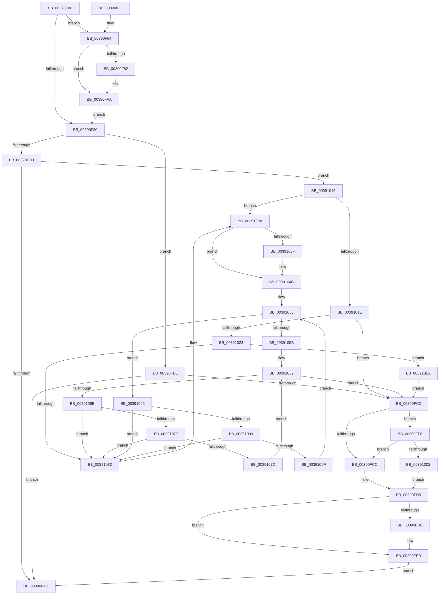

# PsLeavePriorityRegion

- RVA: `0x00390F00`–`0x003910C5` (길이 `453` bytes)
- VA: `0x0000000140390F00`
- 실행 섹션: `.text`
- PDB 이름 있음: `예`; PDB Function 태그: `아니요`
- unwind 정보 RVA: `0x00080A10`
- 디코드: `111`개 명령, `453/453` bytes 표시
- 미해석 바이트: `0` (있으면 어셈블리에 `.byte`로 보존)

> 이 문서는 커널 이미지의 기계어와 PDB 기호를 분석해 생성했습니다. 4번과 5번은 함수 원형과 자료형을 바이너리 사용 방식에서 추정한 C 해석이며 원본 소스 복구 결과는 아닙니다.

## 1. Dependencies

- 직접 호출 지점: **8**; 고유 호출 대상: **6**
- 직접 호출자로 확인된 함수: **0**
- RIP 상대 이미지 참조: **4**

### Outgoing calls
- `0x00390F75` → [ExAllocatePool2](../../poolcode/B8/ExAllocatePool2_function_00B820F0.md) (function, `0x00B820F0`)
- `0x00390F90` → [RtlCaptureStackBackTrace](../2F/RtlCaptureStackBackTrace_function_002F9FF0.md) (function, `0x002F9FF0`)
- `0x00390FB1` → [KeAcquireSpinLockRaiseToDpc](../20/KeAcquireSpinLockRaiseToDpc_function_00208470.md) (function, `0x00208470`)
- `0x00390FE6` → [KiLowerIrqlProcessIrqlFlags](../4F/KiLowerIrqlProcessIrqlFlags_function_004F5698.md) (function, `0x004F5698`)
- `0x0039100E` → [KiReleaseSpinLockInstrumented](KiReleaseSpinLockInstrumented_function_00392EF0.md) (function, `0x00392EF0`)
- `0x00391047` → [ExFreePoolWithTag](../../poolcode/B8/ExFreePoolWithTag_function_00B82870.md) (function, `0x00B82870`)
- `0x00391089` → [ExFreePoolWithTag](../../poolcode/B8/ExFreePoolWithTag_function_00B82870.md) (function, `0x00B82870`)
- `0x003910AB` → [ExFreePoolWithTag](../../poolcode/B8/ExFreePoolWithTag_function_00B82870.md) (function, `0x00B82870`)

### Direct callers
- 이 함수 시작 RVA로 연결되는 직접 call은 확인되지 않았습니다. 간접 호출은 완전히 역산할 수 없습니다.

### Static image references
- `0x00390F27` → RVA `0x00FC6F88` (`ALMOSTRO`; read)
- `0x00390FC3` → RVA `0x00FC6B06` (`ALMOSTRO`; read)
- `0x00390FD5` → RVA `0x00FC6D20` (`ALMOSTRO`; read)
- `0x00390FF8` → RVA `0x00F0DE58` (`.data`; read)

## 2. Other-region calls and transfers

- 다른 실행 섹션으로 향하는 call: **4**
  - `0x00390F75` → [ExAllocatePool2](../../poolcode/B8/ExAllocatePool2_function_00B820F0.md) (`.text` → `POOLCODE`)
  - `0x00391047` → [ExFreePoolWithTag](../../poolcode/B8/ExFreePoolWithTag_function_00B82870.md) (`.text` → `POOLCODE`)
  - `0x00391089` → [ExFreePoolWithTag](../../poolcode/B8/ExFreePoolWithTag_function_00B82870.md) (`.text` → `POOLCODE`)
  - `0x003910AB` → [ExFreePoolWithTag](../../poolcode/B8/ExFreePoolWithTag_function_00B82870.md) (`.text` → `POOLCODE`)
- 별도 외부 분기/꼬리 이동을 확인하지 못했습니다.

## 3. Assembly (complete function range)

```asm
00390F00  48 89 5C 24 08                  mov qword ptr [rsp + 8], rbx
00390F05  48 89 74 24 10                  mov qword ptr [rsp + 0x10], rsi
00390F0A  48 89 7C 24 18                  mov qword ptr [rsp + 0x18], rdi
00390F0F  41 56                           push r14
00390F11  48 83 EC 20                     sub rsp, 0x20
00390F15  65 48 8B 1C 25 88 01 00 00      mov rbx, qword ptr gs:[0x188]
00390F1E  40 32 F6                        xor sil, sil
00390F21  40 32 FF                        xor dil, dil
00390F24  45 33 F6                        xor r14d, r14d
00390F27  44 39 35 5A 60 C3 00            cmp dword ptr [rip + 0xc3605a], r14d
00390F2E  75 34                           jne 0x140390f64
00390F30  83 BB E0 05 00 00 00            cmp dword ptr [rbx + 0x5e0], 0
00390F37  0F 84 81 00 00 00               je 0x140390fbe
00390F3D  F0 FF 8B E0 05 00 00            lock dec dword ptr [rbx + 0x5e0]
00390F44  40 84 F6                        test sil, sil
00390F47  0F 85 C8 00 00 00               jne 0x140391015
00390F4D  48 8B 5C 24 30                  mov rbx, qword ptr [rsp + 0x30]
00390F52  48 8B 74 24 38                  mov rsi, qword ptr [rsp + 0x38]
00390F57  48 8B 7C 24 40                  mov rdi, qword ptr [rsp + 0x40]
00390F5C  48 83 C4 20                     add rsp, 0x20
00390F60  41 5E                           pop r14
00390F62  C3                              ret
00390F63  CC                              int3
00390F64  BA 70 00 00 00                  mov edx, 0x70
00390F69  41 B8 42 6F 6F 73               mov r8d, 0x736f6f42
00390F6F  40 B6 01                        mov sil, 1
00390F72  8D 4A D0                        lea ecx, [rdx - 0x30]
00390F75  E8 76 11 7F 00                  call 0x140b820f0
00390F7A  4C 8B F0                        mov r14, rax
00390F7D  48 85 C0                        test rax, rax
00390F80  74 28                           je 0x140390faa
00390F82  45 33 C9                        xor r9d, r9d
00390F85  4C 8D 40 10                     lea r8, [rax + 0x10]
00390F89  41 8D 51 0A                     lea edx, [r9 + 0xa]
00390F8D  8D 4A F7                        lea ecx, [rdx - 9]
00390F90  E8 5B 90 F6 FF                  call 0x1402f9ff0
00390F95  65 48 8B 04 25 88 01 00 00      mov rax, qword ptr gs:[0x188]
00390F9E  49 89 46 60                     mov qword ptr [r14 + 0x60], rax
00390FA2  49 C7 46 68 00 00 00 00         mov qword ptr [r14 + 0x68], 0
00390FAA  48 8D 8B 10 06 00 00            lea rcx, [rbx + 0x610]
00390FB1  E8 BA 74 E7 FF                  call 0x140208470
00390FB6  0F B6 F8                        movzx edi, al
00390FB9  E9 72 FF FF FF                  jmp 0x140390f30
00390FBE  40 84 F6                        test sil, sil
00390FC1  74 8A                           je 0x140390f4d
00390FC3  F6 05 3C 5B C3 00 01            test byte ptr [rip + 0xc35b3c], 1
00390FCA  75 2C                           jne 0x140390ff8
00390FCC  F0 48 83 A3 10 06 00 00 00      lock and qword ptr [rbx + 0x610], 0
00390FD5  83 3D 44 5D C3 00 00            cmp dword ptr [rip + 0xc35d44], 0
00390FDC  74 0D                           je 0x140390feb
00390FDE  44 0F 20 C1                     mov rcx, cr8
00390FE2  40 0F B6 D7                     movzx edx, dil
00390FE6  E8 AD 46 16 00                  call 0x1404f5698
00390FEB  40 0F B6 C7                     movzx eax, dil
00390FEF  44 0F 22 C0                     mov cr8, rax
00390FF3  E9 55 FF FF FF                  jmp 0x140390f4d
00390FF8  8B 05 5A CE B7 00               mov eax, dword ptr [rip + 0xb7ce5a]
00390FFE  85 C0                           test eax, eax
00391000  75 CA                           jne 0x140390fcc
00391002  48 8B 54 24 28                  mov rdx, qword ptr [rsp + 0x28]
00391007  48 8D 8B 10 06 00 00            lea rcx, [rbx + 0x610]
0039100E  E8 DD 1E 00 00                  call 0x140392ef0
00391013  EB C0                           jmp 0x140390fd5
00391015  83 BB E0 05 00 00 00            cmp dword ptr [rbx + 0x5e0], 0
0039101C  74 1C                           je 0x14039103a
0039101E  4D 85 F6                        test r14, r14
00391021  74 A0                           je 0x140390fc3
00391023  48 8D 83 00 06 00 00            lea rax, [rbx + 0x600]
0039102A  48 8B 48 08                     mov rcx, qword ptr [rax + 8]
0039102E  48 39 01                        cmp qword ptr [rcx], rax
00391031  74 7F                           je 0x1403910b2
00391033  B9 03 00 00 00                  mov ecx, 3
00391038  CD 29                           int 0x29
0039103A  4D 85 F6                        test r14, r14
0039103D  74 0D                           je 0x14039104c
0039103F  BA 42 6F 6F 73                  mov edx, 0x736f6f42
00391044  49 8B CE                        mov rcx, r14
00391047  E8 24 18 7F 00                  call 0x140b82870
0039104C  48 8D B3 F0 05 00 00            lea rsi, [rbx + 0x5f0]
00391053  48 8B 0E                        mov rcx, qword ptr [rsi]
00391056  48 3B CE                        cmp rcx, rsi
00391059  75 35                           jne 0x140391090
0039105B  48 8D B3 00 06 00 00            lea rsi, [rbx + 0x600]
00391062  48 8B 0E                        mov rcx, qword ptr [rsi]
00391065  48 3B CE                        cmp rcx, rsi
00391068  0F 84 55 FF FF FF               je 0x140390fc3
0039106E  48 8B 01                        mov rax, qword ptr [rcx]
00391071  48 39 71 08                     cmp qword ptr [rcx + 8], rsi
00391075  75 BC                           jne 0x140391033
00391077  48 39 48 08                     cmp qword ptr [rax + 8], rcx
0039107B  75 B6                           jne 0x140391033
0039107D  48 89 06                        mov qword ptr [rsi], rax
00391080  BA 42 6F 6F 73                  mov edx, 0x736f6f42
00391085  48 89 70 08                     mov qword ptr [rax + 8], rsi
00391089  E8 E2 17 7F 00                  call 0x140b82870
0039108E  EB D2                           jmp 0x140391062
00391090  48 8B 01                        mov rax, qword ptr [rcx]
00391093  48 39 71 08                     cmp qword ptr [rcx + 8], rsi
00391097  75 9A                           jne 0x140391033
00391099  48 39 48 08                     cmp qword ptr [rax + 8], rcx
0039109D  75 94                           jne 0x140391033
0039109F  48 89 06                        mov qword ptr [rsi], rax
003910A2  BA 42 6F 6F 73                  mov edx, 0x736f6f42
003910A7  48 89 70 08                     mov qword ptr [rax + 8], rsi
003910AB  E8 C0 17 7F 00                  call 0x140b82870
003910B0  EB A1                           jmp 0x140391053
003910B2  49 89 06                        mov qword ptr [r14], rax
003910B5  49 89 4E 08                     mov qword ptr [r14 + 8], rcx
003910B9  4C 89 31                        mov qword ptr [rcx], r14
003910BC  4C 89 70 08                     mov qword ptr [rax + 8], r14
003910C0  E9 FE FE FF FF                  jmp 0x140390fc3
```

## 4. C-style interpretation (structured pseudocode)

```c
__int64 __fastcall PsLeavePriorityRegion(__int64 a1, __int64 a2, __int64 a3, int a4)
{
    __int64 result;
    __int64 v_r14;
    __int64 v_rdi;
    __int64 v_rsi;
    __int64 v_rsp;
    unsigned __int64 v_stack_p10;
    unsigned __int64 v_stack_p18;
    unsigned __int64 v_stack_p28;
    unsigned __int64 v_stack_p8;

    v_stack_p8 = v_rbx;
    v_stack_p10 = v_rsi;
    v_stack_p18 = v_rdi;
    v_rsp = (v_rsp) - (32);
    v_rsi = 0;
    v_rdi = 0;
    v_r14 = 0;
    if ((*(unsigned int *)(v_rip + 12804186)) != 0) goto loc_00390F64;
loc_00390F30:
    if ((*(unsigned int *)(*(unsigned __int64 *)(gs_base + (0 + 392)) + 1504)) == 0) goto loc_00390FBE;
    if (0 != 0) goto loc_00391015;
loc_00390F4D:
    v_rsp = (v_rsp) + (32);
    return result;
loc_00390F64:
    result = ExAllocatePool2(112 - 48, 112, (unsigned int)(0x736F6F42ULL), a4);
    if (result != 0) {
        a4 = 0;
        a3 = result + 16;
        a2 = a4 + 10;
        a1 = a2 - 9;
        result = RtlCaptureStackBackTrace(a1, a2, a3, a4);
        result = *(unsigned __int64 *)(gs_base + (0 + 392));
        *(unsigned __int64 *)(result + 96) = result;
        *(unsigned __int64 *)(result + 104) = 0;
    }
    result = KeAcquireSpinLockRaiseToDpc(v_stack_p8 + 1552, a2, a3, a4);
    goto loc_00390F30;
loc_00390FBE:
    if (1 == 0) goto loc_00390F4D;
loc_00390FC3:
    if (((*(unsigned __int8 *)(v_rip + 12802876)) & (1)) != 0) goto loc_00390FF8;
loc_00390FCC:
loc_00390FD5:
    if ((*(unsigned int *)(v_rip + 12803396)) != 0) {
        a1 = v_cr8;
        a2 = (unsigned __int8)((unsigned __int8)(result));
        result = KiLowerIrqlProcessIrqlFlags(a1, a2, a3, a4);
    }
    goto loc_00390F4D;
loc_00390FF8:
    if ((unsigned int)((unsigned int)(*(unsigned int *)(v_rip + 12045914))) != 0) goto loc_00390FCC;
    result = KiReleaseSpinLockInstrumented(v_stack_p8 + 1552, v_stack_p28, a3, a4);
    goto loc_00390FD5;
loc_00391015:
    if ((*(unsigned int *)(v_stack_p8 + 1504)) == 0) goto loc_0039103A;
    if (result == 0) goto loc_00390FC3;
    if ((*(unsigned __int64 *)(*(unsigned __int64 *)(v_stack_p8 + 1536 + 8))) == (v_stack_p8 + 1536)) goto loc_003910B2;
loc_00391033:
loc_0039103A:
    result = v_stack_p8 + 1536;
    if (result != 0) {
        a2 = 0x736F6F42ULL;
        a1 = result;
        result = ExFreePoolWithTag(a1, a2, a3, a4);
    }
loc_00391053:
    if ((*(unsigned __int64 *)(v_stack_p8 + 1520)) != (v_stack_p8 + 1520)) goto loc_00391090;
loc_00391062:
    if ((*(unsigned __int64 *)(v_stack_p8 + 1536)) == (v_stack_p8 + 1536)) goto loc_00390FC3;
    if ((*(unsigned __int64 *)(*(unsigned __int64 *)(v_stack_p8 + 1536) + 8)) != (v_stack_p8 + 1536)) goto loc_00391033;
    if ((*(unsigned __int64 *)(*(unsigned __int64 *)(*(unsigned __int64 *)(v_stack_p8 + 1536)) + 8)) != (*(unsigned __int64 *)(v_stack_p8 + 1536))) goto loc_00391033;
    *(unsigned __int64 *)(v_stack_p8 + 1536) = *(unsigned __int64 *)(*(unsigned __int64 *)(v_stack_p8 + 1536));
    *(unsigned __int64 *)(*(unsigned __int64 *)(*(unsigned __int64 *)(v_stack_p8 + 1536)) + 8) = v_stack_p8 + 1536;
    result = ExFreePoolWithTag(*(unsigned __int64 *)(v_stack_p8 + 1536), (unsigned int)(0x736F6F42ULL), a3, a4);
    goto loc_00391062;
loc_00391090:
    if ((*(unsigned __int64 *)(*(unsigned __int64 *)(v_stack_p8 + 1536) + 8)) != (v_stack_p8 + 1536)) goto loc_00391033;
    if ((*(unsigned __int64 *)(*(unsigned __int64 *)(*(unsigned __int64 *)(v_stack_p8 + 1536)) + 8)) != (*(unsigned __int64 *)(v_stack_p8 + 1536))) goto loc_00391033;
    *(unsigned __int64 *)(v_stack_p8 + 1536) = *(unsigned __int64 *)(*(unsigned __int64 *)(v_stack_p8 + 1536));
    *(unsigned __int64 *)(*(unsigned __int64 *)(*(unsigned __int64 *)(v_stack_p8 + 1536)) + 8) = v_stack_p8 + 1536;
    result = ExFreePoolWithTag(*(unsigned __int64 *)(v_stack_p8 + 1536), (unsigned int)(0x736F6F42ULL), a3, a4);
    goto loc_00391053;
loc_003910B2:
    *(unsigned __int64 *)(result) = result;
    *(unsigned __int64 *)(result + 8) = *(unsigned __int64 *)(v_stack_p8 + 1536);
    *(unsigned __int64 *)(*(unsigned __int64 *)(v_stack_p8 + 1536)) = result;
    *(unsigned __int64 *)(result + 8) = result;
    goto loc_00390FC3;
}
```

## 5. (Beta) C Style

```c
int64_t PsLeavePriorityRegion(int64_t Arg1, int64_t Arg2, int64_t Arg3, int32_t Arg4)
{
    int64_t result;
    int64_t local_r14;
    int64_t local_rdi;
    int64_t local_rsi;
    int64_t local_rsp;
    uint64_t v_stack_p10;
    uint64_t v_stack_p18;
    uint64_t v_stack_p28;
    uint64_t v_stack_p8;

    v_stack_p8 = local_rbx;
    v_stack_p10 = local_rsi;
    v_stack_p18 = local_rdi;
    local_rsp = (local_rsp) - (32);
    local_rsi = 0;
    local_rdi = 0;
    local_r14 = 0;
    if ((*(uint32_t *)(v_rip + 0xC3605A)) != 0) goto loc_00390F64;
loc_00390F30:
    if ((*(uint32_t *)(*(uint64_t *)(gs_base + (0 + 0x188)) + 0x5E0)) == 0) goto loc_00390FBE;
    if (0 != 0) goto loc_00391015;
loc_00390F4D:
    local_rsp = (local_rsp) + (32);
    return result;
loc_00390F64:
    result = ExAllocatePool2(112 - 48, 112, (uint32_t)(0x736F6F42ULL), Arg4);
    if (result != 0) {
        Arg4 = 0;
        Arg3 = result + 16;
        Arg2 = Arg4 + 10;
        Arg1 = Arg2 - 9;
        result = RtlCaptureStackBackTrace(Arg1, Arg2, Arg3, Arg4);
        result = *(uint64_t *)(gs_base + (0 + 0x188));
        *(uint64_t *)(result + 0x60) = result;
        *(uint64_t *)(result + 0x68) = 0;
    }
    result = KeAcquireSpinLockRaiseToDpc(v_stack_p8 + 1552, Arg2, Arg3, Arg4);
    goto loc_00390F30;
loc_00390FBE:
    if (1 == 0) goto loc_00390F4D;
loc_00390FC3:
    if (((*(uint8_t *)(v_rip + 0xC35B3C)) & (1)) != 0) goto loc_00390FF8;
loc_00390FCC:
loc_00390FD5:
    if ((*(uint32_t *)(v_rip + 0xC35D44)) != 0) {
        Arg1 = v_cr8;
        Arg2 = (uint8_t)((uint8_t)(result));
        result = KiLowerIrqlProcessIrqlFlags(Arg1, Arg2, Arg3, Arg4);
    }
    goto loc_00390F4D;
loc_00390FF8:
    if ((uint32_t)((uint32_t)(*(uint32_t *)(v_rip + 0xB7CE5A))) != 0) goto loc_00390FCC;
    result = KiReleaseSpinLockInstrumented(v_stack_p8 + 1552, v_stack_p28, Arg3, Arg4);
    goto loc_00390FD5;
loc_00391015:
    if ((*(uint32_t *)(v_stack_p8 + 0x5E0)) == 0) goto loc_0039103A;
    if (result == 0) goto loc_00390FC3;
    if ((*(uint64_t *)(*(uint64_t *)(v_stack_p8 + 0x600 + 0x8))) == (v_stack_p8 + 1536)) goto loc_003910B2;
loc_00391033:
loc_0039103A:
    result = v_stack_p8 + 1536;
    if (result != 0) {
        Arg2 = 0x736F6F42ULL;
        Arg1 = result;
        result = ExFreePoolWithTag(Arg1, Arg2, Arg3, Arg4);
    }
loc_00391053:
    if ((*(uint64_t *)(v_stack_p8 + 0x5F0)) != (v_stack_p8 + 1520)) goto loc_00391090;
loc_00391062:
    if ((*(uint64_t *)(v_stack_p8 + 0x600)) == (v_stack_p8 + 1536)) goto loc_00390FC3;
    if ((*(uint64_t *)(*(uint64_t *)(v_stack_p8 + 0x600) + 0x8)) != (v_stack_p8 + 1536)) goto loc_00391033;
    if ((*(uint64_t *)(*(uint64_t *)(*(uint64_t *)(v_stack_p8 + 0x600)) + 0x8)) != (*(uint64_t *)(v_stack_p8 + 0x600))) goto loc_00391033;
    *(uint64_t *)(v_stack_p8 + 0x600) = *(uint64_t *)(*(uint64_t *)(v_stack_p8 + 0x600));
    *(uint64_t *)(*(uint64_t *)(*(uint64_t *)(v_stack_p8 + 0x600)) + 0x8) = v_stack_p8 + 1536;
    result = ExFreePoolWithTag(*(uint64_t *)(v_stack_p8 + 0x600), (uint32_t)(0x736F6F42ULL), Arg3, Arg4);
    goto loc_00391062;
loc_00391090:
    if ((*(uint64_t *)(*(uint64_t *)(v_stack_p8 + 0x600) + 0x8)) != (v_stack_p8 + 1536)) goto loc_00391033;
    if ((*(uint64_t *)(*(uint64_t *)(*(uint64_t *)(v_stack_p8 + 0x600)) + 0x8)) != (*(uint64_t *)(v_stack_p8 + 0x600))) goto loc_00391033;
    *(uint64_t *)(v_stack_p8 + 0x600) = *(uint64_t *)(*(uint64_t *)(v_stack_p8 + 0x600));
    *(uint64_t *)(*(uint64_t *)(*(uint64_t *)(v_stack_p8 + 0x600)) + 0x8) = v_stack_p8 + 1536;
    result = ExFreePoolWithTag(*(uint64_t *)(v_stack_p8 + 0x600), (uint32_t)(0x736F6F42ULL), Arg3, Arg4);
    goto loc_00391053;
loc_003910B2:
    *(uint64_t *)(result) = result;
    *(uint64_t *)(result + 0x8) = *(uint64_t *)(v_stack_p8 + 0x600);
    *(uint64_t *)(*(uint64_t *)(v_stack_p8 + 0x600)) = result;
    *(uint64_t *)(result + 0x8) = result;
    goto loc_00390FC3;
}
```

## 6. Execution-region graph

[열기: 2D/3D 그래프와 함수 탐색 컨트롤 패널](../../../control-panel.html?section=text&rva=0x00390F00&view=graph)

- 2D 그래프는 위에서 아래로 흐르고, 3D 그래프는 빈 공간을 드래그해 회전합니다. Shift+드래그는 이동, 휠은 확대·축소, 함수 노드 선택은 대상 보고서 이동입니다.

### Static fallback


