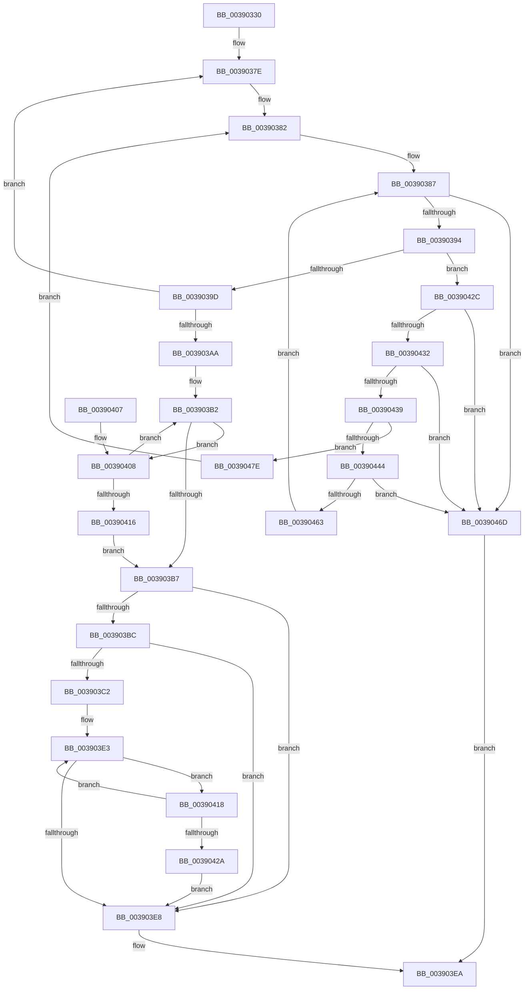

# PspChargeQuota

- RVA: `0x00390330`–`0x0039048F` (길이 `351` bytes)
- VA: `0x0000000140390330`
- 실행 섹션: `.text`
- PDB 이름 있음: `예`; PDB Function 태그: `아니요`
- unwind 정보 RVA: `0x00080948`
- 디코드: `95`개 명령, `351/351` bytes 표시
- 미해석 바이트: `0` (있으면 어셈블리에 `.byte`로 보존)

> 이 문서는 커널 이미지의 기계어와 PDB 기호를 분석해 생성했습니다. 4번과 5번은 함수 원형과 자료형을 바이너리 사용 방식에서 추정한 C 해석이며 원본 소스 복구 결과는 아닙니다.

## 1. Dependencies

- 직접 호출 지점: **1**; 고유 호출 대상: **1**
- 직접 호출자로 확인된 함수: **9**
- RIP 상대 이미지 참조: **1**

### Outgoing calls
- `0x0039045A` → [PspExpandQuota](PspExpandQuota_function_00390660.md) (function, `0x00390660`)

### Direct callers
- [PsChargeProcessQuota](../47/PsChargeProcessQuota_function_0047DEC0.md) at `0x0047DEE0`
- [ObpIncrementHandleCountEx](../../page/86/ObpIncrementHandleCountEx_function_0086DA10.md) at `0x0086DBAA`
- [ObpIncrementHandleCountEx](../../page/86/ObpIncrementHandleCountEx_function_0086DA10.md) at `0x0086DD9A`
- [ObpIncrementHandleCountEx](../../page/86/ObpIncrementHandleCountEx_function_0086DA10.md) at `0x0086DF37`
- [MiChargeFullProcessCommitment](../../page/88/MiChargeFullProcessCommitment_function_00887630.md) at `0x0088766C`
- [PsChargeProcessPagedPoolQuota](../../page/89/PsChargeProcessPagedPoolQuota_function_00891170.md) at `0x00891193`
- [sub_008BA74A](../../page/8B/Unknown_function_008BA74A.md) at `0x008BA8EA`
- [ObSetSecurityDescriptorInfo](../../page/8B/ObSetSecurityDescriptorInfo_function_008BAE20.md) at `0x008BB1C0`
- [sub_0097525E](../../page/97/Unknown_function_0097525E.md) at `0x009752C6`
- [sub_0097525E](../../page/97/Unknown_function_0097525E.md) at `0x0097530F`
- [sub_0097525E](../../page/97/Unknown_function_0097525E.md) at `0x00975405`
- [sub_0099E35D](../../page/99/Unknown_function_0099E35D.md) at `0x0099E37A`
- [sub_0099E3A3](../../page/99/Unknown_function_0099E3A3.md) at `0x0099E3AE`

### Static image references
- `0x0039034F` → RVA `0x00FC7350` (`ALMOSTRO`; read)

## 2. Other-region calls and transfers

- 다른 실행 섹션으로 향하는 call: **0**
- 별도 외부 분기/꼬리 이동을 확인하지 못했습니다.

## 3. Assembly (complete function range)

```asm
00390330  48 89 5C 24 10                  mov qword ptr [rsp + 0x10], rbx
00390335  48 89 6C 24 18                  mov qword ptr [rsp + 0x18], rbp
0039033A  48 89 74 24 20                  mov qword ptr [rsp + 0x20], rsi
0039033F  57                              push rdi
00390340  41 54                           push r12
00390342  41 55                           push r13
00390344  41 56                           push r14
00390346  41 57                           push r15
00390348  48 83 EC 30                     sub rsp, 0x30
0039034C  4D 63 E8                        movsxd r13, r8d
0039034F  48 8D 05 FA 6F C3 00            lea rax, [rip + 0xc36ffa]
00390356  49 8B FD                        mov rdi, r13
00390359  49 8B F1                        mov rsi, r9
0039035C  48 C1 E7 07                     shl rdi, 7
00390360  48 8B EA                        mov rbp, rdx
00390363  48 03 F9                        add rdi, rcx
00390366  4E 8D 24 ED 00 00 00 00         lea r12, [r13*8]
0039036E  45 0F B6 3C 04                  movzx r15d, byte ptr [r12 + rax]
00390373  0F 0D 0F                        prefetchw byte ptr [rdi]
00390376  48 8B 1F                        mov rbx, qword ptr [rdi]
00390379  F0 83 0C 24 00                  lock or dword ptr [rsp], 0
0039037E  48 8B 47 40                     mov rax, qword ptr [rdi + 0x40]
00390382  48 89 44 24 60                  mov qword ptr [rsp + 0x60], rax
00390387  48 8D 0C 33                     lea rcx, [rbx + rsi]
0039038B  48 3B CB                        cmp rcx, rbx
0039038E  0F 82 D9 00 00 00               jb 0x14039046d
00390394  48 3B C8                        cmp rcx, rax
00390397  0F 87 8F 00 00 00               ja 0x14039042c
0039039D  48 8B C3                        mov rax, rbx
003903A0  F0 48 0F B1 0F                  lock cmpxchg qword ptr [rdi], rcx
003903A5  48 8B D8                        mov rbx, rax
003903A8  75 D4                           jne 0x14039037e
003903AA  0F 0D 4F 08                     prefetchw byte ptr [rdi + 8]
003903AE  48 8B 47 08                     mov rax, qword ptr [rdi + 8]
003903B2  48 3B C8                        cmp rcx, rax
003903B5  77 51                           ja 0x140390408
003903B7  48 85 ED                        test rbp, rbp
003903BA  74 2C                           je 0x1403903e8
003903BC  41 F6 C7 04                     test r15b, 4
003903C0  74 26                           je 0x1403903e8
003903C2  48 8B D6                        mov rdx, rsi
003903C5  F0 49 0F C1 94 2C 00 02 00 00   lock xadd qword ptr [r12 + rbp + 0x200], rdx
003903CF  48 03 D6                        add rdx, rsi
003903D2  42 0F 0D 8C ED 10 02 00 00      prefetchw byte ptr [rbp + r13*8 + 0x210]
003903DB  4A 8B 84 ED 10 02 00 00         mov rax, qword ptr [rbp + r13*8 + 0x210]
003903E3  48 3B D0                        cmp rdx, rax
003903E6  77 30                           ja 0x140390418
003903E8  33 C0                           xor eax, eax
003903EA  48 8B 5C 24 68                  mov rbx, qword ptr [rsp + 0x68]
003903EF  48 8B 6C 24 70                  mov rbp, qword ptr [rsp + 0x70]
003903F4  48 8B 74 24 78                  mov rsi, qword ptr [rsp + 0x78]
003903F9  48 83 C4 30                     add rsp, 0x30
003903FD  41 5F                           pop r15
003903FF  41 5E                           pop r14
00390401  41 5D                           pop r13
00390403  41 5C                           pop r12
00390405  5F                              pop rdi
00390406  C3                              ret
00390407  CC                              int3
00390408  48 8B D0                        mov rdx, rax
0039040B  F0 48 0F B1 4F 08               lock cmpxchg qword ptr [rdi + 8], rcx
00390411  48 3B C2                        cmp rax, rdx
00390414  75 9C                           jne 0x1403903b2
00390416  EB 9F                           jmp 0x1403903b7
00390418  48 8B C8                        mov rcx, rax
0039041B  F0 4A 0F B1 94 ED 10 02 00 00   lock cmpxchg qword ptr [rbp + r13*8 + 0x210], rdx
00390425  48 3B C1                        cmp rax, rcx
00390428  75 B9                           jne 0x1403903e3
0039042A  EB BC                           jmp 0x1403903e8
0039042C  41 F6 C7 01                     test r15b, 1
00390430  74 3B                           je 0x14039046d
00390432  48 83 7F 50 00                  cmp qword ptr [rdi + 0x50], 0
00390437  74 34                           je 0x14039046d
00390439  33 C9                           xor ecx, ecx
0039043B  48 87 4F 48                     xchg qword ptr [rdi + 0x48], rcx
0039043F  48 85 C9                        test rcx, rcx
00390442  75 3A                           jne 0x14039047e
00390444  48 8D 44 24 60                  lea rax, [rsp + 0x60]
00390449  4C 8B CE                        mov r9, rsi
0039044C  4C 8B C3                        mov r8, rbx
0039044F  48 89 44 24 20                  mov qword ptr [rsp + 0x20], rax
00390454  48 8B D7                        mov rdx, rdi
00390457  41 8B CD                        mov ecx, r13d
0039045A  E8 01 02 00 00                  call 0x140390660
0039045F  84 C0                           test al, al
00390461  74 0A                           je 0x14039046d
00390463  48 8B 44 24 60                  mov rax, qword ptr [rsp + 0x60]
00390468  E9 1A FF FF FF                  jmp 0x140390387
0039046D  48 8D 05 DC 6E C3 00            lea rax, [rip + 0xc36edc]
00390474  41 8B 44 04 04                  mov eax, dword ptr [r12 + rax + 4]
00390479  E9 6C FF FF FF                  jmp 0x1403903ea
0039047E  48 8B C1                        mov rax, rcx
00390481  F0 48 0F C1 47 40               lock xadd qword ptr [rdi + 0x40], rax
00390487  48 03 C1                        add rax, rcx
0039048A  E9 F3 FE FF FF                  jmp 0x140390382
```

## 4. C-style interpretation (structured pseudocode)

```c
__int64 __fastcall PspChargeQuota(__int64 a1, __int64 a2, int a3, __int64 a4)
{
    __int64 result;
    __int64 v_rdi;
    __int64 v_rsp;
    unsigned int v_stack_m58;
    unsigned __int64 v_stack_p10;
    unsigned __int64 v_stack_p18;
    unsigned __int64 v_stack_p20;
    unsigned __int64 v_stack_p60;
    unsigned __int64 v_stack_p8;

    v_stack_p10 = v_rbx;
    v_stack_p18 = v_rbp;
    v_stack_p20 = v_rsi;
    v_rsp = (v_rsp) - (48);
    v_rdi = ((int)(a3)) << (7);
    v_rdi = (v_rdi) + (a1);
loc_0039037E:
loc_00390382:
    v_stack_p8 = *(unsigned __int64 *)(v_rdi + 64);
loc_00390387:
    if ((*(unsigned __int64 *)(v_rdi) + a4 * 1) < (*(unsigned __int64 *)(v_rdi))) goto loc_0039046D;
    if ((*(unsigned __int64 *)(v_rdi) + a4 * 1) > (*(unsigned __int64 *)(v_rdi + 64))) goto loc_0039042C;
    if ((*(unsigned __int64 *)(v_rdi) + a4 * 1) != (*(unsigned __int64 *)(v_rdi + 64))) goto loc_0039037E;
loc_003903B2:
    if ((*(unsigned __int64 *)(v_rdi) + a4 * 1) > (*(unsigned __int64 *)(v_rdi + 8))) goto loc_00390408;
loc_003903B7:
    if (a2 == 0) goto loc_003903E8;
    if ((((unsigned __int8)(*(unsigned __int8 *)((int)(a3) * 8 + v_rip + 12808186 * 1))) & (4)) == 0) goto loc_003903E8;
    a2 = (a4) + (a4);
loc_003903E3:
    if (a2 > (*(unsigned __int64 *)(a2 + (int)(a3) * 8 + 528))) goto loc_00390418;
loc_003903E8:
    result = 0;
loc_003903EA:
    v_rsp = (v_rsp) + (48);
    return result;
loc_00390408:
    if (0 != 0) goto loc_003903B2;
    goto loc_003903B7;
loc_00390418:
    if (0 != 0) goto loc_003903E3;
    goto loc_003903E8;
loc_0039042C:
    if ((((unsigned __int8)(*(unsigned __int8 *)((int)(a3) * 8 + v_rip + 12808186 * 1))) & (1)) == 0) goto loc_0039046D;
    if ((*(unsigned __int64 *)(v_rdi + 80)) == 0) goto loc_0039046D;
    a1 = 0;
    if (0 != 0) goto loc_0039047E;
    v_stack_p20 = v_stack_p60;
    result = PspExpandQuota((unsigned int)((unsigned int)((int)(a3))), v_rdi, v_stack_p10, v_stack_p20);
    if ((unsigned __int8)(result) == 0) goto loc_0039046D;
    goto loc_00390387;
loc_0039046D:
    goto loc_003903EA;
loc_0039047E:
    result = ((unsigned int)((unsigned int)((int)(a3)))) + ((unsigned int)((unsigned int)((int)(a3))));
    goto loc_00390382;
}
```

## 5. (Beta) C Style

```c
int64_t PspChargeQuota(int64_t Arg1, int64_t Arg2, int32_t Arg3, int64_t Arg4)
{
    int64_t result;
    int64_t local_rdi;
    int64_t local_rsp;
    uint32_t v_stack_m58;
    uint64_t v_stack_p10;
    uint64_t v_stack_p18;
    uint64_t v_stack_p20;
    uint64_t v_stack_p60;
    uint64_t v_stack_p8;

    v_stack_p10 = local_rbx;
    v_stack_p18 = local_rbp;
    v_stack_p20 = local_rsi;
    local_rsp = (local_rsp) - (48);
    local_rdi = ((int32_t)(Arg3)) << (7);
    local_rdi = (local_rdi) + (Arg1);
loc_0039037E:
loc_00390382:
    v_stack_p8 = *(uint64_t *)(local_rdi + 0x40);
loc_00390387:
    if ((*(uint64_t *)(local_rdi) + Arg4 * 1) < (*(uint64_t *)(local_rdi))) goto loc_0039046D;
    if ((*(uint64_t *)(local_rdi) + Arg4 * 1) > (*(uint64_t *)(local_rdi + 0x40))) goto loc_0039042C;
    if ((*(uint64_t *)(local_rdi) + Arg4 * 1) != (*(uint64_t *)(local_rdi + 0x40))) goto loc_0039037E;
loc_003903B2:
    if ((*(uint64_t *)(local_rdi) + Arg4 * 1) > (*(uint64_t *)(local_rdi + 0x8))) goto loc_00390408;
loc_003903B7:
    if (Arg2 == 0) goto loc_003903E8;
    if ((((uint8_t)(*(uint8_t *)((int32_t)(Arg3) * 8 + v_rip + 0xC36FFA * 1))) & (4)) == 0) goto loc_003903E8;
    Arg2 = (Arg4) + (Arg4);
loc_003903E3:
    if (Arg2 > (*(uint64_t *)(Arg2 + (int32_t)(Arg3) * 8 + 0x210))) goto loc_00390418;
loc_003903E8:
    result = 0;
loc_003903EA:
    local_rsp = (local_rsp) + (48);
    return result;
loc_00390408:
    if (0 != 0) goto loc_003903B2;
    goto loc_003903B7;
loc_00390418:
    if (0 != 0) goto loc_003903E3;
    goto loc_003903E8;
loc_0039042C:
    if ((((uint8_t)(*(uint8_t *)((int32_t)(Arg3) * 8 + v_rip + 0xC36FFA * 1))) & (1)) == 0) goto loc_0039046D;
    if ((*(uint64_t *)(local_rdi + 0x50)) == 0) goto loc_0039046D;
    Arg1 = 0;
    if (0 != 0) goto loc_0039047E;
    v_stack_p20 = v_stack_p60;
    result = PspExpandQuota((uint32_t)((uint32_t)((int32_t)(Arg3))), local_rdi, v_stack_p10, v_stack_p20);
    if ((uint8_t)(result) == 0) goto loc_0039046D;
    goto loc_00390387;
loc_0039046D:
    goto loc_003903EA;
loc_0039047E:
    result = ((uint32_t)((uint32_t)((int32_t)(Arg3)))) + ((uint32_t)((uint32_t)((int32_t)(Arg3))));
    goto loc_00390382;
}
```

## 6. Execution-region graph

[열기: 2D/3D 그래프와 함수 탐색 컨트롤 패널](../../../control-panel.html?section=text&rva=0x00390330&view=graph)

- 2D 그래프는 위에서 아래로 흐르고, 3D 그래프는 빈 공간을 드래그해 회전합니다. Shift+드래그는 이동, 휠은 확대·축소, 함수 노드 선택은 대상 보고서 이동입니다.

### Static fallback


