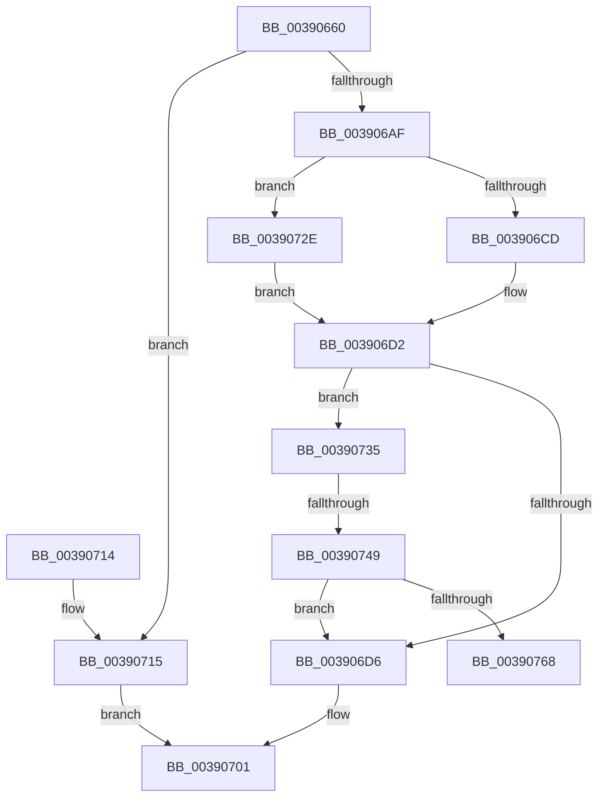

# PspExpandQuota

- RVA: `0x00390660`–`0x0039076D` (길이 `269` bytes)
- VA: `0x0000000140390660`
- 실행 섹션: `.text`
- PDB 이름 있음: `예`; PDB Function 태그: `예`
- unwind 정보 RVA: `0x00080984`
- 디코드: `76`개 명령, `269/269` bytes 표시
- 미해석 바이트: `0` (있으면 어셈블리에 `.byte`로 보존)

> 이 문서는 커널 이미지의 기계어와 PDB 기호를 분석해 생성했습니다. 4번과 5번은 함수 원형과 자료형을 바이너리 사용 방식에서 추정한 C 해석이며 원본 소스 복구 결과는 아닙니다.

## 1. Dependencies

- 직접 호출 지점: **7**; 고유 호출 대상: **5**
- 직접 호출자로 확인된 함수: **4**
- RIP 상대 이미지 참조: **2**

### Outgoing calls
- `0x0039069D` → [PspLockQuotaExpansion](PspLockQuotaExpansion_function_00390774.md) (function, `0x00390774`)
- `0x003906CD` → [MmRaisePoolQuota](MmRaisePoolQuota_function_003907F0.md) (function, `0x003907F0`)
- `0x003906F1` → [PspUnlockQuotaExpansion](PspUnlockQuotaExpansion_function_00390E68.md) (function, `0x00390E68`)
- `0x0039071C` → [PspUnlockQuotaExpansion](PspUnlockQuotaExpansion_function_00390E68.md) (function, `0x00390E68`)
- `0x0039072E` → [guard_dispatch_icall](../6B/guard_dispatch_icall_function_006BAAD0.md) (function, `0x006BAAD0`)
- `0x0039073B` → [PspReleaseReturnedQuota](../5E/PspReleaseReturnedQuota_function_005E2C84.md) (function, `0x005E2C84`)
- `0x0039075B` → [guard_dispatch_icall](../6B/guard_dispatch_icall_function_006BAAD0.md) (function, `0x006BAAD0`)

### Direct callers
- [sub_002A7C4E](../2A/Unknown_function_002A7C4E.md) at `0x002A7C8B`
- [PspChargeQuota](PspChargeQuota_function_00390330.md) at `0x0039045A`
- [sub_003EC92C](../3E/Unknown_function_003EC92C.md) at `0x003EC96A`
- [ExpAllocatePoolWithQuotaTag](../../poolcode/B8/ExpAllocatePoolWithQuotaTag_function_00B82210.md) at `0x00B8277E`

### Static image references
- `0x00390676` → RVA `0x00F06640` (`.data`; read)
- `0x003906B3` → RVA `0x003907F0` (`MmRaisePoolQuota`; read)

## 2. Other-region calls and transfers

- 다른 실행 섹션으로 향하는 call: **0**
- call이 아닌 외부 분기/꼬리 이동: **2**
  - `0x00390743` → [sub_006E5788](../6E/Unknown_function_006E5788.md) (`tail-transfer`)
  - `0x00390768` → [sub_006E5788](../6E/Unknown_function_006E5788.md) (`tail-transfer`)

## 3. Assembly (complete function range)

```asm
00390660  48 89 5C 24 18                  mov qword ptr [rsp + 0x18], rbx
00390665  55                              push rbp
00390666  56                              push rsi
00390667  57                              push rdi
00390668  41 56                           push r14
0039066A  41 57                           push r15
0039066C  48 83 EC 30                     sub rsp, 0x30
00390670  48 83 64 24 68 00               and qword ptr [rsp + 0x68], 0
00390676  48 8D 05 C3 5F B7 00            lea rax, [rip + 0xb75fc3]
0039067D  4C 63 F1                        movsxd r14, ecx
00390680  4C 8B FA                        mov r15, rdx
00390683  49 6B F6 38                     imul rsi, r14, 0x38
00390687  48 8D 54 24 60                  lea rdx, [rsp + 0x60]
0039068C  C6 44 24 60 00                  mov byte ptr [rsp + 0x60], 0
00390691  48 03 F0                        add rsi, rax
00390694  49 8B F9                        mov rdi, r9
00390697  48 8B CE                        mov rcx, rsi
0039069A  49 8B D8                        mov rbx, r8
0039069D  E8 D2 00 00 00                  call 0x140390774
003906A2  49 8B 6F 40                     mov rbp, qword ptr [r15 + 0x40]
003906A6  48 8D 04 3B                     lea rax, [rbx + rdi]
003906AA  48 3B C5                        cmp rax, rbp
003906AD  76 66                           jbe 0x140390715
003906AF  48 8B 46 18                     mov rax, qword ptr [rsi + 0x18]
003906B3  48 8D 0D 36 01 00 00            lea rcx, [rip + 0x136]
003906BA  45 33 C0                        xor r8d, r8d
003906BD  4C 8D 4C 24 68                  lea r9, [rsp + 0x68]
003906C2  48 3B C1                        cmp rax, rcx
003906C5  48 8B D5                        mov rdx, rbp
003906C8  41 8B CE                        mov ecx, r14d
003906CB  75 61                           jne 0x14039072e
003906CD  E8 1E 01 00 00                  call 0x1403907f0
003906D2  84 C0                           test al, al
003906D4  74 5F                           je 0x140390735
003906D6  48 8B 44 24 68                  mov rax, qword ptr [rsp + 0x68]
003906DB  48 2B C5                        sub rax, rbp
003906DE  48 8B D8                        mov rbx, rax
003906E1  F0 49 0F C1 5F 40               lock xadd qword ptr [r15 + 0x40], rbx
003906E7  8A 54 24 60                     mov dl, byte ptr [rsp + 0x60]
003906EB  48 03 D8                        add rbx, rax
003906EE  48 8B CE                        mov rcx, rsi
003906F1  E8 72 07 00 00                  call 0x140390e68
003906F6  48 8B 84 24 80 00 00 00         mov rax, qword ptr [rsp + 0x80]
003906FE  48 89 18                        mov qword ptr [rax], rbx
00390701  B0 01                           mov al, 1
00390703  48 8B 5C 24 70                  mov rbx, qword ptr [rsp + 0x70]
00390708  48 83 C4 30                     add rsp, 0x30
0039070C  41 5F                           pop r15
0039070E  41 5E                           pop r14
00390710  5F                              pop rdi
00390711  5E                              pop rsi
00390712  5D                              pop rbp
00390713  C3                              ret
00390714  CC                              int3
00390715  8A 54 24 60                     mov dl, byte ptr [rsp + 0x60]
00390719  48 8B CE                        mov rcx, rsi
0039071C  E8 47 07 00 00                  call 0x140390e68
00390721  48 8B 84 24 80 00 00 00         mov rax, qword ptr [rsp + 0x80]
00390729  48 89 28                        mov qword ptr [rax], rbp
0039072C  EB D3                           jmp 0x140390701
0039072E  E8 9D A3 32 00                  call 0x1406baad0
00390733  EB 9D                           jmp 0x1403906d2
00390735  48 8B D6                        mov rdx, rsi
00390738  41 8B CE                        mov ecx, r14d
0039073B  E8 44 25 25 00                  call 0x1405e2c84
00390740  48 85 C0                        test rax, rax
00390743  0F 84 3F 50 35 00               je 0x1406e5788
00390749  48 8B 46 18                     mov rax, qword ptr [rsi + 0x18]
0039074D  4C 8D 4C 24 68                  lea r9, [rsp + 0x68]
00390752  45 33 C0                        xor r8d, r8d
00390755  48 8B D5                        mov rdx, rbp
00390758  41 8B CE                        mov ecx, r14d
0039075B  E8 70 A3 32 00                  call 0x1406baad0
00390760  84 C0                           test al, al
00390762  0F 85 6E FF FF FF               jne 0x1403906d6
00390768  E9 1B 50 35 00                  jmp 0x1406e5788
```

## 4. C-style interpretation (structured pseudocode)

```c
__int64 __fastcall PspExpandQuota(int a1, __int64 a2, __int64 a3, __int64 a4, __int64 a5)
{
    __int64 result;
    __int64 v_rbx;
    __int64 v_rsi;
    __int64 v_rsp;
    unsigned __int64 v_stack_p10;
    unsigned __int64 v_stack_p18;
    unsigned __int8 v_stack_p60;
    unsigned __int64 v_stack_p68;
    unsigned __int64 v_stack_p8;

    v_stack_p18 = v_rbx;
    v_rsp = (v_rsp) - (48);
    v_rsi = (v_rsi) * ((int)(a1));
    v_stack_p8 = 0;
    v_rsi = (v_rsi) + (v_rip + 12017603);
    result = PspLockQuotaExpansion(v_rsi, v_stack_p8, a3, a4);
    if ((a3 + a4 * 1) <= (*(unsigned __int64 *)(a2 + 64))) goto loc_00390715;
    a3 = 0;
    if ((*(unsigned __int64 *)(v_rsi + 24)) != (v_rip + 310)) goto loc_0039072E;
    result = MmRaisePoolQuota((unsigned int)((unsigned int)((int)(a1))), *(unsigned __int64 *)(a2 + 64), a3, v_stack_p10);
loc_003906D2:
    if ((unsigned __int8)(result) == 0) goto loc_00390735;
loc_003906D6:
    result = (v_stack_p10) - (*(unsigned __int64 *)(a2 + 64));
    v_rbx = (result) + (result);
    result = PspUnlockQuotaExpansion(v_rsi, v_stack_p8, a3, v_stack_p10);
    *(unsigned __int64 *)(a5) = v_rbx;
loc_00390701:
    v_rsp = (v_rsp) + (48);
    return 1;
loc_00390715:
    result = PspUnlockQuotaExpansion(v_rsi, v_stack_p60, a3, v_stack_p10);
    *(unsigned __int64 *)(a5) = *(unsigned __int64 *)(a2 + 64);
    goto loc_00390701;
loc_0039072E:
    result = guard_dispatch_icall(v_rsi, v_stack_p60, a3, v_stack_p10);
    goto loc_003906D2;
loc_00390735:
    result = PspReleaseReturnedQuota((unsigned int)((unsigned int)((int)(a1))), v_rsi, a3, v_stack_p10);
    a3 = 0;
    result = guard_dispatch_icall((unsigned int)((unsigned int)((int)(a1))), *(unsigned __int64 *)(a2 + 64), a3, v_stack_p68);
    if ((unsigned __int8)(result) != 0) goto loc_003906D6;
}
```

## 5. (Beta) C Style

```c
int64_t PspExpandQuota(int32_t Arg1, void *Arg2, void *Arg3, int64_t Arg4, void *Arg5)
{
    uint8_t *arg2 = (uint8_t *)Arg2;
    uint8_t *arg3 = (uint8_t *)Arg3;
    uint8_t *arg5 = (uint8_t *)Arg5;

    int64_t result;
    int64_t local_rbx;
    int64_t local_rsi;
    int64_t local_rsp;
    uint64_t v_stack_p10;
    uint64_t v_stack_p18;
    uint8_t v_stack_p60;
    uint64_t v_stack_p68;
    uint64_t v_stack_p8;

    v_stack_p18 = local_rbx;
    local_rsp = (local_rsp) - (48);
    local_rsi = (local_rsi) * ((int32_t)(Arg1));
    v_stack_p8 = 0;
    local_rsi = (local_rsi) + (v_rip + 12017603);
    result = PspLockQuotaExpansion(local_rsi, v_stack_p8, Arg3, Arg4);
    if ((Arg3 + Arg4 * 1) <= (*(uint64_t *)(arg2 + 0x40))) goto loc_00390715;
    Arg3 = 0;
    if ((*(uint64_t *)(local_rsi + 0x18)) != (v_rip + 310)) goto loc_0039072E;
    result = MmRaisePoolQuota((uint32_t)((uint32_t)((int32_t)(Arg1))), *(uint64_t *)(arg2 + 0x40), Arg3, v_stack_p10);
loc_003906D2:
    if ((uint8_t)(result) == 0) goto loc_00390735;
loc_003906D6:
    result = (v_stack_p10) - (*(uint64_t *)(arg2 + 0x40));
    local_rbx = (result) + (result);
    result = PspUnlockQuotaExpansion(local_rsi, v_stack_p8, Arg3, v_stack_p10);
    *(uint64_t *)(arg5) = local_rbx;
loc_00390701:
    local_rsp = (local_rsp) + (48);
    return 1;
loc_00390715:
    result = PspUnlockQuotaExpansion(local_rsi, v_stack_p60, Arg3, v_stack_p10);
    *(uint64_t *)(arg5) = *(uint64_t *)(arg2 + 0x40);
    goto loc_00390701;
loc_0039072E:
    result = guard_dispatch_icall(local_rsi, v_stack_p60, Arg3, v_stack_p10);
    goto loc_003906D2;
loc_00390735:
    result = PspReleaseReturnedQuota((uint32_t)((uint32_t)((int32_t)(Arg1))), local_rsi, Arg3, v_stack_p10);
    Arg3 = 0;
    result = guard_dispatch_icall((uint32_t)((uint32_t)((int32_t)(Arg1))), *(uint64_t *)(arg2 + 0x40), Arg3, v_stack_p68);
    if ((uint8_t)(result) != 0) goto loc_003906D6;
}
```

### 관측된 메모리 오프셋

구조체 형식이 확인되지 않은 접근은 인자 기준의 오프셋으로만 기록했습니다.

| 기준 인자 | 오프셋 표현 | 폭 (bit) | 접근 |
|---|---:|---:|---|
| `Arg2` | `+ 0x40` | `64` | `R` |
| `Arg2` | `+ 0x40` | `64` | `R/W` |
| `Arg3` | `+ 0x0 + rdi*1` | `64` | `R` |
| `Arg5` | `+ 0x0` | `64` | `W` |

## 6. Execution-region graph

[열기: 2D/3D 그래프와 함수 탐색 컨트롤 패널](../../../control-panel.html?section=text&rva=0x00390660&view=graph)

- 2D 그래프는 위에서 아래로 흐르고, 3D 그래프는 빈 공간을 드래그해 회전합니다. Shift+드래그는 이동, 휠은 확대·축소, 함수 노드 선택은 대상 보고서 이동입니다.

### Static fallback


