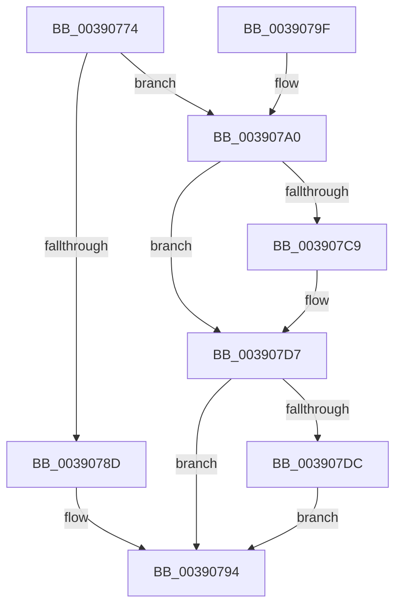

# PspLockQuotaExpansion

- RVA: `0x00390774`–`0x003907E2` (길이 `110` bytes)
- VA: `0x0000000140390774`
- 실행 섹션: `.text`
- PDB 이름 있음: `예`; PDB Function 태그: `아니요`
- unwind 정보 RVA: `0x000809AC`
- 디코드: `33`개 명령, `110/110` bytes 표시
- 미해석 바이트: `0` (있으면 어셈블리에 `.byte`로 보존)

> 이 문서는 커널 이미지의 기계어와 PDB 기호를 분석해 생성했습니다. 4번과 5번은 함수 원형과 자료형을 바이너리 사용 방식에서 추정한 C 해석이며 원본 소스 복구 결과는 아닙니다.

## 1. Dependencies

- 직접 호출 지점: **3**; 고유 호출 대상: **3**
- 직접 호출자로 확인된 함수: **4**
- RIP 상대 이미지 참조: **0**

### Outgoing calls
- `0x0039078D` → [KeAcquireSpinLockRaiseToDpc](../20/KeAcquireSpinLockRaiseToDpc_function_00208470.md) (function, `0x00208470`)
- `0x003907B9` → [KeAbPreAcquire](../21/KeAbPreAcquire_function_00210230.md) (function, `0x00210230`)
- `0x003907D2` → [ExfAcquirePushLockExclusiveEx](../20/ExfAcquirePushLockExclusiveEx_function_0020FC90.md) (function, `0x0020FC90`)

### Direct callers
- [PspReturnResourceQuota](../38/PspReturnResourceQuota_function_0038FFC4.md) at `0x0038FFFD`
- [PspExpandQuota](PspExpandQuota_function_00390660.md) at `0x0039069D`
- [PspExpandLimit](../5E/PspExpandLimit_function_005E2B20.md) at `0x005E2B57`
- [PspInsertExpansionEntry](../5E/PspInsertExpansionEntry_function_005E2BDC.md) at `0x005E2BF6`

### Static image references
- 디코드된 RIP-relative 메모리 참조가 없습니다.

## 2. Other-region calls and transfers

- 다른 실행 섹션으로 향하는 call: **0**
- 별도 외부 분기/꼬리 이동을 확인하지 못했습니다.

## 3. Assembly (complete function range)

```asm
00390774  48 89 5C 24 08                  mov qword ptr [rsp + 8], rbx
00390779  57                              push rdi
0039077A  48 83 EC 20                     sub rsp, 0x20
0039077E  83 39 00                        cmp dword ptr [rcx], 0
00390781  48 8D 59 10                     lea rbx, [rcx + 0x10]
00390785  48 8B CB                        mov rcx, rbx
00390788  48 8B FA                        mov rdi, rdx
0039078B  74 13                           je 0x1403907a0
0039078D  E8 DE 7C E7 FF                  call 0x140208470
00390792  88 07                           mov byte ptr [rdi], al
00390794  48 8B 5C 24 30                  mov rbx, qword ptr [rsp + 0x30]
00390799  48 83 C4 20                     add rsp, 0x20
0039079D  5F                              pop rdi
0039079E  C3                              ret
0039079F  CC                              int3
003907A0  65 48 8B 04 25 88 01 00 00      mov rax, qword ptr gs:[0x188]
003907A9  45 33 C0                        xor r8d, r8d
003907AC  C6 02 00                        mov byte ptr [rdx], 0
003907AF  33 D2                           xor edx, edx
003907B1  66 FF 88 E6 01 00 00            dec word ptr [rax + 0x1e6]
003907B8  90                              nop
003907B9  E8 72 FA E7 FF                  call 0x140210230
003907BE  F0 48 0F BA 2B 00               lock bts qword ptr [rbx], 0
003907C4  48 8B F8                        mov rdi, rax
003907C7  73 0E                           jae 0x1403907d7
003907C9  4C 8B C3                        mov r8, rbx
003907CC  48 8B D0                        mov rdx, rax
003907CF  48 8B CB                        mov rcx, rbx
003907D2  E8 B9 F4 E7 FF                  call 0x14020fc90
003907D7  48 85 FF                        test rdi, rdi
003907DA  74 B8                           je 0x140390794
003907DC  C6 47 0A 01                     mov byte ptr [rdi + 0xa], 1
003907E0  EB B2                           jmp 0x140390794
```

## 4. C-style interpretation (structured pseudocode)

```c
__int64 __fastcall PspLockQuotaExpansion(__int64 a1, __int64 a2, int a3)
{
    __int64 result;
    __int64 v_rsp;
    unsigned __int64 v_stack_p8;

    v_stack_p8 = v_rbx;
    v_rsp = (v_rsp) - (32);
    if ((*(unsigned int *)(a1)) == 0) goto loc_003907A0;
    result = KeAcquireSpinLockRaiseToDpc(a1 + 16, a2, a3, a4);
    *(unsigned __int8 *)(a2) = (unsigned __int8)(result);
loc_00390794:
    v_rsp = (v_rsp) + (32);
    return result;
loc_003907A0:
    a3 = 0;
    *(unsigned __int8 *)(a2) = 0;
    a2 = 0;
    result = KeAbPreAcquire(a1 + 16, a2, a3, a4);
    if (!(condition_is_above_or_equal)) {
        a3 = v_stack_p8;
        a2 = result;
        a1 = v_stack_p8;
        result = ExfAcquirePushLockExclusiveEx(a1, a2, a3, a4);
    }
    if (result == 0) goto loc_00390794;
    *(unsigned __int8 *)(result + 10) = 1;
    goto loc_00390794;
}
```

## 5. (Beta) C Style

```c
int64_t PspLockQuotaExpansion(void *Arg1, void *Arg2, int32_t Arg3)
{
    uint8_t *arg1 = (uint8_t *)Arg1;
    uint8_t *arg2 = (uint8_t *)Arg2;

    int64_t result;
    int64_t local_rsp;
    uint64_t v_stack_p8;

    v_stack_p8 = local_rbx;
    local_rsp = (local_rsp) - (32);
    if ((*(uint32_t *)(arg1)) == 0) goto loc_003907A0;
    result = KeAcquireSpinLockRaiseToDpc(Arg1 + 16, Arg2, Arg3, a4);
    *(uint8_t *)(arg2) = (uint8_t)(result);
loc_00390794:
    local_rsp = (local_rsp) + (32);
    return result;
loc_003907A0:
    Arg3 = 0;
    *(uint8_t *)(arg2) = 0;
    Arg2 = 0;
    result = KeAbPreAcquire(Arg1 + 16, Arg2, Arg3, a4);
    if (!(condition_is_above_or_equal)) {
        Arg3 = v_stack_p8;
        Arg2 = result;
        Arg1 = v_stack_p8;
        result = ExfAcquirePushLockExclusiveEx(Arg1, Arg2, Arg3, a4);
    }
    if (result == 0) goto loc_00390794;
    *(uint8_t *)(result + 0xA) = 1;
    goto loc_00390794;
}
```

### 관측된 메모리 오프셋

구조체 형식이 확인되지 않은 접근은 인자 기준의 오프셋으로만 기록했습니다.

| 기준 인자 | 오프셋 표현 | 폭 (bit) | 접근 |
|---|---:|---:|---|
| `Arg1` | `+ 0x0` | `32` | `R` |
| `Arg1` | `+ 0x0` | `64` | `R/W` |
| `Arg1` | `+ 0x10` | `64` | `R` |
| `Arg2` | `+ 0x0` | `8` | `W` |

## 6. Execution-region graph

[열기: 2D/3D 그래프와 함수 탐색 컨트롤 패널](../../../control-panel.html?section=text&rva=0x00390774&view=graph)

- 2D 그래프는 위에서 아래로 흐르고, 3D 그래프는 빈 공간을 드래그해 회전합니다. Shift+드래그는 이동, 휠은 확대·축소, 함수 노드 선택은 대상 보고서 이동입니다.

### Static fallback


