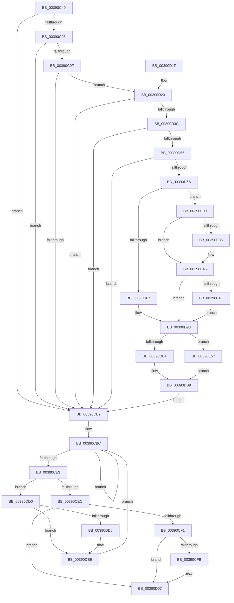

# PspReturnQuota

- RVA: `0x00390C40`–`0x00390E61` (길이 `545` bytes)
- VA: `0x0000000140390C40`
- 실행 섹션: `.text`
- PDB 이름 있음: `예`; PDB Function 태그: `아니요`
- unwind 정보 RVA: `0x000809E4`
- 디코드: `139`개 명령, `545/545` bytes 표시
- 미해석 바이트: `0` (있으면 어셈블리에 `.byte`로 보존)

> 이 문서는 커널 이미지의 기계어와 PDB 기호를 분석해 생성했습니다. 4번과 5번은 함수 원형과 자료형을 바이너리 사용 방식에서 추정한 C 해석이며 원본 소스 복구 결과는 아닙니다.

## 1. Dependencies

- 직접 호출 지점: **7**; 고유 호출 대상: **7**
- 직접 호출자로 확인된 함수: **7**
- RIP 상대 이미지 참조: **3**

### Outgoing calls
- `0x00390D87` → [KeAcquireSpinLockRaiseToDpc](../20/KeAcquireSpinLockRaiseToDpc_function_00208470.md) (function, `0x00208470`)
- `0x00390DB4` → [MmReturnPoolQuota](MmReturnPoolQuota_function_00390EE0.md) (function, `0x00390EE0`)
- `0x00390DC6` → [PspUnlockQuotaExpansion](PspUnlockQuotaExpansion_function_00390E68.md) (function, `0x00390E68`)
- `0x00390DE8` → [KeBugCheckEx](../4F/KeBugCheckEx_function_004FD660.md) (function, `0x004FD660`)
- `0x00390E1E` → [KeAbPreAcquire](../21/KeAbPreAcquire_function_00210230.md) (function, `0x00210230`)
- `0x00390E3B` → [ExfAcquirePushLockExclusiveEx](../20/ExfAcquirePushLockExclusiveEx_function_0020FC90.md) (function, `0x0020FC90`)
- `0x00390E57` → [guard_dispatch_icall](../6B/guard_dispatch_icall_function_006BAAD0.md) (function, `0x006BAAD0`)

### Direct callers
- [PsReturnProcessQuota](../47/PsReturnProcessQuota_function_0047DE8C.md) at `0x0047DEAC`
- [sub_00864C3A](../../page/86/Unknown_function_00864C3A.md) at `0x00864D16`
- [sub_00864C3A](../../page/86/Unknown_function_00864C3A.md) at `0x00864D5D`
- [sub_00864C3A](../../page/86/Unknown_function_00864C3A.md) at `0x00864D77`
- [ObpIncrementHandleCountEx](../../page/86/ObpIncrementHandleCountEx_function_0086DA10.md) at `0x0086DDB7`
- [PsReturnSharedPoolQuota](../../page/8B/PsReturnSharedPoolQuota_function_008BCC30.md) at `0x008BCC54`
- [PsReturnSharedPoolQuota](../../page/8B/PsReturnSharedPoolQuota_function_008BCC30.md) at `0x008BCC69`
- [sub_0097525E](../../page/97/Unknown_function_0097525E.md) at `0x00975329`
- [sub_0099E3A3](../../page/99/Unknown_function_0099E3A3.md) at `0x0099E3C8`
- [PsReturnProcessPageFileQuota](../../page/9E/PsReturnProcessPageFileQuota_function_009EC280.md) at `0x009EC2A3`

### Static image references
- `0x00390C57` → RVA `0x00000000` (`image boundary/outside`; read)
- `0x00390CB5` → RVA `0x00E27F80` (`.data`; read)
- `0x00390D98` → RVA `0x00390EE0` (`MmReturnPoolQuota`; read)

## 2. Other-region calls and transfers

- 다른 실행 섹션으로 향하는 call: **0**
- 별도 외부 분기/꼬리 이동을 확인하지 못했습니다.

## 3. Assembly (complete function range)

```asm
00390C40  48 89 5C 24 10                  mov qword ptr [rsp + 0x10], rbx
00390C45  55                              push rbp
00390C46  56                              push rsi
00390C47  57                              push rdi
00390C48  41 54                           push r12
00390C4A  41 55                           push r13
00390C4C  41 56                           push r14
00390C4E  41 57                           push r15
00390C50  48 83 EC 50                     sub rsp, 0x50
00390C54  4D 63 E0                        movsxd r12, r8d
00390C57  4C 8D 15 A2 F3 C6 FF            lea r10, [rip - 0x390c5e]
00390C5E  4D 8B F4                        mov r14, r12
00390C61  49 8B F1                        mov rsi, r9
00390C64  49 C1 E6 07                     shl r14, 7
00390C68  48 8B EA                        mov rbp, rdx
00390C6B  4C 8B E9                        mov r13, rcx
00390C6E  4D 8B FC                        mov r15, r12
00390C71  43 0F B6 84 E2 50 73 FC 00      movzx eax, byte ptr [r10 + r12*8 + 0xfc7350]
00390C7A  88 84 24 90 00 00 00            mov byte ptr [rsp + 0x90], al
00390C81  49 8D 3C 0E                     lea rdi, [r14 + rcx]
00390C85  0F 0D 0F                        prefetchw byte ptr [rdi]
00390C88  48 8B 1F                        mov rbx, qword ptr [rdi]
00390C8B  48 8B 57 40                     mov rdx, qword ptr [rdi + 0x40]
00390C8F  48 83 7F 50 00                  cmp qword ptr [rdi + 0x50], 0
00390C94  74 1C                           je 0x140390cb2
00390C96  4D 6B CF 38                     imul r9, r15, 0x38
00390C9A  48 3B D3                        cmp rdx, rbx
00390C9D  76 13                           jbe 0x140390cb2
00390C9F  4F 8B 84 11 48 66 F0 00         mov r8, qword ptr [r9 + r10 + 0xf06648]
00390CA7  48 8B C2                        mov rax, rdx
00390CAA  48 2B C3                        sub rax, rbx
00390CAD  49 3B C0                        cmp rax, r8
00390CB0  77 6E                           ja 0x140390d20
00390CB2  48 8B CE                        mov rcx, rsi
00390CB5  4C 8D 15 C4 72 A9 00            lea r10, [rip + 0xa972c4]
00390CBC  48 3B CB                        cmp rcx, rbx
00390CBF  4C 8B CB                        mov r9, rbx
00390CC2  48 8B D3                        mov rdx, rbx
00390CC5  48 8B C3                        mov rax, rbx
00390CC8  4C 0F 42 C9                     cmovb r9, rcx
00390CCC  48 2B D1                        sub rdx, rcx
00390CCF  45 33 C0                        xor r8d, r8d
00390CD2  48 3B CB                        cmp rcx, rbx
00390CD5  4C 0F 42 C2                     cmovb r8, rdx
00390CD9  F0 4C 0F B1 07                  lock cmpxchg qword ptr [rdi], r8
00390CDE  48 8B D8                        mov rbx, rax
00390CE1  75 D9                           jne 0x140390cbc
00390CE3  49 2B C9                        sub rcx, r9
00390CE6  0F 85 E4 00 00 00               jne 0x140390dd0
00390CEC  48 85 ED                        test rbp, rbp
00390CEF  74 16                           je 0x140390d07
00390CF1  F6 84 24 90 00 00 00 04         test byte ptr [rsp + 0x90], 4
00390CF9  74 0C                           je 0x140390d07
00390CFB  48 F7 DE                        neg rsi
00390CFE  F0 4A 01 B4 E5 00 02 00 00      lock add qword ptr [rbp + r12*8 + 0x200], rsi
00390D07  48 8B 9C 24 98 00 00 00         mov rbx, qword ptr [rsp + 0x98]
00390D0F  48 83 C4 50                     add rsp, 0x50
00390D13  41 5F                           pop r15
00390D15  41 5E                           pop r14
00390D17  41 5D                           pop r13
00390D19  41 5C                           pop r12
00390D1B  5F                              pop rdi
00390D1C  5E                              pop rsi
00390D1D  5D                              pop rbp
00390D1E  C3                              ret
00390D1F  CC                              int3
00390D20  4C 3B C6                        cmp r8, rsi
00390D23  48 8B CA                        mov rcx, rdx
00390D26  48 8B C2                        mov rax, rdx
00390D29  4C 0F 47 C6                     cmova r8, rsi
00390D2D  49 2B C8                        sub rcx, r8
00390D30  F0 48 0F B1 4F 40               lock cmpxchg qword ptr [rdi + 0x40], rcx
00390D36  0F 85 76 FF FF FF               jne 0x140390cb2
00390D3C  49 8B C0                        mov rax, r8
00390D3F  F0 48 0F C1 47 48               lock xadd qword ptr [rdi + 0x48], rax
00390D45  4C 03 C0                        add r8, rax
00390D48  4F 3B 84 11 48 66 F0 00         cmp r8, qword ptr [r9 + r10 + 0xf06648]
00390D50  0F 86 5C FF FF FF               jbe 0x140390cb2
00390D56  33 C0                           xor eax, eax
00390D58  48 87 47 48                     xchg qword ptr [rdi + 0x48], rax
00390D5C  48 89 44 24 30                  mov qword ptr [rsp + 0x30], rax
00390D61  48 85 C0                        test rax, rax
00390D64  0F 84 48 FF FF FF               je 0x140390cb2
00390D6A  49 8D 82 40 66 F0 00            lea rax, [r10 + 0xf06640]
00390D71  49 03 C1                        add rax, r9
00390D74  48 89 44 24 38                  mov qword ptr [rsp + 0x38], rax
00390D79  83 38 00                        cmp dword ptr [rax], 0
00390D7C  48 8D 48 10                     lea rcx, [rax + 0x10]
00390D80  48 89 4C 24 40                  mov qword ptr [rsp + 0x40], rcx
00390D85  74 79                           je 0x140390e00
00390D87  E8 E4 76 E7 FF                  call 0x140208470
00390D8C  88 84 24 A0 00 00 00            mov byte ptr [rsp + 0xa0], al
00390D93  48 8B 44 24 38                  mov rax, qword ptr [rsp + 0x38]
00390D98  48 8D 0D 41 01 00 00            lea rcx, [rip + 0x141]
00390D9F  48 8B 54 24 30                  mov rdx, qword ptr [rsp + 0x30]
00390DA4  48 8B 40 20                     mov rax, qword ptr [rax + 0x20]
00390DA8  48 3B C1                        cmp rax, rcx
00390DAB  41 8B CC                        mov ecx, r12d
00390DAE  0F 85 A3 00 00 00               jne 0x140390e57
00390DB4  E8 27 01 00 00                  call 0x140390ee0
00390DB9  0F B6 94 24 A0 00 00 00         movzx edx, byte ptr [rsp + 0xa0]
00390DC1  48 8B 4C 24 38                  mov rcx, qword ptr [rsp + 0x38]
00390DC6  E8 9D 00 00 00                  call 0x140390e68
00390DCB  E9 E2 FE FF FF                  jmp 0x140390cb2
00390DD0  4D 3B EA                        cmp r13, r10
00390DD3  75 19                           jne 0x140390dee
00390DD5  48 89 4C 24 20                  mov qword ptr [rsp + 0x20], rcx
00390DDA  4C 8B CE                        mov r9, rsi
00390DDD  B9 21 00 00 00                  mov ecx, 0x21
00390DE2  4D 8B C7                        mov r8, r15
00390DE5  48 8B D5                        mov rdx, rbp
00390DE8  E8 73 C8 16 00                  call 0x1404fd660
00390DED  CC                              int3
00390DEE  4D 8B EA                        mov r13, r10
00390DF1  4B 8D 3C 16                     lea rdi, [r14 + r10]
00390DF5  0F 0D 0F                        prefetchw byte ptr [rdi]
00390DF8  48 8B 1F                        mov rbx, qword ptr [rdi]
00390DFB  E9 BC FE FF FF                  jmp 0x140390cbc
00390E00  65 48 8B 04 25 88 01 00 00      mov rax, qword ptr gs:[0x188]
00390E09  45 33 C0                        xor r8d, r8d
00390E0C  33 D2                           xor edx, edx
00390E0E  C6 84 24 A0 00 00 00 00         mov byte ptr [rsp + 0xa0], 0
00390E16  66 FF 88 E6 01 00 00            dec word ptr [rax + 0x1e6]
00390E1D  90                              nop
00390E1E  E8 0D F4 E7 FF                  call 0x140210230
00390E23  48 8B 4C 24 40                  mov rcx, qword ptr [rsp + 0x40]
00390E28  48 89 44 24 48                  mov qword ptr [rsp + 0x48], rax
00390E2D  F0 48 0F BA 29 00               lock bts qword ptr [rcx], 0
00390E33  73 10                           jae 0x140390e45
00390E35  4C 8B C1                        mov r8, rcx
00390E38  48 8B D0                        mov rdx, rax
00390E3B  E8 50 EE E7 FF                  call 0x14020fc90
00390E40  48 8B 44 24 48                  mov rax, qword ptr [rsp + 0x48]
00390E45  48 85 C0                        test rax, rax
00390E48  0F 84 45 FF FF FF               je 0x140390d93
00390E4E  C6 40 0A 01                     mov byte ptr [rax + 0xa], 1
00390E52  E9 3C FF FF FF                  jmp 0x140390d93
00390E57  E8 74 9C 32 00                  call 0x1406baad0
00390E5C  E9 58 FF FF FF                  jmp 0x140390db9
```

## 4. C-style interpretation (structured pseudocode)

```c
__int64 __fastcall PspReturnQuota(__int64 a1, __int64 a2, int a3, __int64 a4)
{
    __int64 result;
    __int64 v_r14;
    __int64 v_rsi;
    __int64 v_rsp;
    unsigned __int64 v_stack_p10;
    unsigned __int64 v_stack_p20;
    unsigned __int64 v_stack_p30;
    unsigned __int64 v_stack_p38;
    unsigned __int64 v_stack_p40;
    unsigned __int64 v_stack_p48;
    unsigned __int8 v_stack_p8;
    unsigned __int8 v_stack_pA0;

    v_stack_p10 = v_rbx;
    v_rsp = (v_rsp) - (80);
    v_r14 = ((int)(a3)) << (7);
    v_stack_p8 = (unsigned __int8)(*(unsigned __int8 *)(v_rip - 3738718 + (int)(a3) * 8 + 16544592));
    if ((*(unsigned __int64 *)(v_r14 + a1 * 1 + 80)) == 0) goto loc_00390CB2;
    a4 = (a4) * ((int)(a3));
    if ((*(unsigned __int64 *)(v_r14 + a1 * 1 + 64)) <= (*(unsigned __int64 *)(v_r14 + a1 * 1))) goto loc_00390CB2;
    result = (*(unsigned __int64 *)(v_r14 + a1 * 1 + 64)) - (*(unsigned __int64 *)(v_r14 + a1 * 1));
    if (result > (*(unsigned __int64 *)(a4 + v_rip - 3738718 * 1 + 15754824))) goto loc_00390D20;
loc_00390CB2:
loc_00390CBC:
    a4 = *(unsigned __int64 *)(v_r14 + a1 * 1);
    if (a4 < (*(unsigned __int64 *)(v_r14 + a1 * 1))) { a4 = a4; }
    a2 = (*(unsigned __int64 *)(v_r14 + a1 * 1)) - (a4);
    a3 = 0;
    if (a4 < (*(unsigned __int64 *)(v_r14 + a1 * 1))) { a3 = a2; }
    if (a4 != (*(unsigned __int64 *)(v_r14 + a1 * 1))) goto loc_00390CBC;
    a1 = (a4) - (a4);
    if (condition_is_not_equal) goto loc_00390DD0;
    if (a2 == 0) goto loc_00390D07;
    v_rsi = a4;
    if (((v_stack_p8) & (4)) != 0) {
        v_rsi = -(a4);
    }
    v_rsp = (v_rsp) + (80);
    return *(unsigned __int64 *)(v_r14 + a1 * 1);
loc_00390D20:
    if (a3 > v_rsi) { a3 = v_rsi; }
    a1 = (a2) - (a3);
    if (condition_is_not_equal) goto loc_00390CB2;
    a3 = (a3) + (a3);
    if (a3 <= (*(unsigned __int64 *)(a4 + v_rip + 11104964 * 1 + 15754824))) goto loc_00390CB2;
    result = 0;
    v_stack_p30 = 0;
    if (0 == 0) goto loc_00390CB2;
    result = (v_rip + 11104964 + 15754816) + (a4);
    v_stack_p38 = result;
    v_stack_p40 = result + 16;
    if ((*(unsigned int *)(result)) == 0) goto loc_00390E00;
    result = KeAcquireSpinLockRaiseToDpc(result + 16, a2, a3, a4);
    v_stack_pA0 = (unsigned __int8)(result);
loc_00390D93:
    if ((*(unsigned __int64 *)(v_stack_p38 + 32)) != (v_rip + 321)) goto loc_00390E57;
    result = MmReturnPoolQuota((unsigned int)((unsigned int)((int)(a3))), v_stack_p30, a3, a4);
loc_00390DB9:
    result = PspUnlockQuotaExpansion(v_stack_p38, v_stack_pA0, a3, a4);
    goto loc_00390CB2;
loc_00390DD0:
    if (a1 == (v_rip + 11104964)) {
        v_stack_p20 = v_stack_p38;
        a4 = v_rsi;
        a1 = 33;
        a3 = (int)(a3);
        a2 = a2;
        result = KeBugCheckEx(a1, a2, a3, a4);
    }
    goto loc_00390CBC;
loc_00390E00:
    a3 = 0;
    a2 = 0;
    v_stack_pA0 = 0;
    result = KeAbPreAcquire(a1, a2, a3, a4);
    v_stack_p48 = result;
    if (!(condition_is_above_or_equal)) {
        a3 = v_stack_p40;
        a2 = result;
        result = ExfAcquirePushLockExclusiveEx(v_stack_p40, a2, a3, a4);
        result = v_stack_p48;
    }
    if (result == 0) goto loc_00390D93;
    *(unsigned __int8 *)(result + 10) = 1;
    goto loc_00390D93;
loc_00390E57:
    result = guard_dispatch_icall(v_stack_p40, a2, a3, a4);
    goto loc_00390DB9;
}
```

## 5. (Beta) C Style

```c
int64_t PspReturnQuota(int64_t Arg1, int64_t Arg2, int32_t Arg3, void *Arg4)
{
    uint8_t *arg4 = (uint8_t *)Arg4;

    int64_t result;
    int64_t local_r14;
    int64_t local_rsi;
    int64_t local_rsp;
    uint64_t v_stack_p10;
    uint64_t v_stack_p20;
    uint64_t v_stack_p30;
    uint64_t v_stack_p38;
    uint64_t v_stack_p40;
    uint64_t v_stack_p48;
    uint8_t v_stack_p8;
    uint8_t v_stack_pA0;

    v_stack_p10 = local_rbx;
    local_rsp = (local_rsp) - (80);
    local_r14 = ((int32_t)(Arg3)) << (7);
    v_stack_p8 = (uint8_t)(*(uint8_t *)(v_rip - 0x390C5E + (int32_t)(Arg3) * 8 + 0xFC7350));
    if ((*(uint64_t *)(local_r14 + Arg1 * 1 + 0x50)) == 0) goto loc_00390CB2;
    Arg4 = (Arg4) * ((int32_t)(Arg3));
    if ((*(uint64_t *)(local_r14 + Arg1 * 1 + 0x40)) <= (*(uint64_t *)(local_r14 + Arg1 * 1))) goto loc_00390CB2;
    result = (*(uint64_t *)(local_r14 + Arg1 * 1 + 0x40)) - (*(uint64_t *)(local_r14 + Arg1 * 1));
    if (result > (*(uint64_t *)(arg4 + v_rip - 0x390C5E * 1 + 0xF06648))) goto loc_00390D20;
loc_00390CB2:
loc_00390CBC:
    Arg4 = *(uint64_t *)(local_r14 + Arg1 * 1);
    if (Arg4 < (*(uint64_t *)(local_r14 + Arg1 * 1))) { Arg4 = Arg4; }
    Arg2 = (*(uint64_t *)(local_r14 + Arg1 * 1)) - (Arg4);
    Arg3 = 0;
    if (Arg4 < (*(uint64_t *)(local_r14 + Arg1 * 1))) { Arg3 = Arg2; }
    if (Arg4 != (*(uint64_t *)(local_r14 + Arg1 * 1))) goto loc_00390CBC;
    Arg1 = (Arg4) - (Arg4);
    if (condition_is_not_equal) goto loc_00390DD0;
    if (Arg2 == 0) goto loc_00390D07;
    local_rsi = Arg4;
    if (((v_stack_p8) & (4)) != 0) {
        local_rsi = -(Arg4);
    }
    local_rsp = (local_rsp) + (80);
    return *(uint64_t *)(local_r14 + Arg1 * 1);
loc_00390D20:
    if (Arg3 > local_rsi) { Arg3 = local_rsi; }
    Arg1 = (Arg2) - (Arg3);
    if (condition_is_not_equal) goto loc_00390CB2;
    Arg3 = (Arg3) + (Arg3);
    if (Arg3 <= (*(uint64_t *)(arg4 + v_rip + 0xA972C4 * 1 + 0xF06648))) goto loc_00390CB2;
    result = 0;
    v_stack_p30 = 0;
    if (0 == 0) goto loc_00390CB2;
    result = (v_rip + 11104964 + 15754816) + (Arg4);
    v_stack_p38 = result;
    v_stack_p40 = result + 16;
    if ((*(uint32_t *)(result)) == 0) goto loc_00390E00;
    result = KeAcquireSpinLockRaiseToDpc(result + 16, Arg2, Arg3, Arg4);
    v_stack_pA0 = (uint8_t)(result);
loc_00390D93:
    if ((*(uint64_t *)(v_stack_p38 + 0x20)) != (v_rip + 321)) goto loc_00390E57;
    result = MmReturnPoolQuota((uint32_t)((uint32_t)((int32_t)(Arg3))), v_stack_p30, Arg3, Arg4);
loc_00390DB9:
    result = PspUnlockQuotaExpansion(v_stack_p38, v_stack_pA0, Arg3, Arg4);
    goto loc_00390CB2;
loc_00390DD0:
    if (Arg1 == (v_rip + 11104964)) {
        v_stack_p20 = v_stack_p38;
        Arg4 = local_rsi;
        Arg1 = 33;
        Arg3 = (int32_t)(Arg3);
        Arg2 = Arg2;
        result = KeBugCheckEx(Arg1, Arg2, Arg3, Arg4);
    }
    goto loc_00390CBC;
loc_00390E00:
    Arg3 = 0;
    Arg2 = 0;
    v_stack_pA0 = 0;
    result = KeAbPreAcquire(Arg1, Arg2, Arg3, Arg4);
    v_stack_p48 = result;
    if (!(condition_is_above_or_equal)) {
        Arg3 = v_stack_p40;
        Arg2 = result;
        result = ExfAcquirePushLockExclusiveEx(v_stack_p40, Arg2, Arg3, Arg4);
        result = v_stack_p48;
    }
    if (result == 0) goto loc_00390D93;
    *(uint8_t *)(result + 0xA) = 1;
    goto loc_00390D93;
loc_00390E57:
    result = guard_dispatch_icall(v_stack_p40, Arg2, Arg3, Arg4);
    goto loc_00390DB9;
}
```

### 관측된 메모리 오프셋

구조체 형식이 확인되지 않은 접근은 인자 기준의 오프셋으로만 기록했습니다.

| 기준 인자 | 오프셋 표현 | 폭 (bit) | 접근 |
|---|---:|---:|---|
| `Arg4` | `+ 0xF06648 + r10*1` | `64` | `R` |

## 6. Execution-region graph

[열기: 2D/3D 그래프와 함수 탐색 컨트롤 패널](../../../control-panel.html?section=text&rva=0x00390C40&view=graph)

- 2D 그래프는 위에서 아래로 흐르고, 3D 그래프는 빈 공간을 드래그해 회전합니다. Shift+드래그는 이동, 휠은 확대·축소, 함수 노드 선택은 대상 보고서 이동입니다.

### Static fallback


