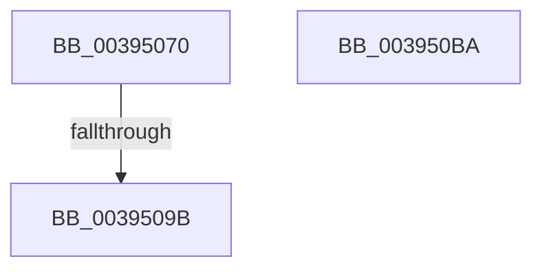

# PspRevertContainerImpersonation

- RVA: `0x00395070`–`0x003950BB` (길이 `75` bytes)
- VA: `0x0000000140395070`
- 실행 섹션: `.text`
- PDB 이름 있음: `예`; PDB Function 태그: `아니요`
- unwind 정보 RVA: `0x00081040`
- 디코드: `19`개 명령, `75/75` bytes 표시
- 미해석 바이트: `0` (있으면 어셈블리에 `.byte`로 보존)

> 이 문서는 커널 이미지의 기계어와 PDB 기호를 분석해 생성했습니다. 4번과 5번은 함수 원형과 자료형을 바이너리 사용 방식에서 추정한 C 해석이며 원본 소스 복구 결과는 아닙니다.

## 1. Dependencies

- 직접 호출 지점: **1**; 고유 호출 대상: **1**
- 직접 호출자로 확인된 함수: **4**
- RIP 상대 이미지 참조: **1**

### Outgoing calls
- `0x003950AB` → [_security_check_cookie](../6A/_security_check_cookie_function_006AC640.md) (function, `0x006AC640`)

### Direct callers
- [NtRevertContainerImpersonation](NtRevertContainerImpersonation_function_00393550.md) at `0x0039355D`
- [sub_00393C19](Unknown_function_00393C19.md) at `0x00393CC1`
- [NtWaitForWorkViaWorkerFactory](NtWaitForWorkViaWorkerFactory_function_00394270.md) at `0x003948EC`
- [PspExitThread](../../page/90/PspExitThread_function_00905F60.md) at `0x00906033`

### Static image references
- `0x0039507A` → RVA `0x00E0A740` (`.data`; read)

## 2. Other-region calls and transfers

- 다른 실행 섹션으로 향하는 call: **0**
- call이 아닌 외부 분기/꼬리 이동: **1**
  - `0x00395099` → [sub_003950BB](Unknown_function_003950BB.md) (`tail-transfer`)

## 3. Assembly (complete function range)

```asm
00395070  40 53                           push rbx
00395072  57                              push rdi
00395073  48 81 EC A8 00 00 00            sub rsp, 0xa8
0039507A  48 8B 05 BF 56 A7 00            mov rax, qword ptr [rip + 0xa756bf]
00395081  48 33 C4                        xor rax, rsp
00395084  48 89 84 24 80 00 00 00         mov qword ptr [rsp + 0x80], rax
0039508C  48 8B B9 50 06 00 00            mov rdi, qword ptr [rcx + 0x650]
00395093  48 8B D9                        mov rbx, rcx
00395096  48 85 FF                        test rdi, rdi
00395099  75 20                           jne 0x1403950bb
0039509B  B8 01 00 00 C0                  mov eax, 0xc0000001
003950A0  48 8B 8C 24 80 00 00 00         mov rcx, qword ptr [rsp + 0x80]
003950A8  48 33 CC                        xor rcx, rsp
003950AB  E8 90 75 31 00                  call 0x1406ac640
003950B0  48 81 C4 A8 00 00 00            add rsp, 0xa8
003950B7  5F                              pop rdi
003950B8  5B                              pop rbx
003950B9  C3                              ret
003950BA  CC                              int3
```

## 4. C-style interpretation (structured pseudocode)

```c
__int64 __fastcall PspRevertContainerImpersonation(__int64 a1)
{
    __int64 result;
    __int64 v_rsp;
    unsigned __int64 v_stack_m38;

    v_rsp = (v_rsp) - (168);
    result = (*(unsigned __int64 *)(v_rip + 10966719)) ^ (v_rsp);
    v_stack_m38 = result;
    a1 = (v_stack_m38) ^ (v_rsp);
    result = _security_check_cookie(a1, a2, a3, a4);
    v_rsp = (v_rsp) + (168);
    return result;
}
```

## 5. (Beta) C Style

```c
int64_t PspRevertContainerImpersonation(void *Arg1)
{
    uint8_t *arg1 = (uint8_t *)Arg1;

    int64_t result;
    int64_t local_rsp;
    uint64_t v_stack_m38;

    local_rsp = (local_rsp) - (168);
    result = (*(uint64_t *)(v_rip + 0xA756BF)) ^ (local_rsp);
    v_stack_m38 = result;
    Arg1 = (v_stack_m38) ^ (local_rsp);
    result = _security_check_cookie(Arg1, a2, a3, a4);
    local_rsp = (local_rsp) + (168);
    return result;
}
```

### 관측된 메모리 오프셋

구조체 형식이 확인되지 않은 접근은 인자 기준의 오프셋으로만 기록했습니다.

| 기준 인자 | 오프셋 표현 | 폭 (bit) | 접근 |
|---|---:|---:|---|
| `Arg1` | `+ 0x650` | `64` | `R` |

## 6. Execution-region graph

[열기: 2D/3D 그래프와 함수 탐색 컨트롤 패널](../../../control-panel.html?section=text&rva=0x00395070&view=graph)

- 2D 그래프는 위에서 아래로 흐르고, 3D 그래프는 빈 공간을 드래그해 회전합니다. Shift+드래그는 이동, 휠은 확대·축소, 함수 노드 선택은 대상 보고서 이동입니다.

### Static fallback


