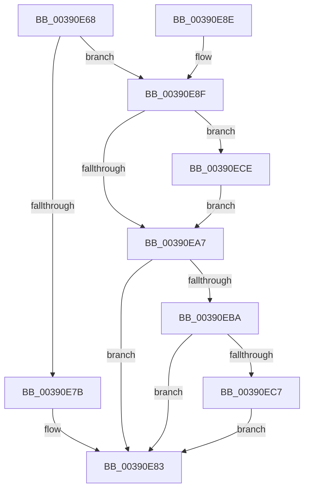

# PspUnlockQuotaExpansion

- RVA: `0x00390E68`–`0x00390ED8` (길이 `112` bytes)
- VA: `0x0000000140390E68`
- 실행 섹션: `.text`
- PDB 이름 있음: `예`; PDB Function 태그: `아니요`
- unwind 정보 RVA: `0x00080A00`
- 디코드: `33`개 명령, `112/112` bytes 표시
- 미해석 바이트: `0` (있으면 어셈블리에 `.byte`로 보존)

> 이 문서는 커널 이미지의 기계어와 PDB 기호를 분석해 생성했습니다. 4번과 5번은 함수 원형과 자료형을 바이너리 사용 방식에서 추정한 C 해석이며 원본 소스 복구 결과는 아닙니다.

## 1. Dependencies

- 직접 호출 지점: **4**; 고유 호출 대상: **4**
- 직접 호출자로 확인된 함수: **6**
- RIP 상대 이미지 참조: **0**

### Outgoing calls
- `0x00390E7E` → [KeReleaseSpinLock](KeReleaseSpinLock_function_00392BA0.md) (function, `0x00392BA0`)
- `0x00390EAA` → [KeAbPostRelease](../2E/KeAbPostRelease_function_002E1600.md) (function, `0x002E1600`)
- `0x00390EC7` → [KiCheckForKernelApcDelivery](../2E/KiCheckForKernelApcDelivery_function_002E2C80.md) (function, `0x002E2C80`)
- `0x00390ED1` → [ExfTryToWakePushLock](../26/ExfTryToWakePushLock_function_00265DD0.md) (function, `0x00265DD0`)

### Direct callers
- [PspReturnResourceQuota](../38/PspReturnResourceQuota_function_0038FFC4.md) at `0x0039002C`
- [PspExpandQuota](PspExpandQuota_function_00390660.md) at `0x003906F1`
- [PspExpandQuota](PspExpandQuota_function_00390660.md) at `0x0039071C`
- [PspReturnQuota](PspReturnQuota_function_00390C40.md) at `0x00390DC6`
- [PspExpandLimit](../5E/PspExpandLimit_function_005E2B20.md) at `0x005E2B78`
- [PspInsertExpansionEntry](../5E/PspInsertExpansionEntry_function_005E2BDC.md) at `0x005E2C28`
- [sub_006E5788](../6E/Unknown_function_006E5788.md) at `0x006E578F`

### Static image references
- 디코드된 RIP-relative 메모리 참조가 없습니다.

## 2. Other-region calls and transfers

- 다른 실행 섹션으로 향하는 call: **0**
- 별도 외부 분기/꼬리 이동을 확인하지 못했습니다.

## 3. Assembly (complete function range)

```asm
00390E68  48 89 5C 24 08                  mov qword ptr [rsp + 8], rbx
00390E6D  57                              push rdi
00390E6E  48 83 EC 20                     sub rsp, 0x20
00390E72  83 39 00                        cmp dword ptr [rcx], 0
00390E75  48 8D 59 10                     lea rbx, [rcx + 0x10]
00390E79  74 14                           je 0x140390e8f
00390E7B  48 8B CB                        mov rcx, rbx
00390E7E  E8 1D 1D 00 00                  call 0x140392ba0
00390E83  48 8B 5C 24 30                  mov rbx, qword ptr [rsp + 0x30]
00390E88  48 83 C4 20                     add rsp, 0x20
00390E8C  5F                              pop rdi
00390E8D  C3                              ret
00390E8E  CC                              int3
00390E8F  65 48 8B 3C 25 88 01 00 00      mov rdi, qword ptr gs:[0x188]
00390E98  48 83 C8 FF                     or rax, 0xffffffffffffffff
00390E9C  F0 48 0F C1 03                  lock xadd qword ptr [rbx], rax
00390EA1  24 06                           and al, 6
00390EA3  3C 02                           cmp al, 2
00390EA5  74 27                           je 0x140390ece
00390EA7  48 8B CB                        mov rcx, rbx
00390EAA  E8 51 07 F5 FF                  call 0x1402e1600
00390EAF  90                              nop
00390EB0  66 83 87 E6 01 00 00 01         add word ptr [rdi + 0x1e6], 1
00390EB8  75 C9                           jne 0x140390e83
00390EBA  48 8D 87 98 00 00 00            lea rax, [rdi + 0x98]
00390EC1  90                              nop
00390EC2  48 39 00                        cmp qword ptr [rax], rax
00390EC5  74 BC                           je 0x140390e83
00390EC7  E8 B4 1D F5 FF                  call 0x1402e2c80
00390ECC  EB B5                           jmp 0x140390e83
00390ECE  48 8B CB                        mov rcx, rbx
00390ED1  E8 FA 4E ED FF                  call 0x140265dd0
00390ED6  EB CF                           jmp 0x140390ea7
```

## 4. C-style interpretation (structured pseudocode)

```c
__int64 __fastcall PspUnlockQuotaExpansion(__int64 a1)
{
    __int64 result;
    __int64 v_rsp;
    unsigned __int64 v_stack_p8;

    v_stack_p8 = v_rbx;
    v_rsp = (v_rsp) - (32);
    if ((*(unsigned int *)(a1)) == 0) goto loc_00390E8F;
    result = KeReleaseSpinLock(a1 + 16, a2, a3, a4);
loc_00390E83:
    v_rsp = (v_rsp) + (32);
    return result;
loc_00390E8F:
    result = (result) | (-1);
    result = (unsigned __int8)((result) & (6));
    if (((unsigned __int8)(result)) == 2) goto loc_00390ECE;
loc_00390EA7:
    result = KeAbPostRelease(v_stack_p8, a2, a3, a4);
    if (((unsigned __int8)(result)) != 2) goto loc_00390E83;
    if ((*(unsigned __int64 *)(*(unsigned __int64 *)(gs_base + (0 + 392)) + 152)) == (*(unsigned __int64 *)(gs_base + (0 + 392)) + 152)) goto loc_00390E83;
    result = KiCheckForKernelApcDelivery(v_stack_p8, a2, a3, a4);
    goto loc_00390E83;
loc_00390ECE:
    result = ExfTryToWakePushLock(v_stack_p8, a2, a3, a4);
    goto loc_00390EA7;
}
```

## 5. (Beta) C Style

```c
int64_t PspUnlockQuotaExpansion(void *Arg1)
{
    uint8_t *arg1 = (uint8_t *)Arg1;

    int64_t result;
    int64_t local_rsp;
    uint64_t v_stack_p8;

    v_stack_p8 = local_rbx;
    local_rsp = (local_rsp) - (32);
    if ((*(uint32_t *)(arg1)) == 0) goto loc_00390E8F;
    result = KeReleaseSpinLock(Arg1 + 16, a2, a3, a4);
loc_00390E83:
    local_rsp = (local_rsp) + (32);
    return result;
loc_00390E8F:
    result = (result) | (-1);
    result = (uint8_t)((result) & (6));
    if (((uint8_t)(result)) == 2) goto loc_00390ECE;
loc_00390EA7:
    result = KeAbPostRelease(v_stack_p8, a2, a3, a4);
    if (((uint8_t)(result)) != 2) goto loc_00390E83;
    if ((*(uint64_t *)(*(uint64_t *)(gs_base + (0 + 0x188)) + 0x98)) == (*(uint64_t *)(gs_base + (0 + 0x188)) + 152)) goto loc_00390E83;
    result = KiCheckForKernelApcDelivery(v_stack_p8, a2, a3, a4);
    goto loc_00390E83;
loc_00390ECE:
    result = ExfTryToWakePushLock(v_stack_p8, a2, a3, a4);
    goto loc_00390EA7;
}
```

### 관측된 메모리 오프셋

구조체 형식이 확인되지 않은 접근은 인자 기준의 오프셋으로만 기록했습니다.

| 기준 인자 | 오프셋 표현 | 폭 (bit) | 접근 |
|---|---:|---:|---|
| `Arg1` | `+ 0x0` | `32` | `R` |
| `Arg1` | `+ 0x0` | `64` | `R/W` |
| `Arg1` | `+ 0x10` | `64` | `R` |

## 6. Execution-region graph

[열기: 2D/3D 그래프와 함수 탐색 컨트롤 패널](../../../control-panel.html?section=text&rva=0x00390E68&view=graph)

- 2D 그래프는 위에서 아래로 흐르고, 3D 그래프는 빈 공간을 드래그해 회전합니다. Shift+드래그는 이동, 휠은 확대·축소, 함수 노드 선택은 대상 보고서 이동입니다.

### Static fallback


