# PspUpdateContainerImpersonation

- RVA: `0x003931EC`–`0x0039344B` (길이 `607` bytes)
- VA: `0x00000001403931EC`
- 실행 섹션: `.text`
- PDB 이름 있음: `예`; PDB Function 태그: `아니요`
- unwind 정보 RVA: `0x00080E68`
- 디코드: `142`개 명령, `607/607` bytes 표시
- 미해석 바이트: `0` (있으면 어셈블리에 `.byte`로 보존)

> 이 문서는 커널 이미지의 기계어와 PDB 기호를 분석해 생성했습니다. 4번과 5번은 함수 원형과 자료형을 바이너리 사용 방식에서 추정한 C 해석이며 원본 소스 복구 결과는 아닙니다.

## 1. Dependencies

- 직접 호출 지점: **14**; 고유 호출 대상: **12**
- 직접 호출자로 확인된 함수: **2**
- RIP 상대 이미지 참조: **8**

### Outgoing calls
- `0x00393227` → [ObfReferenceObjectWithTag](../21/ObfReferenceObjectWithTag_function_00210710.md) (function, `0x00210710`)
- `0x0039323C` → [ExAcquireSpinLockExclusive](../24/ExAcquireSpinLockExclusive_function_00248690.md) (function, `0x00248690`)
- `0x0039325E` → [KeAdjustWobPriority](KeAdjustWobPriority_function_00393570.md) (function, `0x00393570`)
- `0x00393272` → [KeApplyWobBamQos](KeApplyWobBamQos_function_003937AC.md) (function, `0x003937AC`)
- `0x0039329E` → [KiLowerIrqlProcessIrqlFlags](../4F/KiLowerIrqlProcessIrqlFlags_function_004F5698.md) (function, `0x004F5698`)
- `0x003932D1` → [EtwTraceThreadWorkOnBehalfUpdate](EtwTraceThreadWorkOnBehalfUpdate_function_00393A50.md) (function, `0x00393A50`)
- `0x003932F7` → [ObpPushStackInfo](../21/ObpPushStackInfo_function_002109E4.md) (function, `0x002109E4`)
- `0x0039333A` → [KeSetThreadChargeOnlySchedulingGroup](KeSetThreadChargeOnlySchedulingGroup_function_00392F20.md) (function, `0x00392F20`)
- `0x0039337F` → [KeSetThreadChargeOnlySchedulingGroup](KeSetThreadChargeOnlySchedulingGroup_function_00392F20.md) (function, `0x00392F20`)
- `0x003933A3` → [KiClearSystemPriority](../2C/KiClearSystemPriority_function_002C05A8.md) (function, `0x002C05A8`)
- `0x003933C7` → [ExpReleaseSpinLockExclusiveFromDpcLevelInstrumented](../2C/ExpReleaseSpinLockExclusiveFromDpcLevelInstrumented_function_002C0F44.md) (function, `0x002C0F44`)
- `0x003933F0` → [KeBugCheckEx](../4F/KeBugCheckEx_function_004FD660.md) (function, `0x004FD660`)
- `0x0039342E` → [KeBugCheckEx](../4F/KeBugCheckEx_function_004FD660.md) (function, `0x004FD660`)
- `0x00393437` → [ObpDeferObjectDeletion](../3A/ObpDeferObjectDeletion_function_003A2394.md) (function, `0x003A2394`)

### Direct callers
- [PsImpersonateContainerOfThread](../49/PsImpersonateContainerOfThread_function_0049CC98.md) at `0x0049CCA8`
- [NtSetInformationThread](../../page/8C/NtSetInformationThread_function_008C9F60.md) at `0x008CA39D`

### Static image references
- `0x00393235` → RVA `0x00F06590` (`.data`; read)
- `0x00393277` → RVA `0x00FC6B06` (`ALMOSTRO`; read)
- `0x00393284` → RVA `0x00F06590` (`.data`; write)
- `0x0039328E` → RVA `0x00FC6D20` (`ALMOSTRO`; read)
- `0x003932DB` → RVA `0x00FC5010` (`ALMOSTRO`; read)
- `0x003933AD` → RVA `0x00F0DE58` (`.data`; read)
- `0x00393419` → RVA `0x00FC6E4C` (`ALMOSTRO`; read)
- `0x00393423` → RVA `0x00FC7800` (`ALMOSTRO`; read)

## 2. Other-region calls and transfers

- 다른 실행 섹션으로 향하는 call: **0**
- 별도 외부 분기/꼬리 이동을 확인하지 못했습니다.

## 3. Assembly (complete function range)

```asm
003931EC  48 89 5C 24 08                  mov qword ptr [rsp + 8], rbx
003931F1  48 89 6C 24 10                  mov qword ptr [rsp + 0x10], rbp
003931F6  48 89 74 24 18                  mov qword ptr [rsp + 0x18], rsi
003931FB  57                              push rdi
003931FC  48 83 EC 30                     sub rsp, 0x30
00393200  48 8B B1 50 06 00 00            mov rsi, qword ptr [rcx + 0x650]
00393207  48 8B FA                        mov rdi, rdx
0039320A  48 8B D9                        mov rbx, rcx
0039320D  48 85 F6                        test rsi, rsi
00393210  0F 84 11 01 00 00               je 0x140393327
00393216  48 85 D2                        test rdx, rdx
00393219  0F 84 34 01 00 00               je 0x140393353
0039321F  BA 43 6F 6E 74                  mov edx, 0x746e6f43
00393224  48 8B CF                        mov rcx, rdi
00393227  E8 E4 D4 E7 FF                  call 0x140210710
0039322C  48 85 F6                        test rsi, rsi
0039322F  0F 85 1E 01 00 00               jne 0x140393353
00393235  48 8D 0D 54 33 B7 00            lea rcx, [rip + 0xb73354]
0039323C  E8 4F 54 EB FF                  call 0x140248690
00393241  0F B6 E8                        movzx ebp, al
00393244  48 89 BB 50 06 00 00            mov qword ptr [rbx + 0x650], rdi
0039324B  48 85 FF                        test rdi, rdi
0039324E  0F 84 35 01 00 00               je 0x140393389
00393254  0F BE 97 C3 00 00 00            movsx edx, byte ptr [rdi + 0xc3]
0039325B  48 8B CB                        mov rcx, rbx
0039325E  E8 0D 03 00 00                  call 0x140393570
00393263  65 48 8B 0C 25 20 00 00 00      mov rcx, qword ptr gs:[0x20]
0039326C  4C 8B C7                        mov r8, rdi
0039326F  48 8B D3                        mov rdx, rbx
00393272  E8 35 05 00 00                  call 0x1403937ac
00393277  F6 05 88 38 C3 00 01            test byte ptr [rip + 0xc33888], 1
0039327E  0F 85 29 01 00 00               jne 0x1403933ad
00393284  C7 05 02 33 B7 00 00 00 00 00   mov dword ptr [rip + 0xb73302], 0
0039328E  83 3D 8B 3A C3 00 00            cmp dword ptr [rip + 0xc33a8b], 0
00393295  74 0C                           je 0x1403932a3
00393297  44 0F 20 C1                     mov rcx, cr8
0039329B  40 8A D5                        mov dl, bpl
0039329E  E8 F5 23 16 00                  call 0x1404f5698
003932A3  44 0F 22 C5                     mov cr8, rbp
003932A7  48 85 FF                        test rdi, rdi
003932AA  74 1F                           je 0x1403932cb
003932AC  48 8B 87 20 02 00 00            mov rax, qword ptr [rdi + 0x220]
003932B3  48 8B 88 A0 02 00 00            mov rcx, qword ptr [rax + 0x2a0]
003932BA  48 85 C9                        test rcx, rcx
003932BD  74 0C                           je 0x1403932cb
003932BF  48 8B 91 E0 04 00 00            mov rdx, qword ptr [rcx + 0x4e0]
003932C6  48 85 D2                        test rdx, rdx
003932C9  75 6C                           jne 0x140393337
003932CB  48 8B D7                        mov rdx, rdi
003932CE  48 8B CE                        mov rcx, rsi
003932D1  E8 7A 07 00 00                  call 0x140393a50
003932D6  48 85 F6                        test rsi, rsi
003932D9  74 34                           je 0x14039330f
003932DB  83 3D 2E 1D C3 00 00            cmp dword ptr [rip + 0xc31d2e], 0
003932E2  48 8D 5E D0                     lea rbx, [rsi - 0x30]
003932E6  74 14                           je 0x1403932fc
003932E8  33 D2                           xor edx, edx
003932EA  41 B9 43 6F 6E 74               mov r9d, 0x746e6f43
003932F0  48 8B CB                        mov rcx, rbx
003932F3  44 8D 42 01                     lea r8d, [rdx + 1]
003932F7  E8 E8 D6 E7 FF                  call 0x1402109e4
003932FC  48 83 C8 FF                     or rax, 0xffffffffffffffff
00393300  F0 48 0F C1 03                  lock xadd qword ptr [rbx], rax
00393305  48 83 E8 01                     sub rax, 1
00393309  0F 8E C2 00 00 00               jle 0x1403933d1
0039330F  33 C0                           xor eax, eax
00393311  48 8B 5C 24 40                  mov rbx, qword ptr [rsp + 0x40]
00393316  48 8B 6C 24 48                  mov rbp, qword ptr [rsp + 0x48]
0039331B  48 8B 74 24 50                  mov rsi, qword ptr [rsp + 0x50]
00393320  48 83 C4 30                     add rsp, 0x30
00393324  5F                              pop rdi
00393325  C3                              ret
00393326  CC                              int3
00393327  48 85 FF                        test rdi, rdi
0039332A  0F 85 EF FE FF FF               jne 0x14039321f
00393330  B8 01 00 00 C0                  mov eax, 0xc0000001
00393335  EB DA                           jmp 0x140393311
00393337  48 8B CB                        mov rcx, rbx
0039333A  E8 E1 FB FF FF                  call 0x140392f20
0039333F  84 C0                           test al, al
00393341  74 88                           je 0x1403932cb
00393343  F0 81 8B A0 05 00 00 00 00 00 01  lock or dword ptr [rbx + 0x5a0], 0x1000000
0039334E  E9 78 FF FF FF                  jmp 0x1403932cb
00393353  0F 0D 8B A0 05 00 00            prefetchw byte ptr [rbx + 0x5a0]
0039335A  8B 83 A0 05 00 00               mov eax, dword ptr [rbx + 0x5a0]
00393360  8B C8                           mov ecx, eax
00393362  0F BA F1 18                     btr ecx, 0x18
00393366  F0 0F B1 8B A0 05 00 00         lock cmpxchg dword ptr [rbx + 0x5a0], ecx
0039336E  75 F0                           jne 0x140393360
00393370  0F BA E0 18                     bt eax, 0x18
00393374  0F 83 BB FE FF FF               jae 0x140393235
0039337A  33 D2                           xor edx, edx
0039337C  48 8B CB                        mov rcx, rbx
0039337F  E8 9C FB FF FF                  call 0x140392f20
00393384  E9 AC FE FF FF                  jmp 0x140393235
00393389  65 48 8B 04 25 88 01 00 00      mov rax, qword ptr gs:[0x188]
00393392  8B 48 74                        mov ecx, dword ptr [rax + 0x74]
00393395  F6 C1 04                        test cl, 4
00393398  0F 85 A3 00 00 00               jne 0x140393441
0039339E  33 D2                           xor edx, edx
003933A0  48 8B CB                        mov rcx, rbx
003933A3  E8 00 D2 F2 FF                  call 0x1402c05a8
003933A8  E9 CA FE FF FF                  jmp 0x140393277
003933AD  8B 05 A5 AA B7 00               mov eax, dword ptr [rip + 0xb7aaa5]
003933B3  85 C0                           test eax, eax
003933B5  0F 85 C9 FE FF FF               jne 0x140393284
003933BB  48 8B 54 24 38                  mov rdx, qword ptr [rsp + 0x38]
003933C0  48 8D 0D C9 31 B7 00            lea rcx, [rip + 0xb731c9]
003933C7  E8 78 DB F2 FF                  call 0x1402c0f44
003933CC  E9 BD FE FF FF                  jmp 0x14039328e
003933D1  48 8B 4B 08                     mov rcx, qword ptr [rbx + 8]
003933D5  48 85 C9                        test rcx, rcx
003933D8  75 1C                           jne 0x1403933f6
003933DA  48 85 C0                        test rax, rax
003933DD  79 55                           jns 0x140393434
003933DF  33 D2                           xor edx, edx
003933E1  48 89 44 24 20                  mov qword ptr [rsp + 0x20], rax
003933E6  44 8D 49 04                     lea r9d, [rcx + 4]
003933EA  4C 8B C6                        mov r8, rsi
003933ED  8D 4A 18                        lea ecx, [rdx + 0x18]
003933F0  E8 6B A2 16 00                  call 0x1404fd660
003933F5  CC                              int3
003933F6  41 B9 03 00 00 00               mov r9d, 3
003933FC  48 89 4C 24 20                  mov qword ptr [rsp + 0x20], rcx
00393401  48 8B C3                        mov rax, rbx
00393404  4C 8B C6                        mov r8, rsi
00393407  48 C1 E8 08                     shr rax, 8
0039340B  0F B6 D0                        movzx edx, al
0039340E  0F B6 43 18                     movzx eax, byte ptr [rbx + 0x18]
00393412  41 8D 49 15                     lea ecx, [r9 + 0x15]
00393416  48 33 D0                        xor rdx, rax
00393419  0F B6 05 2C 3A C3 00            movzx eax, byte ptr [rip + 0xc33a2c]
00393420  48 33 D0                        xor rdx, rax
00393423  48 8D 05 D6 43 C3 00            lea rax, [rip + 0xc343d6]
0039342A  48 8B 14 D0                     mov rdx, qword ptr [rax + rdx*8]
0039342E  E8 2D A2 16 00                  call 0x1404fd660
00393433  CC                              int3
00393434  48 8B CB                        mov rcx, rbx
00393437  E8 58 EF 00 00                  call 0x1403a2394
0039343C  E9 CE FE FF FF                  jmp 0x14039330f
00393441  0F BA 6B 74 10                  bts dword ptr [rbx + 0x74], 0x10
00393446  E9 2C FE FF FF                  jmp 0x140393277
```

## 4. C-style interpretation (structured pseudocode)

```c
__int64 __fastcall PspUpdateContainerImpersonation(__int64 a1, __int64 a2)
{
    __int64 result;
    __int64 v_rsp;
    unsigned __int64 v_stack_p10;
    unsigned __int64 v_stack_p18;
    unsigned __int64 v_stack_p20;
    unsigned __int64 v_stack_p38;
    unsigned __int64 v_stack_p8;

    v_stack_p8 = v_rbx;
    v_stack_p10 = v_rbp;
    v_stack_p18 = v_rsi;
    v_rsp = (v_rsp) - (48);
    if (*(unsigned __int64 *)(a1 + 1616) == 0) goto loc_00393327;
    if (a2 == 0) goto loc_00393353;
loc_0039321F:
    result = ObfReferenceObjectWithTag(a2, (unsigned int)(0x746E6F43ULL), a3, a4);
    if (*(unsigned __int64 *)(a1 + 1616) != 0) goto loc_00393353;
loc_00393235:
    result = ExAcquireSpinLockExclusive(v_rip + 12006228, (unsigned int)(0x746E6F43ULL), a3, a4);
    *(unsigned __int64 *)(a1 + 1616) = a2;
    if (a2 == 0) goto loc_00393389;
    result = KeAdjustWobPriority(a1, (__int8)(*(unsigned __int8 *)(a2 + 195)), a3, a4);
    result = KeApplyWobBamQos(*(unsigned __int64 *)(gs_base + (0 + 32)), a1, a2, a4);
loc_00393277:
    if (((*(unsigned __int8 *)(v_rip + 12793992)) & (1)) != 0) goto loc_003933AD;
loc_00393284:
    *(unsigned int *)(v_rip + 12006146) = 0;
loc_0039328E:
    if ((*(unsigned int *)(v_rip + 12794507)) != 0) {
        a1 = v_cr8;
        a2 = (unsigned __int8)((unsigned __int8)(result));
        result = KiLowerIrqlProcessIrqlFlags(a1, a2, a2, a4);
    }
    if (a2 == 0) goto loc_003932CB;
    if (*(unsigned __int64 *)(*(unsigned __int64 *)(a2 + 544) + 672) == 0) goto loc_003932CB;
    if (*(unsigned __int64 *)(*(unsigned __int64 *)(*(unsigned __int64 *)(a2 + 544) + 672) + 1248) != 0) goto loc_00393337;
loc_003932CB:
    result = EtwTraceThreadWorkOnBehalfUpdate(*(unsigned __int64 *)(a1 + 1616), a2, a2, a4);
    if (*(unsigned __int64 *)(a1 + 1616) == 0) goto loc_0039330F;
    if ((*(unsigned int *)(v_rip + 12786990)) != 0) {
        a2 = 0;
        a4 = 0x746E6F43ULL;
        a1 = *(unsigned __int64 *)(a1 + 1616) - 48;
        a3 = a2 + 1;
        result = ObpPushStackInfo(a1, a2, a3, a4);
    }
    result = (result) | (-1);
    result = (result) - (1);
    if (condition_is_less_or_equal) goto loc_003933D1;
loc_0039330F:
    result = 0;
loc_00393311:
    v_rsp = (v_rsp) + (48);
    return result;
loc_00393327:
    if (0 != 0) goto loc_0039321F;
    goto loc_00393311;
loc_00393337:
    result = KeSetThreadChargeOnlySchedulingGroup(v_stack_p8, a2, a3, a4);
    if ((unsigned __int8)(result) == 0) goto loc_003932CB;
    goto loc_003932CB;
loc_00393353:
loc_00393360:
    if ((unsigned __int8)(result) != 0) goto loc_00393360;
    if (condition_is_above_or_equal) goto loc_00393235;
    a2 = 0;
    result = KeSetThreadChargeOnlySchedulingGroup(v_stack_p8, a2, a3, a4);
    goto loc_00393235;
loc_00393389:
    if ((((unsigned __int8)((unsigned int)(*(unsigned int *)(*(unsigned __int64 *)(gs_base + (0 + 392)) + 116)))) & (4)) != 0) goto loc_00393441;
    a2 = 0;
    result = KiClearSystemPriority(v_stack_p8, a2, a3, a4);
    goto loc_00393277;
loc_003933AD:
    if ((unsigned int)((unsigned int)(*(unsigned int *)(v_rip + 12036773))) != 0) goto loc_00393284;
    result = ExpReleaseSpinLockExclusiveFromDpcLevelInstrumented(v_rip + 12005833, v_stack_p38, a3, a4);
    goto loc_0039328E;
loc_003933D1:
    if (*(unsigned __int64 *)(v_stack_p8 + 8) != 0) goto loc_003933F6;
    if (!sign_flag) goto loc_00393434;
    a2 = 0;
    v_stack_p20 = result;
    result = KeBugCheckEx(a2 + 24, a2, v_stack_p18, *(unsigned __int64 *)(v_stack_p8 + 8) + 4);
loc_003933F6:
    v_stack_p20 = a2 + 24;
    result = (v_stack_p8) >> (8);
    a2 = ((unsigned __int8)(result)) ^ (*(unsigned __int8 *)(v_stack_p8 + 24));
    a2 = (a2) ^ (*(unsigned __int8 *)(v_rip + 12794412));
    result = KeBugCheckEx(3 + 21, *(unsigned __int64 *)(v_rip + 12796886 + a2 * 8), v_stack_p18, 3);
loc_00393434:
    result = ObpDeferObjectDeletion(v_stack_p8, *(unsigned __int64 *)(v_rip + 12796886 + a2 * 8), v_stack_p18, 3);
    goto loc_0039330F;
loc_00393441:
    goto loc_00393277;
}
```

## 5. (Beta) C Style

```c
int64_t PspUpdateContainerImpersonation(void *Arg1, int64_t Arg2)
{
    uint8_t *arg1 = (uint8_t *)Arg1;

    int64_t result;
    int64_t local_rsp;
    uint64_t v_stack_p10;
    uint64_t v_stack_p18;
    uint64_t v_stack_p20;
    uint64_t v_stack_p38;
    uint64_t v_stack_p8;

    v_stack_p8 = local_rbx;
    v_stack_p10 = local_rbp;
    v_stack_p18 = local_rsi;
    local_rsp = (local_rsp) - (48);
    if (*(uint64_t *)(arg1 + 0x650) == 0) goto loc_00393327;
    if (Arg2 == 0) goto loc_00393353;
loc_0039321F:
    result = ObfReferenceObjectWithTag(Arg2, (uint32_t)(0x746E6F43ULL), a3, a4);
    if (*(uint64_t *)(arg1 + 0x650) != 0) goto loc_00393353;
loc_00393235:
    result = ExAcquireSpinLockExclusive(v_rip + 12006228, (uint32_t)(0x746E6F43ULL), a3, a4);
    *(uint64_t *)(arg1 + 0x650) = Arg2;
    if (Arg2 == 0) goto loc_00393389;
    result = KeAdjustWobPriority(Arg1, (int8_t)(*(uint8_t *)(Arg2 + 0xC3)), a3, a4);
    result = KeApplyWobBamQos(*(uint64_t *)(gs_base + (0 + 0x20)), Arg1, Arg2, a4);
loc_00393277:
    if (((*(uint8_t *)(v_rip + 0xC33888)) & (1)) != 0) goto loc_003933AD;
loc_00393284:
    *(uint32_t *)(v_rip + 0xB73302) = 0;
loc_0039328E:
    if ((*(uint32_t *)(v_rip + 0xC33A8B)) != 0) {
        Arg1 = v_cr8;
        Arg2 = (uint8_t)((uint8_t)(result));
        result = KiLowerIrqlProcessIrqlFlags(Arg1, Arg2, Arg2, a4);
    }
    if (Arg2 == 0) goto loc_003932CB;
    if (*(uint64_t *)(*(uint64_t *)(Arg2 + 0x220) + 0x2A0) == 0) goto loc_003932CB;
    if (*(uint64_t *)(*(uint64_t *)(*(uint64_t *)(Arg2 + 0x220) + 0x2A0) + 0x4E0) != 0) goto loc_00393337;
loc_003932CB:
    result = EtwTraceThreadWorkOnBehalfUpdate(*(uint64_t *)(arg1 + 0x650), Arg2, Arg2, a4);
    if (*(uint64_t *)(arg1 + 0x650) == 0) goto loc_0039330F;
    if ((*(uint32_t *)(v_rip + 0xC31D2E)) != 0) {
        Arg2 = 0;
        a4 = 0x746E6F43ULL;
        Arg1 = *(uint64_t *)(arg1 + 0x650) - 48;
        a3 = Arg2 + 1;
        result = ObpPushStackInfo(Arg1, Arg2, a3, a4);
    }
    result = (result) | (-1);
    result = (result) - (1);
    if (condition_is_less_or_equal) goto loc_003933D1;
loc_0039330F:
    result = 0;
loc_00393311:
    local_rsp = (local_rsp) + (48);
    return result;
loc_00393327:
    if (0 != 0) goto loc_0039321F;
    goto loc_00393311;
loc_00393337:
    result = KeSetThreadChargeOnlySchedulingGroup(v_stack_p8, Arg2, a3, a4);
    if ((uint8_t)(result) == 0) goto loc_003932CB;
    goto loc_003932CB;
loc_00393353:
loc_00393360:
    if ((uint8_t)(result) != 0) goto loc_00393360;
    if (condition_is_above_or_equal) goto loc_00393235;
    Arg2 = 0;
    result = KeSetThreadChargeOnlySchedulingGroup(v_stack_p8, Arg2, a3, a4);
    goto loc_00393235;
loc_00393389:
    if ((((uint8_t)((uint32_t)(*(uint32_t *)(*(uint64_t *)(gs_base + (0 + 0x188)) + 0x74)))) & (4)) != 0) goto loc_00393441;
    Arg2 = 0;
    result = KiClearSystemPriority(v_stack_p8, Arg2, a3, a4);
    goto loc_00393277;
loc_003933AD:
    if ((uint32_t)((uint32_t)(*(uint32_t *)(v_rip + 0xB7AAA5))) != 0) goto loc_00393284;
    result = ExpReleaseSpinLockExclusiveFromDpcLevelInstrumented(v_rip + 12005833, v_stack_p38, a3, a4);
    goto loc_0039328E;
loc_003933D1:
    if (*(uint64_t *)(v_stack_p8 + 0x8) != 0) goto loc_003933F6;
    if (!sign_flag) goto loc_00393434;
    Arg2 = 0;
    v_stack_p20 = result;
    result = KeBugCheckEx(Arg2 + 24, Arg2, v_stack_p18, *(uint64_t *)(v_stack_p8 + 0x8) + 4);
loc_003933F6:
    v_stack_p20 = Arg2 + 24;
    result = (v_stack_p8) >> (8);
    Arg2 = ((uint8_t)(result)) ^ (*(uint8_t *)(v_stack_p8 + 0x18));
    Arg2 = (Arg2) ^ (*(uint8_t *)(v_rip + 0xC33A2C));
    result = KeBugCheckEx(3 + 21, *(uint64_t *)(v_rip + 0xC343D6 + Arg2 * 8), v_stack_p18, 3);
loc_00393434:
    result = ObpDeferObjectDeletion(v_stack_p8, *(uint64_t *)(v_rip + 0xC343D6 + Arg2 * 8), v_stack_p18, 3);
    goto loc_0039330F;
loc_00393441:
    goto loc_00393277;
}
```

### 관측된 메모리 오프셋

구조체 형식이 확인되지 않은 접근은 인자 기준의 오프셋으로만 기록했습니다.

| 기준 인자 | 오프셋 표현 | 폭 (bit) | 접근 |
|---|---:|---:|---|
| `Arg1` | `+ 0x74` | `32` | `R/W` |
| `Arg1` | `+ 0x5A0` | `8` | `R` |
| `Arg1` | `+ 0x5A0` | `32` | `R` |
| `Arg1` | `+ 0x5A0` | `32` | `R/W` |
| `Arg1` | `+ 0x650` | `64` | `R` |
| `Arg1` | `+ 0x650` | `64` | `W` |

## 6. Execution-region graph

[열기: 2D/3D 그래프와 함수 탐색 컨트롤 패널](../../../control-panel.html?section=text&rva=0x003931EC&view=graph)

- 2D 그래프는 위에서 아래로 흐르고, 3D 그래프는 빈 공간을 드래그해 회전합니다. Shift+드래그는 이동, 휠은 확대·축소, 함수 노드 선택은 대상 보고서 이동입니다.

### Static fallback

```mermaid
flowchart TD
  bb_003931EC[BB_003931EC]
  bb_00393216[BB_00393216]
  bb_0039321F[BB_0039321F]
  bb_00393235[BB_00393235]
  bb_00393254[BB_00393254]
  bb_00393277[BB_00393277]
  bb_00393284[BB_00393284]
  bb_0039328E[BB_0039328E]
  bb_00393297[BB_00393297]
  bb_003932A3[BB_003932A3]
  bb_003932AC[BB_003932AC]
  bb_003932BF[BB_003932BF]
  bb_003932CB[BB_003932CB]
  bb_003932DB[BB_003932DB]
  bb_003932E8[BB_003932E8]
  bb_003932FC[BB_003932FC]
  bb_0039330F[BB_0039330F]
  bb_00393311[BB_00393311]
  bb_00393326[BB_00393326]
  bb_00393327[BB_00393327]
  bb_00393330[BB_00393330]
  bb_00393337[BB_00393337]
  bb_00393343[BB_00393343]
  bb_00393353[BB_00393353]
  bb_00393360[BB_00393360]
  bb_00393370[BB_00393370]
  bb_0039337A[BB_0039337A]
  bb_00393389[BB_00393389]
  bb_0039339E[BB_0039339E]
  bb_003933AD[BB_003933AD]
  bb_003933BB[BB_003933BB]
  bb_003933D1[BB_003933D1]
  bb_003933DA[BB_003933DA]
  bb_003933DF[BB_003933DF]
  bb_003933F6[BB_003933F6]
  bb_00393434[BB_00393434]
  bb_00393441[BB_00393441]
  bb_003931EC -->|branch| bb_00393327
  bb_003931EC -->|fallthrough| bb_00393216
  bb_00393216 -->|branch| bb_00393353
  bb_00393216 -->|fallthrough| bb_0039321F
  bb_0039321F -->|branch| bb_00393353
  bb_0039321F -->|fallthrough| bb_00393235
  bb_00393235 -->|branch| bb_00393389
  bb_00393235 -->|fallthrough| bb_00393254
  bb_00393254 -->|flow| bb_00393277
  bb_00393277 -->|branch| bb_003933AD
  bb_00393277 -->|fallthrough| bb_00393284
  bb_00393284 -->|flow| bb_0039328E
  bb_0039328E -->|branch| bb_003932A3
  bb_0039328E -->|fallthrough| bb_00393297
  bb_00393297 -->|flow| bb_003932A3
  bb_003932A3 -->|branch| bb_003932CB
  bb_003932A3 -->|fallthrough| bb_003932AC
  bb_003932AC -->|branch| bb_003932CB
  bb_003932AC -->|fallthrough| bb_003932BF
  bb_003932BF -->|branch| bb_00393337
  bb_003932BF -->|fallthrough| bb_003932CB
  bb_003932CB -->|branch| bb_0039330F
  bb_003932CB -->|fallthrough| bb_003932DB
  bb_003932DB -->|branch| bb_003932FC
  bb_003932DB -->|fallthrough| bb_003932E8
  bb_003932E8 -->|flow| bb_003932FC
  bb_003932FC -->|branch| bb_003933D1
  bb_003932FC -->|fallthrough| bb_0039330F
  bb_0039330F -->|flow| bb_00393311
  bb_00393326 -->|flow| bb_00393327
  bb_00393327 -->|branch| bb_0039321F
  bb_00393327 -->|fallthrough| bb_00393330
  bb_00393330 -->|branch| bb_00393311
  bb_00393337 -->|branch| bb_003932CB
  bb_00393337 -->|fallthrough| bb_00393343
  bb_00393343 -->|branch| bb_003932CB
  bb_00393353 -->|flow| bb_00393360
  bb_00393360 -->|branch| bb_00393360
  bb_00393360 -->|fallthrough| bb_00393370
  bb_00393370 -->|branch| bb_00393235
  bb_00393370 -->|fallthrough| bb_0039337A
  bb_0039337A -->|branch| bb_00393235
  bb_00393389 -->|branch| bb_00393441
  bb_00393389 -->|fallthrough| bb_0039339E
  bb_0039339E -->|branch| bb_00393277
  bb_003933AD -->|branch| bb_00393284
  bb_003933AD -->|fallthrough| bb_003933BB
  bb_003933BB -->|branch| bb_0039328E
  bb_003933D1 -->|branch| bb_003933F6
  bb_003933D1 -->|fallthrough| bb_003933DA
  bb_003933DA -->|branch| bb_00393434
  bb_003933DA -->|fallthrough| bb_003933DF
  bb_003933DF -->|flow| bb_003933F6
  bb_003933F6 -->|flow| bb_00393434
  bb_00393434 -->|branch| bb_0039330F
  bb_00393441 -->|branch| bb_00393277
```


