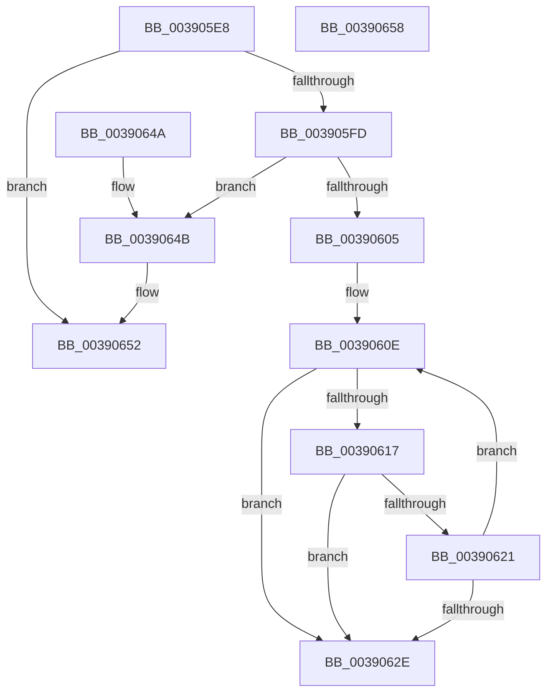

# RtlStringCbCopyNW

- RVA: `0x003905E8`–`0x00390659` (길이 `113` bytes)
- VA: `0x00000001403905E8`
- 실행 섹션: `.text`
- PDB 이름 있음: `예`; PDB Function 태그: `아니요`
- unwind 정보 RVA: `0x000DB714`
- 디코드: `37`개 명령, `113/113` bytes 표시
- 미해석 바이트: `0` (있으면 어셈블리에 `.byte`로 보존)

> 이 문서는 커널 이미지의 기계어와 PDB 기호를 분석해 생성했습니다. 4번과 5번은 함수 원형과 자료형을 바이너리 사용 방식에서 추정한 C 해석이며 원본 소스 복구 결과는 아닙니다.

## 1. Dependencies

- 직접 호출 지점: **0**; 고유 호출 대상: **0**
- 직접 호출자로 확인된 함수: **12**
- RIP 상대 이미지 참조: **0**

### Outgoing calls
- 직접 디코드된 call 명령이 없습니다.

### Direct callers
- [PopDiagTraceIrpFinish](../26/PopDiagTraceIrpFinish_function_0026F2A8.md) at `0x0026F447`
- [PopDiagTraceDeviceAcquireIrp](PopDiagTraceDeviceAcquireIrp_function_00390498.md) at `0x003905CB`
- [PopDiagTraceDIrpAfterSx](../47/PopDiagTraceDIrpAfterSx_function_00470D88.md) at `0x00470E26`
- [PopDiagGetDriverName](../47/PopDiagGetDriverName_function_0047FDB4.md) at `0x0047FDEC`
- [HalpMcEnumerateAndSetPatchConfig](../55/HalpMcEnumerateAndSetPatchConfig_function_0055AB38.md) at `0x0055AD1C`
- [IopCheckIfNotNativeDriver](../../page/71/IopCheckIfNotNativeDriver_function_0071AFB4.md) at `0x0071B022`
- [AslPathWildcardFindFirst](../../page/81/AslPathWildcardFindFirst_function_0081B534.md) at `0x0081B687`
- [AslPathWildcardFindNext](../../page/81/AslPathWildcardFindNext_function_0081BB2C.md) at `0x0081C184`
- [LocalConvertSidToStringSidW](../../page/A0/LocalConvertSidToStringSidW_function_00A0191C.md) at `0x00A0197F`
- [AuthzBasepCopyoutClaimAttributes](../../page/A1/AuthzBasepCopyoutClaimAttributes_function_00A18570.md) at `0x00A18669`
- [AuthzBasepCopyoutClaimAttributeValues](../../page/A1/AuthzBasepCopyoutClaimAttributeValues_function_00A186F8.md) at `0x00A18847`
- [AuthzBasepCopyoutClaimAttributeValues](../../page/A1/AuthzBasepCopyoutClaimAttributeValues_function_00A186F8.md) at `0x00A188A7`
- [PiUEventGetProcessImagePath](../../page/AB/PiUEventGetProcessImagePath_function_00AB76F0.md) at `0x00AB776A`

### Static image references
- 디코드된 RIP-relative 메모리 참조가 없습니다.

## 2. Other-region calls and transfers

- 다른 실행 섹션으로 향하는 call: **0**
- 별도 외부 분기/꼬리 이동을 확인하지 못했습니다.

## 3. Assembly (complete function range)

```asm
003905E8  48 D1 EA                        shr rdx, 1
003905EB  4D 8B D0                        mov r10, r8
003905EE  41 B8 FE FF FF 7F               mov r8d, 0x7ffffffe
003905F4  48 8D 42 FF                     lea rax, [rdx - 1]
003905F8  49 3B C0                        cmp rax, r8
003905FB  77 55                           ja 0x140390652
003905FD  49 D1 E9                        shr r9, 1
00390600  4D 3B C8                        cmp r9, r8
00390603  77 46                           ja 0x14039064b
00390605  4C 2B CA                        sub r9, rdx
00390608  4C 2B D1                        sub r10, rcx
0039060B  45 33 C0                        xor r8d, r8d
0039060E  49 8D 04 11                     lea rax, [r9 + rdx]
00390612  48 85 C0                        test rax, rax
00390615  74 17                           je 0x14039062e
00390617  41 0F B7 04 0A                  movzx eax, word ptr [r10 + rcx]
0039061C  66 85 C0                        test ax, ax
0039061F  74 0D                           je 0x14039062e
00390621  66 89 01                        mov word ptr [rcx], ax
00390624  48 83 C1 02                     add rcx, 2
00390628  48 83 EA 01                     sub rdx, 1
0039062C  75 E0                           jne 0x14039060e
0039062E  48 85 D2                        test rdx, rdx
00390631  48 8D 41 FE                     lea rax, [rcx - 2]
00390635  48 0F 45 C1                     cmovne rax, rcx
00390639  48 F7 DA                        neg rdx
0039063C  66 44 89 00                     mov word ptr [rax], r8w
00390640  1B C0                           sbb eax, eax
00390642  F7 D0                           not eax
00390644  25 05 00 00 80                  and eax, 0x80000005
00390649  C3                              ret
0039064A  CC                              int3
0039064B  45 33 C0                        xor r8d, r8d
0039064E  66 44 89 01                     mov word ptr [rcx], r8w
00390652  B8 0D 00 00 C0                  mov eax, 0xc000000d
00390657  C3                              ret
00390658  CC                              int3
```

## 4. C-style interpretation (structured pseudocode)

```c
__int64 __fastcall RtlStringCbCopyNW(__int64 a1, __int64 a2, __int64 a3, __int64 a4)
{
    __int64 result;
    __int64 v_r10;

    a2 = (a2) >> (1);
    if ((a2 - 1) > ((unsigned int)(0x7FFFFFFEULL))) goto loc_00390652;
    a4 = (a4) >> (1);
    if (a4 > ((unsigned int)(0x7FFFFFFEULL))) goto loc_0039064B;
    a4 = (a4) - (a2);
    v_r10 = (a3) - (a1);
    a3 = 0;
loc_0039060E:
    if (a4 + a2 * 1 == 0) goto loc_0039062E;
    if ((unsigned __int16)(*(unsigned __int16 *)(v_r10 + a1 * 1)) == 0) goto loc_0039062E;
    *(unsigned __int16 *)(a1) = (unsigned __int16)(*(unsigned __int16 *)(v_r10 + a1 * 1));
    a1 = (a1) + (2);
    a2 = (a2) - (1);
    if (condition_is_not_equal) goto loc_0039060E;
loc_0039062E:
    result = a1 - 2;
    if (a2 != 0) { result = a1; }
    a2 = -(a2);
    *(unsigned __int16 *)(result) = 0;
    result = (unsigned int)(~(result));
    result = (unsigned int)((result) & (0x80000005ULL));
    return result;
loc_0039064B:
    a3 = 0;
    *(unsigned __int16 *)(a1) = 0;
loc_00390652:
    return (unsigned int)(0xC000000DULL);
}
```

## 5. (Beta) C Style

```c
int64_t RtlStringCbCopyNW(void *Arg1, int64_t Arg2, void *Arg3, int64_t Arg4)
{
    uint8_t *arg1 = (uint8_t *)Arg1;
    uint8_t *arg3 = (uint8_t *)Arg3;

    int64_t result;
    int64_t local_r10;

    Arg2 = (Arg2) >> (1);
    if ((Arg2 - 1) > ((uint32_t)(0x7FFFFFFEULL))) goto loc_00390652;
    Arg4 = (Arg4) >> (1);
    if (Arg4 > ((uint32_t)(0x7FFFFFFEULL))) goto loc_0039064B;
    Arg4 = (Arg4) - (Arg2);
    local_r10 = (Arg3) - (Arg1);
    Arg3 = 0;
loc_0039060E:
    if (Arg4 + Arg2 * 1 == 0) goto loc_0039062E;
    if ((uint16_t)(*(uint16_t *)(local_r10 + arg1 * 1)) == 0) goto loc_0039062E;
    *(uint16_t *)(arg1) = (uint16_t)(*(uint16_t *)(local_r10 + arg1 * 1));
    Arg1 = (Arg1) + (2);
    Arg2 = (Arg2) - (1);
    if (condition_is_not_equal) goto loc_0039060E;
loc_0039062E:
    result = Arg1 - 2;
    if (Arg2 != 0) { result = Arg1; }
    Arg2 = -(Arg2);
    *(uint16_t *)(result) = 0;
    result = (uint32_t)(~(result));
    result = (uint32_t)((result) & (0x80000005ULL));
    return result;
loc_0039064B:
    Arg3 = 0;
    *(uint16_t *)(arg1) = 0;
loc_00390652:
    return (uint32_t)(0xC000000DULL);
}
```

### 관측된 메모리 오프셋

구조체 형식이 확인되지 않은 접근은 인자 기준의 오프셋으로만 기록했습니다.

| 기준 인자 | 오프셋 표현 | 폭 (bit) | 접근 |
|---|---:|---:|---|
| `Arg1` | `- 0x2` | `64` | `R` |
| `Arg1` | `+ 0x0` | `16` | `W` |
| `Arg3` | `+ 0x0 + rcx*1` | `16` | `R` |

## 6. Execution-region graph

[열기: 2D/3D 그래프와 함수 탐색 컨트롤 패널](../../../control-panel.html?section=text&rva=0x003905E8&view=graph)

- 2D 그래프는 위에서 아래로 흐르고, 3D 그래프는 빈 공간을 드래그해 회전합니다. Shift+드래그는 이동, 휠은 확대·축소, 함수 노드 선택은 대상 보고서 이동입니다.

### Static fallback


