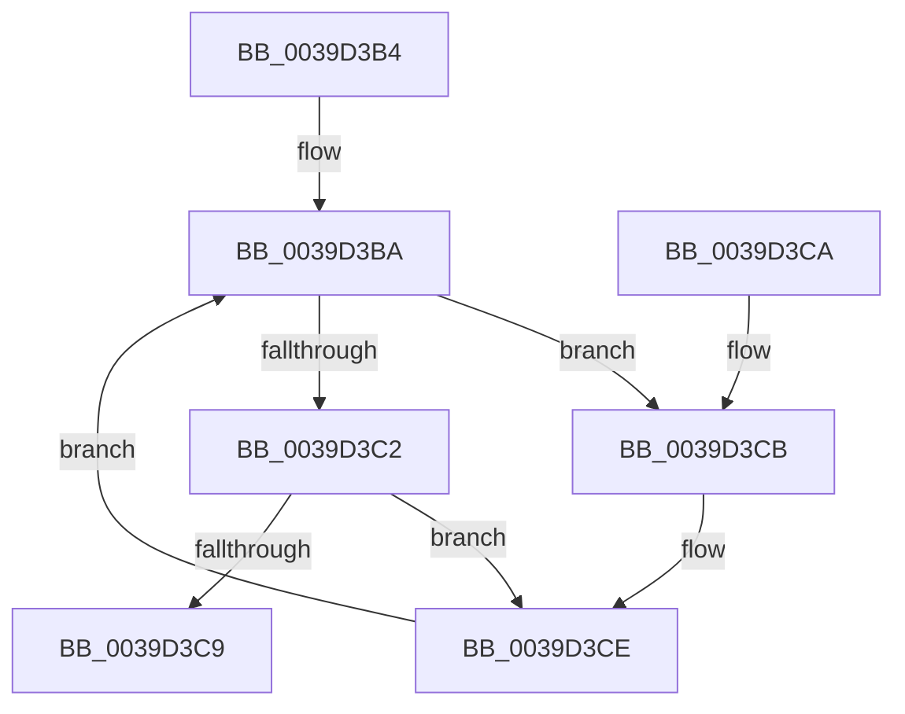

# RtlWriteAcquireTickLock

- RVA: `0x0039D3B4`–`0x0039D3D2` (길이 `30` bytes)
- VA: `0x000000014039D3B4`
- 실행 섹션: `.text`
- PDB 이름 있음: `예`; PDB Function 태그: `아니요`
- unwind 정보 RVA: `0x000DB714`
- 디코드: `12`개 명령, `30/30` bytes 표시
- 미해석 바이트: `0` (있으면 어셈블리에 `.byte`로 보존)

> 이 문서는 커널 이미지의 기계어와 PDB 기호를 분석해 생성했습니다. 4번과 5번은 함수 원형과 자료형을 바이너리 사용 방식에서 추정한 C 해석이며 원본 소스 복구 결과는 아닙니다.

## 1. Dependencies

- 직접 호출 지점: **0**; 고유 호출 대상: **0**
- 직접 호출자로 확인된 함수: **9**
- RIP 상대 이미지 참조: **0**

### Outgoing calls
- 직접 디코드된 call 명령이 없습니다.

### Direct callers
- [KiUpdateTime](KiUpdateTime_function_0039B530.md) at `0x0039B631`
- [KiUpdateTimeAssist](KiUpdateTimeAssist_function_0039E230.md) at `0x0039E2E7`
- [KiUpdateProcessAvailableCpuState](../3C/KiUpdateProcessAvailableCpuState_function_003C00B4.md) at `0x003C00F1`
- [KiUpdateSystemTime](../4B/KiUpdateSystemTime_function_004B1570.md) at `0x004B15A7`
- [KiUpdateSystemAvailableCpuState](../5B/KiUpdateSystemAvailableCpuState_function_005B9B04.md) at `0x005B9B2E`
- [KeSetTagCpuSets](../5C/KeSetTagCpuSets_function_005C11BC.md) at `0x005C121B`
- [KiAddCpuToSystemCpuPartition](../../pagelk/B6/KiAddCpuToSystemCpuPartition_function_00B680F0.md) at `0x00B68165`
- [KiCreateCpuSetForProcessor](../../pagelk/B6/KiCreateCpuSetForProcessor_function_00B681A0.md) at `0x00B681F8`
- [sub_00B80868](../../pagelk/B8/Unknown_function_00B80868.md) at `0x00B80980`

### Static image references
- 디코드된 RIP-relative 메모리 참조가 없습니다.

## 2. Other-region calls and transfers

- 다른 실행 섹션으로 향하는 call: **0**
- 별도 외부 분기/꼬리 이동을 확인하지 못했습니다.

## 3. Assembly (complete function range)

```asm
0039D3B4  0F 0D 09                        prefetchw byte ptr [rcx]
0039D3B7  48 8B 01                        mov rax, qword ptr [rcx]
0039D3BA  48 8D 50 01                     lea rdx, [rax + 1]
0039D3BE  A8 01                           test al, 1
0039D3C0  75 09                           jne 0x14039d3cb
0039D3C2  F0 48 0F B1 11                  lock cmpxchg qword ptr [rcx], rdx
0039D3C7  75 05                           jne 0x14039d3ce
0039D3C9  C3                              ret
0039D3CA  CC                              int3
0039D3CB  48 8B 01                        mov rax, qword ptr [rcx]
0039D3CE  F3 90                           pause
0039D3D0  EB E8                           jmp 0x14039d3ba
```

## 4. C-style interpretation (structured pseudocode)

```c
__int64 __fastcall RtlWriteAcquireTickLock(__int64 a1)
{
loc_0039D3BA:
    if ((((unsigned __int8)(*(unsigned __int64 *)(a1))) & (1)) != 0) goto loc_0039D3CB;
    if ((((unsigned __int8)(*(unsigned __int64 *)(a1))) & (1)) != 0) goto loc_0039D3CE;
    return *(unsigned __int64 *)(a1);
loc_0039D3CB:
loc_0039D3CE:
    goto loc_0039D3BA;
}
```

## 5. (Beta) C Style

```c
int64_t RtlWriteAcquireTickLock(void *Arg1)
{
    uint8_t *arg1 = (uint8_t *)Arg1;

loc_0039D3BA:
    if ((((uint8_t)(*(uint64_t *)(arg1))) & (1)) != 0) goto loc_0039D3CB;
    if ((((uint8_t)(*(uint64_t *)(arg1))) & (1)) != 0) goto loc_0039D3CE;
    return *(uint64_t *)(arg1);
loc_0039D3CB:
loc_0039D3CE:
    goto loc_0039D3BA;
}
```

### 관측된 메모리 오프셋

구조체 형식이 확인되지 않은 접근은 인자 기준의 오프셋으로만 기록했습니다.

| 기준 인자 | 오프셋 표현 | 폭 (bit) | 접근 |
|---|---:|---:|---|
| `Arg1` | `+ 0x0` | `8` | `R` |
| `Arg1` | `+ 0x0` | `64` | `R` |

## 6. Execution-region graph

[열기: 2D/3D 그래프와 함수 탐색 컨트롤 패널](../../../control-panel.html?section=text&rva=0x0039D3B4&view=graph)

- 2D 그래프는 위에서 아래로 흐르고, 3D 그래프는 빈 공간을 드래그해 회전합니다. Shift+드래그는 이동, 휠은 확대·축소, 함수 노드 선택은 대상 보고서 이동입니다.

### Static fallback


