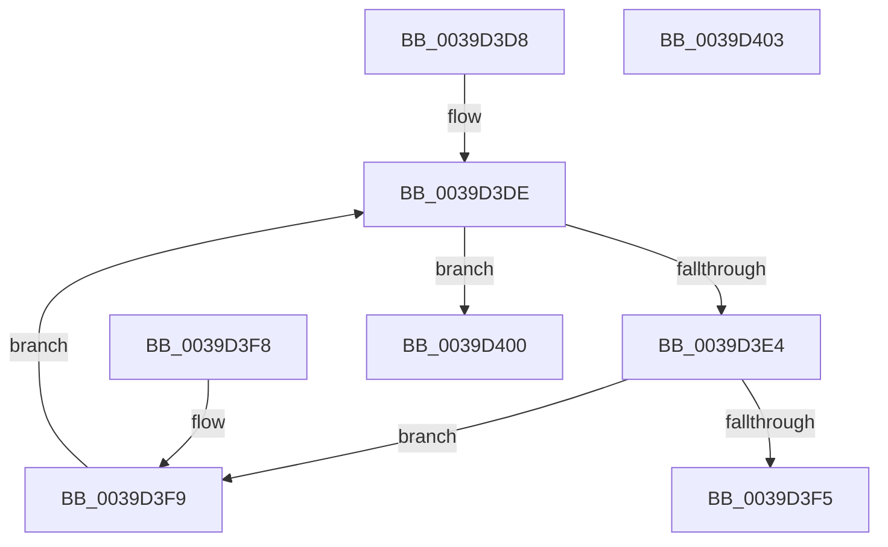

# RtlWriteTryAcquireTickLock

- RVA: `0x0039D3D8`–`0x0039D404` (길이 `44` bytes)
- VA: `0x000000014039D3D8`
- 실행 섹션: `.text`
- PDB 이름 있음: `예`; PDB Function 태그: `아니요`
- unwind 정보 RVA: `0x000DB714`
- 디코드: `18`개 명령, `44/44` bytes 표시
- 미해석 바이트: `0` (있으면 어셈블리에 `.byte`로 보존)

> 이 문서는 커널 이미지의 기계어와 PDB 기호를 분석해 생성했습니다. 4번과 5번은 함수 원형과 자료형을 바이너리 사용 방식에서 추정한 C 해석이며 원본 소스 복구 결과는 아닙니다.

## 1. Dependencies

- 직접 호출 지점: **0**; 고유 호출 대상: **0**
- 직접 호출자로 확인된 함수: **4**
- RIP 상대 이미지 참조: **0**

### Outgoing calls
- 직접 디코드된 call 명령이 없습니다.

### Direct callers
- [KiUpdateTime](KiUpdateTime_function_0039B530.md) at `0x0039B612`
- [KiUpdateTimeAssist](KiUpdateTimeAssist_function_0039E230.md) at `0x0039E2C6`
- [KeFreezeExecution](../4D/KeFreezeExecution_function_004DFA40.md) at `0x004DFD0A`
- [KiSchedulerDpc](../69/KiSchedulerDpc_function_0069BEC0.md) at `0x0069BF59`

### Static image references
- 디코드된 RIP-relative 메모리 참조가 없습니다.

## 2. Other-region calls and transfers

- 다른 실행 섹션으로 향하는 call: **0**
- 별도 외부 분기/꼬리 이동을 확인하지 못했습니다.

## 3. Assembly (complete function range)

```asm
0039D3D8  0F 0D 09                        prefetchw byte ptr [rcx]
0039D3DB  4C 8B 01                        mov r8, qword ptr [rcx]
0039D3DE  41 F6 C0 01                     test r8b, 1
0039D3E2  75 1C                           jne 0x14039d400
0039D3E4  49 8D 50 01                     lea rdx, [r8 + 1]
0039D3E8  49 8B C0                        mov rax, r8
0039D3EB  F0 48 0F B1 11                  lock cmpxchg qword ptr [rcx], rdx
0039D3F0  4C 3B C0                        cmp r8, rax
0039D3F3  75 04                           jne 0x14039d3f9
0039D3F5  B0 01                           mov al, 1
0039D3F7  C3                              ret
0039D3F8  CC                              int3
0039D3F9  4C 8B C0                        mov r8, rax
0039D3FC  F3 90                           pause
0039D3FE  EB DE                           jmp 0x14039d3de
0039D400  32 C0                           xor al, al
0039D402  C3                              ret
0039D403  CC                              int3
```

## 4. C-style interpretation (structured pseudocode)

```c
__int64 __fastcall RtlWriteTryAcquireTickLock(__int64 a1)
{
    __int64 result;

loc_0039D3DE:
    if ((((unsigned __int8)(*(unsigned __int64 *)(a1))) & (1)) != 0) goto loc_0039D400;
    if ((*(unsigned __int64 *)(a1)) != (*(unsigned __int64 *)(a1))) goto loc_0039D3F9;
    return 1;
loc_0039D3F9:
    goto loc_0039D3DE;
loc_0039D400:
    result = 0;
    return result;
}
```

## 5. (Beta) C Style

```c
int64_t RtlWriteTryAcquireTickLock(void *Arg1)
{
    uint8_t *arg1 = (uint8_t *)Arg1;

    int64_t result;

loc_0039D3DE:
    if ((((uint8_t)(*(uint64_t *)(arg1))) & (1)) != 0) goto loc_0039D400;
    if ((*(uint64_t *)(arg1)) != (*(uint64_t *)(arg1))) goto loc_0039D3F9;
    return 1;
loc_0039D3F9:
    goto loc_0039D3DE;
loc_0039D400:
    result = 0;
    return result;
}
```

### 관측된 메모리 오프셋

구조체 형식이 확인되지 않은 접근은 인자 기준의 오프셋으로만 기록했습니다.

| 기준 인자 | 오프셋 표현 | 폭 (bit) | 접근 |
|---|---:|---:|---|
| `Arg1` | `+ 0x0` | `8` | `R` |
| `Arg1` | `+ 0x0` | `64` | `R` |

## 6. Execution-region graph

[열기: 2D/3D 그래프와 함수 탐색 컨트롤 패널](../../../control-panel.html?section=text&rva=0x0039D3D8&view=graph)

- 2D 그래프는 위에서 아래로 흐르고, 3D 그래프는 빈 공간을 드래그해 회전합니다. Shift+드래그는 이동, 휠은 확대·축소, 함수 노드 선택은 대상 보고서 이동입니다.

### Static fallback


