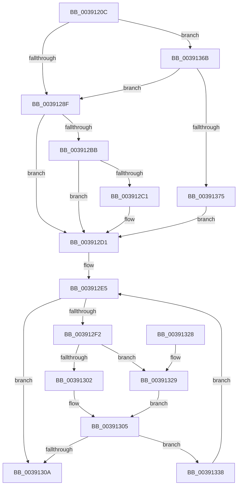

# SMKM_STORE_MGR&lt;SM_TRAITS&gt;::SmAsyncReadQueueInsert

- RVA: `0x0039120C`–`0x0039138E` (길이 `386` bytes)
- VA: `0x000000014039120C`
- 실행 섹션: `.text`
- PDB 이름 있음: `예`; PDB Function 태그: `아니요`
- unwind 정보 RVA: `0x00080A48`
- 디코드: `107`개 명령, `386/386` bytes 표시
- 미해석 바이트: `0` (있으면 어셈블리에 `.byte`로 보존)

> 이 문서는 커널 이미지의 기계어와 PDB 기호를 분석해 생성했습니다. 4번과 5번은 함수 원형과 자료형을 바이너리 사용 방식에서 추정한 C 해석이며 원본 소스 복구 결과는 아닙니다.

## 1. Dependencies

- 직접 호출 지점: **4**; 고유 호출 대상: **4**
- 직접 호출자로 확인된 함수: **1**
- RIP 상대 이미지 참조: **1**

### Outgoing calls
- `0x0039127D` → [KeAcquireSpinLockRaiseToDpc](../20/KeAcquireSpinLockRaiseToDpc_function_00208470.md) (function, `0x00208470`)
- `0x003912AF` → [KeQueryActiveProcessorCountEx](../24/KeQueryActiveProcessorCountEx_function_00249EF0.md) (function, `0x00249EF0`)
- `0x003912E0` → [KeReleaseSpinLock](KeReleaseSpinLock_function_00392BA0.md) (function, `0x00392BA0`)
- `0x00391361` → [ExQueueWorkItemToPrivatePool](../47/ExQueueWorkItemToPrivatePool_function_0047D3B4.md) (function, `0x0047D3B4`)

### Direct callers
- [sub_003176F1](../31/Unknown_function_003176F1.md) at `0x0031787E`

### Static image references
- `0x0039133C` → RVA `0x004382D0` (`SMKM_STORE_MGR<SM_TRAITS>::SmAsyncReadQueueWorker`; read)

## 2. Other-region calls and transfers

- 다른 실행 섹션으로 향하는 call: **0**
- 별도 외부 분기/꼬리 이동을 확인하지 못했습니다.

## 3. Assembly (complete function range)

```asm
0039120C  48 8B C4                        mov rax, rsp
0039120F  48 89 58 08                     mov qword ptr [rax + 8], rbx
00391213  48 89 70 10                     mov qword ptr [rax + 0x10], rsi
00391217  48 89 78 18                     mov qword ptr [rax + 0x18], rdi
0039121B  4C 89 60 20                     mov qword ptr [rax + 0x20], r12
0039121F  55                              push rbp
00391220  41 56                           push r14
00391222  41 57                           push r15
00391224  48 8B EC                        mov rbp, rsp
00391227  48 83 EC 40                     sub rsp, 0x40
0039122B  48 83 65 F0 00                  and qword ptr [rbp - 0x10], 0
00391230  48 8D 45 F0                     lea rax, [rbp - 0x10]
00391234  45 8B F1                        mov r14d, r9d
00391237  4C 8D BA 00 03 00 00            lea r15, [rdx + 0x300]
0039123E  48 8B F1                        mov rsi, rcx
00391241  48 89 45 F8                     mov qword ptr [rbp - 8], rax
00391245  41 8B 40 20                     mov eax, dword ptr [r8 + 0x20]
00391249  41 8B CE                        mov ecx, r14d
0039124C  C1 E9 03                        shr ecx, 3
0039124F  44 8B C8                        mov r9d, eax
00391252  45 33 CE                        xor r9d, r14d
00391255  4F 8D 14 76                     lea r10, [r14 + r14*2]
00391259  41 83 E1 07                     and r9d, 7
0039125D  4A 8D 3C D2                     lea rdi, [rdx + r10*8]
00391261  44 33 C8                        xor r9d, eax
00391264  49 8B D8                        mov rbx, r8
00391267  41 8B 40 28                     mov eax, dword ptr [r8 + 0x28]
0039126B  33 C8                           xor ecx, eax
0039126D  83 E1 03                        and ecx, 3
00391270  45 89 48 20                     mov dword ptr [r8 + 0x20], r9d
00391274  33 C8                           xor ecx, eax
00391276  41 89 48 28                     mov dword ptr [r8 + 0x28], ecx
0039127A  49 8B CF                        mov rcx, r15
0039127D  E8 EE 71 E7 FF                  call 0x140208470
00391282  83 7F 10 00                     cmp dword ptr [rdi + 0x10], 0
00391286  44 8A E0                        mov r12b, al
00391289  0F 84 DC 00 00 00               je 0x14039136b
0039128F  48 8B 47 08                     mov rax, qword ptr [rdi + 8]
00391293  48 8B 08                        mov rcx, qword ptr [rax]
00391296  48 FF C1                        inc rcx
00391299  48 89 0B                        mov qword ptr [rbx], rcx
0039129C  B9 FF FF 00 00                  mov ecx, 0xffff
003912A1  48 8B 47 08                     mov rax, qword ptr [rdi + 8]
003912A5  48 89 18                        mov qword ptr [rax], rbx
003912A8  48 89 5F 08                     mov qword ptr [rdi + 8], rbx
003912AC  48 8B 1B                        mov rbx, qword ptr [rbx]
003912AF  E8 3C 8C EB FF                  call 0x140249ef0
003912B4  8B C0                           mov eax, eax
003912B6  48 3B D8                        cmp rbx, rax
003912B9  72 16                           jb 0x1403912d1
003912BB  48 39 7F 08                     cmp qword ptr [rdi + 8], rdi
003912BF  74 10                           je 0x1403912d1
003912C1  0F 10 07                        movups xmm0, xmmword ptr [rdi]
003912C4  48 89 7F 08                     mov qword ptr [rdi + 8], rdi
003912C8  F3 0F 7F 45 F0                  movdqu xmmword ptr [rbp - 0x10], xmm0
003912CD  48 83 27 00                     and qword ptr [rdi], 0
003912D1  48 8B 45 F8                     mov rax, qword ptr [rbp - 8]
003912D5  49 8B CF                        mov rcx, r15
003912D8  8B 10                           mov edx, dword ptr [rax]
003912DA  01 57 10                        add dword ptr [rdi + 0x10], edx
003912DD  41 8A D4                        mov dl, r12b
003912E0  E8 BB 18 00 00                  call 0x140392ba0
003912E5  48 8B 55 F8                     mov rdx, qword ptr [rbp - 8]
003912E9  48 8D 45 F0                     lea rax, [rbp - 0x10]
003912ED  48 3B D0                        cmp rdx, rax
003912F0  74 18                           je 0x14039130a
003912F2  48 8B 4D F0                     mov rcx, qword ptr [rbp - 0x10]
003912F6  48 8B 01                        mov rax, qword ptr [rcx]
003912F9  48 89 45 F0                     mov qword ptr [rbp - 0x10], rax
003912FD  48 3B CA                        cmp rcx, rdx
00391300  74 27                           je 0x140391329
00391302  48 FF 0A                        dec qword ptr [rdx]
00391305  48 85 C9                        test rcx, rcx
00391308  75 2E                           jne 0x140391338
0039130A  48 8B 5C 24 60                  mov rbx, qword ptr [rsp + 0x60]
0039130F  48 8B 74 24 68                  mov rsi, qword ptr [rsp + 0x68]
00391314  48 8B 7C 24 70                  mov rdi, qword ptr [rsp + 0x70]
00391319  4C 8B 64 24 78                  mov r12, qword ptr [rsp + 0x78]
0039131E  48 83 C4 40                     add rsp, 0x40
00391322  41 5F                           pop r15
00391324  41 5E                           pop r14
00391326  5D                              pop rbp
00391327  C3                              ret
00391328  CC                              int3
00391329  48 83 65 F0 00                  and qword ptr [rbp - 0x10], 0
0039132E  48 8D 45 F0                     lea rax, [rbp - 0x10]
00391332  48 89 45 F8                     mov qword ptr [rbp - 8], rax
00391336  EB CD                           jmp 0x140391305
00391338  48 83 21 00                     and qword ptr [rcx], 0
0039133C  48 8D 05 8D 6F 0A 00            lea rax, [rip + 0xa6f8d]
00391343  48 89 41 10                     mov qword ptr [rcx + 0x10], rax
00391347  41 8B D6                        mov edx, r14d
0039134A  48 89 49 18                     mov qword ptr [rcx + 0x18], rcx
0039134E  48 8B 86 30 08 00 00            mov rax, qword ptr [rsi + 0x830]
00391355  4C 8B 8E A0 08 00 00            mov r9, qword ptr [rsi + 0x8a0]
0039135C  48 89 44 24 20                  mov qword ptr [rsp + 0x20], rax
00391361  E8 4E C0 0E 00                  call 0x14047d3b4
00391366  E9 7A FF FF FF                  jmp 0x1403912e5
0039136B  83 7F 14 00                     cmp dword ptr [rdi + 0x14], 0
0039136F  0F 85 1A FF FF FF               jne 0x14039128f
00391375  48 8B 55 F8                     mov rdx, qword ptr [rbp - 8]
00391379  48 8B 0A                        mov rcx, qword ptr [rdx]
0039137C  48 FF C1                        inc rcx
0039137F  48 89 0B                        mov qword ptr [rbx], rcx
00391382  48 89 1A                        mov qword ptr [rdx], rbx
00391385  48 89 5D F8                     mov qword ptr [rbp - 8], rbx
00391389  E9 43 FF FF FF                  jmp 0x1403912d1
```

## 4. C-style interpretation (structured pseudocode)

```c
__int64 __fastcall SMKM_STORE_MGR_SM_TRAITS___SmAsyncReadQueueInsert(__int64 a1, __int64 a2, __int64 a3, int a4)
{
    __int64 result;
    __int64 v_rsp;
    unsigned __int64 v_stack_m20;
    unsigned __int64 v_stack_m28;
    unsigned __int64 v_stack_p10;
    unsigned __int64 v_stack_p18;
    unsigned __int64 v_stack_p20;
    unsigned __int64 v_stack_p8;

    *(unsigned __int64 *)(v_rsp + 8) = v_rbx;
    *(unsigned __int64 *)(v_rsp + 16) = v_rsi;
    *(unsigned __int64 *)(v_rsp + 24) = v_rdi;
    *(unsigned __int64 *)(v_rsp + 32) = v_r12;
    v_rsp = (v_rsp) - (64);
    v_stack_m20 = v_stack_m28;
    a1 = (unsigned int)(((unsigned int)((unsigned int)((unsigned int)(a4)))) >> (3));
    a4 = (unsigned int)(((unsigned int)((unsigned int)((unsigned int)(*(unsigned int *)(a3 + 32))))) ^ ((unsigned int)((unsigned int)(a4))));
    a4 = (unsigned int)((a4) & (7));
    a4 = (unsigned int)((a4) ^ ((unsigned int)((unsigned int)(*(unsigned int *)(a3 + 32)))));
    a1 = (unsigned int)((a1) ^ ((unsigned int)((unsigned int)(*(unsigned int *)(a3 + 40)))));
    a1 = (unsigned int)((a1) & (3));
    *(unsigned int *)(a3 + 32) = a4;
    a1 = (unsigned int)((a1) ^ ((unsigned int)((unsigned int)(*(unsigned int *)(a3 + 40)))));
    *(unsigned int *)(a3 + 40) = (unsigned int)(a1);
    result = KeAcquireSpinLockRaiseToDpc(a2 + 768, a2, a3, a4);
    if ((*(unsigned int *)(a2 + (unsigned int)(a4) + (unsigned int)(a4) * 2 * 8 + 16)) == 0) goto loc_0039136B;
loc_0039128F:
    a1 = (*(unsigned __int64 *)(*(unsigned __int64 *)(a2 + (unsigned int)(a4) + (unsigned int)(a4) * 2 * 8 + 8))) + 1;
    *(unsigned __int64 *)(a3) = a1;
    *(unsigned __int64 *)(*(unsigned __int64 *)(a2 + (unsigned int)(a4) + (unsigned int)(a4) * 2 * 8 + 8)) = a3;
    *(unsigned __int64 *)(a2 + (unsigned int)(a4) + (unsigned int)(a4) * 2 * 8 + 8) = a3;
    result = KeQueryActiveProcessorCountEx((unsigned int)(0xFFFFULL), a2, a3, a4);
    if ((*(unsigned __int64 *)(a3)) < ((unsigned int)((unsigned int)(result)))) goto loc_003912D1;
    if ((*(unsigned __int64 *)(a2 + (unsigned int)(a4) + (unsigned int)(a4) * 2 * 8 + 8)) != (a2 + (unsigned int)(a4) + (unsigned int)(a4) * 2 * 8)) {
        *(unsigned __int64 *)(a2 + (unsigned int)(a4) + (unsigned int)(a4) * 2 * 8 + 8) = a2 + (unsigned int)(a4) + (unsigned int)(a4) * 2 * 8;
        v_stack_m28 = v_xmm0;
    }
    result = KeReleaseSpinLock(a2 + 768, (unsigned __int8)((unsigned __int8)(result)), a3, a4);
loc_003912E5:
    if (v_stack_m20 == v_stack_m28) goto loc_0039130A;
    v_stack_m28 = *(unsigned __int64 *)(v_stack_m28);
    if (v_stack_m28 == v_stack_m20) goto loc_00391329;
loc_00391305:
    if (v_stack_m28 != 0) goto loc_00391338;
loc_0039130A:
    v_rsp = (v_rsp) + (64);
    return *(unsigned __int64 *)(v_stack_m28);
loc_00391329:
    v_stack_m20 = v_stack_m28;
    goto loc_00391305;
loc_00391338:
    *(unsigned __int64 *)(v_stack_m28 + 16) = v_rip + 683917;
    *(unsigned __int64 *)(v_stack_m28 + 24) = v_stack_m28;
    v_stack_p20 = *(unsigned __int64 *)(v_stack_p10 + 2096);
    result = ExQueueWorkItemToPrivatePool(v_stack_m28, (unsigned int)((unsigned int)((unsigned int)(a4))), a3, *(unsigned __int64 *)(v_stack_p10 + 2208));
    goto loc_003912E5;
loc_0039136B:
    if ((*(unsigned int *)(v_stack_p18 + 20)) != 0) goto loc_0039128F;
    a1 = (*(unsigned __int64 *)(v_stack_m20)) + 1;
    *(unsigned __int64 *)(v_stack_p8) = a1;
    *(unsigned __int64 *)(v_stack_m20) = v_stack_p8;
    v_stack_m20 = v_stack_p8;
    goto loc_003912D1;
}
```

## 5. (Beta) C Style

```c
int64_t SMKM_STORE_MGR_SM_TRAITS___SmAsyncReadQueueInsert(void *Arg1, void *Arg2, void *Arg3, void *Arg4)
{
    uint8_t *arg1 = (uint8_t *)Arg1;
    uint8_t *arg2 = (uint8_t *)Arg2;
    uint8_t *arg3 = (uint8_t *)Arg3;
    uint8_t *arg4 = (uint8_t *)Arg4;

    int64_t result;
    int64_t local_rsp;
    uint64_t v_stack_m20;
    uint64_t v_stack_m28;
    uint64_t v_stack_p10;
    uint64_t v_stack_p18;
    uint64_t v_stack_p20;
    uint64_t v_stack_p8;

    *(uint64_t *)(local_rsp + 0x8) = local_rbx;
    *(uint64_t *)(local_rsp + 0x10) = local_rsi;
    *(uint64_t *)(local_rsp + 0x18) = local_rdi;
    *(uint64_t *)(local_rsp + 0x20) = local_r12;
    local_rsp = (local_rsp) - (64);
    v_stack_m20 = v_stack_m28;
    Arg1 = (uint32_t)(((uint32_t)((uint32_t)((uint32_t)(Arg4)))) >> (3));
    Arg4 = (uint32_t)(((uint32_t)((uint32_t)((uint32_t)(*(uint32_t *)(arg3 + 0x20))))) ^ ((uint32_t)((uint32_t)(Arg4))));
    Arg4 = (uint32_t)((Arg4) & (7));
    Arg4 = (uint32_t)((Arg4) ^ ((uint32_t)((uint32_t)(*(uint32_t *)(arg3 + 0x20)))));
    Arg1 = (uint32_t)((Arg1) ^ ((uint32_t)((uint32_t)(*(uint32_t *)(arg3 + 0x28)))));
    Arg1 = (uint32_t)((Arg1) & (3));
    *(uint32_t *)(arg3 + 0x20) = Arg4;
    Arg1 = (uint32_t)((Arg1) ^ ((uint32_t)((uint32_t)(*(uint32_t *)(arg3 + 0x28)))));
    *(uint32_t *)(arg3 + 0x28) = (uint32_t)(Arg1);
    result = KeAcquireSpinLockRaiseToDpc(Arg2 + 768, Arg2, Arg3, Arg4);
    if ((*(uint32_t *)(arg2 + (uint32_t)(arg4) + (uint32_t)(arg4) * 2 * 8 + 0x10)) == 0) goto loc_0039136B;
loc_0039128F:
    Arg1 = (*(uint64_t *)(*(uint64_t *)(arg2 + (uint32_t)(arg4) + (uint32_t)(arg4) * 2 * 8 + 0x8))) + 1;
    *(void **)(arg3) = Arg1;
    *(void **)(*(uint64_t *)(arg2 + (uint32_t)(arg4) + (uint32_t)(arg4) * 2 * 8 + 0x8)) = Arg3;
    *(void **)(arg2 + (uint32_t)(arg4) + (uint32_t)(arg4) * 2 * 8 + 0x8) = Arg3;
    result = KeQueryActiveProcessorCountEx((uint32_t)(0xFFFFULL), Arg2, Arg3, Arg4);
    if ((*(uint64_t *)(arg3)) < ((uint32_t)((uint32_t)(result)))) goto loc_003912D1;
    if ((*(uint64_t *)(arg2 + (uint32_t)(arg4) + (uint32_t)(arg4) * 2 * 8 + 0x8)) != (Arg2 + (uint32_t)(Arg4) + (uint32_t)(Arg4) * 2 * 8)) {
        *(void **)(arg2 + (uint32_t)(arg4) + (uint32_t)(arg4) * 2 * 8 + 0x8) = Arg2 + (uint32_t)(Arg4) + (uint32_t)(Arg4) * 2 * 8;
        v_stack_m28 = v_xmm0;
    }
    result = KeReleaseSpinLock(Arg2 + 768, (uint8_t)((uint8_t)(result)), Arg3, Arg4);
loc_003912E5:
    if (v_stack_m20 == v_stack_m28) goto loc_0039130A;
    v_stack_m28 = *(uint64_t *)(v_stack_m28);
    if (v_stack_m28 == v_stack_m20) goto loc_00391329;
loc_00391305:
    if (v_stack_m28 != 0) goto loc_00391338;
loc_0039130A:
    local_rsp = (local_rsp) + (64);
    return *(uint64_t *)(v_stack_m28);
loc_00391329:
    v_stack_m20 = v_stack_m28;
    goto loc_00391305;
loc_00391338:
    *(uint64_t *)(v_stack_m28 + 0x10) = v_rip + 683917;
    *(uint64_t *)(v_stack_m28 + 0x18) = v_stack_m28;
    v_stack_p20 = *(uint64_t *)(v_stack_p10 + 0x830);
    result = ExQueueWorkItemToPrivatePool(v_stack_m28, (uint32_t)((uint32_t)((uint32_t)(Arg4))), Arg3, *(uint64_t *)(v_stack_p10 + 0x8A0));
    goto loc_003912E5;
loc_0039136B:
    if ((*(uint32_t *)(v_stack_p18 + 0x14)) != 0) goto loc_0039128F;
    Arg1 = (*(uint64_t *)(v_stack_m20)) + 1;
    *(void **)(v_stack_p8) = Arg1;
    *(uint64_t *)(v_stack_m20) = v_stack_p8;
    v_stack_m20 = v_stack_p8;
    goto loc_003912D1;
}
```

### 관측된 메모리 오프셋

구조체 형식이 확인되지 않은 접근은 인자 기준의 오프셋으로만 기록했습니다.

| 기준 인자 | 오프셋 표현 | 폭 (bit) | 접근 |
|---|---:|---:|---|
| `Arg1` | `+ 0x830` | `64` | `R` |
| `Arg1` | `+ 0x8A0` | `64` | `R` |
| `Arg2` | `+ 0x0` | `64` | `R/W` |
| `Arg2` | `+ 0x0` | `128` | `R` |
| `Arg2` | `+ 0x0 + r10*8` | `64` | `R` |
| `Arg2` | `+ 0x8` | `64` | `R` |
| `Arg2` | `+ 0x8` | `64` | `W` |
| `Arg2` | `+ 0x10` | `32` | `R` |
| `Arg2` | `+ 0x10` | `32` | `R/W` |
| `Arg2` | `+ 0x14` | `32` | `R` |
| `Arg2` | `+ 0x300` | `64` | `R` |
| `Arg3` | `+ 0x0` | `64` | `R` |
| `Arg3` | `+ 0x0` | `64` | `W` |
| `Arg3` | `+ 0x20` | `32` | `R` |
| `Arg3` | `+ 0x20` | `32` | `W` |
| `Arg3` | `+ 0x28` | `32` | `R` |
| `Arg3` | `+ 0x28` | `32` | `W` |
| `Arg4` | `+ 0x0 + r14*2` | `64` | `R` |

## 6. Execution-region graph

[열기: 2D/3D 그래프와 함수 탐색 컨트롤 패널](../../../control-panel.html?section=text&rva=0x0039120C&view=graph)

- 2D 그래프는 위에서 아래로 흐르고, 3D 그래프는 빈 공간을 드래그해 회전합니다. Shift+드래그는 이동, 휠은 확대·축소, 함수 노드 선택은 대상 보고서 이동입니다.

### Static fallback


