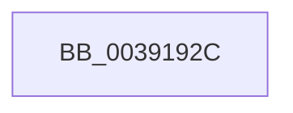

# sub_0039192C

- RVA: `0x0039192C`–`0x0039196A` (길이 `62` bytes)
- VA: `0x000000014039192C`
- 실행 섹션: `.text`
- PDB 이름 있음: `아니요`; PDB Function 태그: `아니요`
- unwind 정보 RVA: `0x00080AD4`
- 디코드: `13`개 명령, `62/62` bytes 표시
- 미해석 바이트: `0` (있으면 어셈블리에 `.byte`로 보존)

> 이 문서는 커널 이미지의 기계어와 PDB 기호를 분석해 생성했습니다. 4번과 5번은 함수 원형과 자료형을 바이너리 사용 방식에서 추정한 C 해석이며 원본 소스 복구 결과는 아닙니다.

## 1. Dependencies

- 직접 호출 지점: **1**; 고유 호출 대상: **1**
- 직접 호출자로 확인된 함수: **0**
- RIP 상대 이미지 참조: **0**

### Outgoing calls
- `0x00391940` → [KeDisableInterrupts](../21/KeDisableInterrupts_function_00217BE0.md) (function, `0x00217BE0`)

### Direct callers
- 이 함수 시작 RVA로 연결되는 직접 call은 확인되지 않았습니다. 간접 호출은 완전히 역산할 수 없습니다.

### Static image references
- 디코드된 RIP-relative 메모리 참조가 없습니다.

## 2. Other-region calls and transfers

- 다른 실행 섹션으로 향하는 call: **0**
- call이 아닌 외부 분기/꼬리 이동: **1**
  - `0x00391964` → [sub_00391A20 + 0x8](Unknown_function_00391A20.md) (`tail-transfer`)

## 3. Assembly (complete function range)

```asm
0039192C  48 89 6C 24 60                  mov qword ptr [rsp + 0x60], rbp
00391931  48 89 74 24 48                  mov qword ptr [rsp + 0x48], rsi
00391936  48 89 7C 24 40                  mov qword ptr [rsp + 0x40], rdi
0039193B  4C 89 7C 24 20                  mov qword ptr [rsp + 0x20], r15
00391940  E8 9B 62 E8 FF                  call 0x140217be0
00391945  45 0F B6 B8 04 02 00 00         movzx r15d, byte ptr [r8 + 0x204]
0039194D  48 8D BB EC 00 00 00            lea rdi, [rbx + 0xec]
00391954  8B 2F                           mov ebp, dword ptr [rdi]
00391956  41 8B F7                        mov esi, r15d
00391959  40 0F B6 CD                     movzx ecx, bpl
0039195D  88 44 24 78                     mov byte ptr [rsp + 0x78], al
00391961  44 3B F9                        cmp r15d, ecx
00391964  0F 84 BE 00 00 00               je 0x140391a28
```

## 4. C-style interpretation (structured pseudocode)

```c
__int64 __fastcall sub_0039192C(__int64 a1, __int64 a2, __int64 a3)
{
    __int64 result;
    unsigned __int64 v_stack_p20;
    unsigned __int64 v_stack_p40;
    unsigned __int64 v_stack_p48;
    unsigned __int64 v_stack_p60;
    unsigned __int8 v_stack_p78;

    v_stack_p60 = v_rbp;
    v_stack_p48 = v_rsi;
    v_stack_p40 = v_rdi;
    v_stack_p20 = v_r15;
    result = KeDisableInterrupts(a1, a2, a3, a4);
    v_stack_p78 = (unsigned __int8)(result);
}
```

## 5. (Beta) C Style

```c
int64_t sub_0039192C(int64_t Arg1, int64_t Arg2, int64_t Arg3)
{
    int64_t result;
    uint64_t v_stack_p20;
    uint64_t v_stack_p40;
    uint64_t v_stack_p48;
    uint64_t v_stack_p60;
    uint8_t v_stack_p78;

    v_stack_p60 = local_rbp;
    v_stack_p48 = local_rsi;
    v_stack_p40 = local_rdi;
    v_stack_p20 = local_r15;
    result = KeDisableInterrupts(Arg1, Arg2, Arg3, a4);
    v_stack_p78 = (uint8_t)(result);
}
```

## 6. Execution-region graph

[열기: 2D/3D 그래프와 함수 탐색 컨트롤 패널](../../../control-panel.html?section=text&rva=0x0039192C&view=graph)

- 2D 그래프는 위에서 아래로 흐르고, 3D 그래프는 빈 공간을 드래그해 회전합니다. Shift+드래그는 이동, 휠은 확대·축소, 함수 노드 선택은 대상 보고서 이동입니다.

### Static fallback


