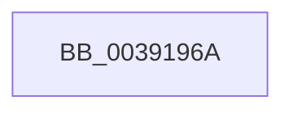

# sub_0039196A

- RVA: `0x0039196A`–`0x00391990` (길이 `38` bytes)
- VA: `0x000000014039196A`
- 실행 섹션: `.text`
- PDB 이름 있음: `아니요`; PDB Function 태그: `아니요`
- unwind 정보 RVA: `0x00080AF4`
- 디코드: `9`개 명령, `38/38` bytes 표시
- 미해석 바이트: `0` (있으면 어셈블리에 `.byte`로 보존)

> 이 문서는 커널 이미지의 기계어와 PDB 기호를 분석해 생성했습니다. 4번과 5번은 함수 원형과 자료형을 바이너리 사용 방식에서 추정한 C 해석이며 원본 소스 복구 결과는 아닙니다.

## 1. Dependencies

- 직접 호출 지점: **0**; 고유 호출 대상: **0**
- 직접 호출자로 확인된 함수: **0**
- RIP 상대 이미지 참조: **0**

### Outgoing calls
- 직접 디코드된 call 명령이 없습니다.

### Direct callers
- 이 함수 시작 RVA로 연결되는 직접 call은 확인되지 않았습니다. 간접 호출은 완전히 역산할 수 없습니다.

### Static image references
- 디코드된 RIP-relative 메모리 참조가 없습니다.

## 2. Other-region calls and transfers

- 다른 실행 섹션으로 향하는 call: **0**
- call이 아닌 외부 분기/꼬리 이동: **1**
  - `0x0039198E` → [sub_003919F6 + 0x7](Unknown_function_003919F6.md) (`tail-transfer`)

## 3. Assembly (complete function range)

```asm
0039196A  4C 89 64 24 38                  mov qword ptr [rsp + 0x38], r12
0039196F  81 E5 00 01 00 00               and ebp, 0x100
00391975  4C 89 6C 24 30                  mov qword ptr [rsp + 0x30], r13
0039197A  41 B4 01                        mov r12b, 1
0039197D  45 32 ED                        xor r13b, r13b
00391980  C6 44 24 70 00                  mov byte ptr [rsp + 0x70], 0
00391985  48 8B C7                        mov rax, rdi
00391988  3B B3 40 8A 00 00               cmp esi, dword ptr [rbx + 0x8a40]
0039198E  74 6D                           je 0x1403919fd
```

## 4. C-style interpretation (structured pseudocode)

```c
__int64 __fastcall sub_0039196A(void)
{
    __int64 v_r13;
    __int64 v_rbp;
    unsigned __int64 v_stack_p30;
    unsigned __int64 v_stack_p38;
    unsigned __int8 v_stack_p70;

    v_stack_p38 = v_r12;
    v_rbp = (unsigned int)((v_rbp) & (256));
    v_stack_p30 = v_r13;
    v_r13 = 0;
    v_stack_p70 = 0;
}
```

## 5. (Beta) C Style

```c
void sub_0039196A(void)
{
    int64_t local_r13;
    int64_t local_rbp;
    uint64_t v_stack_p30;
    uint64_t v_stack_p38;
    uint8_t v_stack_p70;

    v_stack_p38 = local_r12;
    local_rbp = (uint32_t)((local_rbp) & (256));
    v_stack_p30 = local_r13;
    local_r13 = 0;
    v_stack_p70 = 0;
}
```

## 6. Execution-region graph

[열기: 2D/3D 그래프와 함수 탐색 컨트롤 패널](../../../control-panel.html?section=text&rva=0x0039196A&view=graph)

- 2D 그래프는 위에서 아래로 흐르고, 3D 그래프는 빈 공간을 드래그해 회전합니다. Shift+드래그는 이동, 휠은 확대·축소, 함수 노드 선택은 대상 보고서 이동입니다.

### Static fallback


