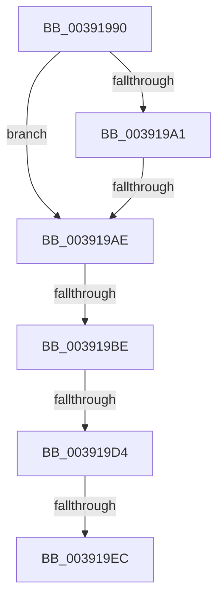

# sub_00391990

- RVA: `0x00391990`–`0x003919F6` (길이 `102` bytes)
- VA: `0x0000000140391990`
- 실행 섹션: `.text`
- PDB 이름 있음: `아니요`; PDB Function 태그: `아니요`
- unwind 정보 RVA: `0x00080B0C`
- 디코드: `22`개 명령, `102/102` bytes 표시
- 미해석 바이트: `0` (있으면 어셈블리에 `.byte`로 보존)

> 이 문서는 커널 이미지의 기계어와 PDB 기호를 분석해 생성했습니다. 4번과 5번은 함수 원형과 자료형을 바이너리 사용 방식에서 추정한 C 해석이며 원본 소스 복구 결과는 아닙니다.

## 1. Dependencies

- 직접 호출 지점: **1**; 고유 호출 대상: **1**
- 직접 호출자로 확인된 함수: **0**
- RIP 상대 이미지 참조: **1**

### Outgoing calls
- `0x003919DB` → [PpmPerfArbitratorApplyProcessorState](PpmPerfArbitratorApplyProcessorState_function_00391E00.md) (function, `0x00391E00`)

### Direct callers
- 이 함수 시작 RVA로 연결되는 직접 call은 확인되지 않았습니다. 간접 호출은 완전히 역산할 수 없습니다.

### Static image references
- `0x003919BE` → RVA `0x00FC6AED` (`ALMOSTRO`; read)

## 2. Other-region calls and transfers

- 다른 실행 섹션으로 향하는 call: **0**
- call이 아닌 외부 분기/꼬리 이동: **5**
  - `0x003919A8` → [sub_00391AFF](Unknown_function_00391AFF.md) (`tail-transfer`)
  - `0x003919B8` → [sub_00391A6C](Unknown_function_00391A6C.md) (`tail-transfer`)
  - `0x003919CE` → [sub_00391AFF + 0x1E](Unknown_function_00391AFF.md) (`tail-transfer`)
  - `0x003919E6` → [sub_00391AFF + 0x38](Unknown_function_00391AFF.md) (`tail-transfer`)
  - `0x003919F4` → [sub_00391A62](Unknown_function_00391A62.md) (`tail-transfer`)

## 3. Assembly (complete function range)

```asm
00391990  4C 89 74 24 28                  mov qword ptr [rsp + 0x28], r14
00391995  4C 8B B3 B8 89 00 00            mov r14, qword ptr [rbx + 0x89b8]
0039199C  4D 85 F6                        test r14, r14
0039199F  74 0D                           je 0x1403919ae
003919A1  45 38 AE 8D 00 00 00            cmp byte ptr [r14 + 0x8d], r13b
003919A8  0F 85 51 01 00 00               jne 0x140391aff
003919AE  0F B7 8B 48 8A 00 00            movzx ecx, word ptr [rbx + 0x8a48]
003919B5  0F A3 F1                        bt ecx, esi
003919B8  0F 83 AE 00 00 00               jae 0x140391a6c
003919BE  80 3D 28 51 C3 00 00            cmp byte ptr [rip + 0xc35128], 0
003919C5  48 8B CB                        mov rcx, rbx
003919C8  89 B3 40 8A 00 00               mov dword ptr [rbx + 0x8a40], esi
003919CE  0F 85 49 01 00 00               jne 0x140391b1d
003919D4  45 33 C0                        xor r8d, r8d
003919D7  41 0F B6 D4                     movzx edx, r12b
003919DB  E8 20 04 00 00                  call 0x140391e00
003919E0  44 88 3F                        mov byte ptr [rdi], r15b
003919E3  45 84 ED                        test r13b, r13b
003919E6  0F 85 4B 01 00 00               jne 0x140391b37
003919EC  4C 8B 74 24 28                  mov r14, qword ptr [rsp + 0x28]
003919F1  45 84 E4                        test r12b, r12b
003919F4  74 6C                           je 0x140391a62
```

## 4. C-style interpretation (structured pseudocode)

```c
__int64 __fastcall sub_00391990(__int64 a1, __int64 a2, int a3, __int64 a4, __int64 a5)
{
    __int64 result;
    unsigned __int64 v_stack_p28;

    v_stack_p28 = v_r14;
    if (*(unsigned __int64 *)(v_rbx + 35256) == 0) goto loc_003919AE;
loc_003919AE:
    *(unsigned int *)(v_rbx + 35392) = (unsigned int)(v_rsi);
    a3 = 0;
    result = PpmPerfArbitratorApplyProcessorState(v_rbx, (unsigned __int8)(v_r12), a3, a4);
    *(unsigned __int8 *)(v_rdi) = (unsigned __int8)(v_r15);
}
```

## 5. (Beta) C Style

```c
int64_t sub_00391990(int64_t Arg1, int64_t Arg2, int32_t Arg3, int64_t Arg4, int64_t Arg5)
{
    int64_t result;
    uint64_t v_stack_p28;

    v_stack_p28 = local_r14;
    if (*(uint64_t *)(local_rbx + 0x89B8) == 0) goto loc_003919AE;
loc_003919AE:
    *(uint32_t *)(local_rbx + 0x8A40) = (uint32_t)(local_rsi);
    Arg3 = 0;
    result = PpmPerfArbitratorApplyProcessorState(local_rbx, (uint8_t)(local_r12), Arg3, Arg4);
    *(uint8_t *)(local_rdi) = (uint8_t)(local_r15);
}
```

## 6. Execution-region graph

[열기: 2D/3D 그래프와 함수 탐색 컨트롤 패널](../../../control-panel.html?section=text&rva=0x00391990&view=graph)

- 2D 그래프는 위에서 아래로 흐르고, 3D 그래프는 빈 공간을 드래그해 회전합니다. Shift+드래그는 이동, 휠은 확대·축소, 함수 노드 선택은 대상 보고서 이동입니다.

### Static fallback


