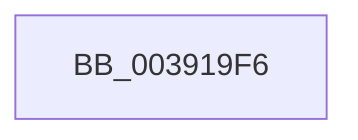

# sub_003919F6

- RVA: `0x003919F6`–`0x00391A20` (길이 `42` bytes)
- VA: `0x00000001403919F6`
- 실행 섹션: `.text`
- PDB 이름 있음: `아니요`; PDB Function 태그: `아니요`
- unwind 정보 RVA: `0x00080B20`
- 디코드: `13`개 명령, `42/42` bytes 표시
- 미해석 바이트: `0` (있으면 어셈블리에 `.byte`로 보존)

> 이 문서는 커널 이미지의 기계어와 PDB 기호를 분석해 생성했습니다. 4번과 5번은 함수 원형과 자료형을 바이너리 사용 방식에서 추정한 C 해석이며 원본 소스 복구 결과는 아닙니다.

## 1. Dependencies

- 직접 호출 지점: **0**; 고유 호출 대상: **0**
- 직접 호출자로 확인된 함수: **0**
- RIP 상대 이미지 참조: **0**

### Outgoing calls
- 직접 디코드된 call 명령이 없습니다.

### Direct callers
- 이 함수 시작 RVA로 연결되는 직접 call은 확인되지 않았습니다. 간접 호출은 완전히 역산할 수 없습니다.

### Static image references
- 디코드된 RIP-relative 메모리 참조가 없습니다.

## 2. Other-region calls and transfers

- 다른 실행 섹션으로 향하는 call: **0**
- call이 아닌 외부 분기/꼬리 이동: **1**
  - `0x00391A1E` → [sub_00391A20 + 0x8](Unknown_function_00391A20.md) (`tail-transfer`)

## 3. Assembly (complete function range)

```asm
003919F6  48 8D 83 EC 00 00 00            lea rax, [rbx + 0xec]
003919FD  8B 0F                           mov ecx, dword ptr [rdi]
003919FF  0F BA F1 08                     btr ecx, 8
00391A03  89 08                           mov dword ptr [rax], ecx
00391A05  4C 8B 6C 24 30                  mov r13, qword ptr [rsp + 0x30]
00391A0A  33 C0                           xor eax, eax
00391A0C  4C 8B 64 24 38                  mov r12, qword ptr [rsp + 0x38]
00391A11  C1 E9 08                        shr ecx, 8
00391A14  83 E1 01                        and ecx, 1
00391A17  85 ED                           test ebp, ebp
00391A19  0F 95 C0                        setne al
00391A1C  3B C1                           cmp eax, ecx
00391A1E  74 08                           je 0x140391a28
```

## 4. C-style interpretation (structured pseudocode)

```c
__int64 __fastcall sub_003919F6(__int64 a1, __int64 a2, __int64 a3, __int64 a4, __int64 a5, __int64 a6, __int64 a7)
{
    __int64 result;

    *(unsigned int *)(v_rbx + 236) = (unsigned int)((unsigned int)(*(unsigned int *)(v_rdi)));
    result = 0;
    a1 = (unsigned int)(((unsigned int)(*(unsigned int *)(v_rdi))) >> (8));
    a1 = (unsigned int)((a1) & (1));
    result = ((unsigned int)(v_rbp) != 0) ? 1 : 0;
}
```

## 5. (Beta) C Style

```c
int64_t sub_003919F6(int64_t Arg1, int64_t Arg2, int64_t Arg3, int64_t Arg4, uint64_t Arg5, int64_t Arg6, int64_t Arg7)
{
    int64_t result;

    *(uint32_t *)(local_rbx + 0xEC) = (uint32_t)((uint32_t)(*(uint32_t *)(local_rdi)));
    result = 0;
    Arg1 = (uint32_t)(((uint32_t)(*(uint32_t *)(local_rdi))) >> (8));
    Arg1 = (uint32_t)((Arg1) & (1));
    result = ((uint32_t)(local_rbp) != 0) ? 1 : 0;
}
```

## 6. Execution-region graph

[열기: 2D/3D 그래프와 함수 탐색 컨트롤 패널](../../../control-panel.html?section=text&rva=0x003919F6&view=graph)

- 2D 그래프는 위에서 아래로 흐르고, 3D 그래프는 빈 공간을 드래그해 회전합니다. Shift+드래그는 이동, 휠은 확대·축소, 함수 노드 선택은 대상 보고서 이동입니다.

### Static fallback


