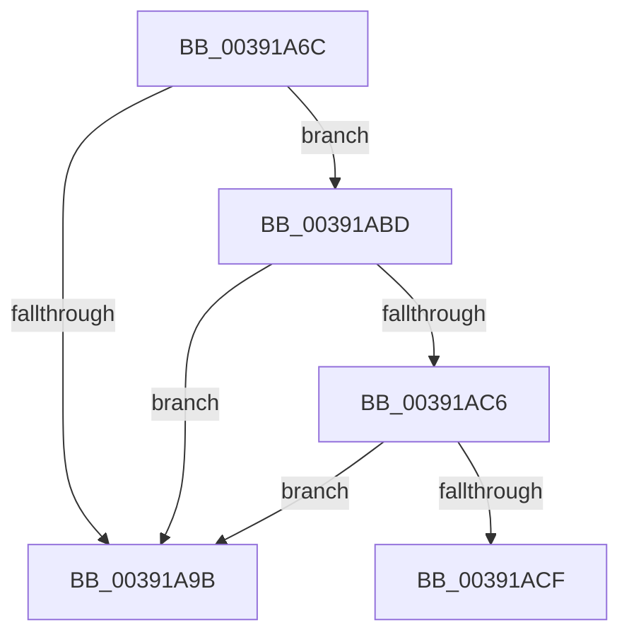

# sub_00391A6C

- RVA: `0x00391A6C`–`0x00391AD7` (길이 `107` bytes)
- VA: `0x0000000140391A6C`
- 실행 섹션: `.text`
- PDB 이름 있음: `아니요`; PDB Function 태그: `아니요`
- unwind 정보 RVA: `0x00080B78`
- 디코드: `24`개 명령, `107/107` bytes 표시
- 미해석 바이트: `0` (있으면 어셈블리에 `.byte`로 보존)

> 이 문서는 커널 이미지의 기계어와 PDB 기호를 분석해 생성했습니다. 4번과 5번은 함수 원형과 자료형을 바이너리 사용 방식에서 추정한 C 해석이며 원본 소스 복구 결과는 아닙니다.

## 1. Dependencies

- 직접 호출 지점: **1**; 고유 호출 대상: **1**
- 직접 호출자로 확인된 함수: **0**
- RIP 상대 이미지 참조: **1**

### Outgoing calls
- `0x00391A6E` → [KeQueryPerformanceCounter](../37/KeQueryPerformanceCounter_function_0037E7E0.md) (function, `0x0037E7E0`)

### Direct callers
- 이 함수 시작 RVA로 연결되는 직접 call은 확인되지 않았습니다. 간접 호출은 완전히 역산할 수 없습니다.

### Static image references
- `0x00391A8B` → RVA `0x00FC54E0` (`ALMOSTRO`; read)

## 2. Other-region calls and transfers

- 다른 실행 섹션으로 향하는 call: **0**
- call이 아닌 외부 분기/꼬리 이동: **2**
  - `0x00391AB8` → [sub_00391990 + 0x2E](Unknown_function_00391990.md) (`tail-transfer`)
  - `0x00391AD2` → [sub_00391990 + 0x53](Unknown_function_00391990.md) (`tail-transfer`)

## 3. Assembly (complete function range)

```asm
00391A6C  33 C9                           xor ecx, ecx
00391A6E  E8 6D CD FE FF                  call 0x14037e7e0
00391A73  48 63 8B 40 8A 00 00            movsxd rcx, dword ptr [rbx + 0x8a40]
00391A7A  4C 8B C0                        mov r8, rax
00391A7D  4C 2B 83 30 8A 00 00            sub r8, qword ptr [rbx + 0x8a30]
00391A84  4C 8B C8                        mov r9, rax
00391A87  48 6B D6 07                     imul rdx, rsi, 7
00391A8B  48 8D 05 4E 3A C3 00            lea rax, [rip + 0xc33a4e]
00391A92  48 03 D1                        add rdx, rcx
00391A95  80 3C 02 00                     cmp byte ptr [rdx + rax], 0
00391A99  75 22                           jne 0x140391abd
00391A9B  48 8B 83 38 8A 00 00            mov rax, qword ptr [rbx + 0x8a38]
00391AA2  48 03 C0                        add rax, rax
00391AA5  4C 89 8B 30 8A 00 00            mov qword ptr [rbx + 0x8a30], r9
00391AAC  4C 3B C0                        cmp r8, rax
00391AAF  0F 93 C0                        setae al
00391AB2  88 83 0E 8A 00 00               mov byte ptr [rbx + 0x8a0e], al
00391AB8  E9 01 FF FF FF                  jmp 0x1403919be
00391ABD  4C 3B 83 38 8A 00 00            cmp r8, qword ptr [rbx + 0x8a38]
00391AC4  73 D5                           jae 0x140391a9b
00391AC6  80 BB 0E 8A 00 00 00            cmp byte ptr [rbx + 0x8a0e], 0
00391ACD  75 CC                           jne 0x140391a9b
00391ACF  45 32 E4                        xor r12b, r12b
00391AD2  E9 0C FF FF FF                  jmp 0x1403919e3
```

## 4. C-style interpretation (structured pseudocode)

```c
__int64 __fastcall sub_00391A6C(int a1)
{
    __int64 result;
    __int64 v_r12;

    a1 = 0;
    result = KeQueryPerformanceCounter(a1, a2, a3, a4);
    a3 = (result) - (*(unsigned __int64 *)(v_rbx + 35376));
    a2 = (a2) * (v_rsi);
    a2 = (a2) + ((int)(*(unsigned int *)(v_rbx + 35392)));
    if ((*(unsigned __int8 *)(a2 + v_rip + 12794446 * 1)) != 0) goto loc_00391ABD;
loc_00391A9B:
    result = (*(unsigned __int64 *)(v_rbx + 35384)) + (*(unsigned __int64 *)(v_rbx + 35384));
    *(unsigned __int64 *)(v_rbx + 35376) = result;
    result = (a3 >= result) ? 1 : 0;
    *(unsigned __int8 *)(v_rbx + 35342) = (unsigned __int8)(result);
loc_00391ABD:
    if (a3 >= (*(unsigned __int64 *)(v_rbx + 35384))) goto loc_00391A9B;
    if ((*(unsigned __int8 *)(v_rbx + 35342)) != 0) goto loc_00391A9B;
    v_r12 = 0;
}
```

## 5. (Beta) C Style

```c
int64_t sub_00391A6C(int32_t Arg1)
{
    int64_t result;
    int64_t local_r12;

    Arg1 = 0;
    result = KeQueryPerformanceCounter(Arg1, a2, a3, a4);
    a3 = (result) - (*(uint64_t *)(local_rbx + 0x8A30));
    a2 = (a2) * (local_rsi);
    a2 = (a2) + ((int32_t)(*(uint32_t *)(local_rbx + 0x8A40)));
    if ((*(uint8_t *)(a2 + v_rip + 0xC33A4E * 1)) != 0) goto loc_00391ABD;
loc_00391A9B:
    result = (*(uint64_t *)(local_rbx + 0x8A38)) + (*(uint64_t *)(local_rbx + 0x8A38));
    *(uint64_t *)(local_rbx + 0x8A30) = result;
    result = (a3 >= result) ? 1 : 0;
    *(uint8_t *)(local_rbx + 0x8A0E) = (uint8_t)(result);
loc_00391ABD:
    if (a3 >= (*(uint64_t *)(local_rbx + 0x8A38))) goto loc_00391A9B;
    if ((*(uint8_t *)(local_rbx + 0x8A0E)) != 0) goto loc_00391A9B;
    local_r12 = 0;
}
```

## 6. Execution-region graph

[열기: 2D/3D 그래프와 함수 탐색 컨트롤 패널](../../../control-panel.html?section=text&rva=0x00391A6C&view=graph)

- 2D 그래프는 위에서 아래로 흐르고, 3D 그래프는 빈 공간을 드래그해 회전합니다. Shift+드래그는 이동, 휠은 확대·축소, 함수 노드 선택은 대상 보고서 이동입니다.

### Static fallback


