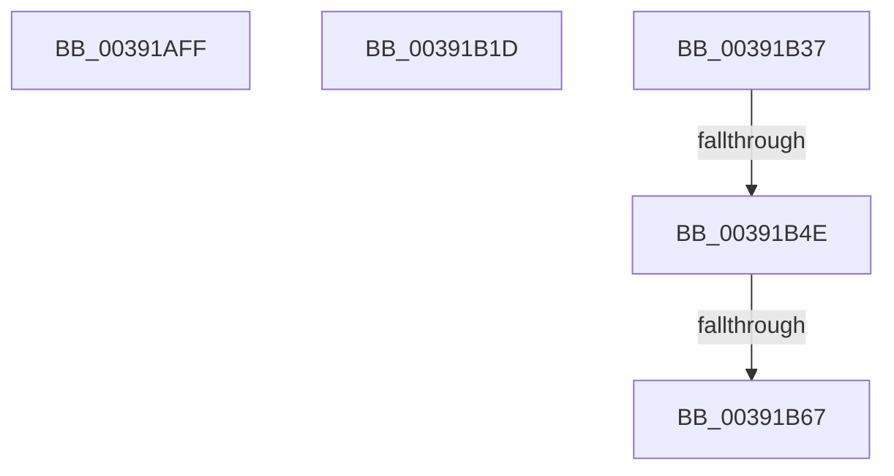

# sub_00391AFF

- RVA: `0x00391AFF`–`0x00391B73` (길이 `116` bytes)
- VA: `0x0000000140391AFF`
- 실행 섹션: `.text`
- PDB 이름 있음: `아니요`; PDB Function 태그: `아니요`
- unwind 정보 RVA: `0x00080BB4`
- 디코드: `23`개 명령, `116/116` bytes 표시
- 미해석 바이트: `0` (있으면 어셈블리에 `.byte`로 보존)

> 이 문서는 커널 이미지의 기계어와 PDB 기호를 분석해 생성했습니다. 4번과 5번은 함수 원형과 자료형을 바이너리 사용 방식에서 추정한 C 해석이며 원본 소스 복구 결과는 아닙니다.

## 1. Dependencies

- 직접 호출 지점: **5**; 고유 호출 대상: **5**
- 직접 호출자로 확인된 함수: **0**
- RIP 상대 이미지 참조: **0**

### Outgoing calls
- `0x00391B03` → [KeDisableInterrupts](../21/KeDisableInterrupts_function_00217BE0.md) (function, `0x00217BE0`)
- `0x00391B13` → [KeAcquireSpinLockAtDpcLevel](../20/KeAcquireSpinLockAtDpcLevel_function_00208430.md) (function, `0x00208430`)
- `0x00391B25` → [PpmHvSetVirtualProcessorQos](../5D/PpmHvSetVirtualProcessorQos_function_005DD0A0.md) (function, `0x005DD0A0`)
- `0x00391B2D` → [PpmEventVpQosChange](../5D/PpmEventVpQosChange_function_005DB35C.md) (function, `0x005DB35C`)
- `0x00391B3E` → [KxReleaseSpinLock](../20/KxReleaseSpinLock_function_00206670.md) (function, `0x00206670`)

### Direct callers
- 이 함수 시작 RVA로 연결되는 직접 call은 확인되지 않았습니다. 간접 호출은 완전히 역산할 수 없습니다.

### Static image references
- 디코드된 RIP-relative 메모리 참조가 없습니다.

## 2. Other-region calls and transfers

- 다른 실행 섹션으로 향하는 call: **0**
- call이 아닌 외부 분기/꼬리 이동: **5**
  - `0x00391B18` → [sub_00391990 + 0x1E](Unknown_function_00391990.md) (`tail-transfer`)
  - `0x00391B32` → [sub_00391990 + 0x50](Unknown_function_00391990.md) (`tail-transfer`)
  - `0x00391B48` → [sub_00391990 + 0x5C](Unknown_function_00391990.md) (`tail-transfer`)
  - `0x00391B61` → [sub_006E57A6 + 0x18](../6E/Unknown_function_006E57A6.md) (`tail-transfer`)
  - `0x00391B6E` → [sub_006E57A6](../6E/Unknown_function_006E57A6.md) (`tail-transfer`)

## 3. Assembly (complete function range)

```asm
00391AFF  45 0F B6 EC                     movzx r13d, r12b
00391B03  E8 D8 60 E8 FF                  call 0x140217be0
00391B08  49 8D 8E 90 00 00 00            lea rcx, [r14 + 0x90]
00391B0F  88 44 24 70                     mov byte ptr [rsp + 0x70], al
00391B13  E8 18 69 E7 FF                  call 0x140208430
00391B18  E9 91 FE FF FF                  jmp 0x1403919ae
00391B1D  8B D6                           mov edx, esi
00391B1F  89 93 44 8A 00 00               mov dword ptr [rbx + 0x8a44], edx
00391B25  E8 76 B5 24 00                  call 0x1405dd0a0
00391B2A  48 8B CB                        mov rcx, rbx
00391B2D  E8 2A 98 24 00                  call 0x1405db35c
00391B32  E9 A9 FE FF FF                  jmp 0x1403919e0
00391B37  49 8D 8E 90 00 00 00            lea rcx, [r14 + 0x90]
00391B3E  E8 2D 4B E7 FF                  call 0x140206670
00391B43  80 7C 24 70 00                  cmp byte ptr [rsp + 0x70], 0
00391B48  0F 84 9E FE FF FF               je 0x1403919ec
00391B4E  65 48 8B 0C 25 20 00 00 00      mov rcx, qword ptr gs:[0x20]
00391B57  4C 8B 81 B8 8E 00 00            mov r8, qword ptr [rcx + 0x8eb8]
00391B5E  4D 85 C0                        test r8, r8
00391B61  0F 84 57 3C 35 00               je 0x1406e57be
00391B67  41 0F 0D 08                     prefetchw byte ptr [r8]
00391B6B  41 8B 00                        mov eax, dword ptr [r8]
00391B6E  E9 33 3C 35 00                  jmp 0x1406e57a6
```

## 4. C-style interpretation (structured pseudocode)

```c
__int64 __fastcall sub_00391AFF(void)
{
    __int64 result;
    unsigned __int8 v_stack_p70;

    result = KeDisableInterrupts(a1, a2, a3, a4);
    v_stack_p70 = (unsigned __int8)(result);
    result = KeAcquireSpinLockAtDpcLevel(v_r14 + 144, a2, a3, a4);
}
```

## 5. (Beta) C Style

```c
void sub_00391AFF(void)
{
    int64_t result;
    uint8_t v_stack_p70;

    result = KeDisableInterrupts(a1, a2, a3, a4);
    v_stack_p70 = (uint8_t)(result);
    result = KeAcquireSpinLockAtDpcLevel(local_r14 + 144, a2, a3, a4);
}
```

## 6. Execution-region graph

[열기: 2D/3D 그래프와 함수 탐색 컨트롤 패널](../../../control-panel.html?section=text&rva=0x00391AFF&view=graph)

- 2D 그래프는 위에서 아래로 흐르고, 3D 그래프는 빈 공간을 드래그해 회전합니다. Shift+드래그는 이동, 휠은 확대·축소, 함수 노드 선택은 대상 보고서 이동입니다.

### Static fallback


