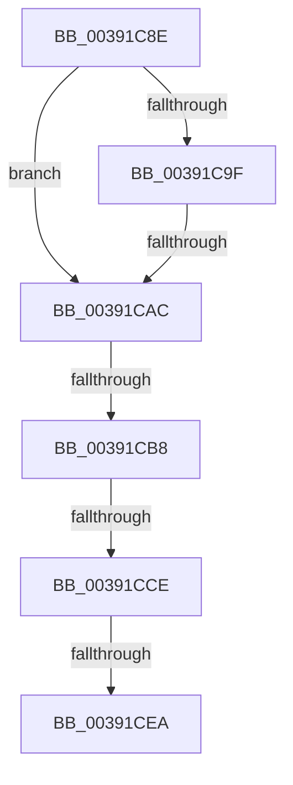

# sub_00391C8E

- RVA: `0x00391C8E`–`0x00391CF3` (길이 `101` bytes)
- VA: `0x0000000140391C8E`
- 실행 섹션: `.text`
- PDB 이름 있음: `아니요`; PDB Function 태그: `아니요`
- unwind 정보 RVA: `0x00080C34`
- 디코드: `21`개 명령, `101/101` bytes 표시
- 미해석 바이트: `0` (있으면 어셈블리에 `.byte`로 보존)

> 이 문서는 커널 이미지의 기계어와 PDB 기호를 분석해 생성했습니다. 4번과 5번은 함수 원형과 자료형을 바이너리 사용 방식에서 추정한 C 해석이며 원본 소스 복구 결과는 아닙니다.

## 1. Dependencies

- 직접 호출 지점: **1**; 고유 호출 대상: **1**
- 직접 호출자로 확인된 함수: **0**
- RIP 상대 이미지 참조: **1**

### Outgoing calls
- `0x00391CD5` → [PpmPerfArbitratorApplyProcessorState](PpmPerfArbitratorApplyProcessorState_function_00391E00.md) (function, `0x00391E00`)

### Direct callers
- 이 함수 시작 RVA로 연결되는 직접 call은 확인되지 않았습니다. 간접 호출은 완전히 역산할 수 없습니다.

### Static image references
- `0x00391CB8` → RVA `0x00FC6AED` (`ALMOSTRO`; read)

## 2. Other-region calls and transfers

- 다른 실행 섹션으로 향하는 call: **0**
- call이 아닌 외부 분기/꼬리 이동: **4**
  - `0x00391CA6` → [sub_00391D5F + 0x1A](Unknown_function_00391D5F.md) (`tail-transfer`)
  - `0x00391CB6` → [sub_00391D08](Unknown_function_00391D08.md) (`tail-transfer`)
  - `0x00391CC8` → [sub_00391D5F + 0x38](Unknown_function_00391D5F.md) (`tail-transfer`)
  - `0x00391CE4` → [sub_00391D5F + 0x52](Unknown_function_00391D5F.md) (`tail-transfer`)

## 3. Assembly (complete function range)

```asm
00391C8E  48 89 74 24 40                  mov qword ptr [rsp + 0x40], rsi
00391C93  48 8B B1 B8 89 00 00            mov rsi, qword ptr [rcx + 0x89b8]
00391C9A  48 85 F6                        test rsi, rsi
00391C9D  74 0D                           je 0x140391cac
00391C9F  44 38 B6 8D 00 00 00            cmp byte ptr [rsi + 0x8d], r14b
00391CA6  0F 85 CD 00 00 00               jne 0x140391d79
00391CAC  0F B7 83 48 8A 00 00            movzx eax, word ptr [rbx + 0x8a48]
00391CB3  0F A3 F8                        bt eax, edi
00391CB6  73 50                           jae 0x140391d08
00391CB8  80 3D 2E 4E C3 00 00            cmp byte ptr [rip + 0xc34e2e], 0
00391CBF  48 8B CB                        mov rcx, rbx
00391CC2  89 BB 40 8A 00 00               mov dword ptr [rbx + 0x8a40], edi
00391CC8  0F 85 C9 00 00 00               jne 0x140391d97
00391CCE  45 33 C0                        xor r8d, r8d
00391CD1  40 0F B6 D5                     movzx edx, bpl
00391CD5  E8 26 01 00 00                  call 0x140391e00
00391CDA  40 88 BB EC 00 00 00            mov byte ptr [rbx + 0xec], dil
00391CE1  45 84 F6                        test r14b, r14b
00391CE4  0F 85 C7 00 00 00               jne 0x140391db1
00391CEA  48 8B 74 24 40                  mov rsi, qword ptr [rsp + 0x40]
00391CEF  40 0F B6 C5                     movzx eax, bpl
```

## 4. C-style interpretation (structured pseudocode)

```c
__int64 __fastcall sub_00391C8E(__int64 a1, __int64 a2, int a3, __int64 a4, __int64 a5, __int64 a6, __int64 a7, __int64 a8)
{
    __int64 result;
    unsigned __int64 v_stack_p40;

    v_stack_p40 = v_rsi;
    if (*(unsigned __int64 *)(a1 + 35256) == 0) goto loc_00391CAC;
loc_00391CAC:
    *(unsigned int *)(v_rbx + 35392) = (unsigned int)(v_rdi);
    a3 = 0;
    result = PpmPerfArbitratorApplyProcessorState(v_rbx, (unsigned __int8)(v_rbp), a3, a4);
    *(unsigned __int8 *)(v_rbx + 236) = (unsigned __int8)(v_rdi);
    return (unsigned __int8)(v_rbp);
}
```

## 5. (Beta) C Style

```c
int64_t sub_00391C8E(void *Arg1, int64_t Arg2, int32_t Arg3, int64_t Arg4, uint64_t Arg5, uint64_t Arg6, uint64_t Arg7, int64_t Arg8)
{
    uint8_t *arg1 = (uint8_t *)Arg1;

    int64_t result;
    uint64_t v_stack_p40;

    v_stack_p40 = local_rsi;
    if (*(uint64_t *)(arg1 + 0x89B8) == 0) goto loc_00391CAC;
loc_00391CAC:
    *(uint32_t *)(local_rbx + 0x8A40) = (uint32_t)(local_rdi);
    Arg3 = 0;
    result = PpmPerfArbitratorApplyProcessorState(local_rbx, (uint8_t)(local_rbp), Arg3, Arg4);
    *(uint8_t *)(local_rbx + 0xEC) = (uint8_t)(local_rdi);
    return (uint8_t)(local_rbp);
}
```

### 관측된 메모리 오프셋

구조체 형식이 확인되지 않은 접근은 인자 기준의 오프셋으로만 기록했습니다.

| 기준 인자 | 오프셋 표현 | 폭 (bit) | 접근 |
|---|---:|---:|---|
| `Arg1` | `+ 0x89B8` | `64` | `R` |

## 6. Execution-region graph

[열기: 2D/3D 그래프와 함수 탐색 컨트롤 패널](../../../control-panel.html?section=text&rva=0x00391C8E&view=graph)

- 2D 그래프는 위에서 아래로 흐르고, 3D 그래프는 빈 공간을 드래그해 회전합니다. Shift+드래그는 이동, 휠은 확대·축소, 함수 노드 선택은 대상 보고서 이동입니다.

### Static fallback


