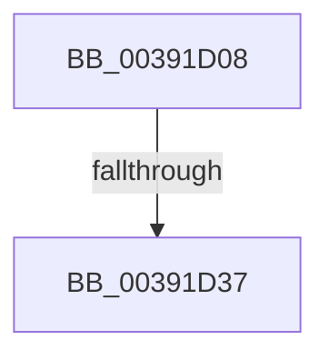

# sub_00391D08

- RVA: `0x00391D08`–`0x00391D59` (길이 `81` bytes)
- VA: `0x0000000140391D08`
- 실행 섹션: `.text`
- PDB 이름 있음: `아니요`; PDB Function 태그: `아니요`
- unwind 정보 RVA: `0x00080C5C`
- 디코드: `18`개 명령, `81/81` bytes 표시
- 미해석 바이트: `0` (있으면 어셈블리에 `.byte`로 보존)

> 이 문서는 커널 이미지의 기계어와 PDB 기호를 분석해 생성했습니다. 4번과 5번은 함수 원형과 자료형을 바이너리 사용 방식에서 추정한 C 해석이며 원본 소스 복구 결과는 아닙니다.

## 1. Dependencies

- 직접 호출 지점: **1**; 고유 호출 대상: **1**
- 직접 호출자로 확인된 함수: **0**
- RIP 상대 이미지 참조: **1**

### Outgoing calls
- `0x00391D0A` → [KeQueryPerformanceCounter](../37/KeQueryPerformanceCounter_function_0037E7E0.md) (function, `0x0037E7E0`)

### Direct callers
- 이 함수 시작 RVA로 연결되는 직접 call은 확인되지 않았습니다. 간접 호출은 완전히 역산할 수 없습니다.

### Static image references
- `0x00391D2A` → RVA `0x00FC54E0` (`ALMOSTRO`; read)

## 2. Other-region calls and transfers

- 다른 실행 섹션으로 향하는 call: **0**
- call이 아닌 외부 분기/꼬리 이동: **2**
  - `0x00391D35` → [sub_00391D5F](Unknown_function_00391D5F.md) (`tail-transfer`)
  - `0x00391D54` → [sub_00391C8E + 0x2A](Unknown_function_00391C8E.md) (`tail-transfer`)

## 3. Assembly (complete function range)

```asm
00391D08  33 C9                           xor ecx, ecx
00391D0A  E8 D1 CA FE FF                  call 0x14037e7e0
00391D0F  48 8B D0                        mov rdx, rax
00391D12  4C 8B C0                        mov r8, rax
00391D15  48 63 83 40 8A 00 00            movsxd rax, dword ptr [rbx + 0x8a40]
00391D1C  48 2B 93 30 8A 00 00            sub rdx, qword ptr [rbx + 0x8a30]
00391D23  48 6B CF 07                     imul rcx, rdi, 7
00391D27  48 03 C8                        add rcx, rax
00391D2A  48 8D 05 AF 37 C3 00            lea rax, [rip + 0xc337af]
00391D31  80 3C 01 00                     cmp byte ptr [rcx + rax], 0
00391D35  75 28                           jne 0x140391d5f
00391D37  48 8B 83 38 8A 00 00            mov rax, qword ptr [rbx + 0x8a38]
00391D3E  48 03 C0                        add rax, rax
00391D41  4C 89 83 30 8A 00 00            mov qword ptr [rbx + 0x8a30], r8
00391D48  48 3B D0                        cmp rdx, rax
00391D4B  0F 93 C0                        setae al
00391D4E  88 83 0E 8A 00 00               mov byte ptr [rbx + 0x8a0e], al
00391D54  E9 5F FF FF FF                  jmp 0x140391cb8
```

## 4. C-style interpretation (structured pseudocode)

```c
__int64 __fastcall sub_00391D08(int a1)
{
    __int64 result;

    a1 = 0;
    result = KeQueryPerformanceCounter(a1, a2, a3, a4);
    a2 = (result) - (*(unsigned __int64 *)(v_rbx + 35376));
    a1 = (a1) * (v_rdi);
    a1 = (a1) + ((int)(*(unsigned int *)(v_rbx + 35392)));
    result = (*(unsigned __int64 *)(v_rbx + 35384)) + (*(unsigned __int64 *)(v_rbx + 35384));
    *(unsigned __int64 *)(v_rbx + 35376) = result;
    result = (a2 >= result) ? 1 : 0;
    *(unsigned __int8 *)(v_rbx + 35342) = (unsigned __int8)(result);
}
```

## 5. (Beta) C Style

```c
int64_t sub_00391D08(int32_t Arg1)
{
    int64_t result;

    Arg1 = 0;
    result = KeQueryPerformanceCounter(Arg1, a2, a3, a4);
    a2 = (result) - (*(uint64_t *)(local_rbx + 0x8A30));
    Arg1 = (Arg1) * (local_rdi);
    Arg1 = (Arg1) + ((int32_t)(*(uint32_t *)(local_rbx + 0x8A40)));
    result = (*(uint64_t *)(local_rbx + 0x8A38)) + (*(uint64_t *)(local_rbx + 0x8A38));
    *(uint64_t *)(local_rbx + 0x8A30) = result;
    result = (a2 >= result) ? 1 : 0;
    *(uint8_t *)(local_rbx + 0x8A0E) = (uint8_t)(result);
}
```

## 6. Execution-region graph

[열기: 2D/3D 그래프와 함수 탐색 컨트롤 패널](../../../control-panel.html?section=text&rva=0x00391D08&view=graph)

- 2D 그래프는 위에서 아래로 흐르고, 3D 그래프는 빈 공간을 드래그해 회전합니다. Shift+드래그는 이동, 휠은 확대·축소, 함수 노드 선택은 대상 보고서 이동입니다.

### Static fallback


