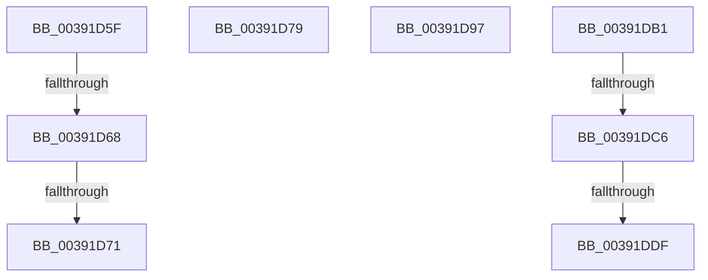

# sub_00391D5F

- RVA: `0x00391D5F`–`0x00391DEB` (길이 `140` bytes)
- VA: `0x0000000140391D5F`
- 실행 섹션: `.text`
- PDB 이름 있음: `아니요`; PDB Function 태그: `아니요`
- unwind 정보 RVA: `0x00080C80`
- 디코드: `29`개 명령, `140/140` bytes 표시
- 미해석 바이트: `0` (있으면 어셈블리에 `.byte`로 보존)

> 이 문서는 커널 이미지의 기계어와 PDB 기호를 분석해 생성했습니다. 4번과 5번은 함수 원형과 자료형을 바이너리 사용 방식에서 추정한 C 해석이며 원본 소스 복구 결과는 아닙니다.

## 1. Dependencies

- 직접 호출 지점: **5**; 고유 호출 대상: **5**
- 직접 호출자로 확인된 함수: **0**
- RIP 상대 이미지 참조: **0**

### Outgoing calls
- `0x00391D7D` → [KeDisableInterrupts](../21/KeDisableInterrupts_function_00217BE0.md) (function, `0x00217BE0`)
- `0x00391D8D` → [KeAcquireSpinLockAtDpcLevel](../20/KeAcquireSpinLockAtDpcLevel_function_00208430.md) (function, `0x00208430`)
- `0x00391D9F` → [PpmHvSetVirtualProcessorQos](../5D/PpmHvSetVirtualProcessorQos_function_005DD0A0.md) (function, `0x005DD0A0`)
- `0x00391DA7` → [PpmEventVpQosChange](../5D/PpmEventVpQosChange_function_005DB35C.md) (function, `0x005DB35C`)
- `0x00391DB8` → [KxReleaseSpinLock](../20/KxReleaseSpinLock_function_00206670.md) (function, `0x00206670`)

### Direct callers
- 이 함수 시작 RVA로 연결되는 직접 call은 확인되지 않았습니다. 간접 호출은 완전히 역산할 수 없습니다.

### Static image references
- 디코드된 RIP-relative 메모리 참조가 없습니다.

## 2. Other-region calls and transfers

- 다른 실행 섹션으로 향하는 call: **0**
- call이 아닌 외부 분기/꼬리 이동: **8**
  - `0x00391D66` → [sub_00391D08 + 0x2F](Unknown_function_00391D08.md) (`tail-transfer`)
  - `0x00391D6F` → [sub_00391D08 + 0x2F](Unknown_function_00391D08.md) (`tail-transfer`)
  - `0x00391D74` → [sub_00391C8E + 0x53](Unknown_function_00391C8E.md) (`tail-transfer`)
  - `0x00391D92` → [sub_00391C8E + 0x1E](Unknown_function_00391C8E.md) (`tail-transfer`)
  - `0x00391DAC` → [sub_00391C8E + 0x4C](Unknown_function_00391C8E.md) (`tail-transfer`)
  - `0x00391DC0` → [sub_00391C8E + 0x5C](Unknown_function_00391C8E.md) (`tail-transfer`)
  - `0x00391DD9` → [sub_006E57C4 + 0x18](../6E/Unknown_function_006E57C4.md) (`tail-transfer`)
  - `0x00391DE6` → [sub_006E57C4](../6E/Unknown_function_006E57C4.md) (`tail-transfer`)

## 3. Assembly (complete function range)

```asm
00391D5F  48 3B 93 38 8A 00 00            cmp rdx, qword ptr [rbx + 0x8a38]
00391D66  73 CF                           jae 0x140391d37
00391D68  80 BB 0E 8A 00 00 00            cmp byte ptr [rbx + 0x8a0e], 0
00391D6F  75 C6                           jne 0x140391d37
00391D71  40 32 ED                        xor bpl, bpl
00391D74  E9 68 FF FF FF                  jmp 0x140391ce1
00391D79  44 0F B6 F5                     movzx r14d, bpl
00391D7D  E8 5E 5E E8 FF                  call 0x140217be0
00391D82  48 8D 8E 90 00 00 00            lea rcx, [rsi + 0x90]
00391D89  44 0F B6 F8                     movzx r15d, al
00391D8D  E8 9E 66 E7 FF                  call 0x140208430
00391D92  E9 15 FF FF FF                  jmp 0x140391cac
00391D97  8B D7                           mov edx, edi
00391D99  89 93 44 8A 00 00               mov dword ptr [rbx + 0x8a44], edx
00391D9F  E8 FC B2 24 00                  call 0x1405dd0a0
00391DA4  48 8B CB                        mov rcx, rbx
00391DA7  E8 B0 95 24 00                  call 0x1405db35c
00391DAC  E9 29 FF FF FF                  jmp 0x140391cda
00391DB1  48 8D 8E 90 00 00 00            lea rcx, [rsi + 0x90]
00391DB8  E8 B3 48 E7 FF                  call 0x140206670
00391DBD  45 84 FF                        test r15b, r15b
00391DC0  0F 84 24 FF FF FF               je 0x140391cea
00391DC6  65 48 8B 0C 25 20 00 00 00      mov rcx, qword ptr gs:[0x20]
00391DCF  4C 8B 81 B8 8E 00 00            mov r8, qword ptr [rcx + 0x8eb8]
00391DD6  4D 85 C0                        test r8, r8
00391DD9  0F 84 FD 39 35 00               je 0x1406e57dc
00391DDF  41 0F 0D 08                     prefetchw byte ptr [r8]
00391DE3  41 8B 00                        mov eax, dword ptr [r8]
00391DE6  E9 D9 39 35 00                  jmp 0x1406e57c4
```

## 4. C-style interpretation (structured pseudocode)

```c
__int64 __fastcall sub_00391D5F(__int64 a1, __int64 a2)
{
    __int64 v_rbp;

    v_rbp = 0;
}
```

## 5. (Beta) C Style

```c
int64_t sub_00391D5F(int64_t Arg1, int64_t Arg2)
{
    int64_t local_rbp;

    local_rbp = 0;
}
```

## 6. Execution-region graph

[열기: 2D/3D 그래프와 함수 탐색 컨트롤 패널](../../../control-panel.html?section=text&rva=0x00391D5F&view=graph)

- 2D 그래프는 위에서 아래로 흐르고, 3D 그래프는 빈 공간을 드래그해 회전합니다. Shift+드래그는 이동, 휠은 확대·축소, 함수 노드 선택은 대상 보고서 이동입니다.

### Static fallback


