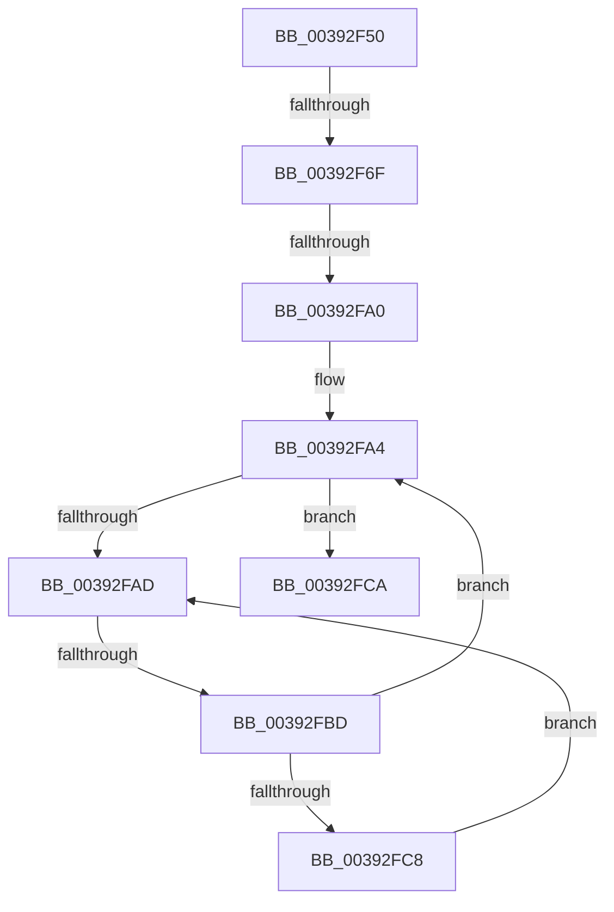

# sub_00392F50

- RVA: `0x00392F50`–`0x00392FD4` (길이 `132` bytes)
- VA: `0x0000000140392F50`
- 실행 섹션: `.text`
- PDB 이름 있음: `아니요`; PDB Function 태그: `아니요`
- unwind 정보 RVA: `0x00080D80`
- 디코드: `31`개 명령, `132/132` bytes 표시
- 미해석 바이트: `0` (있으면 어셈블리에 `.byte`로 보존)

> 이 문서는 커널 이미지의 기계어와 PDB 기호를 분석해 생성했습니다. 4번과 5번은 함수 원형과 자료형을 바이너리 사용 방식에서 추정한 C 해석이며 원본 소스 복구 결과는 아닙니다.

## 1. Dependencies

- 직접 호출 지점: **1**; 고유 호출 대상: **1**
- 직접 호출자로 확인된 함수: **0**
- RIP 상대 이미지 참조: **2**

### Outgoing calls
- `0x00392F82` → [KiUpdateTotalCyclesCurrentThread](../37/KiUpdateTotalCyclesCurrentThread_function_0037DE40.md) (function, `0x0037DE40`)

### Direct callers
- 이 함수 시작 RVA로 연결되는 직접 call은 확인되지 않았습니다. 간접 호출은 완전히 역산할 수 없습니다.

### Static image references
- `0x00392F62` → RVA `0x00FC6D20` (`ALMOSTRO`; read)
- `0x00392FB0` → RVA `0x00FC52AC` (`ALMOSTRO`; reference)

## 2. Other-region calls and transfers

- 다른 실행 섹션으로 향하는 call: **0**
- call이 아닌 외부 분기/꼬리 이동: **4**
  - `0x00392F69` → [sub_00393045](Unknown_function_00393045.md) (`tail-transfer`)
  - `0x00392F9A` → [sub_00393045 + 0x39](Unknown_function_00393045.md) (`tail-transfer`)
  - `0x00392FB7` → [sub_00393045 + 0x11](Unknown_function_00393045.md) (`tail-transfer`)
  - `0x00392FD2` → [sub_00393034](Unknown_function_00393034.md) (`tail-transfer`)

## 3. Assembly (complete function range)

```asm
00392F50  4C 89 74 24 40                  mov qword ptr [rsp + 0x40], r14
00392F55  44 0F 20 C6                     mov rsi, cr8
00392F59  B8 02 00 00 00                  mov eax, 2
00392F5E  44 0F 22 C0                     mov cr8, rax
00392F62  83 3D B7 3D C3 00 00            cmp dword ptr [rip + 0xc33db7], 0
00392F69  0F 85 D6 00 00 00               jne 0x140393045
00392F6F  65 48 8B 1C 25 20 00 00 00      mov rbx, qword ptr gs:[0x20]
00392F78  FA                              cli
00392F79  45 33 C0                        xor r8d, r8d
00392F7C  48 8B D7                        mov rdx, rdi
00392F7F  48 8B CB                        mov rcx, rbx
00392F82  E8 B9 AE FE FF                  call 0x14037de40
00392F87  65 48 8B 0C 25 20 00 00 00      mov rcx, qword ptr gs:[0x20]
00392F90  4C 8B 81 B8 8E 00 00            mov r8, qword ptr [rcx + 0x8eb8]
00392F97  4D 85 C0                        test r8, r8
00392F9A  0F 85 DE 00 00 00               jne 0x14039307e
00392FA0  FB                              sti
00392FA1  45 33 F6                        xor r14d, r14d
00392FA4  F0 48 0F BA 6B 30 00            lock bts qword ptr [rbx + 0x30], 0
00392FAB  73 1D                           jae 0x140392fca
00392FAD  41 FF C6                        inc r14d
00392FB0  44 85 35 F5 22 C3 00            test dword ptr [rip + 0xc322f5], r14d
00392FB7  0F 84 99 00 00 00               je 0x140393056
00392FBD  F3 90                           pause
00392FBF  48 8B 43 30                     mov rax, qword ptr [rbx + 0x30]
00392FC3  48 85 C0                        test rax, rax
00392FC6  74 DC                           je 0x140392fa4
00392FC8  EB E3                           jmp 0x140392fad
00392FCA  4C 8B 74 24 40                  mov r14, qword ptr [rsp + 0x40]
00392FCF  48 85 ED                        test rbp, rbp
00392FD2  75 60                           jne 0x140393034
```

## 4. C-style interpretation (structured pseudocode)

```c
__int64 __fastcall sub_00392F50(__int64 a1, __int64 a2, int a3, __int64 a4, __int64 a5, __int64 a6, __int64 a7, __int64 a8)
{
    __int64 result;
    __int64 v_r14;
    unsigned __int64 v_stack_p40;

    v_stack_p40 = v_r14;
    a3 = 0;
    result = KiUpdateTotalCyclesCurrentThread(*(unsigned __int64 *)(gs_base + (0 + 32)), v_rdi, a3, a4);
    v_r14 = 0;
loc_00392FA4:
    if (condition_is_above_or_equal) goto loc_00392FCA;
loc_00392FAD:
    v_r14 = (unsigned int)((v_r14) + 1);
    if (*(unsigned __int64 *)(*(unsigned __int64 *)(gs_base + (0 + 32)) + 48) == 0) goto loc_00392FA4;
    goto loc_00392FAD;
loc_00392FCA:
}
```

## 5. (Beta) C Style

```c
int64_t sub_00392F50(int64_t Arg1, int64_t Arg2, int32_t Arg3, int64_t Arg4, uint64_t Arg5, uint64_t Arg6, uint64_t Arg7, int64_t Arg8)
{
    int64_t result;
    int64_t local_r14;
    uint64_t v_stack_p40;

    v_stack_p40 = local_r14;
    Arg3 = 0;
    result = KiUpdateTotalCyclesCurrentThread(*(uint64_t *)(gs_base + (0 + 0x20)), local_rdi, Arg3, Arg4);
    local_r14 = 0;
loc_00392FA4:
    if (condition_is_above_or_equal) goto loc_00392FCA;
loc_00392FAD:
    local_r14 = (uint32_t)((local_r14) + 1);
    if (*(uint64_t *)(*(uint64_t *)(gs_base + (0 + 0x20)) + 0x30) == 0) goto loc_00392FA4;
    goto loc_00392FAD;
loc_00392FCA:
}
```

## 6. Execution-region graph

[열기: 2D/3D 그래프와 함수 탐색 컨트롤 패널](../../../control-panel.html?section=text&rva=0x00392F50&view=graph)

- 2D 그래프는 위에서 아래로 흐르고, 3D 그래프는 빈 공간을 드래그해 회전합니다. Shift+드래그는 이동, 휠은 확대·축소, 함수 노드 선택은 대상 보고서 이동입니다.

### Static fallback


