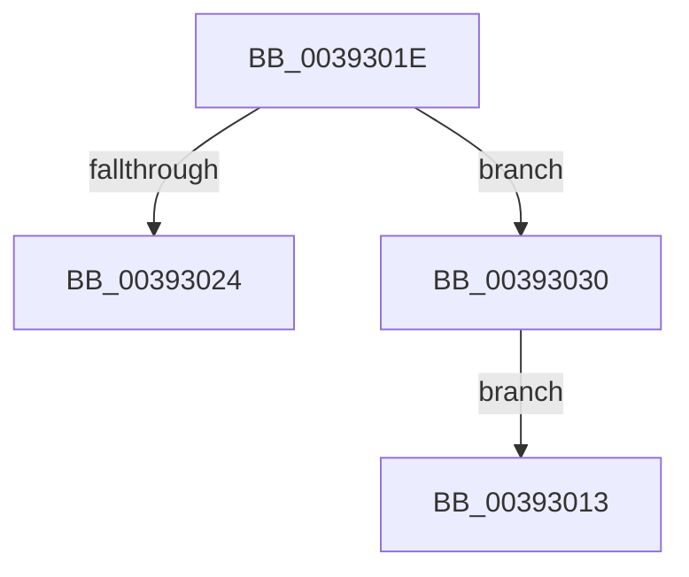

# sub_00393013

- RVA: `0x00393013`–`0x00393034` (길이 `33` bytes)
- VA: `0x0000000140393013`
- 실행 섹션: `.text`
- PDB 이름 있음: `아니요`; PDB Function 태그: `아니요`
- unwind 정보 RVA: `0x00080DB8`
- 디코드: `12`개 명령, `33/33` bytes 표시
- 미해석 바이트: `0` (있으면 어셈블리에 `.byte`로 보존)

> 이 문서는 커널 이미지의 기계어와 PDB 기호를 분석해 생성했습니다. 4번과 5번은 함수 원형과 자료형을 바이너리 사용 방식에서 추정한 C 해석이며 원본 소스 복구 결과는 아닙니다.

## 1. Dependencies

- 직접 호출 지점: **0**; 고유 호출 대상: **0**
- 직접 호출자로 확인된 함수: **0**
- RIP 상대 이미지 참조: **0**

### Outgoing calls
- 직접 디코드된 call 명령이 없습니다.

### Direct callers
- 이 함수 시작 RVA로 연결되는 직접 call은 확인되지 않았습니다. 간접 호출은 완전히 역산할 수 없습니다.

### Static image references
- 디코드된 RIP-relative 메모리 참조가 없습니다.

## 2. Other-region calls and transfers

- 다른 실행 섹션으로 향하는 call: **0**
- call이 아닌 외부 분기/꼬리 이동: **1**
  - `0x0039302B` → [KeSetThreadChargeOnlySchedulingGroup + 0x20](KeSetThreadChargeOnlySchedulingGroup_function_00392F20.md) (`tail-transfer`)

## 3. Assembly (complete function range)

```asm
00393013  48 8B 6C 24 48                  mov rbp, qword ptr [rsp + 0x48]
00393018  48 83 C4 20                     add rsp, 0x20
0039301C  5F                              pop rdi
0039301D  C3                              ret
0039301E  CC                              int3
0039301F  48 85 ED                        test rbp, rbp
00393022  74 0C                           je 0x140393030
00393024  48 8B 41 68                     mov rax, qword ptr [rcx + 0x68]
00393028  48 85 C0                        test rax, rax
0039302B  E9 10 FF FF FF                  jmp 0x140392f40
00393030  32 C0                           xor al, al
00393032  EB DF                           jmp 0x140393013
```

## 4. C-style interpretation (structured pseudocode)

```c
__int64 __fastcall sub_00393013(__int64 a1, __int64 a2, __int64 a3, __int64 a4, __int64 a5, __int64 a6, __int64 a7, __int64 a8, __int64 a9)
{
    __int64 v_rsp;

    v_rsp = (v_rsp) + (32);
    return result;
}
```

## 5. (Beta) C Style

```c
int64_t sub_00393013(int64_t Arg1, int64_t Arg2, int64_t Arg3, int64_t Arg4, uint64_t Arg5, uint64_t Arg6, uint64_t Arg7, uint64_t Arg8, int64_t Arg9)
{
    int64_t local_rsp;

    local_rsp = (local_rsp) + (32);
    return result;
}
```

## 6. Execution-region graph

[열기: 2D/3D 그래프와 함수 탐색 컨트롤 패널](../../../control-panel.html?section=text&rva=0x00393013&view=graph)

- 2D 그래프는 위에서 아래로 흐르고, 3D 그래프는 빈 공간을 드래그해 회전합니다. Shift+드래그는 이동, 휠은 확대·축소, 함수 노드 선택은 대상 보고서 이동입니다.

### Static fallback


